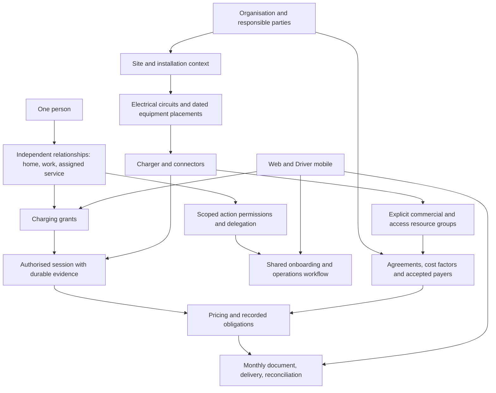

# Straumvakt — Statement of Work

**v5.9 · 2026-10-27 · Codex: activation delegation, sponsorship through an ongoing session, and full sponsored-session CDR visibility decided by Andri.**

**Status: REVIEW DRAFT.** Andri authorized correcting this document and sending it to Opus for re-review. This is not approval of every proposal below, a Sonnet assignment, or permission to apply migrations, deploy, change infrastructure, operate chargers or send external correspondence. Existing operational boundaries in [CLAUDE.md](CLAUDE.md) apply.

This is the single consolidated replacement proposal. It incorporates Opus's v5.1, his bounded corrections and Codex's reviews; readers do not need to merge the mailbox exchanges. The already-retired v4, including its retirement notice and uncommitted documentation changes, is [preserved verbatim](docs/agent-runs/2026-10-27/2026-10-27-0048-sow-v4-preserved.md). Older task lists and manifests remain historical until explicitly reconciled. This draft does not silently adopt the proposed canon amendments in section 12.

**Review status:** Opus's [v5.6 review](docs/agent-runs/2026-10-27/2026-10-27-1803-opus-sow-v56-review.md) closed the earlier corrections and identified a draft-rendering dependency. Andri then explicitly clarified and approved the three-stage milestone boundary below. That direction supersedes v5.6's requirement for completed test issuance in the initial milestone. The [v5.6 snapshot](docs/agent-runs/2026-10-27/2026-10-27-sow-v56-before-milestone-boundary.md) preserves the prior wording. The stage boundary is adopted; detailed engineering proposals and review of this exact revision remain pending. Source review does not establish current external database state or prove that a migration has never run anywhere.

**Preserved decisions and evidence:** Prisma is replaced in the adopted application; historical guarantees are retained, replaced or rejected deliberately, never restored blindly. Those decisions remain adopted in `DECISIONS.md` and `FOCUS.md`. The [preceding v5.4 snapshot](docs/agent-runs/2026-10-27/2026-10-27-sow-v54-before-ten-topic-reconciliation.md) preserves the draft before this reconciliation. Section 9 maps all ten investigations to the amended packages and acceptance criteria, with explicit corrections and verification limits. No finding is marked fixed by inclusion here.

**Decision-register update:** at Andri's request, section 11 now lists only decisions needed for S1, with owners, affected work and risks of later rework. Deferred S2/S3 choices have a separate safeguard/revisit register; they are not current feature requirements. The [v5.7 snapshot](docs/agent-runs/2026-10-27/2026-10-27-sow-v57-before-s1-decision-register.md) preserves the prior stage allocation, which remains unchanged. New implementation recommendations are not silently adopted by this register.

**Product decisions adopted 2026-10-27:** Andri settled who may activate, the effect of mid-session sponsorship revocation, and sponsor access to the full covered-session CDR. Section 2 and the affected acceptance/decision rows now carry those rules. Other recommendations remain subject to review. The [v5.8 snapshot](docs/agent-runs/2026-10-27/2026-10-27-sow-v58-before-three-product-decisions.md) preserves the preceding review target.

## 1. Outcome, milestone boundary and later release

Build a working pre-commercial Straumvakt in which an organisation can register, prepare an installation, admit and commission a charger, grant a driver access, record a reliable session, and explain test costs and payer attribution. Web and Driver mobile use the same backend rules. Staff can assist within those rules; self-registration remains part of the journey and greater automation is the intended end state. Extend this foundation into validated monthly postpaid billing during the subsequent pre-commercial stage.

**Adopted boundary:** the current “to-market” milestone delivers a working, testable pre-commercial service. It does not require a paying customer, real customer invoices, payment collection, a completed invoice engine or commercial release. Every task and acceptance criterion names its stage. Later-stage requirements remain visible without becoming hidden prerequisites for the initial working product.

| Stage | Factual goal and exit evidence | Boundary |
|---|---|---|
| **S1 — Working product (current milestone)** | Connected web/mobile registration and context selection; shared identity and scoped roles; organisation/installation setup; charger admission, commissioning and activation; allowed/refused charging; durable session evidence; explainable test costs and payer attribution. Demonstrate the selected journeys with synthetic accounts and controlled equipment, including independent home/work relationships, failures and lifecycle changes. | No first customer, invoice-engine completion, issued document or collected payment required. A disconnected UI or fixture-only demonstration cannot establish completion. The affected integrity, authority and evidence guarantees must work. |
| **S2 — Pre-commercial validation and development** | Exercise controlled chargers over time, refine workflows, measure reliability/operating cost and build/test monthly billing, invoice generation, corrections, numbering and delivery using isolated test records and captured destinations. | No real customer invoicing required. This stage supplies evidence for a later release decision; it does not itself authorize sale or operation for customers. |
| **S3 — Commercial release (later approval)** | Selected offer/customer, mandates and applicable accounting requirements, support/exit arrangements, release readiness and actual billing/payment operations. | Outside the current milestone; requires a separate explicit readiness/release decision and the applicable operational approvals. |

S1 is complete only when its selected application boundary and required S1 acceptance cases below have evidence. The delivery manifest names the actor journeys, supported factors, interfaces and hardware configuration being proved; it must not remove agreed identity, mobile, authority or lifecycle requirements by calling them optional. S2 functionality can be developed earlier when useful, but its completion is not an S1 exit condition. No unmeasured delivery date or completion percentage is asserted.

**First customer — S3, unresolved.** Before a customer-facing pilot or sale, Andri identifies the organisation and representative, installation and equipment, day-one needs, permitted assistance, support expectations and written commitments. S1/S2 controlled testing can involve consenting operators and real equipment without a paying customer; identify those test participants, equipment and permissions separately. Do not turn a test participant into a commercial customer by terminology.

**Commercial model clarified by Andri, 2026-10-31; prices remain unresolved.** Straumvakt invoices the CPO for its own monthly platform service fees. Separately, Straumvakt supplies the húsfélag/CPO with a monthly batch of driver-usage invoices, which the húsfélag handles through its existing resident billing/collection process. Straumvakt does not collect driver payments, hold customer funds or remit driver money. CPO registration includes acceptance of the Straumvakt–CPO agreement. Exact service-fee amount/unit, start/cutoff, collection method and usage-invoice batch format remain to be specified; no per-connector price is selected. Applicable document, mandate and tax requirements still need validation before real issuance. S1/S2 use explicit synthetic terms; stage boundaries are unchanged.

The platform fee calculation can be independent of driver attribution. **The charging and mobile journey cannot.** Choosing platform-fee revenue first does not defer access enforcement, attribution, driver terms or session evidence.

## 2. Requirements already directed by Andri

| Requirement | Consequence for the scope |
|---|---|
| One person, many independent relationships | A person can drive at home, administer an installation at work and hold other relationships without duplicate accounts. Removing one relationship preserves unrelated rights, identity and historical liability. |
| Mobile is the driver's primary UI | A driver must not need the operator console. Organisation registration must also be available on mobile, using the same workflow as web. Detailed bulk administration may remain web-first. |
| Assisted launch, automation later | Manual assistance is attributable, scoped and resumable. Later automation uses the same capabilities and conditions. |
| Standard OCPP first | First hardware path: OCPP 1.6J Cloud on a manually configured Zaptec installation/charger. No Zaptec API dependency for admission, charging attribution or the first session-to-billing journey. |
| One onboarding lifecycle | Preregistration, a knocking charger and later vendor enrichment converge on the same identity, claim, placement, commissioning and activation rules. |
| Controlled device admission | Admission authority comes through Straumvakt Admin or an authorised certified installer. A host may start the process without thereby acquiring admission authority. Qualification, assignment and delegation details remain to be specified. |
| Activation and delegation | Straumvakt, the Installation Representative, and a user granted activation rights by either may activate within the authorised installation scope. All must satisfy the same readiness prerequisites; record actor, time and authority. Activation permission is distinct from technical admission/qualification. |
| Monthly postpaid | Prices and responsibility are determined from applicable historical evidence and terms, not invented from current memberships at month end. |
| Sponsorship covers whole factors | Work may pay all eligible factors or selected whole factors; the driver or another accepted payer covers the others. Percentage sharing is not a launch requirement. |
| Sponsorship ends after the ongoing session | If sponsorship is revoked during a session, its existing coverage remains for that session through completion and does not apply to subsequent sessions. Preserve the effective cutoff and the covered factors/payer; no revocation-time split or automatic transfer of the remaining amount to the driver. |
| Sponsor sees the full covered-session CDR | Authorised sponsor users can access the full charge detail record for sessions to which that sponsorship applies, including partial-factor sponsorship. This does not expose unrelated sessions or the driver's broader account history. Ending future sponsorship does not rewrite the historical session's payer or sponsorship coverage. |
| Configurable additional cost factors | Authorised representatives can apply supported factors to drivers, driver groups, chargers and charger groups, subject to scope, authority, acceptance and versioning. |
| Electrical structure is independent of commercial terms and access | Rewiring does not automatically change price, payer or charging grants. Commercial groups are explicit relationships. |
| Preserve useful UI and code | Preserve suitable visual design; audit and rebuild invalid data connections. Prefer tested reuse of engines and libraries, while correcting demonstrated defects. |
| Future neighbour assistance | Design a scoped, time/assignment-aware helper seam. Helper, contractor, installer and finance authority remain distinct. The helper UI is later work. |
| Controlled synthetic testing is valid | Default/fixed tags can test permitted and refused charging. They do not establish the identity of the human plugging in, mobile authentication or physical RFID-reader behavior. |

Detailed direction and role proposals are in the [hierarchy proposal](docs/notes/2026-10-26-hierarchy-onboarding-and-commercial-rules-proposal.md). Its recommendations are not all approved simply because this SOW references them.

## 3. How people, equipment and money fit together

There is no single role ladder that determines every privilege. Separate personal identity, organisation representation, equipment responsibility, charging eligibility and commercial responsibility.

This is a conceptual map, not an instruction to create a table for every box. Reuse suitable entities. Membership in an equipment structure does not create a commercial group or grant automatically.

### Authority contracts

Every action resolves the actor and credential, business relationship, permitted action, resource scope, delegation, effective time/state, allowed data disclosure and commercial responsibility. Holding a permission in organisation A does not establish that a resource in the request belongs to A.

For activation specifically, the authorised principals are Straumvakt, the Installation Representative and users granted the right by either. Verify the current installation-scoped right and readiness at the action, and retain its actor/time/authority basis separately from technical onboarding state. The grant does not automatically include permission to admit equipment, perform certified technical work or delegate other capabilities.

| Context | Launch responsibility | Boundary |
|---|---|---|
| Platform staff | Organisation verification, assisted onboarding, authorised exceptions and support | Customer assistance is not customer acceptance of debt; platform actions retain actor and represented party. |
| Organisation representative | Invitations, permitted administration and delegated commercial actions | Granting access, publishing prices and accepting sponsorship are separate powers. |
| Installation/operator responsibility | Setup, access management and operational actions within scope | Operational control does not imply ownership, tax authority or authority to accept another party's costs. |
| Certified installer | Admitted technical work within qualification and assignment | Certification does not grant unrestricted access to every installation; company administration does not establish technical qualification. |
| Driver | Personal credentials, eligible chargers, terms, sessions and personal obligations | An organisation invitation or work email does not automatically grant employer administration. |
| Finance representative | Explicitly delegated terms, statements, corrections and exports | Drafting, publishing, accepting liability and correcting an issued bill can have different permissions. |
| Future helper / contractor / auditor | Named extension seams for bounded assistance, jobs and read-only disclosure | No implicit inheritance of installer, platform or finance powers. Implement only what an approved slice requires. |

Protect ownership continuity and membership changes. Define which grant an actor can delegate, for which scope and period; do not compare unrelated roles on a single rank. Resolve the current per-user `audience` restriction so the settled home/work requirement is possible. Choose the technical representation during the identity slice; do not reopen the product requirement.

Authentication establishes one person; UI/session purpose does not force separate home/work accounts. Replace the host shell's single-persona assumptions with checks of the relevant capabilities and relationship. Represent membership separately from independently scoped, effective grants; the chosen representation must support multiple responsibilities within one organisation. Every affected consumer enforces resource and time limits, not merely the presence of stored scope arrays or a role name. The legacy `helper` alias currently expands to technician powers and must not be enabled as the future neighbour-helper role.

Tenant-owned resources need tenant-safe queries and cross-resource integrity. Global persons, credentials and the unassigned discovery pool may be legitimately global. Their use still requires explicit authorization and appropriately limited disclosure.

## 4. The shared journey

| Step | Product behavior | Acceptance boundary |
|---|---|---|
| Register a person or organisation | Mobile and web support personal registration, organisation creation/joining, invitations and progress. Verify representative authority; prevent duplicate registration from becoming an ownership claim. | Same identity and workflow across surfaces; assistance is recorded. |
| Establish the installation | Record responsible parties, site/meter context and electrical assertions. Reuse existing structures. Mark claimed versus verified information. | Physical topology is distinguishable from service, ownership, access and commercial scope. |
| Register or discover a charger | Preregister equipment or record an unknown knock. Preserve available evidence without trusting a serial or connection as ownership proof. | Unknown devices do not gain ordinary service or leak through host listings. |
| Claim and admit | An authorised actor verifies the claim and connection identity, handles collisions and establishes an approved scope. | Unassigned candidates remain platform-only; securely associated candidates can become host-visible through an authorised relation. |
| Place and commission | Create dated placement; establish connector inventory with provenance; verify settings and readiness. Show incomplete work per charger. | Connector observations do not automatically activate service. Handover, retries, cancellation and partial readiness are supported. |
| Establish access and terms | Respective authorities grant driver access and configure accepted payer/price arrangements. These activities may run alongside commissioning. | Visibility, entitlement and current operability are separate. Terms do not grant charging permission. |
| Activate | An authorised actor explicitly activates only ready devices. Record admission, readiness, activation and service-start times separately. | Commissioning success is not implicit activation, and billing start follows the agreement rather than discovery time. |
| Charge | Attribute the accepted credential/context, correlate the transaction, retain meter evidence and explain the resulting session state. | Allowed and refused paths are tested; incomplete evidence is visible and cannot silently become a charge. |
| Explain costs, then close the month | S1 preserves session evidence, applicable test terms, payer attribution and explainable test amounts. S2 adds period close, issuance from immutable inputs, captured delivery and test payment reconciliation. | Invoice-engine completion is S2. Actual customer documents/payment operations are S3; no real invoice is needed to complete S1/S2. |
| Change or end service | End selected grants, move or retire equipment, then explicitly recommission/reactivate when appropriate. | Historical liability and other relationships survive; repeated actions resume rather than duplicate effects. |

The Driver app shows authorised chargers, availability, accepted terms, sponsorship coverage, personal responsibility, session progress and costs or a visible pending/held state. A host can complete the scoped journey or hand it to staff without restarting. Empty, loading, denied, offline, awaiting-evidence and awaiting-pricing states must be truthful; absence of a calculated price is not "free."

### Revocation and retirement

Follow the [October revocation and retirement policy](docs/reference/revocation-and-charger-retirement-policies.md). Removing a work relationship recomputes the affected grants and sponsorship; it does not delete the person or unrelated home relationships. Block new starts when required and recheck queued commands. Preserve the default active-session continuation policy unless an authorised explicit stop is requested; do not turn every revocation into an automatic disconnect.

Administrative service eligibility is independent of online/charging telemetry. Final retirement requires active-session closure or audited reconciliation, device shutdown or accepted physical handover evidence, closed placement/service periods, and connection-right changes only after necessary device actions. Keep stop and diagnostic paths available where needed. A returning retired identity requires explicit reactivation and readiness checks.

Offline 0 A is an accepted commissioning requirement to verify on the selected hardware. No telemetry, offline status, or zero current alone proves session closure. If the selected configuration cannot meet the requirement, stop that hardware acceptance and obtain a scoped policy/hardware decision; do not fabricate proof.

## 5. Work packages and dependencies

The labels below identify acceptance packages, not a serial waterfall or new Sonnet assignments. Each task names its stage, inputs, files, safety boundary and tests. Independent foundation, UI contract and later-stage design work can proceed together. An unresolved decision blocks only the claim that needs it. Shared packages extend their proven boundary when later functionality is adopted; future invoice tables/routes are not implicitly part of S1 acceptance merely because they exist in source.

| Package | Stage | Deliverables and exit evidence | Actual prerequisites |
|---|---|---|---|
| **A — Adoption and contracts** | S1, extend per adopted stage | Select current Next org/staff and Flutter entrypoints; classify local fixtures, archived host/driver and road-to-market separately. Name retained Drizzle repositories/adapters, device/placement authority, excluded legacy writers and one reviewed reference-data entrypoint. Prove the adopted runtime/build does not depend on Prisma or stale generated clients. | Needed before changing the affected application boundary. Neither customer selection nor final price is required. |
| **B1a — Schema audit** | S1, extend for S2 | Enumerate extensions, referential/tenant guarantees and historical business CHECKs; decide retain/replace/reject and SQL versus transactional enforcement. Specify migration, period-boundary, cross-org, negative-write, concurrency, rollback and restore tests with independent expectations. | No database target required for source audit and test design. Identity representation decisions block only affected schema changes. |
| **B1b — Database execution** | S1, extend for S2 | Apply the applicable B1a plan on an empty PG17 target; inspect actual catalog/validation state and prove integrity, concurrency, rollback and restore. Initialize only the reviewed reference manifest; prove rerun and interrupted-initialization behavior. | Exact disposable target, migration and reference-data write operations approved before execution; applicable B1a expectations settled. |
| **B2 — Person, authority and surfaces** | S1 | Shared actor/action/resource/time authorization contract; independent home/work relationships; real route isolation; delegation/ownership controls; mobile/web registration and minimal host/driver journeys. Map each retained screen's backend calls, intended actor, auth mode and scope; identify targeted repairs. | Define affected identity and delegation contracts. Build UI prototypes alongside backend work. Inventory the existing console/mobile surfaces to size reuse, but complete mapping first for the thin journey rather than block it on every deferred screen. |
| **C — Onboarding and commissioning** | S1 | Preregistration and knock-to-claim flow, safe identity namespace, verified association, dated placement, inventory provenance, partial readiness, handover and explicit activation. | Relevant B1b/B2 guarantees for database-backed acceptance; simulation can proceed earlier. Installation semantics and admission authority; controlled configuration scope for physical proof. |
| **D — Charging lifecycle** | S1, sustained validation in S2 | Durable verdict and transaction correlation; retry/reconnect/out-of-order handling; measurement holds; vendor-independent attribution; allow/deny, revocation, retirement and reactivation. Implement and test grant-period enforcement in listing, app start, OCPP authorization and any supported credential-list/cache delivery path. | A controlled admitted device for hardware proof, or simulator for contract tests; effective grant and session policies. No final commercial offer needed. |
| **E1 — Obligations** | S1 test costs/payers; S2 monthly integration | Whole-factor sponsorship, supported custom factors and audience/resource scopes, historical payer/terms, deterministic amounts, rounding/reconciliation and database-enforced retry/concurrency behavior. | Agreed obligation contracts and relevant integrity guarantees. Use labelled test rates and parties; no final price or customer needed. |
| **E2 — Monthly documents** | S2 | Period close/late data/corrections, immutable issuance snapshot, atomic statement and number, delivery retry/outbox and driver-usage invoice batches supplied to the húsfélag/CPO. Straumvakt service-fee invoices and payment provenance remain separate; no direct driver collection. | E1 contract for exercised factors; chosen batch/document/creditor context. Synthetic design/tests need no real customer. Legal/mandate requirements apply before corresponding real issuance. |
| **F1 — Technical release and pilot operations** | S1 controlled operation; S2 sustained validation | Fresh environment manifest, session topology, deployment/recovery proof, bounded cost, and named pilot support/stop arrangements. | Technical guarantees for features used and target-specific operational approvals. Pilot deployment can precede hardware acceptance; broader hardware-support claims require that acceptance. No paying customer or final price required. |
| **F2 — Commercial operation** | S3 | Approved customer commitments and applicable mandates/terms; first real invoice, delivery and payment evidence; ongoing support/exit arrangements. | F1 and applicable controlled hardware evidence, selected offer/customer and the legal/commercial prerequisites of the exercised flow. |

**S1 end-to-end rehearsal (A00):** B2 registration → C admission/commissioning → D one accepted session and one refused new start → E1 explainable test costs and payer attribution, visible through the appropriate web/mobile surfaces. Preserve evidence and applicable historical terms so S2 billing can use trustworthy inputs. Extend the same journey for independent organisations, whole-factor sponsorship, failures and lifecycle changes. A00 does not depend on invoice rendering, numbering, issuance or delivery.

**S2 draft preview (A00a):** reconcile frozen draft inputs and show unissued status without allocating or displaying an invoice number. The existing invoice renderers require a constructed, numbered document; an optional rendered draft therefore needs an explicit non-issuable preview type/render path as scoped E2 work. Do not bypass the construction guarantee with a cast or consume an issuance number for preview. A screen explaining S1 costs need not use the invoice renderer or resemble a final invoice. S2 test issuance, atomic statement/number allocation and durable captured delivery are assessed under A17; none is an S1 exit condition.

Package A also measures the actual Prisma footprint of the proposed adopted boundary: direct imports, transitive dependencies, reachable query sites, generated-client/build requirements and test-only or retired paths. Record the counting method and its limits; regex counts alone do not prove runtime reachability. This manifest sizes A23 and replaces historical whole-repository numbers as an estimate of the selected work.

### First implementation sequence

1. **Choose and specify the slice:** adopt the actual web/mobile/API entrypoints and write its reference-data, identity/grant and device/placement contracts. Reconcile outstanding Sonnet work before dispatch. Do not wait for every deferred screen or the final commercial offer.
2. **Prove the affected foundations while building the journey:** design and run the applicable B1 checks on the approved isolated target; implement mobile/web registration and context selection against the same B2 contract. Mock-only UI prototypes and protocol tests can proceed before database execution; their success does not establish database-backed acceptance. A simulator that exercises persistence still needs the appropriate target and write approval. Simulation replaces hardware, not database guarantees.
3. **Connect admission, access and evidence:** integrate one authoritative equipment lifecycle, effective grants, standard-OCPP attribution, durable acceptance and transaction matching. Prove the relevant failures as well as the permitted path before accepting its usage as billable evidence.
4. **Complete the S1 rehearsal:** calculate the selected factors under explicit synthetic terms and explain test amounts and payer attribution through the actual interfaces. Preserve reproducible source evidence and term versions. Prove home/work independence, supported sponsorship and lifecycle/failure cases; confirm physical behavior on controlled equipment separately from simulator results. Follow with S2 invoice-engine development and sustained validation, then a separate S3 release decision.

This order sets dependencies, not concurrent implementation assignments or a requirement to complete every foundation package before any onboarding screen. The first slice cannot bypass the integrity, authority or evidence guarantees it actually uses.

### Evidence types and their limits

1. **Synthetic/local/database evidence (S1/S2):** permissions, home/work independence, workflow transitions, protocol replay, calculation, sponsorship, period boundaries, duplicates, corrections and database integrity can be tested without customers. Use the real approved database for claims that require persistence/concurrency; mocks prove only their stated boundary. Invoice tests belong to S2 even when entirely synthetic.
2. **Controlled hardware evidence (S1 and extended in S2):** manually configured Zaptec OCPP Cloud, connection identity and setting scope, inventory, accepted/refused starts, meter observations, reconnects/offline operation and retirement confirmation. Synthetic driver identities and real test equipment are sufficient. A simulator verdict does not prove that energy stopped or that a physical reader identified a person.
3. **Sustained-use evidence (S2):** exercise actual workflows and controlled equipment over an agreed observation period to assess usability, support workload, realistic operating costs and reliability. Record duration, workload and failures; neither a short happy-path test nor invented production traffic establishes long-term performance.
4. **Commercial evidence (S3):** real customer acceptance, actual delivery/collection behaviour and ongoing commercial support. These are outside S1/S2 acceptance. A customer cannot waive correctness or authority guarantees of a feature used.

Basic support, escalation and stop/recovery arrangements exist before the physical pilot. A collected invoice is a commercial milestone, not the definition of all technical readiness.

## 6. Foundation and session contracts

These engineering contracts are proposed by this draft. The directed requirements in section 2 govern; implementation mechanisms remain recommendations open to review and scoped approval.

### Database and data workloads

Drizzle remains the active schema-authoring path. Raw SQL may serve the approved hot paths. ORM selection does not itself supply integrity, good queries, separate storage workloads or lower operating cost. Do not introduce another ORM or money engine to bypass a missing contract.

**Directed replacement:** retained workflows in the adopted application use Drizzle and reviewed SQL, with no Prisma runtime or generated-client dependency. Port needed behaviour and exclude retired paths; retaining a transitional Prisma runtime is not an open adoption option. Existing source that still uses Prisma is unfinished replacement work, not the target architecture.

Do not restore legacy schema, constraints or business rules merely because they existed before. For each affected guarantee, explicitly retain it, replace it with a contract that fits the new model, or reject it with a reason. Prove the selected integrity and lifecycle behaviour; replacing Prisma alone proves none of it.

On an expressly approved disposable PostgreSQL 17 target, prove migration ordering and required extensions, named constraints and their validation state, temporal non-overlap, cross-organisation references, uniqueness under concurrent requests and rollback. Inspect the current absence of declared FKs guarantee by guarantee; decide which protections belong in SQL and which deliberately remain transactional application guarantees. Do not mark an empty database migrated using the baseline helper.

The B1a guarantee matrix must also assess the six historical CHECKs identified by C3: agreement anchors; paired scope type/ID; paired audience type/ID; third-party payer reference; session reference for a session billing line; and bill-object ownership consistency. Their old formulations are not automatically the intended new rules. Account for `citext` provisioning, explicit interval-bound semantics and validation of the two `NOT VALID` status checks. Test deliberate orphan/cross-org writes and concurrent conflicts against the real database; matching TypeScript declarations and migration-text tests are insufficient.

Provision `citext` before the first migration statement using that type. An extension step after the failing baseline is too late. Reviewed target bootstrap or a correctly ordered initial migration can satisfy this; choose according to privileges and migration history, without silently rewriting an applied migration. This is an ordering requirement, not a prohibition on extension creation in migrations.

Reference data has one adopted owner and entrypoint. Seed only the selected catalogue definitions and necessary hardware references, with a versioned manifest and a defined failure/rerun contract. Exclude competing legacy factor authoring and contradictory meanings. Production reference data must not invent tariffs, customer parties, grants or consent; synthetic terms belong to labelled rehearsal fixtures or the real workflow. A clean adopted build must not be rescued by generating an obsolete Prisma client.

Specify operational queries, session/CDR evidence, financial records, reporting and long-term aggregates as different workloads. Use pagination, bounded selections and suitable indexes/read models; avoid fetching the entire dataset or calling vendor APIs on page load. Record freshness, retention, correction, export and restoration requirements. Start with the simplest suitable storage arrangement; another database or analytics service needs an evidenced workload, cost and consistency reason.

Money- and access-affecting history must explain effective dates, later corrections and the actor responsible. Closing a relationship must not erase its historical effect. Data retention and restore policy for future real operation is a separate obligation from the authorized deletion of old test material.

### OCPP and session evidence

Specify the durable identity/connector/transaction mapping, request/retry identity, recorded authorization outcome and response behavior when ingestion fails. The acceptance path must not claim success while lacking the required durable evidence. Match Stop and meter events to the correct transaction, not simply the latest active session for a charger identity.

Durable queue acceptance may precede consumer/database persistence; `recorded: false` alone is not evidence of loss. Define exactly what acknowledgement promises, which component owns replay, backlog limits/backpressure, terminal rejection and recovery. Fault-inject queue failure with successful fallback, fallback failure, and both transports failing; include restart and crash-after-acceptance. Transport retry identity and protocol transaction identity must work together without conflating legitimate equal-timestamp observations. The chosen key must handle messages lacking transaction or connector fields. Do not prescribe a natural key or a new storage service before proving those cases.

Preserve both accepted sessions and rejected/contradictory observations appropriately. A rejected start must not create accepted billable usage. If energy flows despite refusal, retain the discrepancy and hold it for resolution rather than erase it or assign debt silently.

Bind attribution and applicable authorization/terms at their defined effective times. Mid-session revocation must not erase who started or rewrite earlier liability. The raw OCPP journey must feed the intended agreements engine without a vendor enrichment job. Any legacy pricing writer that would conflict is explicitly excluded by the adoption manifest.

Trace the accepted credential through the session to the intended obligation resolver. A driver identified only in a separate display ledger does not satisfy that contract. Missing or ambiguous attribution stays visibly unresolved and cannot acquire a payer from an unrelated current membership. Tests must show the permitted standard-OCPP path passes the resolver's attribution boundary without a Zaptec API job or manual database patch.

Missing, decreasing, reset or implausible meter evidence produces a named unresolved state and pricing hold. A cumulative final meter reading must not become session consumption merely because delta calculation failed. Supported rollover/reset resolution needs a stated evidence rule. Differentiate ordinary samples, signed evidence and interval data; claiming a registered MeterValues handler does not establish all three.

## 7. Commercial rules and monthly documents

Section 2's directed requirements govern. S1 implements the supported test-cost, factor, payer and historical-evidence contracts it exercises. S2 implements and validates the invoice engine and monthly-document lifecycle. S3 settles real commercial terms and applicable legal treatment. The retained design requirements below do not move S2/S3 completion into S1; every implementation task states its stage and corresponding evidence.

### Factors, parties and sponsorship

Keep debtor/payer, claim holder, document presenter and upstream cost supplier distinct. DSO, electricity retailer and other cost inputs need an effective source/rate and a defined contractual treatment; their presence in a cost calculation does not automatically make that supplier the recipient of the driver's payment. Preserve the previous finance research, but do not label the complete operating finance flow validated.

For each supported factor define its meaning, calculation method and unit, amount/rate source, currency and rounding, audience, equipment/resource scope, precedence, effective version, publication authority, claim holder and accepted payer. Customer-defined factors use supported calculations, not arbitrary executable formulas. Define cancellation/retirement and proration through the agreement rather than inventing different rules in each lifecycle handler.

An employer can assume all eligible factors or named whole factors; a driver can owe the remaining applicable factors under accepted terms. Resolve whether associated markup and tax are included in a sponsored factor before publishing that arrangement. Refuse unsupported percentage configurations at the write boundary. Distinguish the commercial group from a circuit and preserve independent employment/home arrangements.

**Adopted sponsorship cutoff:** when sponsorship ends during an ongoing session, retain its applicable factor coverage and payer through that session's completion, including later consumption in the same session. Subsequent sessions receive no rights from that ended sponsorship; another valid arrangement may apply. Record the cutoff and session attribution so delayed processing/retries do not apply today's sponsorship status to historical usage. Ending sponsorship alone does not revoke charging access or stop the active session. This decision does not separately fix all tariff-selection or rate-change policies and does not require a meter reading exactly at revocation.

**Adopted sponsor visibility:** authorised users acting for the sponsor may read/export the full CDR for a session their sponsorship covers, even if it covers only some factors. Implement session-level eligibility from historical sponsorship evidence, not merely the driver's current employer or current memberships. Preserve the full record for that session; a sponsored-amount-only view is insufficient. This entitlement does not grant access to unrelated sessions, the person's wider profile/history, credentials or raw system logs. The concrete CDR contract and allowed sponsor-user permissions must be mapped and tested; this is not a new invoice requirement or a claim that the CDR API already exists.

Design obligation identity, component identity, arithmetic validity and concurrent uniqueness as separate guarantees. A component-key change must not expose invalid allocations previously rejected by duplicate detection. Prove exact reconciliation and idempotency for the supported whole-factor model without implementing unnecessary percentage splitting.

Define one explicit money contract across calculation, persistence and document rendering: stored units, conversion boundaries, VAT rounding stage, final currency rounding, negative amounts and reconciliation. Implementations may have separate responsibilities but must not independently invent incompatible arithmetic. Independent examples must cover realistic positive amounts with fractional tax, exact-half boundaries, whole-factor sponsorship, full reversal and partial correction. A full reversal must reconcile with its original under the chosen policy; do not run negative amounts through helpers restricted to non-negative input. Tax treatment remains a decision for the relevant real flow; synthetic tests label their assumptions. Agreement on one positive fixture proves neither all rounding cases nor lawful tax treatment.

Select and document one consistent engineering policy before implementing the affected obligation/document path. A provisional rounding stage is valid for labelled synthetic rehearsal only when every layer uses that same selected policy; listing alternatives is not a contract. Validate the applicable units, rounding and signed-correction treatment as well as tax rates against real accounting requirements before commercial use. Synthetic engineering progress does not require pretending that external validation can never change the policy.

If the adopted offer includes a monthly platform factor, specify and implement its rate source and effective quantity calculation before accepting that factor; the current empty flat-fee loader and unsupported `per_connector` basis do not supply it. This is conditional on the selected factor, not a requirement to choose per-connector pricing or a blocker to an energy-only synthetic rehearsal.

### Periods, issuance and payment

**Stage boundary:** the invoice-engine, statement, numbering, correction-document, delivery and payment-reconciliation implementation in this subsection is S2, with actual customer use in S3. S1 must retain effective timestamps, attribution, test-term versions and correction provenance so this later work has sound inputs. It need not implement a final invoice format, monthly close or an issued financial record.

Define period time zone/cutoff, sessions crossing boundaries, late data, unresolved evidence, changed sponsorship and backdated corrections. Preserve the applicable context when liability arises. Month-end postpayment does not permit recalculating historical responsibility from today's grants.

An issued statement groups only compatible obligations. Prove that the grouping key fixes the required creditor, recipient, posture, currency and period; do not assume `(period, recipient)` is sufficient without that context. Persist immutable inputs and the issued content/version so a repeat render is independent of subsequent profile or price changes.

Allocate the document number and write the statement atomically, with defined retry/crash behavior and correction/void rules. Use an outbox or equivalent durable delivery contract; do not hold a database transaction open around an external send. Retries, duplicates, exports and delivery failures retain evidence. Corrections reference the original document; original measurement evidence and issued obligations are not silently overwritten.

Payment state records who or what supplied the evidence. Manual reconciliation and verified external settlement are distinct states; duplicate provider callbacks are idempotent. Bank automation, direct debit and external collection are not all prerequisites for a synthetic monthly-postpaid rehearsal. Select the real payment/claim rail before promising it to a customer.

Legal/tax prerequisites attach to the relevant seller and money line. A host buying platform service is distinct from a host acting as charging creditor. Obtain applicable customer procurement/invoice requirements; do not infer a universal Peppol supplier obligation from a public buyer's receipt obligations. Confirm the applicable electronic-system declaration or other permitted route with the accountant. The existing letter is draft material; this SOW does not send it or certify compliance.

## 8. Acceptance matrix

Each implementation handoff identifies the exact tests or observations used, expected results derived from these contracts, source revision and dirty scope, and remaining gaps. A passing test that encodes a defect does not count as acceptance. Audit the relevant expectations; a repository-wide test rewrite is not a prerequisite to every task.

Every listed subcase needs evidence for its assigned stage; passing the S1 part of a shared row does not mark its S2/S3 part complete. Later-stage subcases do not gate S1. Stage labels apply to this matrix, the work packages and all derived assignments. The relevant automatic checks belong in CI as well as the local handoff. Keep external writes and hardware exercises behind explicit isolated-target controls; a routine CI run must not operate live chargers or customer data. Use independently calculated money examples rather than deriving expected outputs from the implementation under test.

| ID | Stage | Scenario | Required evidence |
|---|---|---|---|
| A00 | S1 | Working-product end-to-end rehearsal | Through the actual web/mobile actor surfaces: register an organisation, admit/commission/activate a charger, complete an allowed session and refuse a separate unauthorized start, then explain test amounts and payer attribution from retained session evidence and applicable term versions. Record actor, authority and evidence at each transition; use labelled synthetic accounts/prices. Simulator results and controlled-device confirmation are separate evidence. Database-backed execution requires B1b's approved target/write operations. No invoice rendering, issuance, numbering, delivery or A17 completion is required; no step bypasses its authority model. |
| A00a | S2 | Unissued draft preview | Reconcile frozen draft inputs from the journey and show unissued status, with no invoice number allocated or displayed. A rendered draft requires a scoped non-issuable preview type/render path because existing renderers require constructed numbered documents; do not cast past that guarantee or spend sequence numbers for preview. A cost-explanation screen does not depend on this renderer. Do not claim issuance/delivery or A17 completion. Database-backed variants require B1b approval; a mock-only prototype establishes no database-backed acceptance. |
| A01 | S1 | Organisation registers from mobile and web | Same workflow, duplicate/representation checks, scoped audit and resumable staff assistance; prototype then real route/UI proof. |
| A02 | S1 | Person drives at home and administers work | The same identity signs in through mobile and web and selects legitimate contexts without a duplicate account or host_admin-only shell requirement. An authorised owner with no host_admin role/persona can enter the appropriate host console. An explicit unmatched organisation slug must not silently select the first membership; specify a no-slug landing/chooser separately. Remove work and its derived grants/sponsorship, preserve home, personal history and incurred obligations; test rejoin and effective boundaries. An organisation membership deletion alone is not proof of complete offboarding. |
| A03 | S1 | Cross-org and same-org resource isolation | Org A cannot read/change B; a driver at installation A cannot use disallowed B. Within one organisation, a site/installation-scoped administrator cannot read or mutate another disallowed site/installation merely because the role grants an action. Verify real permission resolution and API/repository predicates as well as UI; fetching scope arrays without applying them is not enforcement. |
| A04 | S1 | Expiry and delegation | Effective periods enforced in listing, authorization and commands; actors cannot delegate beyond their permitted grants/scope; ownership continuity protected. |
| A05 | S1 | Knock and preregistration converge | Untrusted identity cannot claim ownership; case/cross-tenant collisions handled; securely associated candidates have scoped visibility. |
| A06 | S1 | Commissioning and explicit activation | Resume or hand off without duplicate placement; incomplete devices remain unactivated; physical claims carry their evidence source. Verify activation by Straumvakt, the Installation Representative and a user granted the right by either. Deny missing/revoked/out-of-scope activation rights and unmet readiness for every actor. Persist the activation actor, time and authority separately from technical onboarding state; activation rights alone do not authorise admission or certified technical work. |
| A07 | S1 | Circuit is changed | Only electrical relationships change; existing commercial groups, prices, payers and access do not follow automatically. |
| A08 | S1 | Known permitted versus unknown/revoked/expired/out-of-scope tag | Separate evidence for each of these five cases with enforcement armed; observe real charger response in hardware stage. Fixed tags establish technical behavior, not human identity. |
| A08b | S1 | Grant period ends before a new start | Test listing, app start, OCPP authorization and supported credential-list/cache paths against the effective period. An ended grant cannot supply authority; recompute any other valid grants. State propagation and offline/cache limits explicitly, showing device confirmation pending where necessary. Do not confuse new-start refusal with stopping an already authorized session. |
| A09 | S1 | Restart, duplicate Start/Stop, late Stop and queue retry | Retain the correct transaction; no duplicate billable usage or closing another session. Fault-inject queue failure/fallback success, fallback failure and both transports failing; prove the acknowledgement promise, bounded backlog, retry/terminal outcomes and crash recovery. State and test the OCPP-visible response or withheld response in every fault case, matching what the charger is told to the durable acknowledgement promise. Accept durable asynchronous queueing without pretending the consumer has committed. Preserve legitimate equal-timestamp observations and handle missing transaction/connector fields. |
| A10 | S1 | Missing/reset/decreasing or unsupported meter evidence | Visible hold, no final-register fallback; resolution preserves original evidence and identifies its rule/actor. |
| A11 | S1 | OCPP session without Zaptec API | Accepted credential, effective authorization, driver/session and transaction context reach the intended cost/obligation resolver and persisted test result without vendor enrichment or a manual DB patch. Explain factor, claim holder and payer; unresolved attribution is held visibly, never guessed. Preserve the evidence and term versions needed for later documents; S2 consumes them in A00a/A17 without making a document part of this S1 criterion. |
| A12 | S1 | Work covers selected factors and ends sponsorship | Sponsor owes the accepted whole factors, driver owes only applicable personal factors; no percentages, duplicate charge or payment assigned without authority. End sponsorship during an active session: its covered factors stay with that sponsor through completion, including post-cutoff usage; the next session cannot use that ended sponsorship. Verify retries/delayed processing preserve that result and unrelated sponsorship/access remain intact. No exact revocation-time meter checkpoint or within-session payer split is required by this policy. |
| A12b | S1 / S2 | Money and signed corrections reconcile | S1: independently calculate the supported test factors, positive fractional-tax/exact-half cases and whole-factor sponsorship; reconcile resolver, persisted test lines and payer totals under one selected units/rounding policy. Include ordinary-sized counterexamples and reject unsupported percentage configurations before persistence. Preserve correction provenance; any signed amounts implemented in S1 must also reconcile. S2: extend to full reversal, partial correction, VAT buckets and document totals through the invoice engine. Document-level reconciliation and credit-document completion are not S1 prerequisites. |
| A13 | S1 | Additional factor scopes | Driver, driver-group, charger and charger-group targeting, precedence and versions behave as specified; commercial authority cannot grant charging access. |
| A14 | S1 | Grant ends during a session | New-start policy enforced, explicit active-session policy preserved, historical attribution retained and other valid grants re-evaluated. |
| A15 | S1 | Retirement and return | New starts blocked, queued commands rechecked, session closure and shutdown/handover evidence recorded, explicit reactivation and dated placement. |
| A16 | S2 | Month boundary, late data and correction | Correct period treatment, held items visible, historical payer stable, issued content immutable and adjustments traceable. |
| A17 | S2 | Captured test issuance, concurrency and retry | Extend the working journey through actual test statement construction, atomic statement/number allocation and durable delivery to a captured sink using isolated records. No duplicate obligation/statement/number; crash recovery and delivery retry demonstrated. No invoice is sent to real people and no payment is collected. This completes the S2 test-issuance path, not S3 commercial acceptance, and does not gate S1. |
| A18 | S1 / S2 | Driver and host surfaces | S1: for each adopted screen, test complete load/mutations as the intended membership-only actor, mobile/web registration, join/context selection, charging and truthful cost/payer views. S2 adds draft/issued-test-document retrieval when implemented. Distinguish transient failure from invalid authentication, unavailable route from completed action, and empty data from fetch failure. No legacy fixtures presented as live, sessions relabelled as invoices, or required vendor page-load fan-out. Extend the map when another screen is adopted. |
| A19 | S1 | Fresh schema and recovery | Apply the reviewed chain and reference manifest to the approved empty PG17 target. Verify extensions and constraint validation state; deliberately reject invalid periods, orphan/cross-org references and business-rule violations according to the chosen guarantees. Concurrent conflicts have the defined outcome. Prove reference initialization rerun/interruption behavior and the agreed rollback/restore boundary; record target and manifest version. |
| A20 | S1 / S2 | Controlled operation fails | S1: exercise an offline charger, a session that will not stop, denied legitimate access and incorrect session/test-cost evidence. Identify support contact, permitted diagnosis/actions, escalation, stop/recovery and outcome. S2 adds invoice-engine failure/correction cases. Physical or commercial effects require their respective authority. |
| A21 | S1 | Explicit deployment and cost protections | Author the replacement environment manifest and validate each adopted environment's required bindings and configuration before deployment; the inspected source's legacy staging block is not a ready production configuration. Exercise missing rate-limit binding and abuse/refusal behavior on the selected public/authentication endpoints; do not accept a warning-only unprotected release. Inventory schedules by job and latency, with measured wake-up/connection/query budgets on the approved target. Do not copy the retired staging cron or resources by default. |
| A22 | S1 / S2 / S3 | Personal-data access and departure | S1: map person → credential → session/test-cost/CDR fields actually collected; exercise allowed/denied driver/host/employer/support views and applicable access/export/closure. Authorised sponsor users see the full CDR of covered sessions, including partial-factor sponsorship and completion after mid-session sponsorship revocation; deny unrelated sessions and users lacking sponsor authority. Preserve independent home access and necessary history. Real test participants still require appropriate data handling. S2 extends tests to documents/accounting evidence; S3 validates commercial retention/disclosure before real use. Treat optional telemetry separately; an unused deleted_at column is not a workflow. |
| A23 | S1 | Adopted application and reference-data boundary | From a clean dependency/build state, prove the selected routes, jobs and bundles use adopted Drizzle/reviewed-SQL paths without Prisma runtime/generated-client dependency. Replace or retire obsolete Prisma generation, validation and schema-sync CI steps while preserving the underlying adopted schema/API consistency guarantees. Exclude conflicting seed/pricing writers and fixture routes. Demonstrate one device/identity/dated-placement authority with compatible readers, and one reference manifest without implicit customer rates, grants or consent. |
| A24 | S2 | Sustained controlled-use validation | Before the run, specify observation duration, participating equipment/users, workload, success thresholds and stop/recovery conditions. Record reconnect/offline behaviour, session and costing accuracy, user difficulties, support actions and actual resource costs. Report failures and untested conditions; a short successful demonstration does not establish sustained reliability. No paying customer is required. |
| A25 | S3 | Commercial release decision and operation | Identify selected offer/customer, mandates and applicable accounting requirements, supported equipment and support/exit arrangements; review S1/S2 evidence and unresolved risks before explicit release approval. Actual customer document delivery, payment reconciliation and ongoing service are evidenced after authorized operation begins. Neither this decision nor real payment evidence is required for S1/S2 completion. |

## 9. What is actually available: dated evidence, not readiness claims

This document was edited against `E:\Claude\Straumvakt`, branch `fix/drizzle-unique-constraints-2026-10-26`, HEAD `15c036f7de0d7b8c948d6cc64fef757b7d79935f`, one worktree with existing uncommitted changes. Source observations span 2026-10-26 and the 2026-10-27 reviews. Editing this document did not rerun product tests or inspect cloud infrastructure.

The [WORKSPACE checkpoint](WORKSPACE.md) at 2026-10-26 23:57 UTC records authorized removal of the legacy runtime and test data. Opus independently reported zero Workers and an empty application-table inventory at 00:09–00:17 UTC. A fresh unconnected Neon PG17 development project exists in London, `aws-eu-west-2`; it is not an installed application schema or a deployed new system. Historical counts and old connection strings/resource IDs must not be used as current targets. Recheck before any operation. The empty inventory does not establish what migrations ran in a retired database.

| Capability | Source/review evidence | Local validation available | Database / deployed / hardware status |
|---|---|---|---|
| Gateway and OCPP projections | Existing code; correlation, verdict and energy gaps identified | Existing tests; projections suite included in the four-suite run below, which did not validate gateway durability | No replacement deployment; corrected end-to-end journey not proved |
| Agreements resolver and persistence | Reusable calculations; identity, concurrency and attribution gaps | Resolver tests and static trace | No fresh-target or complete raw-OCPP-to-agreements proof |
| Permissions and routes | Sonnet's dated authority map; selected login/lookup paths spot-checked by Codex/Opus | 155 tests reported in earlier map handoff; route isolation task outstanding at last mailbox check | Multi-org installation authority not yet established end to end |
| Admin Origin guard | Mounted on admin route family; broader cookie coverage not established by this SOW | 41 tests reported in guard handoff | Uncommitted local work, not deployed; host-only cookies remain a proposal |
| Cold schema / constraint repair | Cold SQL plus uncommitted restored constraints | Static migration-text tests | Fresh application untested; extension and integrity audit required |
| Invoice models, numbering and renderer | Existing reusable modules; issuance port currently refuses safely | Existing component tests and dated issuance handoff | Statement issuance/delivery/payment workflow not complete |
| Web and Flutter/driver surfaces | Existing designs and source retained | Current backend connections require scoped audit | Legacy sites offline; no new end-to-end UI claim |

Codex ran **108 tests across four files** at approximately 00:02 UTC on 2026-10-27: `apps/api/src/lib/ocpp/projections.test.ts`, `apps/api/src/routes/internal/ocpp-authorize.test.ts`, `packages/commercial/src/agreement/resolve.test.ts`, and `apps/api/src/lib/migration-constraints.test.ts`. That result includes an expectation encoding the invalid meter fallback; it is evidence of current behavior, not proof of desired correctness. No fresh PostgreSQL execution or hardware observation formed part of that run.

### Ten-investigation reconciliation

The [Codex C1–C5 report](docs/agent-runs/2026-10-27/2026-10-27-0151-codex-five-investigations.md), [combined initial readout](docs/agent-runs/2026-10-27/2026-10-27-0200-ten-investigations-readout.md), and [Opus's corrected report and worked cases](docs/agent-runs/2026-10-27/2026-10-27-0805-opus-corrections-and-worked-cases.md) are dated evidence. The dispositions below govern this draft where those reports contain superseded recommendations. In particular, C4's earlier transitional-Prisma option is superseded by Andri's replacement decision.

| Topic | Scope consequence and evidence limit | Package / acceptance |
|---|---|---|
| C1 — Web/mobile journeys | Preserve selected visual components; repair registration, context selection, composed host loads and issued-document contracts. Current Next org/staff, Flutter, local fixtures, archived host/driver and road-to-market are separate surfaces, not one ready frontend. Twenty focused Flutter tests passed in the investigation; complete UI/backend behavior is unproved. | A, B2, E2 / A01, A02, A18, A23 |
| C2 — Person and authority | Global identity and separate relationships are useful foundations. Single-audience login, host-only context, unused scopes and missing period checks need reconciliation across consumers; legacy helper is not the neighbour-helper contract. Source traces are not full offboarding/isolation proof. | B2, D / A02–A04, A08b, A14 |
| C3 — Database foundations | Declarations agree on 85 tables/1,038 columns, but the cold SQL has no declared FKs, assumes citext and lacks six historical CHECKs beyond the eleven repaired constraints. Review each guarantee rather than restore it blindly. Stale generated membership types cannot certify a clean adopted build. No fresh DB execution was performed. | A, B1a, B1b / A19, A23 |
| C4 — Seeds and adoption | Competing factor generations and old asset writes require one adopted reference-data and equipment authority. Exclude retired writers and implicit consent/rates. Neither seed was approved or run by the investigation. | A, C, E1 / A06, A15, A19, A23 |
| C5 — Delivery sequence | Specify the affected contracts, prove their foundations while building the smallest genuine journey, then expand failure/lifecycle cases. No invented schedule, wholesale UI rewrite or new competing implementation lane. | Section 5 / A00 and its exercised dependencies |
| O1 — Money and monthly cases | Reconcile VAT stages, signed correction arithmetic and document conversion; wire attribution and issuance. Whole-factor sponsorship is sufficient. Flat-fee input is required only for a selected fee factor. Opus ran pure exported-function cases; Codex separately reproduced four VAT boundaries. No complete monthly issuance or real financial operation was validated. | D, E1, E2 / A11, A12, A12b, A16, A17 |
| O2 — OCPP durability | The inspected both-transports-fail path can proceed to its response without retaining the event for retry. Fix acknowledgement, durability, replay and transaction correlation as one contract; no hardware or fault-injected runtime proof yet. Queue acceptance alone is not this defect. | D / A09, A11 |
| O3 — Journey security | Bound unauthenticated discovery and credential/session access; validate the required rate-limit bindings explicitly. A bare digest for human-chosen charger passwords needs a reviewed protection strategy. No fixed cracking time, staff-API hash disclosure or deployed exploit was established. | C, D, F1 / A05, A08, A21 |
| O4 — Personal-data lifecycle | Complete the selected field/disclosure/retention/export/closure workflow already scoped in section 10. Schema fields or a narrow symbol search prove neither a complete workflow nor its universal absence; no specific disclosure incident or legal retention duration was established. | B1a, B2, F2 / A22 |
| O5 — Operations and delivery | Separate recovery, maintenance/retention and optional vendor sync scheduling decisions; validate environment bindings and obtain actual build/CI evidence. The work-view CI-blocker claim and stale test count were withdrawn. Current Actions status and new runtime costs were not observed. | A, F1 / A21, A23 |

**Qualifications retained after the corrections:** positive VAT divergence is not restricted to tiny amounts. At an illustrative 24% rate, two net lines of 100003 minor units produce 48002 VAT units when rounded per line versus 48001 per bucket; this demonstrates a policy boundary, not a chosen tax rate or a real invoice defect. Negative helper behavior is a demonstrated arithmetic risk if reused for credits, not evidence that a live credit note was issued incorrectly. The privacy review does not establish that raw identifiers can never escape via other routes, aliases, exports or logs. No source finding below establishes current production exposure in the retired estate.

### Defect and implementation-gap register

This concise register preserves the material findings without making them the product plan. Detailed sources and qualifications are in the [v5 critical review](docs/agent-runs/2026-10-27/2026-10-27-0007-sow-v5-critical-review.md), [v5.1 follow-up](docs/agent-runs/2026-10-27/2026-10-27-0036-sow-v51-follow-up-review.md), and [Sonnet authority map](docs/agent-runs/2026-10-26/2026-10-26-2150-authority-enforcement-map.md). Inherited map findings need current source checks before implementation; absence in a search is not proof of absence everywhere.

| Ref | Finding and qualification | Package |
|---|---|---|
| X16 | Cold SQL uses `citext` without an inspected extension-creation step; target provisioning could supply it. No declared FKs in cold SQL. Fresh execution and guarantee audit needed. | B1a, B1b |
| X18, X21–23 | Dated map reports platform-only host setup routes, missing membership ceiling/ownership/audit protections, bootstrap bypass and unenforced stored scopes. Selected per-user audience login exclusion conflicts with the multi-role requirement. | B2 |
| X6, X7, X19 | Missing complete inventory/claim/commission/activate/retire workflow. Global unassigned discovery is legitimate; secure association and scoped visibility need implementation. GetConfiguration is available; TriggerMessage alone does not solve inventory. | C, D |
| X8 | Case-folded global identity lookup with first-result selection conflicts with per-org exact identity uniqueness; cross-org exact duplicates also matter. Successor-table constraints do not fix the legacy lookup. | C |
| X5, X11 | Admission does not enforce selected status; null secret permits anonymous mode. Clearing a secret is not a safe retirement operation. Telemetry overwrites status; lifecycle eligibility must be separate. Authorization granularity is currently installation-level. | C, D |
| X4, X13 | Raw event precedes verdict; returned transaction ID is not retained by the inspected raw Start path, and raw Stop chooses latest in-progress session rather than matching ID. | D |
| X14 | Invalid delta falls back to the final meter register as energy; a passing test expects it. Existing meter-hold primitives are reuse candidates, not an implemented durable hold workflow. | D |
| X3, X15, X20 | Projection token lookup is weaker than authorization checks; raw path lacks its own userId bridge into the agreements tick. Dated map reports unenforced grant periods. Bind effective context and test all consumers. | B2, D |
| X10 | Four policy-relevant OCPP commands are absent from dispatch. Mapping, adapter support and physical completion need separate verification. | D |
| X1, X2, X9 | Duplicate component identity masks invalid percentage allocations; existing plain index/read-before-write does not prove concurrency safety. Do not claim a demonstrated persisted 120% overbill. | E1 |
| X12 | London differs from older Frankfurt/EU statements. Decide residency and separately verify network/access controls before the affected release. | F1, F2 |
| F8 | The organisation charger page mixes an org-scoped charger list with flat platform-only sites/installations calls in one Promise.all, followed by browser-side org filtering; creation uses the flat charger endpoint. Codex spot-checked these calls and permission definitions at approximately 01:13 UTC. A membership-only actor lacks the required platform permissions for the composed load. Static inference, not an authenticated runtime reproduction; repair scope needs a screen-to-route map, not an assumed whole-console rebuild. | B2 |

The C/O rows above supplement this register with seed/adoption, arithmetic, durability, privacy and deployment findings. Their acceptance mappings are requirements to prove, not completed tests or additional automatically adopted product features.

The S2 statement writer, issuance transaction, invoice-batch delivery/export handlers and service-fee test payment-reconciliation flow require contracts and implementation. The húsfélag collects driver payments through its existing process; any later import of its payment results needs a separate scoped requirement and does not authorise Straumvakt collection. Actual collection integration for Straumvakt's own monthly service fees belongs to S3. Existing tables, endpoint declarations and pure functions do not make these merely connection work; their incompleteness is not an S1 blocker.

## 10. Operations, infrastructure and cost

Before a physical pilot, name the responsible person, support channel/hours, escalation route and who may stop work. Exercise the response to an offline charger, a session that will not stop, denied legitimate access and incorrect billing evidence. A manual process is sufficient initially when responsibilities, permissions and records are explicit.

Before deployment, produce an environment manifest naming the intended application and gateway Workers, domains/routes, bindings, queue retry/dead-letter behavior, database target/schema version, secrets ownership, scheduled jobs, observability and retention. Include UI/API origin and cookie/session topology; the host-only migration is not silently installed by adopting the guard. Keep real and rehearsal destinations distinguishable. Never reuse deleted resource IDs by default.

For each adopted environment, declare and validate required authentication/discovery rate controls rather than assuming bindings are inherited. Current source applies rate limiting but permits requests when its binding is missing; the inspected limiter definitions exist only in the legacy staging block. The replacement release must prove the intended protected behavior or reject the misconfigured deployment. This is a future configuration/acceptance requirement, not a claim that a currently deployed public system is exposed.

Prove restore/rollback and failure recovery at the appropriate scope. A database restore, physical charger rollback and invoice correction are different operations with different authority and evidence. Customer exit defines what data/documents they receive, what happens to equipment configuration, who communicates, and which new corrections or refunds are needed. No generic "rollback" erases an issued financial record.

Budget for database wake-ups, scheduled scans, storage/retention, event volume and vendor calls. Require bounded read queries, rate limits on public discovery, useful cost alerts and appropriate suspension. The previous minute cron is not automatically reinstated. A read model is justified by a workload and freshness contract, not mandated one-per-aggregate. The recent spending concern makes this a release input, not a later optimization exercise.

**Cost constraint reinforced by Andri, 2026-10-27:** UI-only work and visual tests must not require or wake Neon. Before adopting additional runtime resources or background work, state the expected workload, monthly cost, idle behavior and available enforcement controls. Reconcile the historical Dalvegur forecast with actual billing; include shared infrastructure, development/test usage, compute, storage/history, transfer and logging rather than treating database cost as total OPEX. The reported $29.08 against a $25 Neon email-notification threshold is a billing investigation input, not proof of the current project's recurring cost or an enforced spending cap. An explicit all-service numerical budget is still to be reconciled; do not invent one.

Inventory outbound-command recovery, partition maintenance/retention and optional vendor synchronization as separate jobs with their own latency and ownership. A shared timer is acceptable only when those requirements and measured costs justify it; do not retain coupling by accident. Monthly payment does not justify hourly command recovery, and a configured 1 CU maximum does not establish continuous 1 CU billing. Obtain actual CI/build results for the adopted scope; the stale work-view comment is a documentation correction, not an acceptance blocker.

The Issues Engine and automated support routing can remain deferred. Their deferral does not defer responsibility for pilot incidents.

### Coverage still to establish for the selected slice

Make the following explicit bounded tasks or checks within the relevant packages, not a claim that an exhaustive audit has already happened:

- **Security (B2/D/F1):** assess identity/token/session handling, bootstrap privileges, credential storage, ingest authentication, discovery abuse, session topology and secret ownership against the selected journey. Preserve the existing Origin guard's limited scope; it is not a complete security review.
- **Personal-data lifecycle (B1a/B2/F2):** map profile fields including kennitala/date of birth, credential identifiers, session location/time, optional vehicle identifiers and document parties. Justify collection and define separate driver/host/employer/support disclosure. Specify access/export, relationship closure and account-level deletion/anonymisation with applicable retention exceptions; do not equate ending work with deleting the person. Separate accounting documents, supporting session evidence and optional telemetry by purpose and policy. The unused soft-delete field is an investigation input, not a complete fix or instruction to toggle one column. Decide applicable legal retention with the appropriate adviser before real operation; bound optional telemetry deliberately rather than asserting it has no possible purpose.
- **Gateway/device edges (D):** enqueue/response ordering and failure branches have had partial source inspection; hibernation, outbound command behavior and live durability need their own evidence. Inventory is provenance-bearing domain data whose adapter source may change with later protocols.
- **Recovery envelope (F1/F2):** choose acceptable data loss and recovery time, then verify backup/PITR retention and restore capability on the actual target. Opus reported one-day PITR at 00:09 UTC; that is a dated observation to verify, not a change requested by this SOW.
- **Capacity and responsibility:** Sonnet is the default implementation lane; Codex coordinates and reviews; Opus provides an independent review when requested; Andri supplies product/offer decisions and coordinates or authorizes physical testing. Assign named operational owners before a pilot and derive estimates from scoped tasks rather than treating these packages as concurrent staffed teams.

## 11. S1 decisions, safeguards for deferred choices, and reuse

### Current decision requirements — S1 only

Already directed: one personal identity with independent relationships, mobile/web organisation registration, Drizzle/reviewed SQL, standard OCPP without required vendor API enrichment, monthly postpaid as the eventual billing model, whole-factor sponsorship, and electrical structure independent of commercial terms/access. Decide implementation and unresolved policy details below without reopening those requirements. A later paid offer, invoice format or customer selection is not an S1 decision.

Engineering prepares concrete options, a recommendation and affected tests; Andri resolves product-policy choices and exact operational approvals. These are not ten questions Andri must answer from scratch or ten prerequisites to any useful work. Each blocks only its affected change. Status is unresolved unless a cited adopted decision already settles the specific detail.

**Now settled within D01/D05/D07:** activation principals/delegation, continued sponsorship for an ongoing session, and full covered-session CDR visibility. These product choices are recorded in DECISIONS.md and are not to be re-asked. Their enforcement, record/API contracts and tests remain engineering work; the other policy details in those rows are not automatically approved.

| ID / decision | Minimum to settle for S1 | Owner and decision point | Legacy/rework risk if left implicit |
|---|---|---|---|
| **S1-D01 — Registration and authority** | Activation is decided: Straumvakt, the Installation Representative and users granted activation rights by either, scoped to the installation with readiness checks and actor/time/authority evidence. Still specify registration/representation, site creation, other delegation, ownership continuity and staff assistance. Preserve platform/authorised certified-installer admission separately. | Engineering implements the settled activation policy in its proposed matrix; Andri resolves remaining product-policy details before affected route/UI behaviour. | Hardcoded staff-only setup or broad host roles become entrenched; later self-service requires bypasses or a parallel flow. |
| **S1-D02 — Identity, context and effective access** | Implement shared-person login and web/mobile context selection; distinguish org membership, installation role, driver grant and sponsorship. Specify scope/delegation, effective intervals, leave/rejoin and any unresolved active-session edge cases under the October policy. | Engineering recommendation, Andri for unresolved policy; before affected identity/grant schema and consumers. | Duplicate identities, org-wide permission leakage, or ending work erasing home rights/history. |
| **S1-D03 — Equipment identity and lifecycle authority** | One authoritative device/connector/placement model, OCPP identity namespace and reader/writer mapping; site/installation/circuit meanings; claimed versus verified topology; admission/readiness/activation/retirement/return transitions and times. | Engineering + Andri's domain input before lifecycle persistence and OCPP reader integration. | Two competing equipment trees, serial-based ownership assumptions, lost movement history or wiring changes affecting prices. |
| **S1-D04 — Session and failure contract** | Meaning of acknowledgement and durable refusal/acceptance evidence; retry/transaction correlation, missing-meter holds and response when persistence fails. Preserve event time, receive time, stable identities and correction provenance needed by later billing. | Engineering proposal before ingest/enforcement implementation; operator input for physical stop/recovery effects. | Lost/duplicated sessions, incorrect payer attribution, or source evidence that an invoice engine cannot reconstruct later. |
| **S1-D05 — Test factors and payer rules** | Sponsorship cutoff is decided: an ongoing session keeps its existing sponsorship coverage through completion; subsequent sessions cannot use the ended sponsorship. Still specify factor calculations/scopes/precedence, markup/tax coverage, synthetic prices, units and rounding. Select one resolver; retain effective term/payer versions and reproducible source inputs. Rate-change policy is a separate matter. | Engineering implements/tests the settled cutoff; Andri resolves remaining factor/coverage policy before persistence/display. | Only saving a total, overwriting prices/payers, coupling historical payer to current membership, or building a second money engine. No real price, invoice format or revocation-time session split required. |
| **S1-D06 — Adopted application and database guarantees** | Selected Next/Flutter/API/job boundary; pruning versus separate composition entry as needed; Drizzle port/retirement manifest; one reference-data owner; affected integrity guarantees and migration/extension ordering. | Engineering proposal before changing composition/schema/build; review concrete evidence, not old counts. | Legacy Prisma/jobs remain reachable, generated clients mask contracts, or unchecked schema assumptions become expensive migrations. |
| **S1-D07 — Data visibility and lifecycle** | Sponsor visibility is decided: authorised sponsor users receive the full CDR for covered sessions, including partial-factor sponsorship, without unrelated-session/account access. Specify the CDR/permission contract, other audiences, minimum collection, audit/export/closure and source-history versus optional-telemetry retention. Handle real test participants appropriately. | Engineering maps/tests the settled sponsor view; Andri resolves other audience-policy questions before affected collection/disclosure. | Unnecessary sensitive data, erased historical attribution, or an employer seeing unrelated home activity. Final commercial accounting retention periods can wait, but deletion must not destroy planned validation evidence by accident. |
| **S1-D08 — Disposable database execution** | Exact isolated PG17 target/role, reviewed migration/reference operations, bootstrap ordering, concurrency/negative tests and recovery plan; obtain explicit write approval. | Engineering prepares the concrete target/operations; Andri approves before execution. | Testing the wrong database, ambiguous migration history or uncontrolled fixtures becoming the application baseline. Static/mock-only work proceeds independently. |
| **S1-D09 — Controlled environment and operations** | Test Worker/API/UI domains and session topology, required bindings/rate controls, secret ownership, scheduling, observation, cost limits and stop/recovery arrangements. Keep test destinations distinct from later commercial ones. | Engineering prepares manifest; Andri approves exact external mutations before deployment/use. | Hardcoded staging URLs, permissive auth defaults, accidental job costs or test records/configuration carried into a later release. |
| **S1-D10 — Charger test scope** | Exact test installation/chargers, portal-setting scope, operator/participant permissions, fixed-tag scenarios, enforcement conditions, allowed/refused observations and rollback/stop procedure. | Andri/operator with engineering test plan before physical changes or hardware claims. | Treating a fixed tag as human identity, assuming all models behave alike, or changing other installation users' operation. No paying customer needed. |

### Deferred decisions — protect the S1 foundation without building later features

For an unresolved later choice, record the minimum S1 safeguard, who owns the revisit and its trigger. Do not create speculative tables, engines or generic frameworks for every future possibility. A theoretical future feature is not a reason to block S1; an irreversible loss of necessary identity, history or evidence is. If the proposed safeguard cannot preserve an already-directed requirement, escalate that specific decision before the affected write/API contract is fixed.

| Deferred choice | Minimum S1 safeguard / explicit assumption | Owner and revisit trigger |
|---|---|---|
| Final offer, prices, creditor posture and real tax treatment — S3 | Use labelled synthetic terms; preserve separate person/org, payer, claim-holder and factor identities and effective versions. Keep wiring independent. Provisional arithmetic must be internally consistent and identifiable; do not claim commercial validation. | Andri + engineering/accounting input before real terms are published; revisit sooner if a proposed S1 data shape cannot represent the directed payer/factor distinctions. |
| Monthly close policy, late-data corrections and invoice format/numbering/delivery — S2 | Retain event/effective/received times, applicable test-term versions, attribution and correction provenance. Keep cost results separate from issued documents; no invoice number or rendered invoice is required for S1. | Engineering at the start of S2 invoice design, before period/issuance contracts are implemented. |
| Monthly service-fee payment method — S3 | Straumvakt collects only its own monthly fees from the CPO. Driver-usage invoice batches go to the húsfélag for its existing collection process; no driver payment-provider integration or custody. Keep calculated costs, issued invoices and confirmed payment distinct; no S1 payment-provider integration. | Andri + engineering before selecting collection of Straumvakt's service fees; specify the húsfélag invoice-batch format during S2. |
| Neighbour helper, Verktakar and expanded role surfaces — later scoped work | Use explicit action/resource/time/delegation boundaries for S1 roles; do not treat a legacy helper role as universal authority. No future-role UI or exhaustive role catalogue required now. | Andri/domain owner when the first concrete later-role task is scoped; review S1 authority contract now for unavoidable person/organisation coupling. |
| Vendor enrichment, broader hardware and later protocols — later scoped work | Keep vendor identifiers/metadata separate from internal identity, authority and placement. Standard OCPP remains sufficient for S1; later enrichment must not silently replace ownership or grants. | Engineering + operator before adding the vendor/protocol path. No vendor API work required now. |
| Long-term storage split, analytics and final retention policy — S2/S3 as applicable | Bounded queries and distinguish operational state, source evidence and derived totals by contract. Preserve stable references and required history; do not deploy extra databases on speculation or assume all records live forever. | Engineering on measured load/retention evidence; appropriate policy review before irreversible deletion of required records or real commercial use. |

Record each provisional choice with its scope/version, reason, relevant test, owner and revisit trigger in the existing task/handoff or decision record. This is a small decision note, not another planning system. Future changes must identify affected records and compatibility/migration work; silently changing a provisional meaning creates legacy problems even when its original data was synthetic.

External approvals remain operation-specific. A plan identifies its owner and target; it neither grants approval nor makes unrelated work wait. No estimates or delivery dates are asserted without scoped work and available capacity.

### Reuse

Prefer suitable gateway, resolver, permission, schema and invoice components. Correct defects with bounded changes and meaningful tests; neither "reuse" nor "proven" exempts a component from correction. A new application folder is not itself evidence of better architecture. The adoption manifest settles boundaries and legacy-writer exclusions before affected implementation.

Use the [open-source reference inventory](docs/reference/open-source-workflow-sources.md): SAP simulator for independent protocol exercise; CitrineOS for selected behavior and contract comparisons; SAP backend and SteVe as workflow/protocol references; XState, Alertmanager and OpenEMS only for concrete needs. Pin versions and check the chosen components' licences and maintenance before code adoption. Simulator or upstream certification does not transfer hardware acceptance to Straumvakt.

Retain Driivz, Ampcontrol, AMPECO and Zaptec research in the [scope reconciliation](docs/notes/2026-10-26-market-scope-reconciliation.md) and integration references. Ampcontrol and AMPECO are different sources. Vendor API enrichment, including possible import or write-back, requires an explicit authority/source-of-truth and conflict policy; it joins the same workflow and never bypasses admission or commercial acceptance.

### Later capabilities with preserved boundaries

Dedicated contractor/Verktakar surfaces and billable jobs, neighbour-helper UI, broader vendor automation, roaming/OCPI, additional OCPP versions, smart/phase/load control, advanced employer budgets, percentage allocation, reimbursement, multi-currency and automated collections are not all first-slice deliverables. Each needs a concrete approved use case and scoped acceptance before being added. Keep contracts extensible where inexpensive; do not prebuild entire future systems or discard the recorded vision.

## 12. Canon reconciliation and coordination

The following are proposed amendments to reconcile surrounding documents after review, not claims that they have already changed. Current user direction and operational instructions govern this draft; unresolved architecture choices remain explicit.

| Record | Proposed correction |
|---|---|
| FOCUS tenancy rule | Require tenant-safe access for tenant-owned resources; distinguish legitimate global identities/discovery. Resource ownership and delegated scope must be checked as well as the actor's permission. |
| FOCUS harvest/runtime wording | Replace the assumption that the old runtime stays running with the dated retired-estate checkpoint. Preserve useful behavior and require replacement evidence for the affected slice. |
| Prisma / new-build conflict | **Decided 2026-10-27:** replace Prisma in the adopted application. The adoption manifest identifies retained workflows to port to Drizzle/reviewed SQL, retired paths to exclude and verification of the resulting runtime/generated-client independence. Historical constraints and rules are retained, replaced or rejected explicitly against the intended model; no blind restoration. |
| Legacy first-revenue and v5.6 issuance milestone statements | S1 is the working pre-commercial product with test costs/payer attribution. S2 develops/tests the invoice engine; S3 handles commercial release and real revenue. The earlier first-milestone issued-document requirement is superseded. Flat-fee-first remains historical pending the offer decision. |
| Default-tag testing statement | Distinguish the original happy-path fixture from separate controlled refusal tests. Fixed identifiers can test enforcement but not human identity. |
| ADR 0048 / old CO-3 requirement | Record the old corpus comparison as unperformed and not the selected validation route after approved cleanup. Preserve the original reasons for choosing the agreements model; replace missing replay proof with independently specified invariants, examples and controlled evidence. |
| ADR 0055 / historical eight-file Prisma count | Treat it as a dated measurement, not current scope or an affordability estimate. Package A measures the selected boundary with method and limits; re-derive replacement sizing from that manifest rather than inherit historical totals. |
| TASKS and old manifest | Retain their legacy status; create a new scoped queue from the reviewed SOW and current handoffs. Do not resurrect historical completion ticks or assign concurrent work over unfinished Sonnet work. |
| Mail protocol | Notify affected agents before a planned material shared-state change and after its observed result. Reports carry observation times and recheck dependent state. Mail alone does not wake its recipient. Use the manual mailbox workflow in docs/AGENT_MAIL.md; automatic Sonnet dispatch is disabled pending identification and verification of the intended connection. Model names do not select a provider. Reconcile existing work before any replacement session. Opus still receives local mail with a manual “Got mail” wake-up. |

Sonnet remains the default implementation agent. Codex and Opus can review and create scoped assignments only after checking current checkout, dirty paths and unfinished work. The [status reconciliation](docs/agent-runs/2026-10-27/2026-10-27-1020-multi-org-assignment-status.md) found the older multi-org isolation assignment never started. Sonnet has since returned the [static journey/dependency map](docs/agent-runs/2026-10-27/2026-10-27-1030-first-journey-and-prisma-map.md) for review; its proposed sequence must be reconciled with the S1/S2/S3 boundary adopted here before dispatch. The multi-org regressions remain S1 evidence, not completed work. One shared identity is already directed, not a decision to reopen. Recheck live state before each dispatch.

## 13. Review and adoption

Opus should review this exact file/version for contradictions, missing user requirements, incorrect dependencies, evidence overclaims and whether the acceptance criteria can be exercised. Return concrete findings with section/acceptance IDs and proposed changes; do not produce another detached errata chain as the working SOW.

The three-stage boundary and section 2's user-directed requirements are adopted. After review, record the remaining detailed choices and create only the next bounded, stage-labelled tasks. Do not reintroduce invoice-engine completion, a first customer or real revenue into S1 through a task prerequisite. A feature/task approval does not supply a migration, deployment, external-message or charger-operation approval. The working scope can retain bounded unresolved decisions without pretending that every future role, offer or vendor detail is settled.

**Evidence references:** [hierarchy proposal](docs/notes/2026-10-26-hierarchy-onboarding-and-commercial-rules-proposal.md), [authority research](docs/notes/2026-10-26-cpms-authority-research.md), [authority enforcement map](docs/agent-runs/2026-10-26/2026-10-26-2150-authority-enforcement-map.md), [onboarding policy](docs/reference/installation-onboarding-policies.md), [revocation/retirement policy](docs/reference/revocation-and-charger-retirement-policies.md), [cloud execution record](docs/agent-runs/2026-10-26/2026-10-26-2339-cloudflare-neon-read-only-review.md), and the two critical reviews linked in section 9. External/legal/vendor claims in those sources retain their dates and limits; this documentation consolidation did not perform a fresh external research pass.
