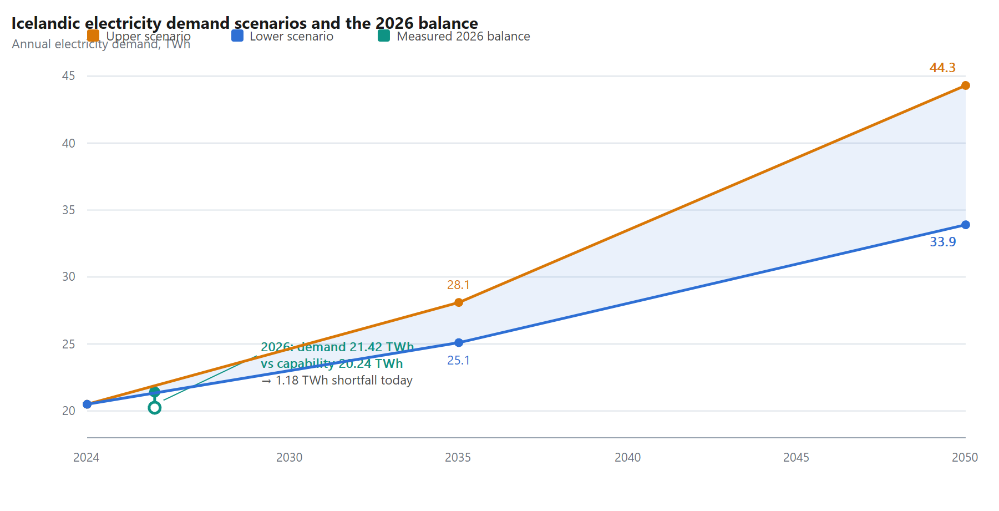
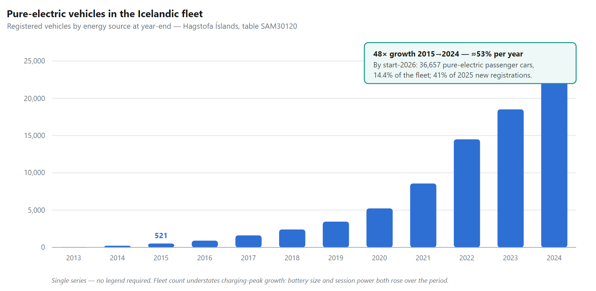
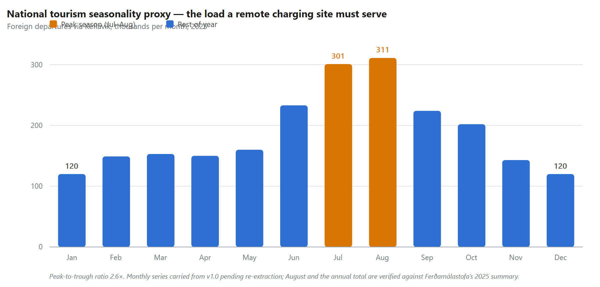
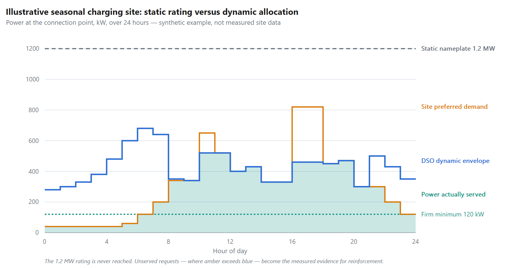
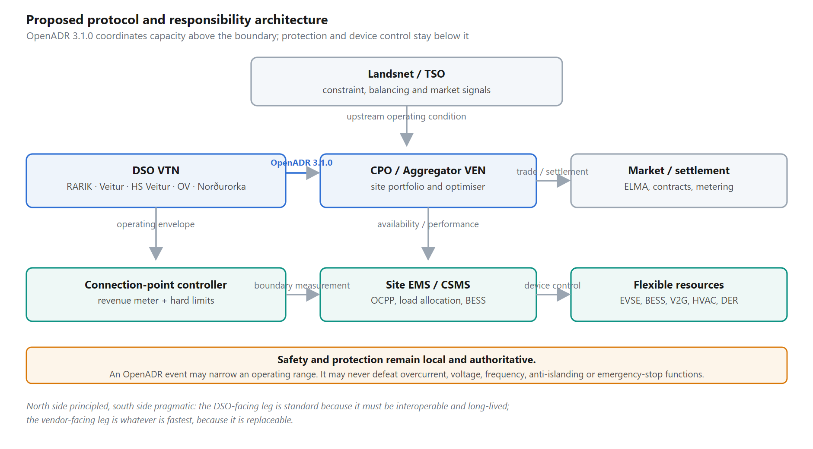
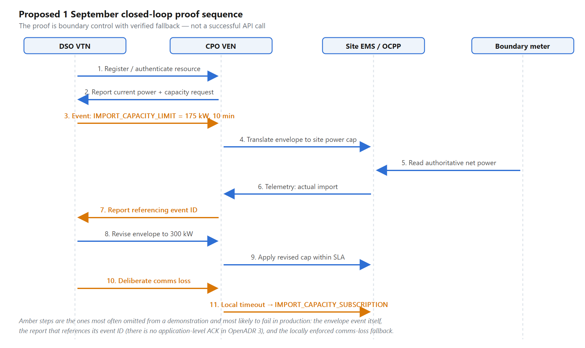

# FROM STATIC TARIFF VARIABLES TO DYNAMICALLY CONTROLLED GRID CAPACITY

**An OpenADR 3.1.0 framework for Icelandic EV charging, distributed energy resources, storage and network flexibility**

Master's-level technical and policy report

Prepared for stakeholder engagement with **Landsnet, RARIK, Veitur, HS Veitur, Orkubú Vestfjarða, Norðurorka**, Umhverfis- og orkustofnun (Raforkueftirlitið) and related market institutions

- **Date:** 5 August 2026
- **Project milestone:** proof of a reliable DSO VTN – CPO VEN interface over OpenADR 3.1.0 by 1 September 2026

> **Central proposition**
>
> The decisive transition is not the adoption of one protocol. It is the replacement of static, predefined grid variables with continuously measured, requested, allocated and verified operating variables. OpenADR 3.1.0 is an implementable starting interface for that transition.

*Status: analytical report, not legal advice. Publicly documented facts, derived calculations, illustrative scenarios and practitioner evidence are explicitly distinguished.*

---

## Abstract

Iceland's electricity-demand outlook, transmission investment programme and decarbonisation objectives create a timing mismatch: electricity demand and high-power charging infrastructure can develop in one to three years, while new grid infrastructure commonly requires five to fifteen years internationally and is constrained by permitting, equipment lead times, outage windows, specialised labour and finance. Landsnet projects national demand of 25.1–28.1 TWh in 2035 and 33.9–44.3 TWh in 2050 [1]. The system is already short: projected 2026 consumption of 21.42 TWh exceeds maximum system capability of 20.24 TWh by 1.18 TWh [25]. Landsnet invested approximately USD 118 million in transmission development in 2025, one of its largest investment years [2].

This report investigates whether a grid architecture based on dynamically controlled variables can complement unavoidable physical reinforcement and remove avoidable barriers created by static tariff and connection assumptions. It examines Landsnet's four-peak transmission power charge, Netmáli 1.0's discounted-cash-flow connection-contribution method, the injection tariffs applied by Icelandic DSOs (innmötunargjald), seasonal public charging, megawatt charging, small producers, BESS, V2G and flexible industrial demand — across **all five Icelandic distribution system operators**, not one.

The report concludes that OpenADR 3.1.0 can serve as the interoperable VTN–VEN coordination interface for capacity requests, operating envelopes, activations and performance reports, while local protection, certified controllers and revenue-grade metering remain authoritative.

The principal finding is qualified but strong, and it points in an unexpected direction. Dynamic control cannot remove energy scarcity, asset condition, protection, metering or N-1 reinforcement requirements. It can convert time diversity, unused hosting capacity, storage, local production and controllable demand into an operational resource. Crucially, **the Icelandic tariff system already prices interruptibility, utilisation and seasonality as distinct commercial variables in at least five separate published instruments.** What is missing is not the economic principle but a standard, auditable, real-time interface that lets the principle be applied continuously rather than in coarse contractual bands. The published DSO injection tariffs do not disclose a granular cost-of-service allocation; their continuing application to dispatch-only resources therefore requires a transparent cost-causation audit rather than an assumption that every connected kilowatt creates a permanent network obligation.

The report proposes a September 2026 proof-of-interface, an Icelandic constraint profile over standard OpenADR 3.1.0 enumerations, and a tariff reform that separates firm access, dynamic access, flexibility availability, activation and measured network benefit.

**Keywords:** OpenADR 3.1.0; dynamic operating envelope; EV charging; MCS; BESS; V2G; DSO; TSO; RARIK; Veitur; HS Veitur; Orkubú Vestfjarða; Norðurorka; Landsnet; innmötunargjald; kerfisframlag; skerðanlegur flutningur; network tariff; demand flexibility.

---

## Executive Summary

> **Main conclusion**
>
> A dynamically controlled grid is not sufficient by itself, but it is a necessary component of a feasible Icelandic electrification pathway. Physical reinforcement alone cannot match the speed, geography and intermittency of emerging demand. Static allocation alone leads to rationed connections, premature capital expenditure and tariffs that annualise temporary peaks.
>
> **Note on scope of change:** the reform required is smaller than it first appears. Iceland's tariffs already recognise interruptible access, utilisation-dependent pricing and seasonal peak weighting. The gap is instrumentation and granularity, not principle.

**The bottleneck is already visible.** Public charging projects, especially remote and seasonal sites, are assessed against possible maximum power and forecast utilisation even when demand is zero for long periods and the operator is willing to accept real-time limits. Megawatt Charging System (MCS) hardware can reach megawatt-scale power per port, amplifying the mismatch between installed capability and guaranteed grid demand [18].

**The upstream tariff is explicitly peak-based — and so are the downstream ones.** Landsnet's DSO capacity charge is calculated from the average of the four highest 60-minute monthly peaks at each delivery point [3]. Verified against the operators' own published tariffs: **the identical rule is reproduced by RARIK, Veitur, HS Veitur and Orkubú Vestfjarða in their own customer tariffs.** A single billing abstraction propagates from the transmission system to the end customer without ever asking whether the load was controllable.

**Utilisation hours are already a pricing variable — against seasonal sites.** Landsnet charges curtailable DSO customers 418 ISK/MWh above 4,500 annual utilisation hours and 1,100 ISK/MWh below it [3]. Orkubú Vestfjarða splits its curtailable classes at the same 4,500 hours [26]. HS Veitur's most favourable large-user tariffs require a minimum 7,000 utilisation hours, 2 MW and 14 GWh under a five-year take-or-pay contract [27]. A seasonal charging hub cannot reach these thresholds by construction.

**Curtailable access already costs less — in tariff and in statute.** Landsnet collects **no capacity charge** for curtailable transmission meeting its B5 conditions, and grants a further 17% discount on system services reflecting avoided reserve-power cost [3]. HS Veitur publishes an *Ótryggð orka* class; Orkubú Vestfjarða publishes a *Skerðanleg orka* class. Since 1 January 2026 the statutory equalisation charge is **0.52 kr/kWh for firm supply but 0.17 kr/kWh for curtailable transmission** [22]. The economic distinction between firm and non-firm is settled Icelandic practice.

**Connection economics remain static and asymmetric.** Regulation 302/2022 requires system contributions where expected direct revenue and other benefits do not cover connection costs, calculated from discounted future revenue, operating cost, capital cost and contract term [7]. Netmáli 1.0, adopted by all five DSOs and effective 15 May 2025, provides the common method [8, 9]. Landsnet operates parallel kerfisframlag terms of its own [28].

**The cost basis of innmötunargjald is not publicly itemised — at any DSO.** RARIK's tariff (edition 46, effective 1 December 2025) charges fixed annual fees of ISK 105,930–294,250 by generator class plus ISK 837,638/MW on agreed export power, with connection charges billed separately [5]. No DSO publishes a mapping of these charges to cost pools. A transparent cost study is needed, and it must be national.

**Dynamic access is a different product from firm access.** A site can request preferred power and receive a time-limited upper/lower operating envelope at its connection point. The DSO controls the boundary; the CPO or site EMS chooses how chargers, BESS, V2G, HVAC and local generation comply.

**OpenADR 3.1.0 can be the interface.** It uses HTTP, JSON, OAuth 2.0 and REST; defines programs, events, reports, VENs and resources; supports subscriptions/webhooks; and has certification tooling [12]. Its User Guide works Dynamic Operating Envelopes and Dynamic Capacity Management as first-class examples. An Icelandic profile is required — but as a **constraint over standard enumerations**, not a private vocabulary.

**Construction remains essential, but evidence replaces speculation.** Internationally, grid projects commonly take 5–15 years while EV charging can be deployed in 1–2 years [14].

**Electrification is not a forecast — it is a measured trend.** Pure electric vehicles in the Icelandic fleet grew from 521 in 2015 to 25,238 in 2024 [23]. At the start of 2026, 36,657 of 254,550 passenger cars in circulation were pure electric — **14.4%** — and electric vehicles were **41%** of all new passenger-car registrations in 2025, rising above **60%** among private buyers in 2026 [24].

### Recommended decisions

- Complete the 1 September interface proof as a closed-loop operational test, not merely a successful API call.
- Ask Landsnet whether the four-peak DSO tariff is an immutable cost principle or a proxy adopted because dynamic verifiable control was previously unavailable.
- **Ask the same question of all five DSOs, which have replicated the four-peak rule downstream.**
- Require a cost-causation disclosure for innmötunargjald **from every DSO that levies one**, including the mapping of fixed and MW charges to actual cost pools and the treatment of dispatch-only resources.
- Define four separate network products: firm access, dynamic non-firm access, paid flexibility availability and paid activation.
- **Anchor the reform in existing precedent** — Landsnet gr. 4.4, the DSO curtailable classes, the 0.17 kr/kWh curtailable equalisation charge, and HS Veitur's 50% summer-peak weighting — rather than presenting it as a new principle.
- Use connection-point metering and local fail-safe control as the settlement and safety boundary; use OpenADR above that boundary and OCPP/EMS/device protocols below it.
- Pilot a seasonal public charging site and at least one BESS/V2G or industrial-flexibility resource to prove both import and export operating envelopes.

---

## Contents

1. Introduction and research questions
2. Methodology and evidentiary limits
3. Icelandic tariff and institutional architecture — all five DSOs
4. Forensic analysis of innmötunargjald
5. Demand growth, fleet electrification and the timing gap
6. Public EV charging, seasonality and MCS
7. Static versus dynamically controlled grid variables
8. OpenADR 3.1.0 technical architecture
9. Flexible producers, BESS, V2G and industrial demand
10. Economic and tariff redesign
11. Quantitative scenarios
12. September proof-of-interface specification
13. Safety, cybersecurity and certification
14. Governance and implementation roadmap
15. Counterarguments and limitations
16. Conclusions and recommendations
- References
- Appendices

---

## 1. Introduction and Research Questions

The Icelandic electricity system is entering a period in which the central planning variable is no longer annual energy alone. Electrified transport, batteries, converter-based generation and large digital loads create power demand that is geographically concentrated, time-dependent and controllable. The traditional network model, however, converts possible maximum demand into a long-term contractual and financial obligation before the actual operating pattern is known.

The thesis examined in this report is that the principal system transition is from static predefined variables to dynamically controlled variables. OpenADR is not the thesis. It is a practical interface through which the thesis can first be demonstrated between a DSO virtual top node (VTN) and a customer or aggregator virtual end node (VEN).

> **Research proposition**
>
> Where a customer does not request a permanent firm entitlement and grants the DSO enforceable control of a time-varying connection-point envelope, the network service, cost causation and tariff treatment are materially different from a conventional firm connection.

### 1.1 Research questions

1. What costs can be verified as being recovered by Icelandic DSOs' current innmötunargjald, and which cost allocations remain undisclosed?
2. How do Landsnet's four-peak power tariff and Netmáli 1.0's discounted-cash-flow model propagate static assumptions into DSO tariffs and connection contributions?
3. Can OpenADR 3.1.0 provide a reliable two-way interface for capacity requests, operating envelopes, activation and performance verification?
4. How would dynamic allocation change the treatment of seasonal EV charging, MCS, small generators, BESS, V2G and large flexible consumers?
5. Which physical, safety and economic costs remain even under fully non-firm operation?
6. What can be proven by the proposed VTN milestone on 1 September 2026, and what cannot?
7. Given that Icelandic tariffs already price interruptibility, utilisation and seasonality, what is the minimum institutional change required to make those distinctions continuous and measured rather than contractual and coarse?

### 1.2 Scope

The report focuses on the operational and tariff boundary among Landsnet, the five Icelandic DSOs and a CPO/aggregator. It treats ELMA or other market platforms as energy-trading and settlement interfaces rather than replacements for grid control. It does not provide a full power-flow study, legal opinion, cyber-penetration test or investment-grade business case. Numerical scenarios labelled "illustrative" are constructed to expose mechanisms, not to predict a specific site.

**All five DSOs are in scope: RARIK, Veitur, HS Veitur, Orkubú Vestfjarða and Norðurorka** [29]. Two consequences follow from covering the sector rather than a single utility. First, the static-variable defect is demonstrably national rather than one utility's policy choice. Second, any reform delivered bilaterally with a single DSO produces a fragmented market in which a CPO faces five different interfaces — precisely the outcome a standard interface exists to prevent.

---

## 2. Methodology and Evidentiary Limits

The analysis combines: (i) current Icelandic tariffs and regulations, **read in the original Icelandic from the operators' own published documents**; (ii) official demand forecasts and financial reporting; (iii) OpenADR Alliance documentation, including the 3.1.0 Definitions, OpenAPI YAML and User Guide; (iv) international evidence on dynamic operating envelopes and flexible connections; (v) official statistics from Hagstofa Íslands and Samgöngustofa; and (vi) practitioner evidence supplied in the underlying project discussion.

| Evidence class | Treatment in this report |
|---|---|
| Publicly documented fact | Cited to an official tariff, law, regulator, system operator, standards body or government dataset. |
| Derived calculation | Arithmetic consequence of a cited tariff or dataset; assumptions are shown. |
| Illustrative scenario | Synthetic values used to test mechanisms; never presented as an observed site. |
| Practitioner evidence | Operational experience reported by the project proponent; identified as such when not found in public documents. |
| Inference | Reasoned conclusion from multiple sources; explicitly described as an inference rather than a disclosed fact. |

### 2.1 Evidentiary qualification: the 630 A and lease-term practice

The practitioner account states that connection applications above approximately 630 A are commonly subjected to a DSO return-on-investment assessment using a binding site lease and a representative 24-hour utilisation forecast. Regulation 302/2022 and Netmáli establish the discounted-revenue method and the use of contract term and time-series utilisation, but the authors did not identify a statutory 630 A threshold or an express legal requirement that the contract term must be evidenced by a property lease [7, 8].

A bespoke-assessment boundary demonstrably exists, but it is a *published tariff boundary and it is not national*:

| DSO | Standard published connection fees up to | Above that |
|---|---|---|
| Orkubú Vestfjarða | **315 A** | Written offer (*skriflegt tilboð*) [26] |
| HS Veitur | **900 A** three-phase (ISK 2,804,089 excl. VAT) | Written offer [27] |
| RARIK (generators) | **140 kW / 200 A** on the general connection tariff since 1 Dec 2025 | Connection agreement; ISK 100,000 agreement fee above 100 kW where an operating permit is required [23a] |

The practitioner's "630 A" is therefore best read as a description of one operator's practice at one time, not a legal rule. The underlying point survives intact and is in fact strengthened: **the threshold at which a connection stops being priced from a published tariff and starts being priced from a bespoke profitability judgement is set by each DSO independently and varies by a factor of three.** An applicant's exposure to discretionary assessment depends on which DSO's territory the site happens to fall in. That is itself a defect worth naming.

The threshold and lease implementation should be documented through each DSO's application procedures, correspondence or calculation workbooks before being presented as a rule.

### 2.2 Known verification gap in this version

Landsnet's **current** published transmission tariff document could not be retrieved from a public index during preparation of this report. The verified primary document available is Gjaldskrá nr. 20 (effective 1 January 2016) [3], which is authoritative for the **structure and rules** — the four-peak method, the B5 curtailable provisions, the utilisation-hour tiers, the withdrawal-charge thresholds for embedded generation — all of which are quoted in this report from that source. The **current rate levels** are not verified here. What is verified is that Landsnet's DSO tariff items **decreased by 8.5% on 1 January 2026** [22] and that Veitur reports a further reduction of approximately 10% in the transmission component from 1 April 2026 [30].

Consequently, every monetary conclusion in §11 is expressed **parametrically in the capacity-charge rate** rather than anchored to a single figure. Before circulation to Landsnet, the current rate should be obtained directly from Landsnet and substituted. This is stated openly rather than papered over: a report that argues for cost transparency cannot itself present an unverified rate as fact.

---

## 3. Icelandic Tariff and Institutional Architecture

### 3.1 The formal cost pipeline

The electricity value chain runs generation and wholesale energy → transmission and system operation → distribution → retail/CPO activity → end use. The tariff pipeline is not identical to the physical power flow, but upstream transmission charges are incorporated into DSO revenue requirements and passed into downstream tariffs. Icelandic regulatory material confirms that transmission cost paid by DSOs is added to DSO revenue limits as actual cost [21].

The project proponent's institutional thesis is that Landsvirkjun occupies the practical top of the "food chain" because of its generation position and influence, even though formal ownership, statutory duties and tariff regulation separate Landsvirkjun, Landsnet and the DSOs. This report treats that claim as a **stakeholder-power hypothesis to test in interviews**, not as a conclusion proven by public corporate diagrams. It is worth noting that in the 2024 Supreme Court proceedings the party that successfully challenged Landsnet's tariff was Landsvirkjun [11] — evidence of independent commercial interest, and a data point for the hypothesis rather than against it.

### 3.2 Landsnet's static power variable

Landsnet charges each delivery point an annual delivery charge, a power charge and an energy charge, with system services and transmission losses billed separately.

**Verified primary text (Gjaldskrá nr. 20, gr. 4.5):** *"Aflgjald vegna úttektar er reiknað út frá meðaltali fjögurra hæstu 60 mínútna mánaðarafltoppa ársins fyrir sérhvern afhendingarstað"* — the capacity charge for withdrawal is calculated from the average of the four highest 60-minute monthly peaks of the year, for each delivery point [3].

```
P_bill = (P_peak,1 + P_peak,2 + P_peak,3 + P_peak,4) / 4
```

The static billing variable is determined after selecting four monthly one-hour peaks. **It does not distinguish controllable from uncontrollable load during those hours.** That is the entire defect, expressed in one line of a tariff.

**Structure of the DSO tariff** (rates shown are from the verified 2016 document and are given to establish the *shape* of the tariff, not current levels — see §2.2):

| Landsnet DSO tariff component | Structure | 2016 verified level |
|---|---|---|
| Afhendingargjald (delivery) | per delivery point per year | ISK 5,176,725 |
| Aflgjald (capacity) | per annual MW, from the four-peak average | ISK 5,315,090 |
| Orkugjald (energy) | per MWh | ISK 384.87 |
| Kerfisþjónusta (system services) | per MWh | ISK 47.69 |
| Flutningstöp (transmission losses) | per MWh | ISK 98.41 |

Three further provisions matter to this report and are frequently overlooked:

- **gr. 4.3** — a 5% discount on capacity and energy charges where delivery to a DSO is at a nominal voltage above 66 kV.
- **gr. 7.2** — the delivery charge itself is *already* discounted by measured peak: 40% off between 3.0 and 6.0 MW, 70% off between 1.0 and 3.0 MW, and it may be waived entirely below 1.0 MW in favour of Landsnet's direct fixed cost at that withdrawal point. **Measured maximum power already modulates a fixed charge.** The precedent for measurement-driven pricing exists in the same document as the static peak rule.
- **gr. 9** — power-factor discipline: energy and capacity charges rise 2% for each 1% by which the monthly average cos φ falls below 0.9.

### 3.3 The four-peak rule is not Landsnet's alone — it is the national billing abstraction

This is among the most consequential findings in this report.

| Operator | Instrument | Verified rule |
|---|---|---|
| **Landsnet** (TSO) | Gjaldskrá gr. 4.5 [3] | *"meðaltali fjögurra hæstu 60 mínútna mánaðarafltoppa ársins fyrir sérhvern afhendingarstað"* |
| **Orkubú Vestfjarða** | Verðskrá, Skýring 2 [26] | *"Í hverjum mánuði er fundinn hæsti 60 mínútna meðaltoppur. Sölutoppur ársins er meðaltal af 4 hæstu mánaðartoppunum."* — with a floor: the annual sales peak is never less than **15 kW** |
| **HS Veitur** | Verðskrá nr. 35, Afltaxtar [27] | *"Ársuppgjör afltoppa er miðað við meðaltal fjögurra hæstu mánaðar toppa ársins"*, with pro-rated variants for partial years (highest of 3 months; average of 2 highest over 6; average of 3 highest over 9) |
| **Veitur** | Tariff documentation [30] | *"Sölutoppur ársins reiknast síðan sem meðaltal fjögurra hæstu mánaðartoppanna"* |
| **RARIK** | Innmötun tariff, small-generator credit [5] | The generator credit is computed from the difference in *"meðaltal fjögurra hæstu mánaðartoppa"* with and without the generator |

**Inference.** A single abstraction — four hours out of 8,760 — determines the capacity component of network charges from the transmission system down to an individual industrial customer, and also determines what a distributed generator is paid for relieving the network. It is an elegant proxy for coincident stress under conditions where per-hour measurement and control were impractical. Those conditions no longer hold. Interval metering is universal, and the loads that now dominate incremental peak growth — EV charging, batteries, heat — are the most controllable loads ever connected to the network.

The reform question to put to the sector is therefore precise and answerable: **is the four-peak average a statement about cost, or a statement about what could formerly be measured?**

### 3.4 Netmáli 1.0 and connection contributions

Regulation 302/2022 requires a DSO to calculate and collect a system contribution when expected direct revenue and other benefit do not cover the cost of the connection. The formula is based on discounted future revenue, future operating cost, capital cost and connection charge; the discount horizon for users is the contract term [7]. Netmáli 1.0 provides the common calculation method, was put out for consultation to 14 March 2025, was adopted by **all five DSOs**, and took effect 15 May 2025 [8, 9].

| Netmáli design variable | Published rule |
|---|---|
| Utilisation plan | Power and energy plan over ramp-up and expected contract term, with time series aligned to Landsnet B7 |
| Maximum contract term | 25 years |
| Revenue share credited, urban | 50% to customer-specific connection investment; 50% to backbone system |
| Revenue share credited, rural | 30% to customer-specific connection investment; 70% to backbone system |
| Disagreement on utilisation | The DSO calculation applies if the parties do not agree |
| Additional cost | Added to connection charge and expected usage charges; calculated by discounted cash flow |

```
Additional contribution = −NPV(investment) + NPV(revenue share × tariff revenue − operating cost)
```

A negative result represents the estimated shortfall charged to the applicant. **Under a static model, controllability has no explicit value** unless the DSO incorporates it into the investment and revenue assumptions.

**The same problem exists one level up.** Landsnet operates its own kerfisframlag terms under its Netmáli (D2 and D3, D3 at version 3.0 in 2025) [28]. A project large enough to trigger transmission-level reinforcement therefore faces two independent discounted-cash-flow assessments, each using its own forecast of a demand pattern that does not yet exist. Reform of the DSO-level method alone would leave the defect in place for exactly the largest and most strategically important loads — including megawatt truck-charging hubs.

### 3.5 Why static variables cascade

The upstream four-peak charge incentivises the DSO to manage annual coincident peaks. The DSO then reproduces the same four-peak variable in its own customer tariff (§3.3). The connection model then asks an applicant to forecast utilisation over a long contract term so the DSO can estimate whether tariffs recover investment. Where a remote charging site has low current use but strategic seasonal value, the same characteristic is interpreted **twice** as a liability: high possible peak power increases the technical investment, while low average energy reduces expected tariff revenue.

A third penalty follows, documented in §3.6: **low utilisation hours also move the site into a worse energy-charge band, and out of eligibility for the most favourable tariffs altogether.**

### 3.6 Utilisation hours are already a pricing variable — and they point the wrong way

| Operator | Threshold | Consequence of falling below it |
|---|---|---|
| **Landsnet** [3] | 4,500 h/yr | Curtailable DSO customers above 4,500 h pay **418 ISK/MWh**; those below 4,500 h for two consecutive years pay **1,100 ISK/MWh** — a **2.63× penalty**. New customers start in the higher band until assessed after a full calendar year. Utilisation time is itself computed from the four highest 60-minute monthly peaks and annual energy, net of Landsnet curtailment periods. |
| **Orkubú Vestfjarða** [26] | 4,500 h/yr | *Skerðanleg orka* above 1 MW splits into class D41/D50 (>4,500 h) at 3.73 ISK/kWh and D42/D49 (<4,500 h) at 5.10 ISK/kWh — a **37% penalty** |
| **HS Veitur** [27] | 7,000 h/yr | Tariffs BD6/BD7/BD8 require minimum 2 MW, **minimum 7,000 utilisation hours**, minimum 14 GWh, and a take-or-pay contract of at least 5 years. Below these, the customer cannot access the class at all. |

**Derived observation.** A seasonal public charging site is structurally incapable of meeting any of these thresholds. A 1.2 MW hub delivering, say, 900 MWh per year has a utilisation time of 750 hours. It is not merely disadvantaged by the four-peak rule; it is placed in the worst band of every utilisation-graded tariff in the country and excluded outright from the most favourable ones. **These are not incidental features. They are the operative mechanism of the market failure described in §6.2.**

The mechanism is defensible under a static regime: low utilisation genuinely does mean poor recovery of a fixed asset. It ceases to be defensible when the customer offers to relinquish firm entitlement, because the asset then need not be sized for the customer's peak at all.

### 3.7 Curtailable access is already a distinct, cheaper product — this is the reform's strongest precedent

Landsnet's B5 curtailable transmission is often described as useful precedent. The precedent is in fact broader and more deeply embedded than that.

| Instrument | Provision | Verified source |
|---|---|---|
| **Landsnet gr. 4.4** | *"Ekki er innheimt aflgjald vegna skerðanlegs flutnings enda séu skilmálar B5 um skerðanlegan flutning uppfylltir."* — **no capacity charge at all** for compliant curtailable transmission | [3] |
| **Landsnet gr. 4.4** | A further **17.0% discount on system services** for curtailable transmission, expressly stated to equal Landsnet's reserve-power cost — i.e. an explicit, quantified cost-causation statement | [3] |
| **HS Veitur** | *Ótryggð orka* classes ÓD1, ÓD2, ÓD3, ÓD6, conditioned on the delivery being economically favourable to distribution-system operation, *"t.d. falist í að geta rofið afhendingu með skömmum fyrirvara"* — e.g. the ability to interrupt at short notice | [27] |
| **Orkubú Vestfjarða** | *Skerðanleg orka* classes D40/D48 (<1 MW, within the peak), D41/D50 and D42/D49 (>1 MW, outside the peak) | [26] |
| **Statute, from 1 Jan 2026** | The equalisation charge (jöfnunargjald) is **0.52 ISK/kWh for firm supply** and **0.17 ISK/kWh for curtailable transmission** — a legislated 67% reduction reflecting the different service | [22] |
| **Landsnet gr. 8.1** | DSOs pay **no withdrawal charge** on energy generated by embedded plant below **1.42 MW**; the charge tapers upward from 1.42 to 3.1 MW, reaching 60% of full charge, and stays at 60% from 3.1 to 10 MW | [3] |

**Conclusion, and it changes the report's rhetorical position.** Iceland does not need to be persuaded that interruptible network use is economically distinct from firm use. Its transmission tariff sets the capacity charge for such use to **zero**, quantifies the avoided reserve cost at **17%**, and its Parliament has legislated a **67% lower equalisation charge** for it. Three DSOs publish interruptible classes.

What Iceland lacks is a *continuous, measured, auditable* version of this distinction. Today, interruptibility is a coarse contractual status negotiated once and applied to a whole tariff class. The proposal in this report is to make it an operating variable, measured hour by hour at the connection point and settled on evidence. **That is an instrumentation upgrade to an accepted commercial principle, not a new commercial principle.** It should be presented to Landsnet and the DSOs in exactly those terms.

### 3.8 The five DSOs are not interchangeable

| DSO | Territory | Structural notes relevant to this report |
|---|---|---|
| **Veitur** | Capital region and parts of the west/south | Largest by customer count; separate urban and rural revenue caps; four-peak rule in force; 1 Jan 2026 distribution +1.11%, Landsnet component −6.67%, jöfnunargjald +27%; further −3.23% on distribution from 1 Apr 2026 [30] |
| **RARIK** | Most rural Iceland and many towns | Separate urban and rural revenue caps; 44 embedded generating plants totalling ~74 MW; abolished per-connection profitability assessment for small generators on 1 Dec 2025; three settlements reclassified urban on 1 Jan 2026 [5, 22, 23a] |
| **HS Veitur** | Reykjanes, Vestmannaeyjar, Hafnarfjörður and Árborg areas | The most differentiated tariff book: three-rate time-of-use class ADÞ with explicit seasonal and hourly bands; demand tariffs BD2–BD8; **BD4 weights summer peaks at 50%**; *Ótryggð orka* classes; utilisation-gated large-user tariffs [27] |
| **Orkubú Vestfjarða** | Westfjords | Weakest network, highest rural cost; dreifbýlisframlag of 38.4%; mandatory demand tariff above 500 A; 15 kW floor on the billing peak; written offers above 315 A [26] |
| **Norðurorka** | Akureyri and surrounding area | Single tariff across the whole service area; mandatory demand tariff above 500 A; current schedule effective 1 July 2026 [31] |

Two of the five split revenue caps between urban and rural areas; the other three apply a combined cap [29].

**Implication for the pilot.** Orkubú Vestfjarða and RARIK offer the strongest *demonstration* case — weak networks, seasonal tourism load, high connection cost, and in RARIK's case an existing embedded-generation population. Veitur offers the strongest *volume* case. HS Veitur offers the strongest *tariff-design* case, because it has already built seasonal and time-of-use structures and would need to extend rather than invent. A national profile requires all five; a first pilot does not.

---

## 4. Forensic Analysis of Innmötunargjald

### 4.1 What is publicly known

RARIK's injection tariff, **edition 46, effective 1 December 2025**, applies to generating units above 16 A that inject into the distribution network; smaller units (*örvirkjanir*) fall under the standard distribution tariff. It contains fixed annual fees by generator class and an annual capacity fee. Both fixed and capacity charges are based on the agreed export power in the connection and parallel-operation agreement. The physical connection charge is billed separately [5].

| Generator category | Annual fixed fee excl. VAT | Incl. VAT |
|---|---|---|
| Below 35 kW | ISK 105,930 | ISK 131,353 |
| 35–59 kW | ISK 141,240 | ISK 175,138 |
| 60–99 kW | ISK 200,090 | ISK 248,112 |
| Synchronous generator | ISK 294,250 | ISK 364,870 |
| **Capacity component** | **ISK 837,638 per MW per year** | ISK 1,038,671 |

*Note on classification: the first three bands are read here as asynchronous machines by size and the fourth as synchronous. The ISK figures are verified; the generator-type reading should be confirmed against the Icelandic original before publication, as the published table's class labels are the basis of the distinction.*

**Small-generator credits.** Two distinct mechanisms operate and they are easily conflated:

1. **Landsnet's withdrawal-charge relief (gr. 8.1)** [3]. DSOs pay **no** withdrawal charge on energy produced by embedded plant **below 1.42 MW**. Between 1.42 and 3.1 MW the charge rises proportionally to 60% of the full rate at the upper bound. From 3.1 to 10 MW it is 60%. This is the statutory recognition that embedded generation reduces the DSO's upstream withdrawal.
2. **RARIK's own credit (art. 17.a)** [5]. Qualifying operators receive a **50% discount on energy and capacity charges** for measured consumption through the grid corresponding to their generation. The calculation references the four-highest-monthly-peak method and Landsnet's capacity, energy and loss components.

Both mechanisms **explicitly acknowledge that distributed resources create an upstream network benefit and that the benefit should be reflected in charges.** That acknowledgement is the entire economic basis of the flexibility products proposed in §10 — the principle is conceded; only the granularity and the measurement are missing.

### 4.2 Numerical burden on small resources

For a 20 kW producer in the lowest fee band, the published annual injection fee is:

```
ISK 105,930 + 0.020 × ISK 837,638 = ISK 122,683 per year excl. VAT
```

One hundred identical resources represent 2 MW in aggregate and would pay approximately **ISK 12.27 million annually** before connection charges. This calculation does not prove that the tariff is excessive; it shows how a fixed site charge dominates the economics of small, intermittently used resources. The fixed component alone is 86% of the total for a 20 kW unit.

**Note on scale.** RARIK's distribution network already hosts **44 generating plants with a combined installed capacity of approximately 74 MW**, in the 12 kW to 10 MW range [23a]. This is a real, existing population — not a hypothetical one — and it is the natural first cohort for a two-sided flexibility product.

### 4.3 What is not publicly disclosed

> **Direct answer to the cost question**
>
> No Icelandic DSO's published injection tariff itemises how much of innmötunargjald is assigned to metering, protection, control-room operation, network capacity, losses, administration, depreciation, return on capital or other regulated cost pools. **The actual granular cost allocation cannot be determined from the published tariffs.** This finding is now established across the sector, not for RARIK alone.

General DSO revenue limits are built from permitted capital cost, operating cost and depreciation; transmission cost and network losses are also passed into DSO revenue requirements [20, 21]. Those categories establish what the monopoly network as a whole may recover. **They do not establish which marginal cost is caused by a dispatch-only 20 kW battery or V2G resource at a particular feeder and time.**

### 4.4 Historical lineage and the "ancient tariff" hypothesis

RARIK stated in 2009 that its injection tariff largely followed Landsnet's tariff [10]. In 2022 it stated that the revised injection tariff was aligned with Landsnet and that the capacity charge would be the same as Landsnet's [6]. This supports the hypothesis that the tariff evolved from an upstream static allocation model rather than from a contemporary dynamic cost-to-serve study.

However, historical lineage is not proof that every component is irrelevant. The defensible academic conclusion is narrower: **dynamic dispatch changes the cost-causation question, while the published tariffs do not disclose enough information to test whether the current MW charge reflects the remaining cost.** A cost-causation audit is required.

**The direction of travel is already reformist.** On 1 December 2025 RARIK simplified its small-generator connection process, expressly to *"auka gegnsæi, stytta afgreiðslutíma og bæta skilvirkni"* (increase transparency, shorten processing time, improve efficiency). It **abolished the practice of assessing each connection separately on its own profitability**, moved units below 140 kW (200 A) onto the standard published connection tariff, waived the connection fee where an existing connection already accommodates the proposed generation, and introduced a flat ISK 100,000 connection-agreement fee for units above 100 kW requiring an operating permit, creditable against the final connection charge and lapsing automatically if the project does not proceed [23a].

This is directly relevant. **A DSO has already concluded, in writing, that per-connection profitability assessment of small resources was an obstacle worth removing.** The argument in this report extends the same logic upward in scale and outward to demand-side connections.

### 4.5 Supreme Court evidence: tariff allocation versus total cost

In **Hæstiréttur case 2/2024, decided 5 June 2024**, the Supreme Court held that Landsnet was not authorised to levy its transmission in-feed capacity fee on producers [11]. The charge had taken effect on 1 April 2022. The Court reasoned that the fee was not a conventional service charge but a special-purpose levy, and that the 2011 amendment to the electricity legislation removed the provision that had referenced in-feed fees, leaving no statutory basis. The revenue-limits provisions were held not to supply that basis.

Landsnet described the charge as a reallocation among customer groups rather than an increase in total revenue [11]. Landsnet's 2025 financial statements confirm that approximately **USD 22.4 million was refunded** to producers early in the year and that collection shifted to end users — large users and DSOs — because the total revenue cap was unchanged [2].

**This does not invalidate DSO-level injection tariffs**, which rest on a different statutory footing. It demonstrates that an "in-feed charge" can operate as a **revenue-allocation mechanism rather than a direct invoice for incremental physical cost**. It strengthens the demand for transparency: what exact service is a distribution injection tariff purchasing, and how does that service change when export exists only on DSO request?

### 4.6 Cost-causation audit required — from every DSO levying an injection charge

- Identify every ledger cost pool recovered through the fixed and MW components.
- Separate one-time connection and protection costs from recurring annual costs.
- Show whether the MW component represents reserved firm export capacity, shared assets, losses, administration or an allocation of upstream charges.
- Quantify avoided Landsnet capacity and energy charges by location and hour — noting that Landsnet gr. 8.1 and RARIK art. 17.a already require this calculation to be performed for the credit, so the capability exists.
- Demonstrate the incremental cost of a resource with zero firm export entitlement and a hardware-enforced zero-export fallback.
- Disclose whether the tariff is reconciled against actual utilisation, curtailment and network benefit.
- Explain why a capacity charge should apply to export that the DSO can refuse before it occurs.
- **Explain why the answers differ between DSOs, or harmonise them.**

---

## 5. Demand Growth, Fleet Electrification and the Timing Gap

### 5.1 The system is short now, not in 2035

Landsnet forecasts national electricity demand of 25.1–28.1 TWh in 2035 and 33.9–44.3 TWh in 2050, representing 22–37% and 65–116% growth respectively, with transport electrification a principal driver [1]. A newer national forecast, **Orkuspá Íslands 2025–2050**, has since been published and should be read alongside it [32].

But the binding constraint is not a 2035 projection. **Projected 2026 consumption is 21.42 TWh against a maximum system capability of 20.24 TWh — a shortfall of 1.18 TWh** [25]. Landsvirkjun states that the system is fully sold, that for the first time in its history it must decline viable projects for lack of energy, and that consented new capacity has been delayed by permitting [25].

Landsnet's 2025 transmission investment was approximately **USD 118 million**, one of the company's largest investment years; operating profit was USD 44.9 million, total debt USD 706.1 million and the equity ratio 48.5% [2]. High investment does not contradict the bottleneck thesis; it confirms the scale of physical work already under way. **The bottleneck is a rate problem**, and it is compounded by an energy-adequacy problem that dynamic control cannot solve at all (§5.3).

The IEA reports that planning, permitting and completing new grid infrastructure can take 5–15 years, compared with 1–2 years for EV charging infrastructure [14].



*__Figure 1.__ Icelandic electricity demand scenarios and the 2026 balance. Sources: Landsnet Raforkuspá 2024–2050 [1]; Landsvirkjun [25]. The 2024 baseline is inferred from the published growth percentages. The teal marker is measured, not forecast.*

### 5.2 Fleet electrification is measured, not forecast

Transport electrification is frequently asserted as a demand driver without being quantified. This section supplies the audited numbers.

**Registered vehicles by energy source, year-end — Hagstofa Íslands, table SAM30120** [23]:

| Year | All vehicles | Petrol | Diesel | **Pure electric** | Plug-in hybrid | Hybrid |
|---|---|---|---|---|---|---|
| 2013 | 245,060 | 173,210 | 70,536 | 50 | 23 | 971 |
| 2015 | 258,816 | 173,231 | 83,212 | **521** | 128 | 1,434 |
| 2017 | 294,078 | 179,644 | 107,462 | 1,611 | 1,959 | 3,034 |
| 2019 | 314,434 | 174,763 | 123,384 | 3,454 | 7,171 | 5,240 |
| 2020 | 315,271 | 168,074 | 125,849 | 5,229 | 9,191 | 6,451 |
| 2021 | 330,441 | 172,196 | 127,597 | 8,570 | 12,937 | 8,661 |
| 2022 | 332,152 | 159,134 | 127,523 | 14,494 | 18,889 | 11,642 |
| 2023 | 357,155 | 173,490 | 131,683 | 18,512 | 20,378 | 12,608 |
| 2024 | 359,400 | 164,465 | 131,893 | **25,238** | 22,169 | 15,163 |

*Derived: pure-electric vehicles grew 48-fold between 2015 and 2024, a compound annual growth rate of approximately **53%**. Petrol vehicles peaked in 2018 and have since declined by 8%. Electric plus plug-in hybrid plus hybrid reached **62,570** vehicles by end-2024, 17.4% of the registered fleet.*



*__Figure 2.__ Pure-electric vehicles in the Icelandic fleet, 2013–2024 year-end. Source: Hagstofa Íslands PxWeb table SAM30120 [23], retrieved 5 August 2026.*

**Passenger cars (M1), year-end — Hagstofa Íslands, table SAM03105** [23]:

| Year | Passenger cars (M1) | Vans (N1) | Cars per 1,000 inhabitants |
|---|---|---|---|
| 2015 | 187,055 | 18,133 | 574 |
| 2020 | 219,628 | 22,784 | 613 |
| 2023 | 247,876 | 26,880 | 646 |
| 2024 | 249,032 | 27,832 | 641 |
| 2025 | **254,362** | 28,373 | 648 |

**Current snapshot — Samgöngustofa, start of 2026** [24]:

| Metric | Value |
|---|---|
| Vehicles registered "in circulation" | 294,245 |
| Of which passenger cars | 254,550 |
| **Pure electric passenger cars** | **36,657** |
| **Pure electric share of the passenger-car fleet** | **14.4%** |
| Pure electric share of 2025 new passenger-car registrations | **41%** (6,755 vehicles) |
| — among private individuals | 62% |
| — among companies | 57.4% |
| — among rental-car fleets | 9.1% |
| Pure electric share among private buyers, 2026 to date | **above 60%** |

*Cross-validation: Hagstofa's year-end 2025 M1 count of 254,362 and Samgöngustofa's start-2026 "in circulation" count of 254,550 agree to within 0.07%, which supports both series. The two sources use different bases — Hagstofa SAM30120 counts all registered vehicle categories, Samgöngustofa counts passenger cars in circulation — so the electric counts are not directly splice-able and no growth rate is computed across them here.*

**Why this matters to the tariff argument.** Three features of the data bear directly on network planning:

1. **The rental-car anomaly.** At 9.1%, rental fleets electrify far more slowly than private buyers at 62%. Rental vehicles are the fleet that actually drives the Ring Road in summer. The demand for high-power charging at remote seasonal sites is therefore **still ahead of the vehicle stock that will use it** — which is precisely the condition under which a utilisation-based ROI test returns a false negative. The self-reinforcing failure described in §6.2 is not hypothetical; it is visible in this one statistic.
2. **The private-buyer trajectory is effectively decided.** Above 60% of private new registrations and rising. The residential and workplace charging load is committed regardless of what happens to public infrastructure.
3. **Charging load grows faster than the fleet.** Battery capacity per vehicle and charging power per session have both risen over the period in the table. Fleet count understates peak-power growth.

### 5.3 Three distinct scarcity problems

| Scarcity | Can dynamic control solve it? | Required response |
|---|---|---|
| **Annual energy (TWh)** | **No — and Iceland is short today.** Control shifts and trims demand but cannot create sustained energy. | New generation, efficiency, fuel substitution, market balancing |
| **Coincident capacity (MW)** | **Often substantially.** Timing, storage, local generation and load control release headroom. | Dynamic envelopes, flexibility procurement, storage, targeted reinforcement |
| **Reliability / redundancy** | **No**, where an independent physical route or N-1 capability is required. | Lines, substations, protection, condition renewal, emergency resources |

The policy error would be to present software as a replacement for steel. The equally serious error is to assume steel alone can be delivered fast enough and therefore to price every possible peak as firm capacity. **Dynamic control is the bridge between current assets and the long-run reinforced network — and given the 1.18 TWh energy deficit, it is also the only lever available on a 12-month horizon.**

---

## 6. Public EV Charging, Seasonality and MCS

### 6.1 The seasonal-site paradox

The locations with the weakest grid can also be the locations with the strongest seasonal transport need. A remote public charging site may require almost no power for long periods but become nationally important during summer travel, holidays or disruption on alternative routes.

Official Icelandic tourism data provide a national — not site-specific — seasonality proxy. Foreign departures through Keflavík totalled approximately **2.27 million in 2025**, with **August the peak month at approximately 311,000**, against 281,000 in August 2024. Keflavík handled 8.1 million passengers in total during 2025 [19].

*An earlier extract of this series gave a peak-to-trough ratio of 2.61× (August 312,964 / December 120,016) and a summer-to-winter average ratio of 2.18×. The August figure is consistent with Ferðamálastofa's published 2025 summary to within 0.6%; the monthly series should be re-extracted from the current workbook before publication, as figures are revised.*



*__Figure 3.__ National tourism seasonality proxy: monthly foreign departures via Keflavík, 2025. Source: Ferðamálastofa / Isavia [19]. This is a national proxy, not site-specific charging demand.*

This does not measure charging demand directly, but it substantiates the premise that important Icelandic transport demand is highly seasonal — and §5.2 shows the vehicles carrying that demand are the least electrified segment of the fleet, so the seasonal charging peak is still ahead.

**The static model penalises this profile four times over:**

1. A static power tariff annualises a small number of high-demand hours (§3.2).
2. The DSO's own four-peak customer tariff repeats the penalty (§3.3).
3. Low utilisation hours push the site into the worst energy band and out of the best tariff classes (§3.6).
4. A utilisation-based ROI model then penalises the same site again in the connection contribution (§3.4).

**Existing precedent to build on.** HS Veitur's tariff class **BD4** already addresses part of this: for 11 kV customers with seasonal consumption, the peak over the summer months (April–September) is counted at **50% of the actual peak**, while winter months count at 100% [27]. This is a crude, static, annual-contract version of exactly what a dynamic operating envelope does continuously. **An Icelandic DSO has already built a seasonal peak-weighting product.** The reform is to make the weighting measured and hourly rather than fixed and semi-annual.

### 6.2 The self-reinforcing market failure

The static model can create a circular failure: no existing EV traffic produces a weak utilisation forecast; the weak forecast produces a high connection contribution; the contribution prevents a bankable charging site; the absence of charging prevents EV adoption and traffic; the initial low forecast then appears validated. **This is not a neutral forecast error. It can lock in the infrastructure conditions that the forecast assumed.**

> **Perverse incentive**
>
> The current method can reward installation of yesterday's charging power, because future-proof equipment increases theoretical peak exposure before demand exists. Installed charger capability, guaranteed grid capacity and actual time-dependent demand are treated as though they were the same variable.

### 6.3 MCS magnifies the mismatch

The IEA describes MCS maximum power using specifications of 1,250 V and 3,000 A, corresponding to multi-megawatt theoretical capability [18]. A truck-charging hub can therefore have several megawatts of installed port capability while actual simultaneous demand remains intermittent and develops over time. Treating nameplate sum as a permanent grid obligation can make public heavy-transport charging non-bankable before the fleet has an opportunity to transition — and, per §3.4, such a hub is large enough to trigger **two** discounted-cash-flow contribution assessments, one at DSO level and one at transmission level.

A dynamic connection separates equipment readiness from network entitlement. A hub can install high-power chargers, receive a low or zero firm allocation, request additional capacity when a truck connects, and combine the DSO allocation with local BESS. **Repeated unserved requests then become objective evidence for reinforcement** — replacing the applicant's speculative forecast with the network's own measured record.

---

## 7. Static versus Dynamically Controlled Grid Variables

### 7.1 The static system

| Variable | Static interpretation | Consequence |
|---|---|---|
| Connection power | Long-term maximum or nameplate proxy | Capacity reserved or reinforced before use is observed |
| 24-hour utilisation profile | Representative truth over contract period | Forecast error becomes an applicant financing risk |
| Annual utilisation hours | Proxy for asset recovery | Seasonal and standby loads pay the highest rates and are excluded from the best classes |
| Producer export capacity | Annual agreed MW obligation | Dispatch-only resources are charged as if export were continuously available |
| Site identity | Consumer or producer | BESS/V2G bidirectionality is poorly represented |
| Network value | Average tariff category | Time and location of relief are weakly valued |
| Investment signal | Application forecast | Reinforcement may precede persistent measured scarcity |

### 7.2 The dynamic system

The dynamic model defines the connection point as a controlled operating range. The site reports what it wants and what it can flex; the DSO returns what the network can safely support for a defined validity period. **The DSO rents available network capability rather than guaranteeing the installed equipment rating.**

```
P_export,min(t) ≤ P_connection(t) ≤ P_import,max(t)
```

The connection-point power must remain within time-varying lower and upper bounds. Sign convention is defined in the Icelandic profile; the principle is a bidirectional dynamic operating envelope.

```
P_allocated(t) = min[P_requested(t), H_network(t)]
```

For a simple import request, allocated power is limited by the network hosting capacity *H* at the relevant location and time. More advanced allocation includes fairness, priority, contingencies and reactive power.



*__Figure 4.__ Illustrative seasonal charging site: static rating versus dynamic hourly allocation. Synthetic example prepared for this report — not measured site data. The gap between site preferred demand and the DSO envelope is the measured denied-capacity signal of §10.4 and §16.1 recommendation 10.*

### 7.3 Request–response cycle

| Site / CPO report | DSO / VTN response |
|---|---|
| Current net import/export | Maximum permitted import and export |
| Preferred power and minimum useful allocation | Validity interval and ramp requirement |
| Required energy and deadline/departure | Priority and curtailment status |
| Available up/down flexibility | Activation price or contract reference |
| BESS state of charge and constraints | Fallback envelope and communication timeout |
| Measured performance | Acceptance, exception or revised envelope |

### 7.4 The DSO controls the boundary, not the customer's technology

The DSO should not select whether the customer uses a battery, charger queue, HVAC adjustment, onsite generator or process change. It should define and enforce the **connection-point operating envelope**. The customer or aggregator remains responsible for internal optimisation, subject to certified equipment and contractual constraints.

This resolves the "technology-neutral" debate. The DSO is not purchasing a behind-the-meter technology solution; it is controlling use of shared network equipment and, when required, purchasing a verified boundary outcome.

---

## 8. OpenADR 3.1.0 Technical Architecture

> **Version discipline.** The current specification is **OpenADR 3.1.0** (Definitions rev 3.1.0, Final Specification, 7 August 2025; OpenAPI YAML dated 1 August 2025). The changelog states that 3.1.0 is **not fully backwards compatible** with 3.0.1: `/resources` became a first-level object, VEN and resource request bodies changed, and `targets` was refactored from `valuesMap` to plain strings. Specifying "3.0" in a document that a state utility will procure against is a correctness error, not a rounding. All references below are to 3.1.0. [12]

### 8.1 Suitability as the dynamic interface

OpenADR 3.1.0 uses HTTP, JSON, OAuth 2.0 client credentials and a RESTful architecture. It provides program management, APIs for VENs and resources, events and reports, subscriptions/webhooks, model extensions and testing/certification tools [12]. These elements are sufficient to implement the proposed capacity dialogue without redefining the core transport protocol.

Critically, the 3.1.0 **User Guide addresses this use case directly**: §8.10.1 *Dynamic Operating Envelopes* and §8.10.2 *Dynamic Capacity Management* work the full request → allocate → verify cycle as worked examples, referencing CSIP-AUS. This is not an adaptation of a demand-response protocol to an unintended purpose; it is a documented primary use case.

**Honest comparison.** IEEE 2030.5 / CSIP is a genuine peer standard, not an also-ran. `DERControl.opModImpLimW` and `opModExpLimW` map almost one-to-one onto OpenADR's `IMPORT_CAPACITY_LIMIT` and `EXPORT_CAPACITY_LIMIT`. The most mature Dynamic Operating Envelope deployment in the world — **CSIP-AUS (SA HB 218:2023)** — is 2030.5-based, not OpenADR. Any claim that OpenADR is *the* DOE interface must survive that fact. It does, but on operational grounds rather than by omission:

- **For OpenADR 3.1.0:** REST/JSON/OAuth, no PKI to procure or operate. A DSO with a web team can stand up a VTN in days. Onboarding a counterparty means issuing a clientID, not enrolling a certificate.
- **For IEEE 2030.5:** deeper production track record for this exact use case, device-level granularity, and SunSpec certification that vendors already hold.

The honest framing for stakeholders is **peer standards, chosen for operational cost of ownership** — not "OpenADR is the standard".

### 8.2 Role mapping

| OpenADR concept | Proposed Icelandic use |
|---|---|
| **VTN** | The DSO's dynamic-capacity server — RARIK, Veitur, HS Veitur, Orkubú Vestfjarða or Norðurorka; potentially Landsnet at a separate upstream layer |
| **VEN** | CPO, aggregator or site controller representing one or more connection-point resources |
| **Program** | Commercial and operational rules: dynamic access, congestion relief, TSO activation, emergency event |
| **Resource** | Connection point, site, portfolio or certified sub-resource with grid-location metadata |
| **Report** | Current power, requested power, forecast, flexibility availability, state of charge, measured response |
| **Event** | Import/export envelope, activation request, price signal, priority and validity interval |
| **Subscription** | Near-real-time delivery of changed events and reports through webhook/push mechanisms |

### 8.3 The Icelandic profile — a constraint document, not a new vocabulary

> **Do not invent a private vocabulary.** A profile of bespoke `IS_*` strings (`IS_IMPORT_CAPACITY_REQUEST`, `IS_OPERATING_ENVELOPE`, and so on) is a natural first instinct and a mistake. **Almost everything needed already exists as standard OpenADR 3.1.0 enumerations.** Using the standard names is what preserves interoperability, permits certification, and lets a CPO reuse an existing VEN implementation. Inventing private strings forfeits all three for no gain.

The profile Iceland needs is therefore a **constraint document over standard enumerations** — specifying which are mandatory, what units and precision apply, what validity intervals and priorities mean, and how conflicts resolve.

| Need | Standard enumeration to use | Object |
|---|---|---|
| Import / export envelope | `IMPORT_CAPACITY_LIMIT`, `EXPORT_CAPACITY_LIMIT` | Event payload |
| Capacity request from site | `IMPORT_RESERVATION_CAPACITY`, `IMPORT_RESERVATION_FEE` | Report payload |
| Capacity offered back | `IMPORT_CAPACITY_AVAILABLE`, `IMPORT_CAPACITY_AVAILABLE_PRICE`, `..._RESERVATION`, `..._RESERVATION_FEE` | Event payload |
| **Comms-loss fallback level** | `IMPORT_CAPACITY_SUBSCRIPTION`, `EXPORT_CAPACITY_SUBSCRIPTION` | Event payload |
| Flexibility availability | `LOAD_SHED_DELTA_AVAILABLE`, `GENERATION_DELTA_AVAILABLE`, `UP_REGULATION_AVAILABLE`, `DOWN_REGULATION_AVAILABLE` | Report payload |
| Activation | `DISPATCH_SETPOINT`, `DISPATCH_SETPOINT_RELATIVE`, `DISPATCH_INSTRUCTION` | Event payload |
| Metered response | `READING`, `USAGE`, `DEMAND` with `readingType: DIRECT_READ`, plus `DATA_QUALITY` | Report payload |
| Exception / resource state | `OPERATING_STATE` (`ERROR`, `IDLE_OPTED_OUT`, `RUNNING_OPTED_OUT`, …) | Report payload |
| Baseline flexibility settlement | `BASELINE`, `DELTA_USAGE` | Report payload |
| Storage / V2G state | `STORAGE_CHARGE_LEVEL`, `STORAGE_USABLE_CAPACITY`, `STORAGE_MAX_CHARGE_POWER`, `STORAGE_MAX_DISCHARGE_POWER` | Report payload |

**Profile decisions that genuinely must be made in Iceland:**

| Decision | Why it is a profile item |
|---|---|
| **Units: kW, not MW** | The 3.1.0 unit enumeration contains `KW` but **no `MW`**. Standardise on kW throughout the interface; reserve MW for tariff arithmetic. |
| **Conflict resolution** | `event.priority` is an integer, minimum 0, lower value = higher priority. The specification states that when two conflicting events share a priority, **behaviour is undefined**. Iceland must define it — this is the DSO–TSO primacy rule of §9.4 expressed in the protocol. |
| **Event cancellation** | There is **no cancellation operation**. Either set duration `PT0S` with start `0001-01-01`, or DELETE the event and rely on subscriber notification. The profile must pick one. |
| **Fallback value** | The mechanism is standardised (`IMPORT_/EXPORT_CAPACITY_SUBSCRIPTION`); the **value** per connection point is a contractual and engineering decision. |
| **`intervalPeriod.randomizeStart`** | Exists precisely to avoid synchronised switching when one envelope change hits many sites. Mandate its use, and set the window. |
| **Sign convention** | Import positive / export negative, or separate limits. Must be stated once, nationally. |
| **Grid-location metadata** | Feeder, transformer and Landsnet delivery point identifiers on each Resource — required for locational value (§9.1) and for the DSO–TSO aggregation of §14.2 Phase 3. |

**Citation discipline:** cite the Definitions normative tables, never the User Guide examples. User Guide §8.10.2 uses enumerations that do not exist in the normative table (`CAPACITY_SUBSCRIPTION`, `CAPACITY_RESERVATION`, `CAPACITY_AVAILABLE_FEE`); the normative forms carry `IMPORT_`/`EXPORT_` prefixes and use `..._AVAILABLE_PRICE`.

### 8.4 Known defects in the published 3.1.0 documents

These will be encountered during implementation and should be raised with the Alliance rather than worked around silently.

| # | Issue | Consequence |
|---|---|---|
| 1 | The `read_bl` scope is undefined. Seven `/notifiers/mqtt/topics/*` endpoints require it; it appears in neither `securitySchemes.oAuth2ClientCredentials.scopes` nor the Definitions scope table. | Must be defined locally. |
| 2 | `/notifiers` requires `read_all` (BL-only) but User Guide §6.3.2 shows the **VEN** calling it to discover the MQTT binding. | As specified, a VEN cannot discover notifiers. |
| 3 | YAML artifact in `BlVenRequest.targets`: `default: null          -`. The trailing hyphen makes the default parse as a string. | Code generation emits a bogus default. |
| 4 | `venRequest` / `resourceRequest` are `oneOf` with the discriminator commented out; the Definitions warn that `oneOf`/`anyOf` do not code-generate in strongly typed languages. | Hand-write deserialisation, dispatch on `objectType`. |
| 5 | Definitions Figure 6 is stale — shows `"operation": "POST"`; the YAML enum is `[CREATE, READ, UPDATE, DELETE]`. | Follow the YAML. |
| 6 | Definitions walkthrough shows `GET /auth/token` with credentials in headers; the YAML specifies `POST` with `application/x-www-form-urlencoded` per RFC 6749. | Follow the YAML. |

Point counterparties at the Alliance's own repository (`github.com/oadr3/specification`) rather than third-party mirrors. A state utility building against an unofficial copy invites an easy objection.

### 8.5 Protocol boundaries



*__Figure 5.__ Proposed protocol and responsibility architecture. Author's synthesis based on OpenADR 3.1.0 objects and the Icelandic stakeholder model, covering all five DSOs.*

| Layer | Primary interface / responsibility |
|---|---|
| Substation protection and grid control | SCADA, protection relays, IEC 61850 where applicable — **not OpenADR** |
| Connection-point enforcement | Certified local controller, meter and hard import/export limits |
| DSO–CPO / aggregator coordination | **OpenADR 3.1.0 VTN–VEN** |
| Charger management | OCPP / CSMS |
| Vehicle–charger communication | ISO 15118 and MCS/charging standards |
| Inverter/BESS local control | Vendor EMS, Modbus/industrial protocols, applicable grid-code functions |
| Energy market and financial settlement | ELMA/market APIs, contracts and settlement systems |

OpenADR is the **digital nervous system, not the protection reflex**. A remote event can never override local protection, anti-islanding or certified equipment limits.

**Design rule: north side principled, south side pragmatic.** The DSO-facing leg is standard because it must be interoperable and long-lived. The vendor-facing leg is whatever is fastest, because it is replaceable.

```
DSO VTN (OpenADR 3.1.0)
        │
        ▼
   VEN / translator
        │
        ▼
whatever the CPMS speaks ──► OCPP ──► chargers
```

> **The demo trap.** A proprietary vendor API can demonstrate closed-loop boundary control quickly and convincingly. It will also demonstrate that you do not need a standard to do it — from which a DSO reasonably concludes "we'll just integrate each CPO's API." With five DSOs and N CPOs that is 5N integrations, 5N credential sets, and each DSO holding accounts on commercial platforms it does not control. Protocol fragmentation is not an obstacle to the VEN layer; it is the reason the VEN layer has value.

---

## 9. Flexible Producers, BESS, V2G and Industrial Demand

### 9.1 Dispatch-only resources

A small producer, BESS owner or V2G vehicle owner need not receive any guaranteed export right. The resource can declare availability and export only when the DSO or TSO calls it under an agreement. **The network is purchasing an option and an activation outcome, not reserving continuous export capacity for the owner.**

| Payment component | Economic purpose |
|---|---|
| Availability | Compensates the owner for keeping a defined capability ready and not selling it elsewhere |
| Activation | Pays for the actual change in boundary power when called |
| Energy | Pays for exported or additionally consumed kWh |
| Asset impact | Battery degradation, efficiency losses, comfort/process effects, rebound |
| Locational value | Recognises relief at a constrained feeder, transformer or Landsnet delivery point |

**The addressable population already exists.** RARIK's distribution network hosts **44 generating plants totalling approximately 74 MW**, in the 12 kW to 10 MW size range [23a]. Landsnet gr. 8.1 already computes a withdrawal-charge relief for embedded generation below 10 MW, and RARIK art. 17.a already computes a 50% credit using the four-peak differential method [3, 5]. **The metering, the settlement calculation and the counterparty relationships are all in place.** What is absent is the ability to call the resource when the network needs it rather than paying for whatever it happened to produce.

### 9.2 V2G relevance

V2G increases the number and geographic distribution of potential resources, but it also makes static classification less defensible. The same connection can consume, reduce consumption or export depending on vehicle state of charge, driver departure requirements and network need. **The resource should be characterised by an available operating range and energy budget, not a permanent producer label.**

A V2G report can carry maximum export kW, available energy kWh, minimum state of charge, departure time and response time — all of which map to standard 3.1.0 storage enumerations (§8.3). The DSO activates only the amount useful at that grid location; the aggregator selects vehicles and preserves driver constraints.

With 36,657 pure-electric passenger cars already connected to Icelandic distribution networks and private new-car electrification above 60% [24], the theoretical V2G population is already larger than the entire embedded generation fleet by an order of magnitude in count, though not in guaranteed availability.

### 9.3 Large consumers as boundary flexibility

A large consumer can use its own production and storage for normal operations and offer net-load change when grid demand arises. The DSO requests an outcome such as "reduce net import by 400 kW for 30 minutes." The site combines reduced charging, HVAC adjustment, BESS discharge and local generation while maintaining internal constraints.

```
F_delivered(t) = P_baseline(t) − P_actual(t)
```

For import reduction, delivered flexibility is the difference between an agreed baseline and measured actual import. **Baseline governance and rebound treatment are essential for settlement** — and OpenADR 3.1.0 provides `BASELINE` and `DELTA_USAGE` report enumerations plus a Baseline Profile for exactly this.

### 9.4 DSO–TSO coordination and double commitment

A resource can be locally valuable to a DSO and systemically valuable to Landsnet, but **the same kW cannot be sold twice for overlapping obligations.** A hierarchy or "primacy" rule is needed. Mandatory local safety envelopes should dominate commercial TSO activation; available residual flexibility can then be offered upstream. Every event and commitment should carry resource, location, time, priority and exclusivity identifiers.

In protocol terms this is the `event.priority` conflict-resolution decision of §8.3 — and because the specification leaves same-priority conflict behaviour undefined, **the primacy rule must be written before commercial aggregation begins, not after.**

With five DSOs, the rule must also govern conflicts *between* DSOs where an aggregator's portfolio spans territories.

---

## 10. Economic and Tariff Redesign

### 10.1 Four separate products

| Network product | Customer right / obligation | Tariff logic | Existing Icelandic analogue |
|---|---|---|---|
| **Firm access** | Guaranteed capacity except defined emergencies | Full capacity-related charge and attributable reinforcement | Current standard tariffs |
| **Dynamic non-firm access** | Capacity varies within an operating envelope; curtailment accepted | Low fixed platform/service fee plus measured congestion or access charge | Landsnet B5 curtailable; HS Veitur *Ótryggð orka*; OV *Skerðanleg orka* — but contractual, not measured |
| **Flexibility availability** | Resource remains ready under agreed limits | Availability payment | None |
| **Flexibility activation** | Resource changes net power when called | Activation, energy and asset-impact compensation | Partial: Landsnet gr. 8.1 and RARIK art. 17.a pay for *outcome*, but only ex-post and only for generation |

**This table is the argument in one page.** Two of the four products already exist in Icelandic tariffs in coarse form. The reform is to make product 2 measured and continuous, and to create products 3 and 4 on the settlement machinery that already computes the four-peak differential for embedded generation.

### 10.2 Proposed dynamic tariff identity

```
Network charge = fixed service + firm capacity + measured congestion + ICT/settlement − verified network benefit
```

The formula is conceptual. Cost pools must be calibrated through a regulated cost-of-service study and must preserve revenue adequacy without charging non-firm resources as firm capacity.

The dynamic model **does not promise a zero bill.** It changes which costs are attributable. Physical connection, protection, metering, communications, cyber operations, administration and shared network service remain. The avoidable component is the **permanent reservation and premature reinforcement associated with capacity the customer neither requests nor receives as a firm right.**

### 10.3 When marginal capacity cost can approach zero

For a fully controllable resource, marginal capacity cost can approach zero when **all** of the following hold: no firm import/export right is granted; the resource is admitted only inside measured headroom; a local controller enforces the limit; communication failure produces a safe fallback; no reinforcement is undertaken for the non-firm portion; and the DSO can refuse or curtail the flow before a constraint occurs.

Total service cost remains positive. "Close to zero" is an economically precise claim only for **incremental network-capacity cost in unconstrained intervals**, not for the entire connection or system.

This is not a purely theoretical position. **Landsnet already sets the capacity charge to zero for curtailable transmission meeting its B5 conditions** [3]. The claim is therefore demonstrated at transmission level under Icelandic tariff law and contested only at distribution level. That narrows the audit question usefully: *what distribution-level cost survives the removal of a firm entitlement that transmission-level cost does not?*

### 10.4 Reforming the connection ROI calculation

The investment counterfactual should be **the least-cost service actually requested**, not the full technical rating of installed charging equipment. A dynamic assessment compares the investment required for the guaranteed firm envelope with the cost and value of a non-firm layer, storage and operational control.

```
Dynamic contribution = unavoidable incremental investment
                     − NPV(tariff income + flexibility value
                           + deferred-investment value + avoided upstream cost)
```

This expands the current discounted-cash-flow method to include measurable benefits and investment deferral. It does not require the DSO to forecast customer technology; it requires the DSO to value the boundary service it controls.

Because Netmáli 1.0 is common to all five DSOs and Landsnet operates parallel terms of its own (§3.4), **this reform must be made once at Netmáli level and once at Landsnet Netmáli level**, not negotiated per project.

### 10.5 Symmetry and reconciliation

The applicant currently bears downside risk when utilisation is forecast to be low. A fair dynamic model should include periodic reconciliation when actual tariff revenue, denied-capacity hours or later shared use materially depart from the original assumptions. Regulation 302/2022 already provides for cost sharing or repayment when additional users use a reinforced element within ten years [7]; Orkubú Vestfjarða's tariff operates a comparable 10-year, 10%-per-year declining recovery right for customer-funded high-voltage lines [26]. **The mechanism exists. It should be extended to actual utilisation and flexibility value.**

---

## 11. Quantitative Scenarios

### 11.1 Upstream peak value — expressed parametrically

Let **C** be Landsnet's capacity charge in ISK per annual MW (see §2.2 on why C is not fixed here). Because the billing variable is the mean of four monthly peaks, the relationship between a verified peak reduction and the annual charge is linear and simple:

| Verified change at a Landsnet delivery point | Change in annual capacity charge |
|---|---|
| 1 MW reduction in **each** of the four selected billing peaks | **1.00 × C** |
| 1 MW reduction in **one** selected peak | **0.25 × C** |
| 0.5 MW reduction in each of four selected peaks | **0.50 × C** |
| *N* MW reduction in *k* of the four selected peaks | **(N × k / 4) × C** |

Substituting a widely quoted figure of C = ISK 9,786,291/MW gives ISK 9.786 m, ISK 2.447 m and ISK 4.893 m respectively. **Substituting the verified 2016 figure of C = ISK 5,315,090/MW gives ISK 5.315 m, ISK 1.329 m and ISK 2.658 m.** The true current value lies above the latter and below the former, and fell 8.5% on 1 January 2026 [22]. Obtain C directly from Landsnet before circulating this section.

These values are direct tariff arithmetic, **not a prediction of savings passed to a specific site.** Whether and how a DSO shares the avoided cost depends on tariff reform, delivery-point coincidence and the resource's verified performance.

**The structural point is independent of C.** Because only four hours per year set the charge, the value of flexibility is extraordinarily concentrated — and correspondingly, the *cost* of an uncontrolled load that happens to coincide with those four hours is extraordinarily high relative to its energy consumption. A charging hub that shifts 1 MW out of all four peaks earns the same relief as one that permanently disconnects, provided the shift is verified. **That is the strongest single financial argument for the boundary-meter approach in §12.**

### 11.2 Illustrative remote charging hub

| Parameter | Static model | Dynamic model |
|---|---|---|
| Installed EVSE capability | 1.2 MW | 1.2 MW |
| Guaranteed grid right | 1.2 MW assumed in planning | 120 kW firm; 0–1.08 MW non-firm |
| Demand when no vehicle is present | Capacity remains financially relevant | Request and allocation may be near zero |
| Annual utilisation hours | ~750 h → worst tariff band, excluded from best classes (§3.6) | Not a pricing variable for the non-firm layer |
| Peak service | Full grid import if available | DSO envelope + optional 500 kW / 1 MWh BESS |
| Investment signal | Forecast peak and contract utilisation | Measured denied-request hours and persistent congestion |
| Failure mode | Breaker / static contract limit | Local fail-safe to `IMPORT_CAPACITY_SUBSCRIPTION` value (120 kW, or zero non-firm) |

In a synthetic 24-hour profile, the 1.2 MW equipment rating is never reached. The DSO envelope serves part of the preferred request, while the customer decides whether to extend dwell time, use local storage or communicate an expected service level. **The system obtains real demand evidence without first guaranteeing a permanent 1.2 MW entitlement.**

### 11.3 Small-resource portfolio

A portfolio of one hundred 20 kW resources has 2 MW aggregate nameplate capability. Under the current RARIK fee, the annual fixed-plus-capacity amount is approximately **ISK 12.27 million excluding VAT** before connection charges (§4.2). If the portfolio is dispatch-only and exports only when authorised, its economic service resembles an availability option. **The key tariff question becomes which recurring cost remains after firm export reservation is removed** — and Landsnet's own answer at transmission level, for compliant curtailable transmission, is *no capacity charge at all* (§3.7).

### 11.4 Fleet-growth scenario

Pure-electric passenger cars grew from 25,238 registered electric vehicles at end-2024 to 36,657 pure-electric passenger cars in circulation at the start of 2026, on different statistical bases [23, 24]. Rather than splice the series, consider the forward mechanics on the verified 2026 snapshot:

- **Base:** 36,657 pure-electric passenger cars, 14.4% of 254,550 passenger cars.
- **Flow:** 6,755 new EV registrations in 2025, 41% of new passenger-car registrations, with the private-buyer share now above 60% [24].
- **Derived, illustrative:** if the private-buyer share holds above 60% and total new passenger-car registrations remain near the 2025 level, pure-electric share of the passenger fleet passes 20% within approximately three years on new registrations alone, before any acceleration in rental-fleet electrification.
- **Derived, illustrative:** the rental fleet is the binding uncertainty. At 9.1% EV share of its new registrations, it is roughly seven times less electrified than private buyers, and it is the fleet that generates seasonal Ring Road charging demand. **Any forecast of remote high-power charging demand is really a forecast about rental-fleet electrification**, and a utilisation-based ROI test performed today prices in the current 9.1% rather than the trajectory.

This is labelled illustrative. It is not a demand forecast for any site. It identifies which variable a connection assessment is implicitly betting on.

### 11.5 What the scenarios do and do not prove

The scenarios prove arithmetic and demonstrate design logic. They **do not** prove feeder headroom, customer willingness, battery economics, market prices or the exact amount of deferred reinforcement. Those require site power-flow data, interval metering, network topology, outage criteria and a regulated benefit-sharing rule.

---

## 12. September Proof-of-Interface Specification

The proposed milestone is a reliable OpenADR 3.1.0 interface with a DSO operating a VTN. The proof should be defined as a **closed-loop boundary-control test**. A demonstration that merely creates an OpenADR event proves syntax and authentication, not dynamic grid capacity.



*__Figure 6.__ Proposed 1 September closed-loop proof sequence. Author's test specification. Note that there is no acknowledgement step: OpenADR 3 has no application-level ACK operation, so compliance is evidenced by a report referencing the event ID and by the boundary meter (§12.2).*

### 12.1 Minimum test cases

| Test | Procedure | Pass criterion |
|---|---|---|
| Authentication and resource registration | VEN authenticates to VTN; resource IDs reconciled | No unauthorised access; identical resource mapping on both sides |
| Capacity request | VEN reports current, preferred and minimum useful kW via `IMPORT_RESERVATION_CAPACITY` | VTN receives valid, time-stamped report |
| Operating envelope | VTN sends `IMPORT_CAPACITY_LIMIT` = 175 kW for a ten-minute interval | Local site cap applied; a report referencing the event ID is returned |
| Physical response | Simulated or real load attempts to exceed 175 kW | Boundary meter remains within tolerance |
| Envelope revision | VTN changes limit to 300 kW | Site applies change within agreed response SLA |
| Telemetry and audit | Metered kW returned with event/program IDs | DSO and CPO logs reconcile within clock tolerance |
| Communications loss | Network path deliberately interrupted | Local controller falls back to the `IMPORT_CAPACITY_SUBSCRIPTION` value before timeout |
| Recovery | Communication restored, new event issued | No uncontrolled jump; explicit resynchronisation |
| **Simultaneous multi-site change** | One envelope change issued to several resources | `intervalPeriod.randomizeStart` demonstrably prevents synchronised switching |
| **Conflicting events** | Two events with overlapping intervals issued at the same and at different priorities | Documented, deterministic resolution matching the Icelandic profile rule |

The last two are not optional. Synchronised switching across a feeder is a real stability hazard, and the specification leaves same-priority conflict behaviour undefined (§8.3).

### 12.2 Proposed quantitative KPIs

| KPI | Initial proof target |
|---|---|
| Interface availability during test window | ≥99.5% excluding planned interruption |
| Clock synchronisation error | ≤1 second |
| **Event delivery, measured as a report POST referencing the event ID** | **≤5 seconds on a normal network** |
| Site cap application, measured at the boundary meter | ≤10 seconds after valid event |
| Boundary power compliance | Within ±5% or agreed meter/control tolerance |
| Telemetry reporting interval | 5–10 seconds during active event |
| Communication-loss fallback | Within 30–60 seconds, contract-defined |
| Audit completeness | 100% of requests, events, commands and meter values linked by IDs |

> **Why this KPI is not phrased as "delivery and acknowledgement".** **OpenADR 3 has no application-level event acknowledgement operation.** A KPI written that way is untestable and would fail acceptance for reasons unrelated to the interface's quality. Two things are measurable and are used instead: a report POST that references the event ID, and the boundary meter itself. The second is the one that matters — it is the only evidence that survives a dispute.

### 12.3 What to exclude from the first proof

- Full market pricing and financial settlement
- TSO–DSO primacy across multiple simultaneous programmes
- Fleet-scale optimisation across many sites
- V2G export unless already certified and safe
- Claims of avoided capex without a network study
- **Certification.** Certification is per product, per role, per version, per profile, and is irrelevant to a first proof. **Conformance to the published YAML is not.**

Keeping these outside the critical path does not reduce the importance of the proof. It isolates the fundamental proposition: **a DSO can dynamically allocate connection-point power without controlling individual chargers, and can verify compliance through the boundary meter.**

---

## 13. Safety, Cybersecurity and Certification

### 13.1 Non-negotiable local authority

The connection-point controller and protection system remain authoritative. OpenADR events are supervisory and commercial instructions. They may **narrow** an operating range but may not defeat local overcurrent, voltage, frequency, anti-islanding, thermal, earthing or emergency-stop functions.

### 13.2 Fail-safe state

Every dynamic connection requires a contractually defined communication timeout and fallback. **The mechanism is standardised in OpenADR 3.1.0**: after an extended communications interruption with the `CAPACITY_LIMIT` schedule exhausted — and following a grid outage — the VEN reverts to `IMPORT_CAPACITY_SUBSCRIPTION` / `EXPORT_CAPACITY_SUBSCRIPTION` as its default limit.

> **Do not design a bespoke fail-safe.** It is tempting to treat the fallback as an open design question — zero non-firm import/export, a conservative static firm limit, or the last valid envelope. There is no need to invent a fail-safe mechanism; only to **set its value** per connection point. The fallback must nonetheless be **enforced locally**, even if the VEN, cloud platform or telecommunications network fails.

### 13.3 Security controls

OpenADR 3.1.0 uses TLS 1.2+ and OAuth 2.0 client-credentials flow; the Alliance provides VTN/VEN test tooling and an audit trail [12]. Production deployment additionally requires credential lifecycle management, least privilege, network segmentation, event signing or integrity controls where appropriate, time synchronisation, immutable logs, rate limits, incident response, and **separation between commercial APIs and protection networks**.

Note the operational asymmetry against IEEE 2030.5: OAuth client credentials mean onboarding a new CPO is issuing a clientID, not enrolling an X.509 certificate from a managed PKI. For a DSO without an existing PKI practice, this is the decisive difference (§8.1).

### 13.4 Certification perimeter

| Certification / assurance domain | Purpose |
|---|---|
| OpenADR VTN/VEN interoperability | Confirms conformance of protocol implementation and object exchange |
| Connection controller and metering | Confirms accurate boundary enforcement and settlement-grade measurement |
| EVSE and vehicle interfaces | Confirms charger safety, OCPP behaviour, applicable ISO 15118/MCS functions |
| BESS/inverter grid compliance | Confirms export limits, anti-islanding, grid-support behaviour |
| Site commissioning test | Confirms the integrated system follows envelopes and enters safe fallback |
| Operational audit | Confirms ongoing availability, performance and cyber controls |

**Two certification facts worth knowing before procurement.** First, "supports OpenADR" and "is OpenADR certified" are different claims — always ask which certificate, for which role, version and profile. Second, **a closed-system VTN purpose-built by a utility or government agency, and not resold, may certify against OpenADR 3 alone**, with no OpenADR 2.0b obligation. Only commercial VTNs sold as part of a DERMS must carry both. A DSO building its own VTN is not exposed to the 2.0b requirement, and should not be told otherwise by a vendor.

---

## 14. Governance and Implementation Roadmap

### 14.1 Stakeholder roles

| Stakeholder | Proposed role |
|---|---|
| **Landsnet** | Define upstream constraint/value interface; recognise verified DSO peak flexibility; coordinate system services and primacy; disclose whether the four-peak rule is a cost principle or a measurement proxy |
| **RARIK, Veitur, HS Veitur, Orkubú Vestfjarða, Norðurorka** | Operate VTNs; calculate local operating envelopes; procure local flexibility; disclose tariff cost causation; harmonise the resulting products through the Netmáli process that already binds all five |
| **CPO / aggregator** | Operate VEN; aggregate sites/resources; preserve customer requirements; control devices through EMS/OCPP |
| **Umhverfis- og orkustofnun (Raforkueftirlitið)** | Approve tariff/access products, cost allocation, consumer protections and revenue-recovery transition |
| **Samorka** | Natural venue for the common profile, since it already coordinates Netmáli across the five DSOs |
| **Equipment owners** | Opt in under clear availability, activation and asset-impact terms |
| **Market/settlement operator** | Handle energy trades, imbalance and financial settlement outside the safety/control path |

Because Netmáli 1.0 was developed collectively and adopted by all five DSOs [8, 9], the sector has already demonstrated that it can agree a common national method for a connection-economics question. That is the correct precedent and the correct venue for the dynamic-access product. It is a considerably faster path than five bilateral negotiations.

### 14.2 Phased roadmap

| Phase | Deliverable |
|---|---|
| **Phase 0 — 1 September proof** | One VTN, one VEN, one resource: capacity request, changing envelope, meter report, deliberate communications failure, randomised start, conflict resolution |
| **Phase 1 — controlled field pilot** | Seasonal public EV site; real boundary meter; operational but non-financial envelopes; weekly performance review |
| **Phase 2 — two-sided flexibility** | Add BESS or a small generator from the existing 44-plant embedded population; test optional export and paid activation; establish baselines and degradation compensation |
| **Phase 3 — Landsnet interface** | Aggregate resources by delivery point; test an upstream peak-risk window and DSO allocation to local resources |
| **Phase 4 — tariff sandbox** | Firm/non-firm tariff, avoided upstream cost credit, connection-contribution reconciliation, independent evaluation |
| **Phase 5 — national profile** | Common Icelandic OpenADR 3.1.0 constraint profile, certification, primacy rules, **multi-DSO interoperability across all five operators** |

### 14.3 Meeting objective with Landsnet

The immediate meeting is best treated as **institutional reconnaissance rather than technical design.** The central question is whether Landsnet regards the four-peak static charge as a fundamental economic necessity or as a proxy adopted because dynamic verifiable control was previously unavailable. A positive answer does not require Landsnet to operate a DSO pilot; it establishes that the upstream constraint need not remain static forever.

- Would Landsnet recognise verified delivery-point peak reduction from DSO-controlled flexibility as economically different from uncontrolled firm demand?
- **Landsnet already sets the capacity charge to zero for compliant curtailable transmission under B5, and quantifies the avoided reserve cost at 17%. What prevents a graduated, measured version of the same distinction?**
- **The 4,500-hour utilisation threshold in gr. 4.4 penalises low-utilisation customers by a factor of 2.63. Was that threshold set from cost analysis, or as a proxy for a customer type?**
- Would Landsnet provide a constraint or peak-risk signal that a DSO could translate into local envelopes?
- What telemetry, audit and performance evidence would Landsnet require before relying on an aggregated resource?
- Does Landsnet have the institutional mandate to pilot such a change, and which other stakeholder must approve it?

### 14.4 Meeting objective with the DSOs

- All five replicate the four-peak rule in customer tariffs. Is that a deliberate cost-causation choice, or inherited from the upstream tariff?
- Three of five already publish curtailable/interruptible classes. What would it take to make eligibility a measured operating state rather than a contract class?
- HS Veitur already weights summer peaks at 50% under BD4. What evidence base set that number, and could it be replaced by measurement?
- The bespoke-assessment threshold varies from 315 A to 900 A across operators. Is that difference cost-driven or historical?
- Netmáli 1.0 was agreed collectively. Would the same forum take a dynamic-access product?

---

## 15. Counterarguments and Limitations

| Counterargument | Assessment |
|---|---|
| "The grid must simply be built." | True for persistent energy, thermal and reliability constraints. Incomplete because physical build times exceed charging deployment times, rare peaks can be managed more cheaply, and Iceland is **already 1.18 TWh short in 2026** [25] — a gap no construction programme can close in-year. |
| "Dynamic control transfers reliability risk to customers." | It does if the product is unclear. A transparent firm/non-firm contract, service-level disclosure and safe fallback make the trade explicit. Icelandic tariffs already contain such products. |
| "Forecasts are still required." | Correct. Forecasts remain inputs for planning and allocation, but they should not be treated as immutable truth or the sole basis for an upfront penalty. |
| "ICT and cyber costs may offset savings." | Real and must be included. Scale and shared platforms therefore matter — which is an argument for one national profile across five DSOs, not five bespoke integrations [15, 16]. |
| "Customers may not accept curtailment." | Then they can purchase firm access and pay the associated cost. The proposal **adds** choice; it does not remove firm service. |
| "Dynamic access may be unfair." | Allocation rules must be transparent: first-come, pro-rata, priority service, auction or regulated essential-service rules. Fairness is a design variable, not a reason to preserve static scarcity. |
| "OpenADR is not a real-time grid-control protocol." | Correct for protection and sub-second control. Appropriate for supervisory envelopes, events and seconds-to-minutes flexibility when local enforcement remains authoritative. |
| **"IEEE 2030.5 / CSIP is the proven DOE standard, not OpenADR."** | **Substantially correct on track record** — CSIP-AUS is the most mature DOE deployment and is 2030.5-based. The OpenADR case rests on operational cost of ownership for a DSO without an existing PKI, not on technical superiority. This should be conceded openly (§8.1). |
| "The exact benefit is unproven." | The 1 September test proves control reliability, not avoided capex. Benefit quantification follows through measured peaks, denied requests and network studies. |
| **"This is a novel regulatory concept."** | **It is not.** Landsnet gr. 4.4, HS Veitur *Ótryggð orka* and BD4, Orkubú Vestfjarða *Skerðanleg orka*, Landsnet gr. 8.1, RARIK art. 17.a and the statutory 0.17 kr/kWh curtailable equalisation charge all price non-firm or measured behaviour today. The proposal makes an accepted distinction continuous and auditable. |

### 15.1 Limits of the "unavoidable path" claim

The phrase "a dynamically controlled grid is unavoidable to avoid disaster" is rhetorically strong. The defensible academic form is: **dynamic control is a necessary component of a feasible transition** because the alternatives — connection rationing, static overbuilding, punitive peak pricing and delayed electrification — cannot by themselves deliver the required speed and efficiency. Dynamic control is necessary but not sufficient; generation, reinforcement, maintenance and regulation remain necessary.

### 15.2 Limitations of this report

- Landsnet's **current** capacity-charge rate is not verified (§2.2). All monetary conclusions are parametric.
- Norðurorka's detailed tariff figures were not obtained; its structural features (single service-area tariff, mandatory demand tariff above 500 A, schedule effective 1 July 2026) are cited, its rates are not.
- The Icelandic generator-class labels in RARIK's injection tariff should be confirmed against the original (§4.1).
- The monthly tourism series should be re-extracted from Ferðamálastofa's current workbook (§6.1).
- **Electric-vehicle counts by postcode or municipality could not be obtained.** Samgöngustofa's statistics portal exposes a municipal breakdown through an interactive dashboard, but it is a client-rendered embed with no public data endpoint reachable without a browser session, and Hagstofa's PxWeb transport tables carry no geographic dimension. A per-DSO-territory EV density analysis — which would materially sharpen the locational-value argument in §9.1 and the site-selection argument in §14.2 Phase 1 — therefore requires either a data request to Samgöngustofa or an interactive export. **This is a recommended next step, not a gap in the argument.**
- No power-flow, hosting-capacity or feeder-level analysis has been performed for any candidate site.

---

## 16. Conclusions and Recommendations

Iceland's present tariff and connection architecture was built for relatively predictable, one-directional and slowly changing loads. Its key variables — contracted power, representative daily utilisation, annual peak, utilisation hours, producer size and consumer/producer category — are treated as **static commitments**. Electrified transport and distributed energy resources are different: their net power is intermittent, bidirectional and controllable, and their population is growing at a compound rate above 50% per year (§5.2).

**The most important finding of this report is that the Icelandic system already contains the economic principle the reform depends on.** Landsnet charges nothing for capacity on compliant curtailable transmission and quantifies the avoided reserve cost at 17%. Parliament has legislated an equalisation charge two-thirds lower for curtailable transmission. Three of five DSOs publish interruptible classes. One publishes a seasonal 50% peak weighting. Landsnet and RARIK both compute and pay for the upstream benefit that embedded generation creates, using the same four-peak differential that governs the charge itself. Netmáli values "other benefit" in principle. RARIK has already abolished per-connection profitability assessment for small generators on transparency and efficiency grounds.

**What is missing is a standard, reliable and auditable operational interface that turns controllability into a recognised, continuously measured network product** — rather than a coarse contract class negotiated once and applied for a year.

OpenADR 3.1.0 can provide that interface. It can register resources, report requests and availability, issue time-bounded events, subscribe to updates and return measured performance, using standard enumerations that already exist for exactly this purpose. It cannot replace protection, safety certification, connection controllers or financial market systems. The proposed architecture keeps those responsibilities separate. It is a peer of IEEE 2030.5 rather than a superior; it is chosen for operational cost of ownership, and that reasoning should be stated openly.

The exact cost recovered by Icelandic DSOs' innmötunargjald cannot be determined from public tariff material, because no operator discloses a granular allocation. The fees are based on agreed export capacity, connection is charged separately, and their historical design explicitly followed Landsnet. Dynamic dispatch therefore creates a legitimate cost-causation challenge: **a resource with no firm export right and a zero-export fallback should not automatically be priced as though the DSO has reserved its nameplate capacity continuously** — particularly when the transmission system, for the analogous service, reserves nothing and charges nothing.

### 16.1 Priority recommendations

1. Define the September success criterion as **closed-loop boundary control with fail-safe behaviour and reconciled audit logs**, including randomised start and deterministic conflict resolution.
2. Adopt an Icelandic **constraint profile over standard OpenADR 3.1.0 enumerations** — capacity request, operating envelope, flexibility offer, activation, net-power report and exception — and resist any proposal for a private `IS_*` vocabulary.
3. Create separate contracts and tariffs for **firm access and dynamic non-firm access**, presented as a measured extension of the existing curtailable classes rather than a new concept.
4. Require each DSO levying an injection charge to publish, or submit to the regulator, a **cost-causation study for innmötunargjald** — and require the five answers to be reconciled.
5. Ask Landsnet to state whether the **four-peak rule and the 4,500-hour utilisation threshold** are cost principles or measurement proxies, and to say what evidence would justify replacing them.
6. Credit **verified avoided Landsnet peak cost and local reinforcement deferral**, while retaining charges for real connection, metering, cyber and shared-network services. The settlement machinery already exists in Landsnet gr. 8.1 and RARIK art. 17.a.
7. **Pilot seasonal public charging**, because it makes the static-model defect measurable and societally relevant. Orkubú Vestfjarða or RARIK territory offers the sharpest demonstration.
8. Add **BESS/V2G and industrial resources** after the interface proof, starting with the 44 generating plants already embedded in RARIK's network.
9. Establish **DSO–TSO primacy and anti-double-commitment rules**, and inter-DSO rules for portfolios spanning territories, **before** commercial aggregation — and express them as an `event.priority` policy, since the specification leaves same-priority conflicts undefined.
10. Use **persistent denied-capacity hours and measured congestion** — not theoretical nameplate alone — as a primary reinforcement signal.
11. Take the common profile through **the Samorka/Netmáli forum that already binds all five DSOs**, not through five bilateral negotiations.
12. Position dynamic control as **the fast operational bridge** while physical generation and network investment proceed — noting that with a 1.18 TWh energy deficit in 2026, it is the only lever available within twelve months.

> **Closing statement**
>
> Iceland cannot finance, permit and physically build every possible electrification peak before the demand arrives. The viable alternative is not to stop building the grid; it is to operate existing and new assets dynamically, allocate capacity when and where it exists, and build reinforcement where measured scarcity proves it is continuously required.
>
> The Icelandic tariff system has already conceded, in six separate published instruments, that interruptible network use is economically distinct from firm use. The remaining question is not whether that distinction is real. It is whether it will continue to be applied once a year by contract, or continuously by measurement.

---

## References

[1] **Landsnet** — *Raforkuspá Landsnets 2024–2050*. https://www.landsnet.is/utgafa-og-samskipti/ritogskyrslur/raforkuspa-landsnets-2024-2050/

[2] **Landsnet** — *Ársreikningur 2025* (annual financial statements). Investment ≈ USD 118 m; operating profit USD 44.9 m; debt USD 706.1 m; equity ratio 48.5%; in-feed refund ≈ USD 22.4 m. Published 24 Feb 2026. https://www.globenewswire.com/news-release/2026/02/24/3243786/0/is/Ársreikningur-Landsnets-hf-2025.html

[3] **Landsnet** — *Gjaldskrá fyrir flutning á raforku og kerfisþjónustu, nr. 20*, effective 1 Jan 2016. **Primary source for gr. 4.3–4.5 (four-peak method, B5 curtailable, 4,500-hour tiers), gr. 7.2 and gr. 8.1.** https://www.landsnet.is/library?itemid=efb00f23-d1f2-4d51-aaaa-bf9043e0ea8a *(Current rate levels must be obtained from Landsnet — see §2.2.)*

[4] **Landsnet** — *Gjaldskrá og reiknivélar*. https://www.landsnet.is/gjaldskra/gjaldskra-og-reiknivelar/

[5] **RARIK** — *Gjaldskrá fyrir innmötun raforku*, edition 46, effective 1 Dec 2025. https://www.rarik.is/gjaldskrar/gjaldskra-fyrir-innmotun-raforku

[6] **RARIK** — *Breyting á gjaldskrá fyrir innmötun raforku frá 1. apríl 2022*, 5 Apr 2022.

[7] **Government of Iceland** — Regulation No. 302/2022 amending Regulation No. 1040/2005; system contributions for new DSO connections, 24 Feb 2022. https://www.reglugerd.is/reglugerdir/eftir-raduneytum/idnadarraduneyti/nr/22998

[8] **Icelandic DSOs** — *Netmáli 1.0*, terms for additional costs for new DSO connections and major investments; consultation to 14 Mar 2025; effective 15 May 2025.

[9] **Veitur / Samorka** — All electricity DSOs approve Netmáli 1.0, 2025. https://www.veitur.is/frettir/allar-dreifiveitur-rafmagns-samthykkja-netmala-1-0

[10] **RARIK** — *Raforkudreifing kostar meira*, 29 Jul 2009.

[11] **Hæstiréttur Íslands, case 2/2024**, judgment 5 June 2024 — Landsvirkjun v. Landsnet; transmission in-feed capacity charge held to lack statutory basis. See also Landsnet, *Niðurstaða Hæstaréttar skapar óvissu*, 7 Jun 2024, and Landsvirkjun, *Hæstiréttur dæmir gjaldskrá Landsnets ólöglega*.

[12] **OpenADR Alliance** — OpenADR **3.1.0** Definitions (Final Specification, 7 Aug 2025), OpenADR 3 OpenAPI YAML (1 Aug 2025), 3.1.0 User Guide, 3.1.0 Change Log, and *OpenADR 3 Information and Certification Program* README. Official repository: https://github.com/oadr3/specification

[13] **OpenADR Alliance** — *What you need to know about OpenADR 3.1.0*, 17 Sep 2025.

[14] **International Energy Agency** — *Electricity 2026: Grids*; 5–15 year grid lead times versus 1–2 years for EV charging. https://www.iea.org/reports/electricity-2026/grids

[15] **Australian Renewable Energy Agency** — Dynamic Operating Envelopes Workstream.

[16] **Australian Energy Regulator** — *Export Limit Guidance Note*, 2024.

[17] **Energy Networks Association (UK)** — *Good Practice Guide: Active Network Management*, 2015.

[18] **International Energy Agency** — *Global EV Outlook 2024*; MCS maximum power assumptions (1,250 V, 3,000 A).

[19] **Ferðamálastofa / Isavia** — Foreign passenger departures via Keflavík. 2025 total ≈ 2.27 million; August 2025 ≈ 311,000 (August 2024: 281,000); KEF total passengers 2025: 8.1 million. https://www.ferdamalastofa.is/is/gogn/fjoldi-ferdamanna/talningar-ferdamalastofu-i-flugstod-leifs-eirikssonar

[20] **Umhverfis- og orkustofnun / Raforkueftirlitið** — revenue limits based on permitted capital cost, operating cost and depreciation. https://uos.is/raforkueftirlitid

[21] **Alþingi** — Committee report: transmission cost paid by DSOs is added to DSO revenue limits as actual cost.

[22] **RARIK** — *Lækkun gjaldskrár, ný þéttbýlisgjaldsvæði og breytt jöfnunargjald*, effective 1 Jan 2026. Landsnet tariff items −8.5%; jöfnunargjald 0.41 → 0.52 ISK/kWh firm and 0.13 → 0.17 ISK/kWh curtailable, following legislation of 24 Dec 2025; Bifröst, Borg í Grímsnesi and Tjarnabyggð reclassified urban. https://www.rarik.is/frettir/laekkun-gjaldskrar-og-ny-thettbylisgjaldsvaedi

[23] **Hagstofa Íslands** — PxWeb tables **SAM30120** *Fjöldi ökutækja eftir þunga og orkugjafa 1995–2024* (updated 24 Sep 2025) and **SAM03105** *Skrásett ökutæki í árslok 1999–2025* (updated 19 Mar 2026). API: https://px.hagstofa.is/pxis/api/v1/is/Umhverfi/5_samgongur/3_okutaekiogvegir/1_okutaeki/

[23a] **RARIK** — *Við einföldum ferli við tengingu minni virkjana*, effective 1 Dec 2025; and *Flutningur og nýtengingar — Virkjanir* (12 kW–10 MW; 44 plants, ≈74 MW connected). https://www.rarik.is/frettir/vid-einfoldum-ferli-vid-tengingu-minni-virkjana

[24] **Samgöngustofa** — *Bifreiðatölur*, start-of-2026 figures: 294,245 vehicles in circulation; 254,550 passenger cars; 36,657 pure electric (14.4%); 2025 new EV registrations 6,755 = 41% of new passenger cars (individuals 62%, companies 57.4%, rental 9.1%). https://bifreidatolur.samgongustofa.is/

[25] **Landsvirkjun** — *Raforkuöryggi* and related statements: 2026 projected consumption 21.42 TWh against maximum system capability 20.24 TWh (shortfall 1.18 TWh); system fully sold. https://www.landsvirkjun.is/raforkuoryggi

[26] **Orkubú Vestfjarða** — *Verðskrá — Dreifing og flutningur raforku*, effective 1 Jul 2026. Skýring 2 (four-peak rule, 15 kW floor); B50T/B50D demand tariffs; D40–D50 *Skerðanleg orka* classes; written offers above 315 A; dreifbýlisframlag 38.4%. https://www.ov.is/asset/4506/verdskra-dreifing-og-flutningur-raforku

[27] **HS Veitur** — *Verðskrá — Dreifing og flutningur raforku, nr. 35*, effective 1 Jan 2026. Afltaxtar BD2–BD8 (four-peak annual settlement; BD4 50% summer-peak weighting; BD6–BD8 gating at 2 MW / 7,000 h / 14 GWh / 5-year take-or-pay); ADÞ three-rate time-of-use; ÓD1–ÓD6 *Ótryggð orka*; connection fees to 900 A. https://www.hsveitur.is/media/xidkebb5/35-verdskra-fyrir-dreifingu-og-flutning-raforku_01012026.pdf

[28] **Landsnet** — *Netmáli Tenging D3, Skilmálar um kerfisframlag*, útgáfa 3.0 (2025), and D2 terms, útgáfa 1.0 (1 Aug 2025). https://www.landsnet.is/library/?itemid=56675f45-660b-4945-97ec-5ef653bc5b20

[29] **Umhverfis- og orkustofnun / Orkustofnun** — *Eftirlit með sérleyfisfyrirtækjum*: five distribution utilities operate in Iceland — HS Veitur, Norðurorka, Orkubú Vestfjarða, Veitur and RARIK; two split revenue caps between urban and rural areas, three apply a combined cap. https://uos.is/raforkueftirlitid/eftirlit/serleyfisfyrirtaeki

[30] **Veitur** — *Breytingar á verðskrám Veitna 2026* (1 Jan 2026: distribution +1.11%, Landsnet component −6.67%, jöfnunargjald +27%) and *Breytingar á verðskrám Veitna 1. apríl 2026* (distribution −3.23%/kWh; Landsnet transmission component 2.80 → 2.50 ISK/kWh). https://www.veitur.is/frettir/breytingar-verdskram-Veitna-1-april-2026

[31] **Norðurorka** — *Rafveita — verðskrá*, effective 1 Jul 2026; single tariff across the whole distribution area; demand tariff mandatory above 500 A. https://www.no.is/is/thjonusta/verdskra/rafveita

[32] **Orkuspá Íslands** — *Orkuspá Íslands 2025–2050: Raforkuspá, orkuskiptaspá og jarðvarmaspá*. https://orkuspaislands.is/

[33] **Government of Iceland** — *Impact and Allocation Report 2024*: transport as the largest contributor to Icelandic societal GHG emissions.

---

## Appendix A — Example payload semantics (standard enumerations)

Semantic example, not normative OpenADR JSON. **All names below are standard OpenADR 3.1.0 enumerations**; the Icelandic profile constrains their use, it does not rename them. Units are kW throughout, because the 3.1.0 unit enumeration has `KW` but no `MW`.

```
SITE VEN → DSO VTN   (report)
  resource:                        site-connection-001
  DEMAND                           12        kW   (readingType: DIRECT_READ)
  IMPORT_RESERVATION_CAPACITY      350       kW
  IMPORT_RESERVATION_CAPACITY.min   80       kW   (minimum useful)
  USAGE (required)                 120       kWh
  latestCompletion                 2026-09-01T14:45:00Z
  LOAD_SHED_DELTA_AVAILABLE        270       kW
  DATA_QUALITY                     OK

DSO VTN → SITE VEN   (event)
  program:                         IS-DYNAMIC-CAPACITY-PILOT
  event:                           envelope-00042
  IMPORT_CAPACITY_LIMIT            175       kW
  EXPORT_CAPACITY_LIMIT              0       kW
  IMPORT_CAPACITY_SUBSCRIPTION      50       kW   (comms-loss fallback)
  intervalPeriod.start             2026-09-01T14:00:00Z
  intervalPeriod.duration          PT10M
  intervalPeriod.randomizeStart    PT30S
  priority                         0              (0 = highest; mandatory network limit)
```

Note the fallback is carried as a standard `..._CAPACITY_SUBSCRIPTION` value on the event, not as a bespoke `fallbackImportMax_kW` field.

---

## Appendix B — Data calculations

| Metric | Calculation | Result |
|---|---|---|
| 20 kW RARIK injection fee | 105,930 + 0.020 × 837,638 | ISK 122,683/yr excl. VAT |
| 100 × 20 kW resources | 100 × 122,682.76 | ISK 12.27 m/yr excl. VAT |
| Landsnet four-peak relief, 1 MW in all four peaks | 1.00 × C | **C** (see §2.2, §11.1) |
| Landsnet single-peak relief, 1 MW | 0.25 × C | **0.25 C** |
| — at C = 5,315,090 (verified 2016) | 0.25 × 5,315,090 | ISK 1.329 m/yr |
| — at C = 9,786,291 (widely quoted, unverified) | 0.25 × 9,786,291 | ISK 2.447 m/yr |
| Landsnet curtailable utilisation penalty | 1,100 ÷ 418 | **2.63×** |
| Orkubú Vestfjarða curtailable utilisation penalty | 5.10 ÷ 3.73 | **1.37×** |
| Jöfnunargjald firm vs curtailable, from 1 Jan 2026 | 0.52 ÷ 0.17 | **3.06×** |
| Seasonal 1.2 MW hub, 900 MWh/yr | 900,000 ÷ 1,200 | **750 utilisation hours** — below every published threshold |
| EV fleet CAGR 2015→2024 | (25,238 ÷ 521)^(1/9) − 1 | **≈ 53% per year** |
| EV growth multiple 2015→2024 | 25,238 ÷ 521 | **48×** |
| EV share of passenger cars, start 2026 | 36,657 ÷ 254,550 | **14.4%** |
| Private-buyer vs rental EV share, 2025 new registrations | 62% ÷ 9.1% | **6.8×** |
| Iceland energy balance 2026 | 21.42 − 20.24 | **−1.18 TWh** |
| Cross-validation of fleet sources | 254,550 ÷ 254,362 − 1 | **+0.07%** |

---

## Appendix C — Glossary

| Term | Definition |
|---|---|
| ANM | Active Network Management |
| BESS | Battery Energy Storage System |
| CPO | Charge Point Operator |
| CSIP / CSIP-AUS | Common Smart Inverter Profile; Australian variant, SA HB 218:2023 |
| DER | Distributed Energy Resource |
| DOE | Dynamic Operating Envelope |
| DSO | Distribution System Operator |
| EMS | Energy Management System |
| EVSE | Electric Vehicle Supply Equipment |
| MCS | Megawatt Charging System |
| OCPP | Open Charge Point Protocol |
| OpenADR | Open Automated Demand Response |
| TSO | Transmission System Operator |
| VEN | Virtual End Node in OpenADR |
| VTN | Virtual Top Node in OpenADR |
| V2G | Vehicle-to-Grid |
| **Afhendingargjald** | Delivery charge per delivery point |
| **Aflgjald** | Capacity / demand charge |
| **Afltaxti** | Demand-metered tariff class |
| **Dreifbýlisframlag** | Rural distribution subsidy |
| **Dreifiveita** | Distribution system operator |
| **Innmötunargjald** | Distribution-network charge applied to electricity injection |
| **Jöfnunargjald** | Statutory equalisation charge on all distributed electricity |
| **Kerfisframlag** | System contribution / additional connection contribution |
| **Netmáli** | Grid code / connection terms document |
| **Nýtingartími** | Utilisation time (annual energy ÷ peak power) |
| **Orkugjald** | Energy charge |
| **Ótryggð orka** | Non-firm / uninsured energy (HS Veitur tariff class) |
| **Skerðanlegur flutningur** | Curtailable transmission |
| **Skerðanleg orka** | Curtailable energy (Orkubú Vestfjarða tariff class) |
| **Sölutoppur** | Annual billing peak, from the four highest monthly peaks |
| **Stórnotandi** | Large user — at least 80 GWh/yr at one site within three years |
| **Tekjumörk** | Regulated revenue cap |
| **Úttekt / Innmötun** | Withdrawal / injection |
| **Verðskrá / Gjaldskrá** | Price schedule / tariff |
