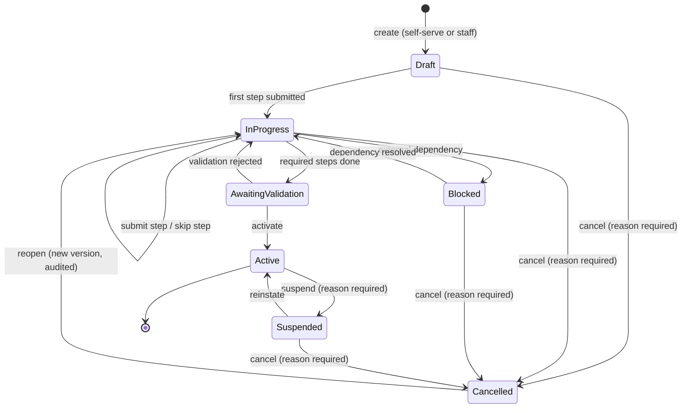

# The singular onboarding aggregate

Phase 1. One workflow, optional steps, two consuming personas. Proposal only.

## 1. Event log plus projections, not a mutable record

The prompt asks for an honest comparison. Both were considered against what the
codebase already does.

| | Single mutable `OnboardingWorkflow` row | Event log + projections |
| --- | --- | --- |
| Fits current code | Prisma/Drizzle rows are mutable today | `audit.actions` already an append-only log **[F]** |
| "Who did what, on whose behalf" | needs a parallel audit table anyway | native — it *is* the log |
| Staff assistance | actor must be squeezed into the row | actor + on-behalf-of are event fields |
| Resume/reopen | last-write-wins, history lost | replay to any point |
| Read cost | one row | needs a projection |
| Concurrency | row-version | append + fold |
| Migration cost | low | **higher** |

**[R] Recommend a hybrid, matching ADR 0050's read-model direction:** an
append-only `onboarding_events` log as the source of truth, plus one
`onboarding_workflow_state` projection for reads.

The deciding argument is Phase 4. Staff assistance requires every mutation to
carry actor, on-behalf-of organisation and reason, visible to both Straumvakt and
the organisation. In a mutable row that is a second, parallel audit system that
can silently disagree with the row. In an event log it is the only system. The
repo already reaches for this shape — `recordAuditAction` is called from inside
the same transaction as the mutation in both invite paths **[F]**.

**[U]** Whether to reuse `audit.actions` as the event log or add a dedicated
table. Reuse keeps one log; a dedicated table avoids overloading an audit
surface with workflow control-flow. Leaning dedicated, because replay semantics
and audit retention have different lifetimes.

## 2. Aggregate identity and fields

```
OnboardingWorkflow
  id, environment                       -- staging is beta, prod separate
  targetOrgId?                          -- null until the org record exists
  channel                               -- self_serve | staff_created | host_application
  applicantUserId?                      -- who started it
  orgAdminUserId?                       -- who will own it afterwards
  assistingStaffUserId?                 -- set only inside a support context
  phase, nextActionOwner                -- org_admin | staff | system
  version                               -- optimistic concurrency
  idempotencyKey                        -- per submit
  openedAt, activatedAt?, suspendedAt?, cancelledAt?, reopenedAt?
```

Steps are rows, not columns, so optionality is data rather than schema:

```
OnboardingStep
  workflowId, key, status               -- pending|in_progress|done|skipped|blocked|failed
  skipReason?, blockedReason?
  completedByUserId?, onBehalfOfOrgId?
  payloadRef?                           -- points at the real record created
```

Step keys, all optional except the two marked required:

`org_identity` (**required**) · `legal_contact` · `commercial_terms` ·
`property` · `site` · `installation` (**required**) · `charger_claim` ·
`vendor_credentials` · `discovery` · `driver_group` · `access_policy` ·
`invitations` · `validation`

**[R]** Only `org_identity` and `installation` are required, because they are the
two things without which nothing else can be true: no tenant, and nothing to
charge at. Everything else has a legitimate "not yet" — which is precisely what
today's model cannot express, forcing either a fake value or a stalled process.

**Commercial terms carry readiness, never fabricated pricing.** The step records
*whether* terms are agreed and which agreement they point at. It must not invent
a tariff. **[F]** The commercial model already has four generations of pricing
logic; a fifth invented at onboarding time would be the worst possible place to
guess.

## 3. State machine



Invariants:

1. `Active` requires `org_identity` and `installation` to be `done` — never
   `skipped`.
2. Only `Active` may confer driver access. A workflow in any other state can
   mint invitations but they cannot be redeemed. **This is the single rule that
   prevents half-onboarded organisations from granting charging.**
3. `Cancelled → InProgress` increments `version` and writes a reopen event; it
   never resurrects the prior step statuses silently.
4. Suspension does not revoke existing `DriverGroupMembership`. Revocation is a
   separate, explicit act — see [03](03-unaffiliated-and-access-code.md) §6.
5. Every transition carries actor, on-behalf-of org and, for suspend/cancel/
   reopen and any destructive step, a reason string.

## 4. Failure and recovery matrix

| Failure | Detection | Recovery | Non-goal |
| --- | --- | --- | --- |
| Step submitted twice (retry, double-tap) | `idempotencyKey` unique per (workflow, step) | second call returns the first result | not a lock |
| Two admins submit different steps at once | independent step rows | both succeed | no workflow-wide lock |
| Two admins submit the *same* step | `version` compare-and-set | second gets `409 conflict` with current state | no last-write-wins |
| Vendor discovery times out | step → `blocked` with reason | retry, or skip and continue | never auto-skip |
| Org record created, installation never claimed | workflow stalls in `InProgress` | staff assist, or cancel with reason | not auto-cancelled |
| Staff context expires mid-step | step stays `in_progress`, no partial write | re-enter support context | no silent continuation |
| Activation races a suspension | `version` guard on the workflow | one wins, other 409s | no partial activation |
| Invitation redeemed before activation | invariant 2 rejects at redemption | redeem after activation | invitation is not voided |

**[U]** Whether a workflow may target an organisation that already exists and is
already active — i.e. adding a second installation years later. Modelled here as
a new workflow with `targetOrgId` pre-set and `org_identity` auto-`done`, but
that needs a product decision about whether it is the same concept at all.
