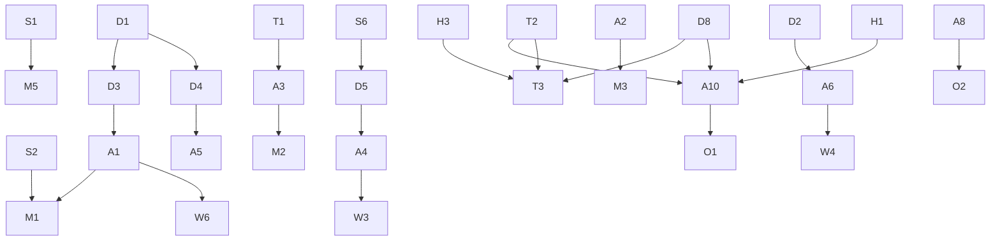

# Work packages and dependency order

Phase 9. Thirty-six issue-ready packages. Every one requires human approval
before implementation; none is authorised by this document.

Format per package: **evidence → invariant → scope → files → deps → acceptance →
rollout → observability**. Non-goals are stated where they are load-bearing.

## Security — do first, no client dependency

**S1. Stop discarding `kennitala` in `invites/consume`**
Evidence: `invites.ts:36-39` strips it; `client.dart:97-107` sends it and
`:135` tells the user it is checked **[F]**. Invariant: an identity factor is
either verified or not requested. Scope: make `ConsumeBody` strict *or* verify
against the invited user; pick one with product. Files:
`routes/public/invites.ts`, later `apps/mobile/.../client.dart`. Deps: none.
Acceptance: T-LEAK-1, T-INV-3. Rollout: additive, reversible. Observability:
count requests carrying an unexpected field. Non-goal: changing the auth model.

**S2. Stop `consume` overwriting an existing password**
Evidence: `invites.ts:142-147` upsert-updates `passwordHash`; the driver path
refuses with `409 already_claimed` **[F]**. Invariant: an invitation is not a
password reset. Scope: refuse when a credential exists. Deps: product answer on
whether anything uses it as a reset. Acceptance: T-INV-4. Rollout: one route,
one branch, revert is one line. Observability: count refusals.

**S3. Rate-limit the join path fail-closed**
Evidence: `rate-limit.ts:23-25,116` fails **OPEN** with a warn when the binding
is absent **[F]**. Invariant: enumeration protection must not vanish where it
was never configured. Scope: fail closed for join/access-code only; leave login
semantics alone. Deps: WP-A3. Acceptance: T-ABUSE-2.

**S4. Assert contractor mapping is never platform authority**
Evidence: ADR 0034 mapping + `effectivePermissions` composition **[F]**.
Invariant: tenant roles never compose into platform verbs. Scope: a test, not a
refactor. Acceptance: T-AUTH-6.

**S5. Generic failure for every join rejection**
Invariant: unknown code, wrong passphrase, expired, revoked, exhausted, closed
and invite-only are indistinguishable. Acceptance: T-ABUSE-1, T-ABUSE-3.

**S6. `platform.support.enter` as a new verb**
Evidence: `permissions.ts:26-28` — `super_user` gets a literal list, not a
wildcard **[F]**. Invariant: existing super-users do not become support agents
retroactively. Deps: WP-D5.

## Domain

**D1. `OnboardingWorkflow` + `OnboardingStep` model** (doc 02 §2). Deps: none.
**D2. Event log + projection decision** — reuse `audit.actions` or dedicated
table (doc 02 §1). Deps: D1. **[U]** open.
**D3. State machine + transition guards** (doc 02 §3), including invariant 2:
only `Active` confers access. Deps: D1.
**D4. Optimistic concurrency + idempotency keys** (doc 02 §4). Deps: D1.
**D5. `SupportContext` aggregate** (doc 05 §3). Deps: D1, S6.
**D6. Step-level permission map** (doc 05 §4), incl. commercial-terms exclusion.
**D7. Failure/recovery matrix as executable guards** (doc 02 §4).
**D8. Attribution value object** — `driver | installation | unknown`, upgrade-only
(doc 06 §4). Deps: none.

## Data

**T1. `InstallationAccessCredential` table** (doc 03 §3). Deps: D1.
**T2. `IdToken.tokenClass`** — `driver | physical_card | installation_technical`
(doc 06 §4.1). Deps: none. **Highest-value single field in the packet.**
**T3. Session attribution columns** — value + basis + upgraded-at. Deps: D8, T2.
**T4. Placeholder user `status: "invited"`** (doc 04 §5). Deps: **[U]** whether
`status` carries other meaning.
**T5. Tenant-isolation predicate review** for every new table.
**T6. Expand/migrate/contract sequence** — no backfill of legacy CPMS data, per
accepted direction 10. **Non-goal: any legacy import.**
**T7. Retention matrix** for identity, access, audit. **[U]** legal input.
**T8. Index plan** — `code` unique, `(orgId, installationId)`,
`(workflowId, stepKey)`, `(idTag)`.

## API

**A1. `POST /api/driver/join`** — four methods, one service (doc 04 §2).
Deps: D1, D3, T1.
**A2. `GET /api/driver/join-state`** — deliberately not `/me` (doc 03 §2).
**A3. Access-credential create/rotate/revoke** endpoints. Deps: T1.
**A4. Support-context enter/exit** endpoints. Deps: D5, S6.
**A5. Workflow read/submit-step/resume** endpoints. Deps: D1, D4.
**A6. Audit-event projection** endpoint, visible to org and staff. Deps: D2.
**A7. Multi-session list/select.** Accepted direction 8.
**A8. Deprecation telemetry** at every legacy entry (doc 04 §4). Deps: none.
**A9. Mint-side convergence** — one command with `kind`. Deps: A1.
**A10. `enforceAuthorize` verdict contract update** — `attribution` field,
`userId: null` for technical tokens (doc 06 §4.2). Deps: T2, D8.

## Web

**W1. Onboarding shell driven by steps, not a fixed wizard.** Deps: A5.
**W2. Skip-with-reason UI.** Deps: A5.
**W3. Support-context banner** — always visible, names the org and the staff
actor, one-click exit. Deps: A4.
**W4. Org-visible audit view** of staff actions (doc 05 §3 rule 6). Deps: A6.
**W5. Access-policy + credential management screen.** Deps: A3.
**W6. Access-request approve/reject queue.** Deps: A1.

## Mobile

**M1. Move invite redemption to the identity-bound path** — `claim-invite` →
login → `redeem-invite`, or `A1`. **This unblocks S2/S4 hardening.** Deps: A1.
**M2. Join by code + passphrase, with QR scan.** Deps: A1, A3.
**M3. Unaffiliated home state** — no org data before a grant. Deps: A2.
**M4. Access-request status screen.** Deps: A1.
**M5. Remove or wire the kennitala field** per S1's product answer. Deps: S1.

## Hardware validation — bench required

**H1.** Does Zaptec demand a non-empty idTag for free-vend `StartTransaction`?
**H2.** Concurrent presentation of one technical token on multiple EVSEs.
**H3.** Does `RemoteStartTransaction` idTag echo unchanged into
`StartTransaction`/`TransactionEvent`? Tap correlation depends on it.
**H4.** OCPP 1.6 vs 2.0.1 `idTagInfo` behaviour with `enforceAuthorize` true.
All four: **[U]**, cannot be settled from the repo (doc 06 §5).

## Operations

**O1. Staged `enforceAuthorize` rollout runbook** — shadow evidence, one
installation, then widen (doc 06 §6).
**O2. Deprecation gates G1–G5** (doc 04 §4), including "no flag-day deletion".
**O3. Support-context review cadence** incl. break-glass (doc 05 §6).
**O4. Emergency credential revocation runbook** (doc 03 §3).

## Dependency graph

## Smallest vertical slice that proves one org and one driver

Prove the whole chain end to end before broadening. Six packages:

**D1 → D3 → A1 (`method: "accessCode"` only) → T1 → A3 → M2**

Plus **S2** shipped alongside, because it is one line and removes a live
password-reset capability.

That is: create a workflow, activate it, mint one access credential for one
installation, scan it in the app, receive a `DriverGroupMembership`, and charge.
It deliberately excludes invitations, staff assistance, approval queues and
attribution changes — each of which is a second slice once the first proves the
spine works.

**Do not start with the invite consolidation.** It is the most valuable work but
it depends on an app release reaching users (M1), so it cannot prove anything
end to end within one cycle. The access-code path has no such dependency: it is
new surface, with no legacy client to wait for.
