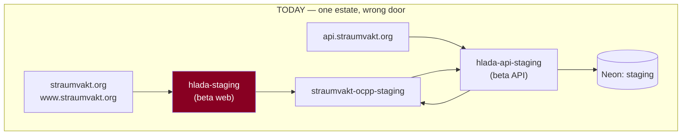
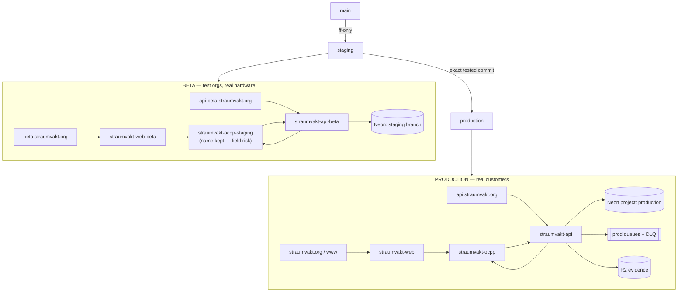

# Target environment topology — development, beta, production

**Design proposal. No resource was created, renamed, bound or configured.**

Built on the [forensics](2026-08-09-hlada-staging-forensics.md). Honours the
accepted decisions: `staging` stays beta, a separate `production` environment
serves real customers, and **organisations are tenants — rows — not branches**.

## Current state, restated

There is **one** deployed estate (beta), and it serves the production brand
domain. This is not a migration between two environments; it is **building the
half that does not exist**.

## Naming

Explicit and boring, per the brief. Production carries **no** suffix; beta is
always suffixed.

| Role | Beta | Production | Note |
|---|---|---|---|
| Web | `straumvakt-web-beta` | `straumvakt-web` | rename of `hlada-staging` — leaf, safest |
| API | `straumvakt-api-beta` | `straumvakt-api` | mobile pins the host — see below |
| OCPP | **`straumvakt-ocpp-staging` (KEEP)** | `straumvakt-ocpp` | **do not rename beta** |

### Why the OCPP names are treated differently

**Recommendation: do not rename the beta OCPP Worker.**

Chargers are configured with an endpoint URL in the field. Changing it means
touching device configuration across the fleet — over vendor APIs, or physically.
Every other rename in this table is a control-plane operation with a rollback;
an OCPP endpoint change is a **field operation** whose failure mode is a charger
that never reconnects. The name `straumvakt-ocpp-staging` is already correct in
spirit; the cosmetic gain from `-beta` is not worth a field migration.

The production OCPP name `straumvakt-ocpp` is **undeployed**, so it can be
created cleanly for production chargers with no field impact.

## Per-environment specification

### Development

| | |
|---|---|
| Git branch | any feature branch |
| Web / API | `wrangler dev` locally; no deployed Worker |
| OCPP | local gateway or beta gateway, operator's choice |
| Database | Neon `test` (`br-withered-hat-abtc5gzi`) — disposable, resettable |
| Domain | none |
| Secrets | `.dev.vars`, never committed |
| Data class | synthetic only |
| Test identities | anything |
| Rollback unit | n/a |

### Beta (the current estate, renamed and re-doored)

| | |
|---|---|
| Git branch | `staging` — fast-forward-only pointer |
| Promotion | `main` → `staging` (fast-forward only) |
| Web Worker | `straumvakt-web-beta` @ **`beta.straumvakt.org`** |
| API Worker | `straumvakt-api-beta` @ **`api-beta.straumvakt.org`** |
| OCPP Worker | `straumvakt-ocpp-staging` (unchanged) @ existing charger endpoint |
| Database | Neon `staging` (`br-tiny-river-abgpqq37`) |
| Hyperdrive | existing `d2d56ab1…` — **verify target first** |
| Queues | `straumvakt-outbound-staging`, `straumvakt-ocpp-events-staging`, `straumvakt-archive-events-staging` + DLQs |
| R2 | `straumvakt-evidence-staging` |
| Secrets | `AUTH_SECRET`, `ADMIN_EMAIL`, `ADMIN_PASSWORD`, `OCPP_INGEST_SECRET`, `OCPP_CRED_KEK` — **beta-specific values, never shared with production** |
| Observability | Workers analytics; queue depth; alerts to the engineering channel |
| Data class | **beta/test data only.** Test organisations, test drivers, real hardware permitted |
| Test identities | `*@beta.straumvakt.test` convention; test orgs flagged in-row |
| Rollback unit | Worker version id |

### Production

| | |
|---|---|
| Git branch | `production` — fast-forward-only pointer |
| Promotion | **the exact commit already running in beta**, never a re-edited branch |
| Web Worker | `straumvakt-web` @ `straumvakt.org` + `www.straumvakt.org` |
| API Worker | `straumvakt-api` @ `api.straumvakt.org` |
| OCPP Worker | `straumvakt-ocpp` @ a production charger endpoint |
| Database | **a separate Neon project** — see below |
| Hyperdrive | a new production Hyperdrive config |
| Queues | production queues + DLQs, separate names |
| R2 | `straumvakt-evidence` with the retention policy of ADR 0018 Decision 3 |
| Secrets | production-only values, distinct from beta |
| Observability | separate dashboards; paging alerts |
| Data class | **real customer data** — GDPR in scope |
| Test identities | **none. Ever.** |
| Rollback unit | Worker version id + Neon backup branch |

## Database: separate project, not a sibling branch

**Recommendation: production gets its own Neon project, not another branch of
the existing one.**

| | Branch of the current project | Separate project |
|---|---|---|
| Blast radius of a wrong `branchId` | **shared — the known live footgun** | isolated |
| Default-branch trap | inherits it | fresh default |
| Billing/quota separation | shared | separate |
| Copy-on-write from beta | possible | not possible |
| Effort | lower | higher |

The deciding evidence is that **a wrong-branch query has already happened** —
the abandoned `production` branch's compute was reached on 2026-08-08T20:38:44Z
by a call omitting a branch id, and its failure mode is silent because the older
schema makes it look like a schema bug. Putting real customer data one omitted
parameter away from that is the wrong trade for a copy-on-write convenience the
no-backfill policy says we will not use anyway.

The existing project's abandoned `production` branch should be renamed or
retired so the word stops meaning two things.

## Organisations are tenants, not infrastructure

**Why per-customer branches or Workers are rejected:**

| Approach | Why rejected |
|---|---|
| Neon branch per customer | Branch count scales with sales. Migrations must run N times and can partially fail. No cross-tenant reporting. Neon branches are a dev tool, not a tenancy boundary |
| Worker per customer | N deploys per release; N secret sets; N rollbacks. A per-tenant bug fix becomes a fleet operation |
| Database per customer | Same as above plus connection-pool multiplication against a Hyperdrive limit that is already the predicted 4k bottleneck |

The tenancy model already exists and is enforced **in query predicates**
(`requirePermission(..., { orgIdParam })` plus `orgId`-scoped repositories),
which is the correct place. Adding infrastructure-level separation would not
strengthen it — it would create a second, weaker boundary to keep in sync.

### Exceptional cases that could justify dedicated infrastructure

Narrow and contractual, not technical:

1. **Data residency** — a contract requiring data in a named jurisdiction.
2. **Regulatory isolation** — an auditor requiring physically separate storage.
3. **A customer-funded dedicated deployment**, priced accordingly.
4. **Acquisition/divestment** — a tenant that must be extractable wholesale.

Each is a commercial decision with a standing operational cost. None is
justified by scale, performance, or "the customer is large".

## Target topology

## Migration order, and the awkward interval

Between now and production existing, **beta serves the brand domain**. That is
already true and is survivable if it is *acknowledged* rather than forgotten.

Recommended order:

1. Stand up `beta.straumvakt.org` on the existing beta web Worker — **additive,
   no cutover**. The brand domain keeps working throughout.
2. Build the production estate on new names, workers.dev only.
3. Prove production, with no traffic.
4. Move `straumvakt.org` / `www` from beta to production — the one
   customer-visible step.
5. Remove the brand domains from the beta Worker **only after** the bake period.

**Step 1 first is deliberate.** It gives beta a permanent, correct address before
anything is taken away from it, so step 4 is a move rather than an eviction — and
if step 4 has to be rolled back, beta is still reachable at its own name.
