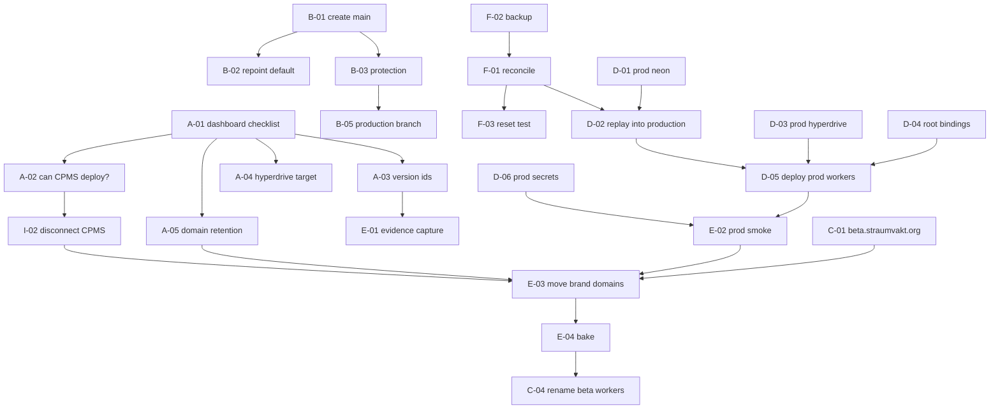

# Beta/production execution backlog

**32 issue-ready work packages.** Every external mutation is marked ⚙️ and every
required human approval 🔒. Nothing here was executed.

Groups: control-plane verification · Git/branch protection · beta topology ·
production topology · Worker/domain cutover · database/migrations ·
secrets/bindings · observability/rollback · CPMS retirement · release governance

---

## A · Control-plane verification (all read-only, all blocking)

### A-01 · Complete the `hlada-staging` dashboard checklist 🔒
**Evidence:** twelve blocked facts in the forensics packet.
**Scope:** account id, active version id, Git-integration owner/branch/build
command, custom domains, workers.dev, secret names, bindings, Hyperdrive target.
**Non-goals:** any change.
**Depends:** dashboard access · **Acceptance:** all twelve recorded verbatim.
**Blocks:** A-02, E-01, F-01, and every cutover stage.

### A-02 · Establish whether CPMS can deploy `hlada-staging` 🔒
**Evidence:** CPMS `wrangler.jsonc:3,32` declares both names; its `CLAUDE.md`
documents auto-deploy. **Acceptance:** documented yes/no per CPMS Worker.
**Stop condition:** if yes → incident, not a release step.

### A-03 · Capture the active Worker version ids ⚙️(read) 
**Evidence:** no rollback target exists today.
**Scope:** `hlada-staging`, `hlada-api-staging`, `straumvakt-ocpp-staging`.
**Acceptance:** three version ids recorded; repeatable procedure documented.

### A-04 · Confirm the Hyperdrive target branch 🔒
**Acceptance:** `d2d56ab1…` proven to point at `br-tiny-river-abgpqq37`.
**Note:** inference from compute activity is **not** acceptable evidence.

### A-05 · Determine custom-domain retention behaviour 🔒
**Evidence:** `origin/staging` has no `routes` block while the domains are live;
Cloudflare does not document the omission case.
**Acceptance:** behaviour established before any deploy. **Blocks:** E-03.

---

## B · Git and branch protection

### B-01 · Create `main` additively ⚙️🔒
**Evidence:** no `main`/`master`; default is a stale placeholder.
**Scope:** new ref at the RC commit. **Non-goals:** renaming or deleting anything
— a rename breaks tracking for ~29 live worktrees at once.
**Acceptance:** `main` exists; no existing ref changed.

### B-02 · Repoint the GitHub default branch ⚙️🔒
**Depends:** B-01. **Acceptance:** default is `main`; a fresh clone checks it out.
**Note:** GitHub refuses to delete a default branch, so the stale placeholder
cannot be retired until this lands.

### B-03 · Ruleset: no force-push, no deletion ⚙️🔒
**Evidence:** 0 of 16 branches protected; rulesets `[]`; repo **public**.
**Scope:** `main`, `staging`, `production`. **Acceptance:** fast-forward still
works; the release runbook is unaffected.

### B-04 · Required status check on `main` only ⚙️🔒
**Depends:** `check` green. **Non-goals:** checks on `staging`/`production` —
they are fast-forward pointers and re-gating them turns bookkeeping into a deploy
blocker.

### B-05 · Create the `production` branch ⚙️🔒
**Depends:** B-01, B-03. **Acceptance:** exists, protected, fast-forward-only.

### B-06 · Advance `staging` to the RC ⚙️🔒
**Evidence:** `origin/staging...RC` = `0 166`, a true fast-forward.
**Depends:** A-01, A-02. **Note:** if a Git integration is connected, this **is**
a deploy.

### B-07 · Publish the trunk→pointer gap
**Evidence:** the 166-commit gap existed because nothing measured it.
**Acceptance:** the number appears somewhere a human reads.

### B-08 · Adopt release tags alongside the branch ⚙️
**Acceptance:** each production advance carries `release-YYYY-MM-DD`; the repo
already has the tagging habit.

---

## C · Beta topology

### C-01 · Add `beta.straumvakt.org` to the beta web Worker ⚙️🔒
**Additive** — brand domain untouched. **Acceptance:** 200 + valid TLS; brand
domain unchanged.

### C-02 · Add `api-beta.straumvakt.org` to the beta API Worker ⚙️🔒
**Acceptance:** `401` on unauthenticated `/api/admin/me`.

### C-03 · Decide the beta cookie/CORS boundary 🔒
**Evidence:** the admin cookie is host-aware and scopes to `.straumvakt.org`, so
a beta subdomain shares the parent with production.
**Options:** same parent (simpler) vs a separate beta domain (isolated).
**Acceptance:** decision recorded with its isolation consequence.

### C-04 · Rename beta Workers to `straumvakt-web-beta` / `straumvakt-api-beta` ⚙️🔒
**Blocked by:** the shipped mobile app pins `hlada-api-staging.straumvakt.workers.dev`.
**Depends:** a mobile release that moves off the pinned host.
**Acceptance:** old hostname retired only after app telemetry shows no traffic.

### C-05 · Flag beta organisations as test tenants
**Acceptance:** a query distinguishes test orgs; beta data is purgeable without
schema changes.

---

## D · Production topology

### D-01 · Create the production Neon project ⚙️🔒
**Evidence:** a wrong-branch query already happened on the shared project.
**Acceptance:** separate project; its default branch is the real one.

### D-02 · Replay migrations from scratch into production ⚙️🔒
**Depends:** F-01 (beta history reconciled). **Acceptance:** 47 applied cleanly
from an empty database.

### D-03 · Create production Hyperdrive ⚙️🔒 · **Acceptance:** points at D-01, proven.
### D-04 · Add `HYPERDRIVE_DB` and missing bindings to the **root** config
**Evidence:** the root config has no Hyperdrive binding — a root deploy today
yields a Worker with no database. **Config only, not deployed.**
### D-05 · Deploy `straumvakt-web` / `straumvakt-api`, workers.dev only ⚙️🔒
### D-06 · Set production secrets by name ⚙️🔒
**Non-goals:** copying any value through a terminal or a document.
**Acceptance:** names match the inventory; no beta value reused.
### D-07 · Create `straumvakt-ocpp` for production chargers ⚙️🔒
**Note:** undeployed today, so creating it costs no field risk.
### D-08 · Create production queues, DLQs, R2 bucket ⚙️🔒

---

## E · Worker and domain cutover

### E-01 · Pre-cutover evidence capture
**Depends:** A-01, A-03. **Acceptance:** version ids, domain list and screenshots
stored outside the repo.

### E-02 · Full production smoke on workers.dev
**Acceptance:** auth gating, a DB-backed read proving the **production**
database, migration status.

### E-03 · Move brand domains to production ⚙️🔒
**Depends:** A-05, E-01, E-02. **The one customer-visible step.**
**Acceptance:** post-cutover smoke S1–S9; beta still reachable at C-01.
**Rollback:** re-attach to the beta Worker, still warm.

### E-04 · Bake period, beta kept warm
**Acceptance:** beta Worker deployed with secrets intact; **nothing deleted**.

### E-05 · Do **not** rename the beta OCPP Worker
**Evidence:** endpoint is device configuration; rename severs every WebSocket
(~83 connects/s at 5k) and `IDENTITY_DO` state does not migrate.
**Acceptance:** decision recorded; production gets a fresh OCPP Worker instead.

---

## F · Database and migrations

### F-01 · Reconcile the two migrations on beta ⚙️🔒
**Method:** `migrate deploy`, **not** `resolve --applied` — resolve would record
a falsehood and strand three enum types.
**Depends:** backup (F-02) + verification queries returning 0 dependent columns.
**Acceptance:** 47 recorded; `migrate status` clean.

### F-02 · Backup branch before F-01 ⚙️🔒
**Note:** a restore discards charger writes since the branch point; 21 chargers
write continuously.

### F-03 · Reset `test` from `staging` ⚙️🔒
**Ordering:** **after** F-01, or test re-inherits the orphaned enum types.

### F-04 · Neon branch protection and default repoint ⚙️🔒
**Evidence:** neither `staging` nor `production` is protected; the default is the
abandoned branch and was reached on 2026-08-08T20:38:44Z.

### F-05 · Document explicit-branch-id discipline
**Acceptance:** written for humans **and** agents; a missing-relation error is
documented as a wrong-branch signal first.

---

## G · Secrets and bindings

### G-01 · Produce a name-only secret inventory per Worker per environment
**Non-goals:** any value. **Acceptance:** table of names, owner, environment.
### G-02 · Verify no secret value is shared between beta and production 🔒
### G-03 · Remove stale `DATABASE_URL`/`DIRECT_URL` from the web Worker ⚙️🔒
**Evidence:** the web app's `src/` has no database client.
**Depends:** A-01 confirming which secrets are actually set.

---

## H · Observability and rollback

### H-01 · Environment-scoped dashboards
**Acceptance:** every alert names its estate.
### H-02 · Queue depth, consumer lag and DLQ alerts
### H-03 · Record a version id on every deploy, both estates
**Acceptance:** a rollback target always exists — it does not today.
### H-04 · Rehearse rollback on paper, per resource

---

## I · CPMS retirement

### I-01 · Inventory CPMS Workers and integrations 🔒 (read-only)
### I-02 · Disconnect any CPMS integration deploying `hlada*` ⚙️🔒
**Depends:** A-02. **Acceptance:** no second repository can deploy these Workers.
### I-03 · Decide CPMS's fate 🔒 — retire, or repoint to unused names.
### I-04 · Do not delete a Worker while CPMS still claims the name
**Evidence:** deletion achieves nothing durable if a CPMS push recreates it, and
destroys the rollback target.

---

## J · Release governance

### J-01 · Remove `check:work-view` from `check-all.mjs`
**Scope:** one line at `:40` plus its now-misleading comment block.
**Non-goals:** deleting the generator, touching `WORKSPACE.md`/`TASKS.md`.
**Acceptance:** `npm run check` passes; `npm run work-view` still runs locally.
### J-02 · Name a release owner for production advances
### J-03 · Adopt the beta and production gate checklists
### J-04 · Record that rollback is ungated
**Acceptance:** stated in the runbook — a control that delays recovery is a
liability.

---

## Dependency graph

## Sequencing

1. **A-01 → A-02** — everything is gated on knowing who can deploy.
2. **I-02** if CPMS is connected. Nothing else proceeds first.
3. **B-01…B-03**, **F-02 → F-01 → F-03**, **C-01/C-02** — all independent, all
   cheap, none customer-visible.
4. **D-01…D-08**, then **E-02**. Production proven with no traffic.
5. **E-03** — the single customer-visible step.
6. **E-04 bake**, then **C-04**, then **I-03/I-04**.

**A-01 is one dashboard session and unblocks nine packages.** It is the highest
leverage item in this backlog by a wide margin.
