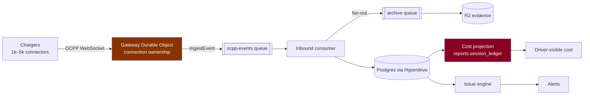

# Connector capacity model — 1k / 4k / 5k

> **No production-scale load test exists. Nothing here is measured capacity.**
> Every figure is `[A]` assumption, `[S]` source-derived, or `[T]` target.
> There is no `[M]` in this document, and there should not be one until a real
> run is cited.

**Reproduce:**

```
node scripts/analysis/capacity-model.mjs --csv
```

Pure function of its constants — no clock, no randomness, no network. Same input
produces byte-identical output. Outputs:
[`capacity-scenarios.csv`](../../scripts/analysis/output/capacity-scenarios.csv) ·
[`capacity-assumptions.csv`](../../scripts/analysis/output/capacity-assumptions.csv) ·
[`capacity-sensitivity.csv`](../../scripts/analysis/output/capacity-sensitivity.csv)

## Ingest pipeline being modelled



Two stages are highlighted because they are the ones whose failure is
**visible to a driver**: connection ownership (session cannot start) and cost
projection (session shows the wrong money, or none).

Topology is `[S]` — `apps/api/wrangler.jsonc` declares `OUTBOUND_QUEUE`,
`ARCHIVE_QUEUE`, `EVIDENCE_BUCKET` and the `OCPP_GATEWAY` service binding.

## Assumptions

Full table with low/base/high in
[`capacity-assumptions.csv`](../../scripts/analysis/output/capacity-assumptions.csv).
The load-bearing ones:

| Assumption | Low | Base | High | Tag |
|---|---|---|---|---|
| Heartbeat interval (s) | 900 | **300** | 60 | `[A]` |
| StatusNotification / connector / hour | 2 | **6** | 20 | `[A]` |
| Concurrent charging | 5% | **10%** | 25% | `[A]` |
| MeterValues / active charge / min | 1 | **1** | 4 | `[A]` |
| Queue fan-out | 2 | **2** | 2 | `[S]` two queues |
| Worker CPU budget | — | **50 ms** | — | `[S]` `wrangler.jsonc:14-16` |
| DB clients per request | — | **1** | — | `[S]` `drizzle.ts` `Pool max: 1` |

"High" is always the **worse** case: a *shorter* heartbeat interval means more
load, so 60 s is the high column.

## Scenario outputs

| id | Scenario | ingest/s | queue msgs/s | DB writes/s | charging | storage GB/day |
|---|---|---|---|---|---|---|
| S1 | 1k normal weekday | 6.6 | 13.1 | 9.9 | 100 | 0.51 |
| S2 | 4k normal weekday | 26.3 | 52.5 | 39.4 | 400 | 2.04 |
| S3 | 5k reconnect storm | 33.3 | 66.7 | 50.0 | 500 | 2.59 |
| S4 | 5k free-period surge | 45.3 | 90.7 | 68.0 | 1,250 | 3.53 |
| S5 | 5k, consumer at 50% | 32.8 | 65.7 | 49.3 | 500 | 2.55 |

**S3 peak: 83.3 connection establishments per second.**
**S5 backlog after one hour: ~118,200 messages.**

## The headline the numbers actually support

**Steady-state throughput is not the problem.** 26–45 events/s at 4–5k
connectors is unremarkable for a Workers + queue pipeline. If the model's
assumptions are anywhere near right, sustained load is comfortable.

**Three edges are the problem**, and none is a throughput number:

1. **Connection establishment**, not connection count. 83 connects/s in a
   60-second reconnect window, each requiring a Durable Object wake and OCPP
   handshake. This is a burst-concurrency problem.
2. **Consumer degradation compounds silently.** At half throughput the backlog
   grows ~33 msg/s — 118k messages in an hour. Nothing in the model self-heals;
   the queue absorbs it until it does not.
3. **Cost projection lag is a product failure, not an infra one.** It is what a
   driver sees. `[A]` 20 s per 1,000 completed sessions puts a 5k-connector day's
   settlement in minutes, not hours — but that assumption is untested and is the
   one most likely to be optimistic.

## Sensitivity (4k connectors)

| Assumption | base ingest/s | high ingest/s | swing |
|---|---|---|---|
| **Heartbeat interval** | 26.3 | 78.0 | **2.97×** |
| MeterValues per charge/min | 26.3 | 46.3 | 1.76× |
| StatusNotification rate | 26.3 | 41.8 | 1.59× |
| Concurrent charging % | 26.3 | 36.3 | 1.38× |
| Active WebSocket % | 26.3 | 26.5 | 1.01× |

**Heartbeat interval dominates**, and it is the one variable the operator
controls directly via OCPP configuration. Cutting it from 300 s to 60 s triples
ingest for zero product benefit. That makes it both the biggest risk and the
cheapest lever — a capacity decision disguised as a device setting.

The active-WebSocket percentage barely matters (1.01×), which is
counter-intuitive and worth stating: **connection count is not the load;
connection churn is.**

## Bottlenecks by scale

| Scale | First expected limit | Why |
|---|---|---|
| **1k** | none expected | every figure is small |
| **4k** | Postgres connection concurrency | Workers mint a client per request; `Pool max: 1` `[S]`. Concurrency is bounded by Hyperdrive pooling, which the model does not simulate |
| **5k** | DO wake concurrency during reconnect | 83 connects/s `[A]`; DO cold-start behaviour under burst is unknown |
| **5k degraded** | queue backlog → projection lag → **driver-visible wrong cost** | S5 |

## Mitigations, ordered by evidence and cost

| # | Mitigation | Evidence | Cost |
|---|---|---|---|
| 1 | **Set and hold a heartbeat-interval policy** | dominates sensitivity, 2.97× | trivial — config |
| 2 | Publish queue-depth and consumer-lag metrics with alerts | S5 grows silently | small |
| 3 | Measure DO wake concurrency under a synthetic reconnect burst | S3 is the least-understood edge | medium |
| 4 | Bound projection lag with an SLO and alert | driver-visible | small |
| 5 | Reconnect jitter/backoff at the charger or gateway | flattens the 83/s spike | medium — may need vendor cooperation |
| 6 | Re-check `cpu_ms: 50` against any fan-out handler | `[S]` hard limit | small |

Mitigation 1 is first on both axes — largest effect, lowest cost. Mitigation 5
is the structurally correct fix for S3 but depends on charger behaviour we do not
control.

## Proposed SLOs and capacity gates `[T]`

| SLI | Target | Gate |
|---|---|---|
| Ingest freshness (event → durable) | p95 < 5 s | 4k pilot |
| Queue consumer lag | p95 < 30 s; alert > 5 min | 4k pilot |
| Dead letters | 0 sustained; any growth pages | launch |
| Cost projection freshness | p95 < 10 min after session end | launch |
| Reconnect recovery | 95% reconnected < 5 min after outage | 4k pilot |
| Command acceptance → charger action | p95 < 10 s | launch |

**Capacity gate wording matters:** "4k pilot readiness" is not "4k proven
capacity". The model supports the former. Only the load-test plan can support
the latter.

## Validating this model later

See [the load and resilience test spec](2026-08-09-load-and-resilience-test-spec.md).
The first three experiments (fan-out, reconnect storm, meter hot path) are
sufficient to confirm or refute the three headline edges above; the rest refine.
