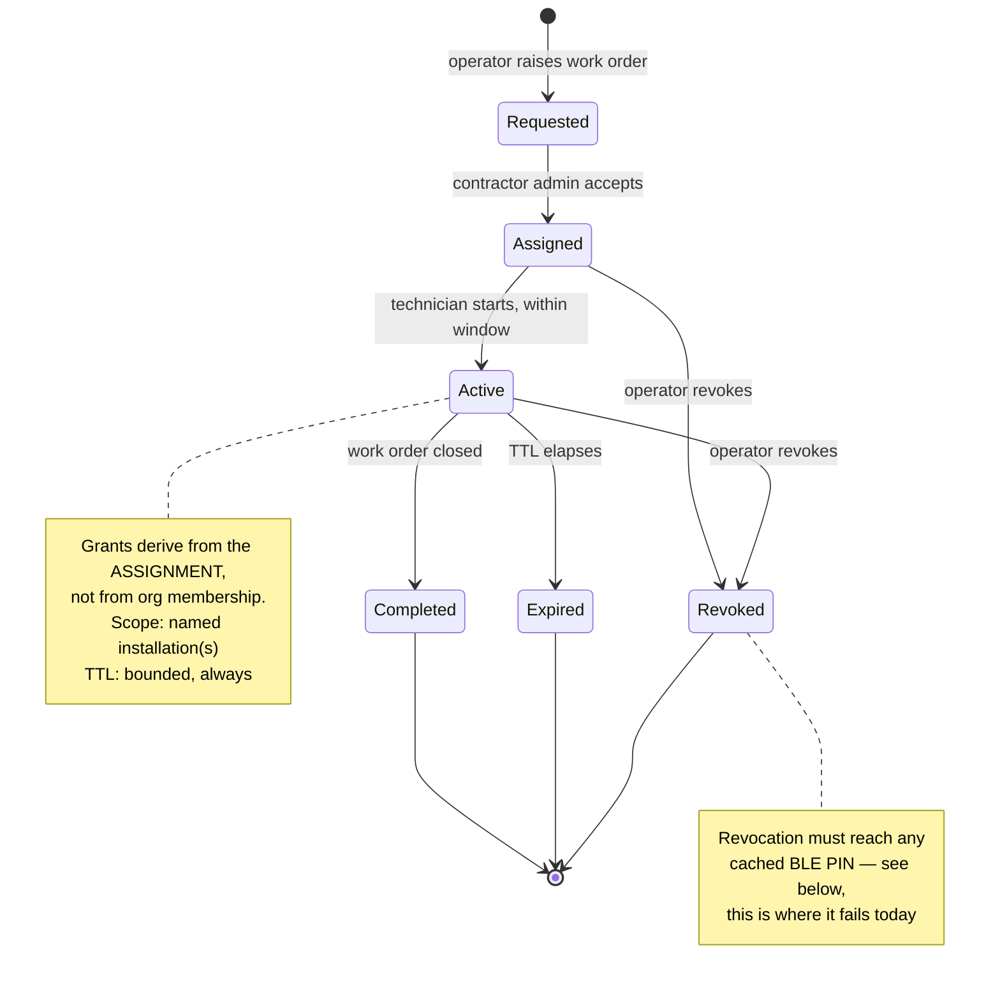

# Complete role model, and where contractors fit

**Proposal. No role, permission, or route was changed.**

## What exists today — evidence first

`apps/api/src/lib/auth/permissions.ts` defines bundles and a role map. Verified
at RC `4b69d0f`:

| Bundle | Contents |
|---|---|
| `VIEWER_BUNDLE` | `org.read`, `site.read`, `charger.read`, `property.read` |
| `TECHNICIAN_BUNDLE` | viewer + `charger.config`, `charger.remote_start`, `charger.remote_stop` |
| `MANAGER_BUNDLE` | technician + `site.write`, `charger.write`, `tariff.read`, `contract.read`, `member.read` |
| `ADMIN_BUNDLE` | manager + `member.invite`, `member.write`, `member.remove`, `billing.read` |
| `HOST_ADMIN_BUNDLE` | viewer + `member.read`, `member.invite`, `member.write`, `billing.read` |

Role map: `owner`, `admin`, `manager`, `technician`, `viewer`, `host_admin`, and
**deprecated pre-ADR-0014 mappings**: `operator → MANAGER`, `helper → TECHNICIAN`,
**`contractor → TECHNICIAN_BUNDLE`**, `driver → []`.

**Two facts that matter:**

1. **`contractor` grants `charger.config`, `charger.remote_start` and
   `charger.remote_stop` today**, via a compatibility shim whose own comment says
   contractors *historically* had that access. It is not a designed model.
2. **No contractor surface exists.** The permissions are granted; nothing
   consumes them. Do not claim contractor access is a feature — it is a latent
   grant.

Drivers are deliberately **not** members: `driver → []`. Driver access flows
through `DriverGroupMembership`, not `Membership`. That separation is sound and
should be preserved.

## The structural problem

Every tenancy predicate in the system assumes **membership implies the
organisation owns the object** — e.g. `requirePermission(..., { orgIdParam })`
plus repository predicates scoped by `orgId`.

**A contractor is the first legitimate case where that is false.** A contractor
works on chargers owned by someone else. Any contractor model therefore either:

- makes the contractor a member of the owning org (over-broad — they see
  everything that org has), or
- introduces **assignment**, a grant that is narrower than membership and crosses
  the tenant boundary deliberately.

The second is correct, and it means every existing predicate must be re-read
before it ships. This is the single most important sentence in this document.

## Proposed roles

| Role | Scope | Invitation | Charger visibility | BLE/service creds | Billing | Audit |
|---|---|---|---|---|---|---|
| **Platform admin** | cross-tenant | platform grant | all | policy-gated | all | every action |
| **Operator/CPO admin** | own org | by platform | own org | yes | own org | write actions |
| **Operator staff** | own org | by CPO admin | own org | role-gated | read | write actions |
| **Host/property admin** | own org | by operator | own org's installs | **no** | own org | write actions |
| **Contractor company admin** | own company | by operator | **assigned only** | per assignment | **none** | every action |
| **Field technician** | assignments | by contractor admin | **assigned only** | per assignment, TTL | **none** | every action |
| **Auditor / support** | read-only, scoped | by platform | scoped | **no** | read | every read |
| **Driver** | own sessions + granted chargers | invite | granted only | **no** | own only | login, session |

Two deliberate "no"s: **hosts do not get service credentials** (they own the
property, not the equipment configuration), and **auditors get no write path at
all** — an auditor who can change something is not an auditor.

## Contractor assignment lifecycle

**Revocation is where this design meets an unsolvable dependency.** The Zaptec
PIN is factory-set and cannot be rotated, so a contractor who has cached one
retains BLE access after revocation. The assignment model can revoke *server*
access; it cannot revoke *radio* access. That must be stated in any contractor
agreement rather than engineered around, or the chargers must be re-PINned —
which the vendor does not support.

## Least-privilege matrix (abridged)

| Capability | Platform | CPO admin | Host | Contractor admin | Technician | Auditor | Driver |
|---|---|---|---|---|---|---|---|
| `org.read` | ✅ | own | own | own company | — | scoped | — |
| `charger.read` | ✅ | own | own | assigned | assigned | scoped | granted |
| `charger.config` | ✅ | ✅ | ❌ | assigned | assigned+TTL | ❌ | ❌ |
| `charger.remote_start/stop` | ✅ | ✅ | ❌ | assigned | assigned | ❌ | own session |
| BLE PIN release | policy | policy | ❌ | assigned+TTL+audit | assigned+TTL+audit | ❌ | **❌ (today: ✅)** |
| `billing.read` | ✅ | ✅ | own | ❌ | ❌ | scoped | own |
| `member.invite` | ✅ | ✅ | ✅ | own company | ❌ | ❌ | ❌ |

The one row that differs from today is BLE PIN release, currently reachable with
a **driver** token (SEC-6/7, PROPOSED-I).

## Separate contractor app, or role-aware surfaces?

**Recommendation: role-aware surfaces first.**

| | Separate app | Role-aware surfaces |
|---|---|---|
| Auth surface | duplicated | single |
| Release cadence | independent | coupled |
| Risk of divergent tenancy logic | **high** | low |
| Time to first contractor | slower | faster |

The decisive argument is not cost. It is that **a second app duplicates the
authorization surface before the role model is settled**, and the current model
has a deprecated role silently granting remote start/stop. Duplicating that into
a second codebase multiplies the thing that most needs fixing.

The mobile app already contains the hard part — roughly 3,800 lines of
bench-tested BLE charger configuration (`apps/mobile/lib/zaptec_ble_settings/`).
It is currently removed from driver navigation (Codex `ae5db26`) but preserved in
source. **That is exactly the right state**: the capability survives, gated by a
role that does not exist yet. Revisit a separate app once assignments are real
and a technician's daily flow is understood.

## Preconditions before any contractor ships

- [ ] PROPOSED-K accepted, or an explicit alternative chosen
- [ ] The deprecated `contractor → TECHNICIAN_BUNDLE` mapping removed or replaced
- [ ] Assignment model implemented with TTL and revocation
- [ ] **Every tenancy predicate re-read against cross-tenant assignment**
- [ ] Server-side enforcement of BLE PIN release by role (SEC-6)
- [ ] Contractor agreement covers non-revocable BLE credentials
- [ ] Audit review: every contractor action attributable to a person, not a company
