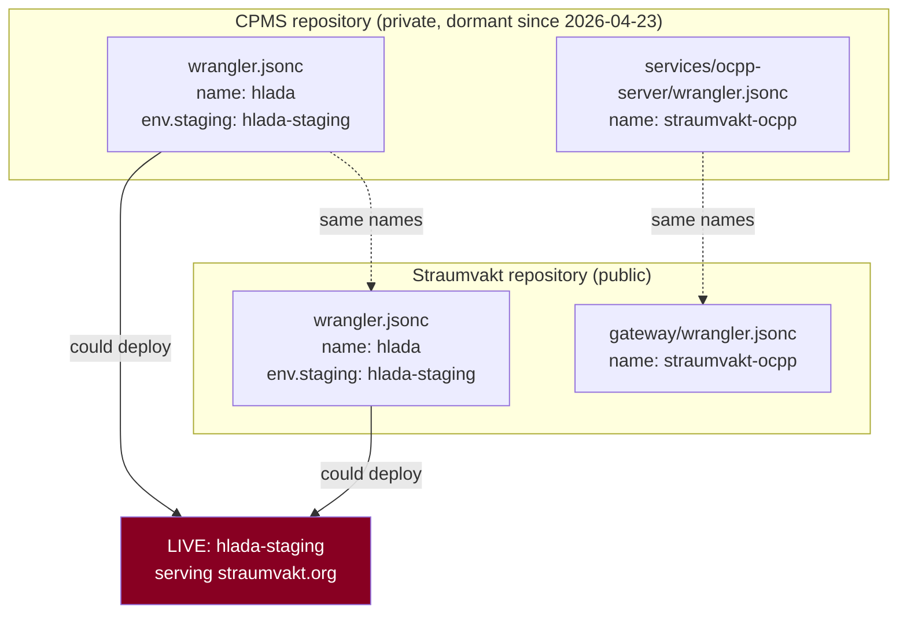

# CPMS and legacy separation

**Read-only investigation and a reversible retirement design. Nothing was
disconnected, deleted, renamed or archived.**

## Provenance — the collision is inheritance, not coincidence

| Date | Event | Evidence |
|---|---|---|
| 2026-04-19 | **CPMS renames its Worker from `straumvakt` to `hlada`** | CPMS `1ca62d0` *"Rename project from 'straumvakt' to 'hlada'"*, one line in `wrangler.jsonc` (RF) |
| 2026-04-24 | **The Straumvakt V3 rebuild introduces `hlada`** in its own `wrangler.jsonc` | Straumvakt `aa53e95` *"[Sprint 0] V3 foundation schema…"* (RF) |
| 2026-08-09 | Both repositories still declare `hlada` and `hlada-staging` | RF, both trees |

**CPMS holds the older claim.** The V3 rebuild inherited the name five days after
CPMS adopted it — almost certainly by copying the Wrangler config forward, which
is also why the two files share comment wording (*"deployed by Cloudflare's git
integration from the `staging` branch"*) verbatim.

This reframes the migration. **Straumvakt moving off `hlada` is not conceding a
name; it is undoing an accidental inheritance.** That is a materially easier
conversation than "which project deserves the name", and it removes the only
argument for CPMS moving instead.

## What is knowable, and what is not

| Fact | Class |
|---|---|
| CPMS declares `hlada` (root) and `hlada-staging` (staging env) | **RF** — `wrangler.jsonc:3,32` |
| CPMS documents auto-deploy on push to `staging` / `master` | **RF** — `CLAUDE.md` |
| CPMS last commit 2026-04-23; `origin/staging` at `a5c5ba8` | **RF** |
| CPMS also owns the OCPP Worker source (`straumvakt-ocpp`) | **RF** — `services/ocpp-server/wrangler.jsonc:3` |
| **CPMS is a private repository** | **DF** — `api.github.com/repos/andri187/CPMS` → **404** |
| Whether CPMS retains a live Cloudflare Git integration | **UNK** — private repo, so webhooks and deployments are **not** publicly visible |

> The privacy finding matters procedurally: for the public Straumvakt repo I
> could check webhooks and deployments from outside. **For CPMS I cannot.** Its
> integration state is dashboard-only, with no independent cross-check.

## Shared resources, which is the deeper entanglement

The name collision is the visible problem. The structural one is that **CPMS is
the source repository for the OCPP gateway Straumvakt binds to**:

**Four Worker names are claimed by two repositories.** Renaming Straumvakt's web
and API Workers resolves two of them; the OCPP pair stays entangled until CPMS is
settled, because Straumvakt must not rename its gateway (field risk).

## Keep / park / retire decision matrix

**Nothing is recommended for deletion merely to reduce clutter.**

| Asset | Recommendation | Reasoning | Reversible? |
|---|---|---|---|
| **CPMS repository** | **KEEP (archive)** | It is the provenance record for the name, the OCPP design, and five months of decisions. Archiving makes it read-only without destroying it | ✅ un-archive |
| **CPMS Git integration → `hlada-staging`** | **RETIRE (disconnect)** | The only asset that can *act* on production. Disconnecting removes the hazard and destroys nothing | ✅ reconnect |
| **CPMS Git integration → `hlada` (prod)** | **RETIRE** | Same, though `hlada` is undeployed so the risk is latent | ✅ |
| **Worker `hlada` identity** | **PARK** | Undeployed (DF: 1042). Leave the name unclaimed rather than creating it to "hold" it | n/a |
| **Worker `hlada-staging` identity** | **KEEP until bake completes** | It is the rollback target for the entire cutover, and deleting it achieves nothing durable while CPMS still declares the name | ⚠️ deletion irreversible |
| **CPMS secrets** | **KEEP, then rotate** | Names should be inventoried; if any value is shared with Straumvakt, that is a finding. Do not read values | ✅ |
| **CPMS domains** | **INVESTIGATE first** | UNK whether CPMS holds any custom domain. If it does, it is a second route into the account | — |
| **CPMS database credentials** | **INVESTIGATE, then separate** | CPMS's `CLAUDE.md` describes the Neon primary branch as its production database — i.e. the branch Straumvakt calls abandoned. **They are the same branch.** | — |
| **CPMS deployed artifacts / versions** | **KEEP** | Rollback value while `hlada-staging` is live | ✅ |
| **Legal / operational retention** | **KEEP** | Unresolved whether CPMS-era data carries obligations. Do not destroy pending that answer | — |

### The Neon overlap deserves its own line

Straumvakt's packets describe the Neon `production` branch as *abandoned*. CPMS's
`CLAUDE.md` describes the **primary** branch as *its production database*. Those
are the same branch (`br-fragrant-bonus-abrc01g6`), which is why its schema is
older and why an unqualified query fails with a missing-relation error rather
than returning empty results.

**It is not junk. It is CPMS-era data whose retention status is unresolved.**
Retiring or repointing it (proposed elsewhere) must therefore be a *decision*,
not a cleanup — and it is a strong argument for the accepted decision that
production gets a separate Neon project.

## Reversible retirement sequence

**Evidence is preserved before anything is disconnected.** Every step is
reversible except where marked.

| # | Step | Type | Reversible |
|---|---|---|---|
| 1 | Inventory every CPMS Worker, its bindings, secret **names**, domains and deployed versions | read-only | n/a |
| 2 | Record which CPMS Workers have a Git integration, and to which branch | read-only | n/a |
| 3 | Export CPMS's `wrangler.jsonc` files and `CLAUDE.md` into the evidence bundle | read-only | n/a |
| 4 | Record the Neon primary branch's role in CPMS's own words | read-only | n/a |
| 5 | **Decision point:** confirm CPMS is not to be redeployed | 🔒 decision | — |
| 6 | **Disconnect** the CPMS integration to `hlada-staging` | ⚙️🔒 | ✅ reconnect |
| 7 | Disconnect any other CPMS integration to shared names | ⚙️🔒 | ✅ |
| 8 | Verify from outside that `hlada-staging` still serves the expected body | read-only | n/a |
| 9 | **Archive** the CPMS repository (read-only, not deleted) | ⚙️🔒 | ✅ un-archive |
| 10 | Only after Straumvakt's cutover and bake: consider the shared Worker names | 🔒 decision | — |

**Step 6 before step 9.** Archiving a repository does not necessarily disable an
existing Cloudflare integration — the integration lives on the Cloudflare side.
Archiving first would create a false sense of safety while the deploy path
remains live.

**Step 8 exists because disconnecting an integration is exactly the kind of
action that can have an unintended side effect on the Worker it was attached
to.** Verify from outside; do not assume.

## Stop conditions

1. **CPMS's integration is found to be the *only* deploy path to `hlada-staging`.**
   Then disconnecting it removes the ability to deploy the Worker serving
   `straumvakt.org` — a Straumvakt integration or a manual deploy path must exist
   first.
2. **CPMS holds a custom domain on a Straumvakt hostname.** Different problem,
   stop and re-plan.
3. **CPMS and Straumvakt share a secret value.** A rotation problem that touches
   both, and it must be sequenced rather than improvised.
4. **The Neon primary branch turns out to hold data with a retention obligation.**
   Then no repoint or retirement happens without a legal answer.

## What this is not

This is **not** a recommendation to delete CPMS. It is the source of the name, the
origin of the OCPP design, and the only record of a five-month project.
The recommendation is narrow: **remove its ability to deploy shared Worker
names, preserve everything else, and archive rather than delete.**
