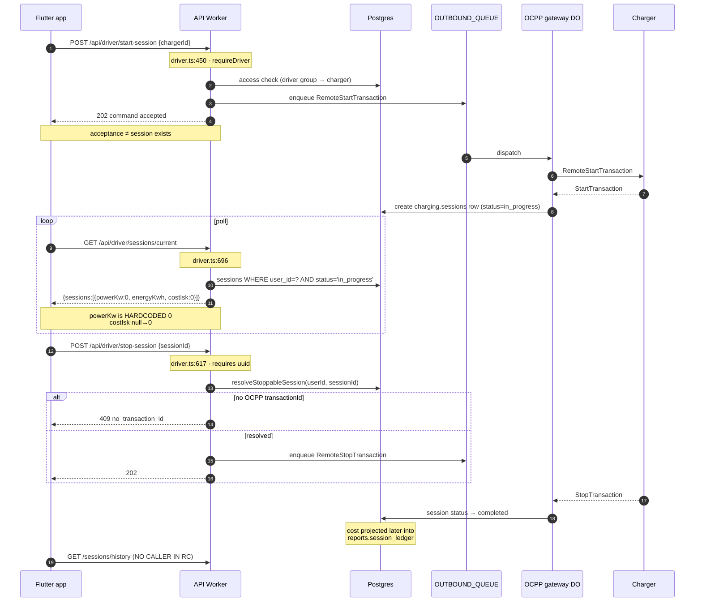
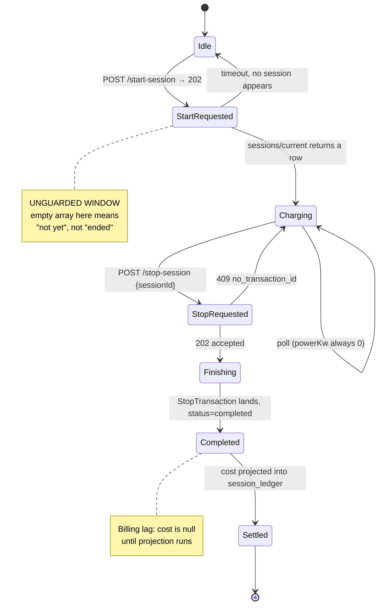

# Driver session lifecycle — deep audit

Companion to [the main packet](2026-08-09-overnight-readiness-audit.md).
All citations are against the release candidate `4265364`.

## 1. Sequence — UI tap to settlement



**The gap that matters:** between "command accepted" and "session row exists"
there is a window in which `/sessions/current` legitimately returns `{sessions:[]}`.
An app that treats empty-array as *ended* will flap. See §4.

## 2. State machine



## 3. The twelve trace points

| # | Question | Answer | Evidence |
|---|---|---|---|
| 1 | Charger selection → start | `POST /start-session`, access-checked | `driver.ts:450` |
| 2 | Command acceptance vs session creation | **Distinct.** Enqueue returns before any session row exists | `driver.ts:450+`, queue dispatch |
| 3 | Current-session envelope | `{ sessions: [...] }`, ordered `startedAt desc` | `driver-sessions.ts` `orderBy` |
| 4 | Zero / one / many active | Array natively supports all three | `getDriverActiveSessions` |
| 5 | Cold-start recovery | Refresh token 30d; `/sessions/current` rebuilds state | `driver.ts:14-16` |
| 6 | Power / energy / cost provenance | **power fabricated; energy real; cost null-until-stop** | §5 |
| 7 | Connector state mapping | `status: "Charging"` is a **literal**, not a mapping | `driver-sessions.ts` |
| 8 | Stop ownership | `WHERE id=? AND userId=? AND status='in_progress'` — ownership enforced in the predicate | `resolveStoppableSession` |
| 9 | Session disappearance / races | Not guarded client-side; see §4 | — |
| 10 | Final detail projection | `getSessionFullDetail`, driver-scoped, 404 on foreign | `driver.ts:759` |
| 11 | History vs billing sources | **Two different tables** — see §6 | `driver.ts:713` vs `:740` |
| 12 | Stop reason / idle / plug-time | Not present in the driver DTOs | — |

## 4. Race: "no session before first poll"

`/sessions/current` returns `{sessions: []}` in **two semantically opposite**
situations:

1. the start command has not yet produced a session row (**transient**), and
2. the session has ended (**terminal**).

The API cannot distinguish them and does not try — correctly, since it has no
command-state in that read model. **The burden is on the client**, and the RC
app has no `StartRequested` grace state (the state machine above is the *needed*
one, not the implemented one).

**Recommended acceptance criterion**, not a code change: after a 202 from
`/start-session`, the app must hold a "starting…" state for a bounded interval
(≥ 60s) before treating an empty array as *ended*. This belongs in Codex's
`active_session.dart` rewrite. Tracked as acceptance case **AC-08**.

## 5. Placeholder semantics — the core finding

From `apps/api/src/repositories/driver-sessions.ts`:

```js
function whToKwh(wh)      { if (wh == null) return 0;    … }
function minorToIsk(minor){ if (minor == null) return 0; return Number(minor); }

return rows.map((r) => ({
  …
  status:    "Charging",   // literal
  powerKw:   0,            // hardcoded — never measured
  energyKwh: whToKwh(r.energyWh),
  costIsk:   minorToIsk(r.costIncVatMinor),
}));
```

| Field | Is `0` measured? | Can it distinguish unknown? |
|---|---|---|
| `powerKw` | **No — always `0`** | No. There is no measured value at all |
| `energyKwh` | Sometimes | **No** — `null` collapses to `0` |
| `costIsk` | Sometimes | **No** — free and unpriced are identical |
| `status` | n/a | Always the literal `"Charging"` |

### The comment contradicts the implementation

`driver-sessions.ts` states: *"the app polls `/sessions/current` and reads live
power from the charger-status surface."*

**There is no such call in the app.** `apps/mobile/lib/api/client.dart` contains
twelve endpoints; none is a charger-status or power surface. The comment
describes an intended design that was never wired. Anyone reading the repository
would reasonably conclude live power works.

### Why this is a launch blocker

`active_session.dart:189-209` renders each value only when non-null:

```dart
value: s?.powerKw != null ? '${s!.powerKw!.toStringAsFixed(1)} kW' : …
value: s?.costIsk  != null ? '${s!.costIsk!.toStringAsFixed(0)} kr' : …
```

The null-guard is already there and is **correct** — it is defeated by the API
sending `0` instead of `null`. The app is written for the truthful contract;
the read model does not honour it.

**Minimal fix, no new data source:** emit `null` for `powerKw` always, and for
`energyKwh`/`costIsk` when the underlying column is null. The app's existing
guards then render the unavailable state with no Dart change at all.

## 6. History vs invoices — two sources, two meanings

| Endpoint | Reads | Meaning |
|---|---|---|
| `GET /sessions/history` `driver.ts:713` | `reports.session_ledger` | **projected/billed subset** — exists only post-stop and post-projection |
| `GET /invoices` `driver.ts:740` | `charging.sessions` (Drizzle) | **all actual sessions** — the superset |

Consequences:

- A just-finished session appears in `/invoices` **before** `/sessions/history`.
  Two screens will disagree, and the "invoices" one will look *more* complete.
- **`/invoices` returns no invoice documents.** Its own comment calls the payload
  "the driver's ACTUAL charge sessions … the full set for invoicing".
- `driver.ts:740-757` is also the only handler in the file on Drizzle while the
  rest is Prisma — flagged in its own comment, not a defect, but a maintenance
  edge.

**Answer to the assignment's question — can the app truthfully call this list
"invoices"?** **No.** It is a list of chargeable sessions. Truthful labels:
*"Charging history"* or *"Billable sessions"*. Calling it "Invoices" implies a
document that can be produced, and none exists.

## 7. Money units

`costIncVatMinor` is `BigInt` minor units. `minorToIsk()` notes *"ISK has no
minor unit, so minor === major"*, so the conversion is an identity **for ISK
only**.

`Organization.defaultCurrency` exists and defaults to `"ISK"`, so a second
currency is representable in the schema. The driver DTO carries a bare number
named `costIsk` with **no currency field** — the unit is encoded in the field
name. The first non-ISK organisation makes every driver-facing amount wrong by
a factor of 100 with no type error anywhere.

Not a launch blocker while Iceland-only. **It is a landmine with a known trigger**
— tracked P1.

## 8. Multiple concurrent sessions

Mechanically supported end to end: the read model returns an array; stop takes an
explicit `sessionId`; ownership is enforced in the query predicate. **Stopping is
deterministic** — there is no "stop my session" ambiguity.

What is undefined is the **product policy**: should a driver have two at once?
The archived web portal, the RC app and Codex's rewrite may each answer
differently. Tracked in the [decision register](2026-08-09-release-decision-register.md).
