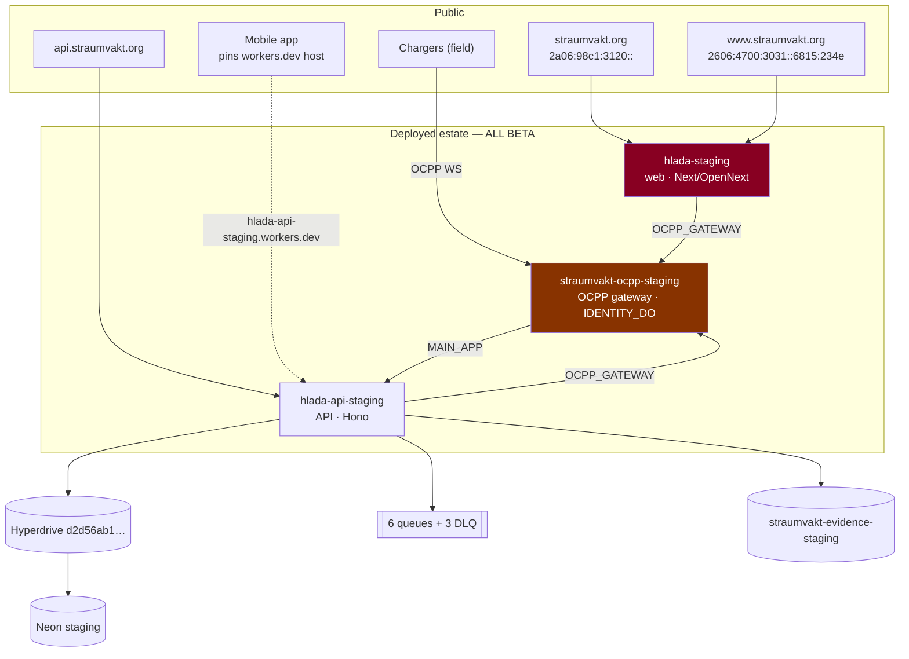
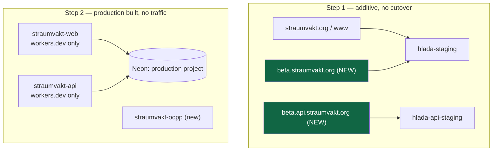
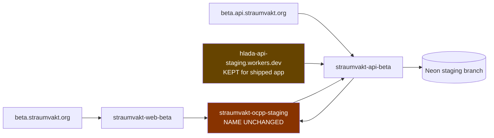
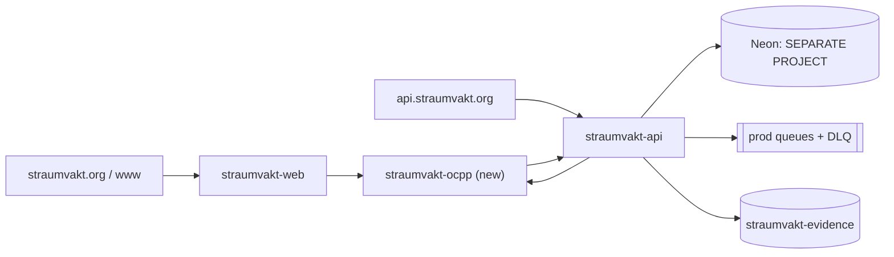
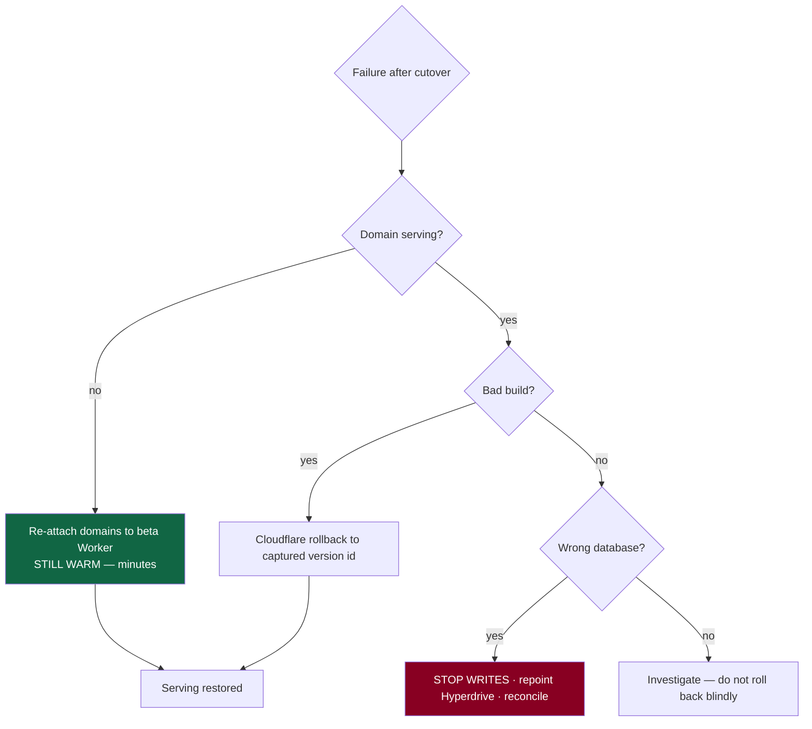

# Complete estate inventory — current, beta target, production target

**Inventory and proposal. No resource was created, renamed, bound or deleted.**
Evidence classes per the [ledger](2026-08-09-release-evidence-ledger.md).

## 1. Topology — current

**The whole deployed estate is beta, and it answers the production brand domain.**
`hlada`, `hlada-api`, `straumvakt-ocpp`, `straumvakt-web`, `straumvakt-api` all
return `error code: 1042` — none exists.

## 2. Inventory

Legend — **Breaks if renamed:** what fails the instant the name changes.

### 2.1 Workers

| Item | Current | Evidence | Desired beta | Desired prod | Breaks if renamed | Owner |
|---|---|---|---|---|---|---|
| Web | `hlada-staging` **live** | DF 200 `text/html` | `straumvakt-web-beta` | `straumvakt-web` | **nothing** — no inbound service binding | web |
| API | `hlada-api-staging` **live** | DF 404 `application/json` | `straumvakt-api-beta` | `straumvakt-api` | gateway `MAIN_APP`; **shipped mobile pins its workers.dev host** | api |
| OCPP | `straumvakt-ocpp-staging` **live** | DF 404 `text/plain` `not found` | **unchanged** | `straumvakt-ocpp` (new) | **every charger in the field**; `IDENTITY_DO` state | ops |
| Web prod | `hlada` **absent** | DF 1042 | — | replaced by `straumvakt-web` | — | — |
| API prod | `hlada-api` **absent** | DF 1042 | — | replaced by `straumvakt-api` | — | — |
| OCPP prod | `straumvakt-ocpp` **absent** | DF 1042 | — | create fresh | — | — |

**Name availability (DF):** `straumvakt-web` and `straumvakt-api` both return
1042 — **the proposed production names are free.**

### 2.2 Durable Objects

| Item | Evidence | Note |
|---|---|---|
| `IDENTITY_DO` → `IdentityDurableObject` | RF `gateway/wrangler.jsonc:9-17,54-58` | declared in **both** root and staging env |
| Namespace ids | **UNK** | control plane |

**State does not migrate between Workers.** A renamed or newly created gateway
begins with empty Durable Objects — this is the core of the OCPP field risk.

### 2.3 Queues (RF `apps/api/wrangler.jsonc:73-116`)

| Producer binding | Queue | DLQ | `max_retries` |
|---|---|---|---|
| `OUTBOUND_QUEUE` | `straumvakt-outbound-staging` | `straumvakt-outbound-dlq-staging` | 5 |
| *(consumer)* | `straumvakt-ocpp-events-staging` | `straumvakt-ocpp-events-dlq-staging` | 3 |
| `ARCHIVE_QUEUE` | `straumvakt-archive-events-staging` | `straumvakt-archive-events-dlq-staging` | 5 |

Production requires six more with distinct names. Consumer concurrency and
current depth: **UNK**.

### 2.4 Storage and data

| Item | Current | Beta | Production |
|---|---|---|---|
| R2 | `straumvakt-evidence-staging` | unchanged | `straumvakt-evidence` |
| Hyperdrive | `d2d56ab1…` (target **UNK**) | unchanged after verification | new config |
| Neon | project `spring-leaf-73019190`, branch `staging` | unchanged | **separate project** (OD) |
| Neon `production` branch | abandoned, **default**, **unprotected** | rename/retire | n/a |
| Neon `test` branch | disposable, resets | unchanged | n/a |

### 2.5 Routes, domains and hostnames

| Hostname | Serves | Cert | Beta target | Production target |
|---|---|---|---|---|
| `straumvakt.org` | beta web | own; SAN incl. `api.` + `*.api.` | — | `straumvakt-web` |
| `www.straumvakt.org` | beta web | **separate cert (INF)** | — | `straumvakt-web` |
| `api.straumvakt.org` | beta API | in apex SAN | — | `straumvakt-api` |
| `beta.straumvakt.org` | **NXDOMAIN** | — | beta web | — |
| `beta.api.straumvakt.org` | **NXDOMAIN** | possibly covered by `*.api.` | beta API | — |
| `hlada-staging.…workers.dev` | beta web | CF | keep during transition | — |
| `hlada-api-staging.…workers.dev` | beta API | CF | **must stay** — mobile pins it | — |
| `straumvakt-ocpp-staging.…workers.dev` | OCPP | CF | **must stay** — charger config | — |

### 2.6 Secrets — names only, no values

| Name | Web | API | Gateway |
|---|---|---|---|
| `AUTH_SECRET` | ✅ | ✅ | — |
| `ADMIN_EMAIL` / `ADMIN_PASSWORD` | ✅ | ✅ | — |
| `OCPP_INGEST_SECRET` | — | ✅ | ✅ |
| `OCPP_CRED_KEK` | — | ✅ | — |
| `DATABASE_URL` / `DIRECT_URL` | declared, **unused by `src/`** | — | — |

Production requires a **distinct value** for every name. What is *actually set*
today: **UNK**.

### 2.7 External consumers — the constraints that outrank tidiness

| Consumer | Pins | Consequence |
|---|---|---|
| **Mobile app (shipped)** | `hlada-api-staging.straumvakt.workers.dev` | renaming the beta API **breaks every installed app**; it cannot be rolled back like a Worker |
| **Chargers (field)** | the gateway's OCPP endpoint | changing it is a field campaign |
| Browser | brand domain | movable with a domain attachment |

### 2.8 Git integrations and triggers

| Item | Evidence |
|---|---|
| Repo default branch | `dev/sprint-00-foundation` (DF, stale) |
| Protected branches | **0 of 16** (DF) · rulesets `[]` (DF) |
| Integration owner for `hlada-staging` | **UNK** — Straumvakt *or* CPMS both declare the name |
| CPMS integrations | **UNK** |

### 2.9 Monitoring

Everything **UNK**: dashboards, alert routes, log retention, analytics. No
deploy-version record exists anywhere, which is why **U3 (no rollback target)**
is an inventory item and not just an operational gap.

## 3. Transition topology

## 4. Beta target

## 5. Production target

## 6. Rollback topology

**R1 is the fastest path back** and is why the beta Worker must stay deployed
and warm through the bake period. **R3 is the dangerous one** — a wrong database
looks healthy while mixing data.

## 7. Creation order

| # | Create | Why here | Mutates | Approval |
|---|---|---|---|---|
| 1 | `beta.straumvakt.org`, `beta.api.straumvakt.org` | additive; gives beta an address before anything is taken away | ⚙️ | 🔒 |
| 2 | Production Neon project + branch | everything downstream needs it | ⚙️ | 🔒 |
| 3 | Production Hyperdrive | needs #2 | ⚙️ | 🔒 |
| 4 | Root-config bindings (`HYPERDRIVE_DB`) | **config only** — root has none today | — | — |
| 5 | Production queues, DLQs, R2 | before Workers reference them | ⚙️ | 🔒 |
| 6 | `straumvakt-web`, `straumvakt-api` — workers.dev only | proven before reachable | ⚙️ | 🔒 |
| 7 | Production secrets by name | Workers must exist first | ⚙️ | 🔒 |
| 8 | `straumvakt-ocpp` (production chargers only) | no field impact — the name is free | ⚙️ | 🔒 |
| 9 | Move brand domains | **the one customer-visible step** | ⚙️ | 🔒 |
| 10 | Rename beta Workers | **after** a mobile release moves off the pinned host | ⚙️ | 🔒 |

Steps 1–8 are all reversible by deletion of something newly created. **Step 9 is
the only step with a customer-visible failure mode**, and step 10 is the only one
gated on an external release train.
