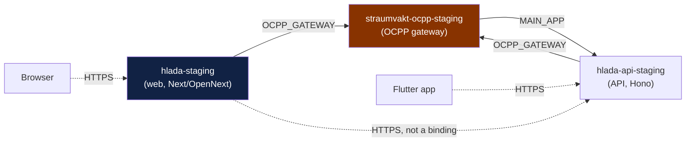

# `hlada-staging` — forensic identity

**Read-only investigation. Nothing was deployed, renamed, mutated or configured.**

| | |
|---|---|
| Worktree | `E:\Claude\Straumvakt-beta-production` |
| Branch | `docs/beta-production-release-architecture` |
| Base | `856ebe2` (infra packet — prior evidence preserved in history) |
| Measured | 2026-08-09T10:48–10:51Z |

## Evidence classes

Used strictly throughout. **Inference is never presented as fact.**

| Class | Meaning |
|---|---|
| **DEPLOYED-FACT** | observed from outside the control plane, right now |
| **REPO-DECL** | what source declares — intent, not proof of deployment |
| **HISTORICAL** | recorded in a prior note; may have decayed |
| **INFERENCE** | consistent with evidence, not proven |
| **BLOCKED** | requires control-plane access I do not have |

---

## 1. The ten questions

### Q1 · What code does the RC build into the root Worker?

**REPO-DECL.** `wrangler.jsonc:4` — `"main": ".open-next/worker.js"`, with
`assets` from `.open-next/assets`. So the root Worker is the **Next.js web
application**, built through OpenNext. It is not an API and not an OCPP engine.

### Q2 · Which routes exist in the RC web app?

**REPO-DECL.** Seven route files — the relaunched surface is genuinely small:

```
/                        login landing
/home                    post-login persona fork
/org                     entry redirect
/org/[slug]              per-org landing
/org/[slug]/profile      org record
/staff                   employee entry
/staff/overview          employee landing
```

**`/admin/*` does not exist** — `src/app/admin` is absent. This matters for
Phase 7 and is the root cause of the red `check:work-view`.

### Q3 · What source config names the Worker `hlada-staging`?

**REPO-DECL.** `wrangler.jsonc:40` — `env.staging.name = "hlada-staging"`.
The root name is `hlada` (`:3`). Both are in the **web** config, not the API or
gateway config.

### Q4 · Which Workers are service-bound, and in which direction?

**REPO-DECL** — and this is the most useful structural finding in the packet.



| Binding | Declared in | Target |
|---|---|---|
| `OCPP_GATEWAY` | web `wrangler.jsonc:70-71` | `straumvakt-ocpp-staging` |
| `OCPP_GATEWAY` | api `apps/api/wrangler.jsonc:28-29` | `straumvakt-ocpp-staging` |
| `MAIN_APP` | gateway `gateway/wrangler.jsonc:64-65` | **`hlada-api-staging`** |

**Nothing is service-bound *to* `hlada-staging`.** The gateway's callback
(`MAIN_APP`) points at the **API** Worker, not the web Worker. The web Worker is
a **leaf**: it consumes bindings, and nothing consumes it.

**Consequence for Phase 5:** migrating the web Worker to a new name breaks **no
service binding**. Migrating the API or the gateway would. That reorders the
migration risk ranking, and it is the opposite of the intuition that the
customer-facing Worker is the risky one.

### Q5 · Which public domains currently return its body?

**DEPLOYED-FACT**, 2026-08-09T10:48:44Z:

| Host | Status | Body SHA-256[0:16] |
|---|---|---|
| `straumvakt.org` | 200 | `4bf6719964446f68` |
| `www.straumvakt.org` | 200 | `4bf6719964446f68` |
| `hlada-staging.straumvakt.workers.dev` | 200 | `4bf6719964446f68` |

Byte-identical. **The brand domain is served by the beta web Worker.**
`beta.straumvakt.org` does not resolve (`000`) — it does not exist yet.

### Q6 · Which Cloudflare account owns it?

**BLOCKED.** `wrangler whoami` → *"You are not authenticated."* No `gh`, no
`CLOUDFLARE_*` env vars, and starting an OAuth flow is out of scope.

**INFERENCE only:** the `straumvakt.workers.dev` subdomain is shared by
Straumvakt and CPMS resources, which is consistent with one account. Not proven.

### Q7 · Which Git repository/branch can auto-deploy it?

**BLOCKED** — and this is the highest-value unknown in the packet.

- **REPO-DECL:** `wrangler.jsonc:33-34` says *"deployed by Cloudflare's git
  integration from the `staging` branch"*.
- **REPO-DECL (CPMS):** `E:\Claude\CPMS\CPMS\wrangler.jsonc:32` declares
  `env.staging.name = "hlada-staging"` — **the same Worker name** — and its
  `CLAUDE.md` documents *"Cloudflare auto-deploys on push: push to `staging` →
  staging Worker rebuilds."*
- **DEPLOYED-FACT:** GitHub shows **no deployments** and **no Cloudflare
  check-runs** on staging's tip. That is *consistent with* no integration, and is
  explicitly **not** proof — Workers Builds does not always surface either.

**Two repositories declare the right to deploy this Worker.** Which (if either)
actually holds it cannot be established from outside.

### Q8 · Which deployed version/date/build does it serve?

**BLOCKED.** The served HTML carries no build marker (no `BUILD_TIME`,
`APP_VERSION`, or Next build id in the body). **Without a version id there is no
rollback target**, which is a release prerequisite, not a nice-to-have.

**DEPLOYED-FACT (dating proxy):** the TLS certificate for `straumvakt.org` is
valid `2026-08-04` → `2026-11-02` (Google Trust Services), so the custom domain
was attached on or about **2026-08-04**.

### Q9 · What secrets/bindings/routes are attached in the control plane?

**BLOCKED** for actual attachment. **REPO-DECL** for what the config asks for:

| | web staging | api staging | gateway staging |
|---|---|---|---|
| `ASSETS` | ✅ | — | — |
| `OCPP_GATEWAY` → | `straumvakt-ocpp-staging` | `straumvakt-ocpp-staging` | — |
| `MAIN_APP` → | — | — | `hlada-api-staging` |
| `HYPERDRIVE_DB` | ✅ `d2d56ab1…` | ✅ same id | — |
| Queues | — | `OUTBOUND_QUEUE`, `ARCHIVE_QUEUE` | `OCPP_EVENTS_QUEUE` |
| R2 | — | `EVIDENCE_BUCKET` | — |
| DO | — | — | `IDENTITY_DO` |
| Rate limiters | — | `ADMIN_LOGIN_RATE_LIMITER`, `DRIVER_LOGIN_RATE_LIMITER` | — |
| Routes | `straumvakt.org`, `www` (`custom_domain: true`) | — | — |
| `workers_dev` | `true` | (default) | (default) |

Secret **names** only, per the web config comment: `AUTH_SECRET`, `ADMIN_EMAIL`,
`ADMIN_PASSWORD`, `DATABASE_URL`, `DIRECT_URL`, `OCPP_INGEST_SECRET`; API adds
`OCPP_CRED_KEK`. **No value was read.**

> Note the web Worker declares `HYPERDRIVE_DB` while its `src/` contains no
> database client — flagged previously; carried forward as a cleanup, not a
> blocker.

### Q10 · Does CPMS retain an integration able to overwrite it?

**BLOCKED.** CPMS **declares** both `hlada` and `hlada-staging`
(`wrangler.jsonc:3,32`) and documents auto-deploy. CPMS is dormant — last commit
2026-04-23 — and its `origin/staging` sits at `a5c5ba8`.

**This is latent, not theoretical.** One push to a dormant repository could
redeploy the Worker serving `straumvakt.org`.

---

## 2. Verdict matrix

**DEPLOYED-FACT** except where marked. Liveness distinguishes a Worker's own 404
(has `CF-RAY`, own body) from Cloudflare's no-Worker page (literal
`error code: 1042`, verified stable across repeated requests).

| Resource | Role | Deployed? | Evidence |
|---|---|---|---|
| **`hlada-staging`** | **beta web application** | ✅ **live** | 200 on 3 hosts, identical body |
| **`hlada-api-staging`** | **beta API** | ✅ **live** | `/api/admin/me` → `401 {"error":"unauthorized"}`; serves `api.straumvakt.org` (identical 404 body at `/`) |
| **`straumvakt-ocpp-staging`** | **beta OCPP gateway** | ✅ **live** | `HTTP/1.1 404`, `content-type: text/plain`, body `not found`, `CF-RAY` present — a Worker responding, **not** the 1042 page |
| `hlada` | production web name | ❌ **not deployed** | `error code: 1042`, stable |
| `hlada-api` | production API name | ❌ **not deployed** | `error code: 1042` |
| `straumvakt-ocpp` | production OCPP name | ❌ **not deployed** | `error code: 1042` |
| `straumvakt-console` | proposed new name (`4fe0a95`) | ❌ does not exist | `error code: 1042` |
| CPMS `hlada` / `hlada-staging` | legacy declarations | **name collision** | CPMS `wrangler.jsonc:3,32` (REPO-DECL) |

### Correcting the record — `hlada-staging` is **not** the OCPP engine

Source binds the web Worker **to** `straumvakt-ocpp-staging`; it is not that
Worker. And the OCPP gateway is independently **live** — confirmed by its own
404 rather than assumed from config.

**The complete deployed beta estate is three Workers.** All three production
names are undeployed. There is currently **no production environment at all** —
which is why the beta estate is serving real brand domains.

---

## 3. Manual verification checklist — one screen

Everything **BLOCKED** above, resolvable in the dashboard in a few minutes.
**Read-only. Change nothing.**

Cloudflare → Workers & Pages → `hlada-staging`:

| # | Where | Record | Expected / watch for |
|---|---|---|---|
| 1 | header | account name + id | is it the same account as CPMS? |
| 2 | Deployments | **version id + timestamp** of the active deployment | **this is the rollback target — capture it verbatim** |
| 3 | Deployments → source | "Uploaded" vs "GitHub" | if GitHub: **which repo?** `Straumvakt` or `CPMS`? |
| 4 | Settings → Build | repo, **branch**, build command, root dir, deploy command | branch should be `staging` if connected |
| 5 | Settings → Domains & Routes | `straumvakt.org`, `www.straumvakt.org` | both present, `custom_domain` |
| 6 | Settings → Domains & Routes | workers.dev enabled? | expected enabled |
| 7 | Settings → Variables and Secrets | **names only** | compare to §Q9 |
| 8 | Settings → Bindings | Hyperdrive, service bindings | `OCPP_GATEWAY` → `straumvakt-ocpp-staging` |
| 9 | Hyperdrive → `d2d56ab1…` | target host/branch | must be Neon `br-tiny-river-abgpqq37` |
| 10 | Workers list | is `hlada` present at all? | 1042 suggests no — confirm |
| 11 | **CPMS Workers** → each | Settings → Build | **any integration that names `hlada-staging`?** |
| 12 | Workers → `straumvakt-ocpp-staging` | Deployments + bindings | confirm live; note version id |

**Stop condition:** if #3/#4 shows the integration belongs to **CPMS**, stop and
treat it as an incident, not a release step — a dormant repository can overwrite
the brand domain.

---

## 4. What this changes

1. **A three-Worker beta estate is serving production traffic**, and no
   production estate exists. The beta/production split is not a refactor; it is
   creating the missing half.
2. **The web Worker is a migration leaf** — nothing is service-bound to it, so it
   is the *safest* of the three to move, not the riskiest.
3. **The OCPP gateway is the opposite**: it owns charger WebSockets, holds the
   `IDENTITY_DO` Durable Object, and both other Workers bind to it. Renaming it
   is field-risk, and the field risk is real, not aesthetic.
4. **No rollback target exists today** (Q8). Capturing a version id is a
   prerequisite for any deploy, and it costs one dashboard read.
