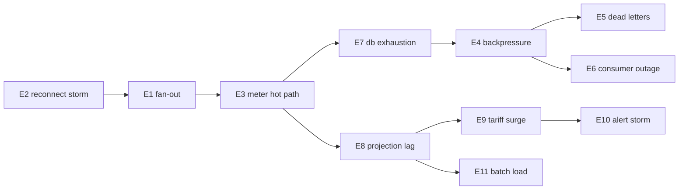

# Load and resilience test specifications

**Specifications only — no test was executed.** These exist to convert the
[capacity model](2026-08-09-connector-capacity-model.md)'s assumptions into
measurements. Until one runs, the model stays assumption-derived.

## Universal safety rules

Every experiment below inherits these. **An experiment that cannot satisfy them
does not run.**

| # | Rule |
|---|---|
| SR1 | Never against production Workers, the brand domain, or the `staging` Neon branch |
| SR2 | Dedicated Neon branch created from `staging`, deleted afterwards; **never** `production` (it is the project default — an omitted branch id lands there) |
| SR3 | Non-production Worker names; no custom domain attached |
| SR4 | Synthetic charger identities in a reserved serial range, so no fixture can collide with a real charger |
| SR5 | Hard abort: any test writing to a real `orgId` stops immediately |
| SR6 | Every run records tool version, seed, commit SHA, and target branch id |
| SR7 | Cost ceiling agreed before a run that spins compute |

## Synthetic connector profile

```
serial:      SYN-<seed>-<index>   e.g. SYN-4021-000173
org:         one synthetic org, one synthetic installation per 500 connectors
heartbeat:   300 s ± jitter(0, 30 s)
status:      6/hour ± Poisson
charging:    10% of connectors, session length ~ LogNormal(median 45 min)
meter:       1/min while charging
```

**Seed strategy:** a single integer seed drives every random draw via a
deterministic PRNG (xorshift or similar). The seed is printed at start and
embedded in every synthetic serial. Re-running with the same seed reproduces the
identical traffic pattern — without that, a regression cannot be distinguished
from a different random draw.

---

## E1 · WebSocket / DO connection fan-out

| | |
|---|---|
| Question | How many concurrent OCPP connections can the gateway own, and where does establishment latency knee? |
| Ramp | 500 → 1k → 2k → 4k → 5k, hold 10 min each |
| Metrics | connections established, p50/p95/p99 handshake latency, DO wake count, error rate, CPU ms per request |
| Pass | 5k concurrent held for 10 min, p95 handshake < 2 s `[T]`, error rate < 0.1% |
| Fail-fast | error rate > 5% at any step |
| Validates | model assumption `activeWebsocketPct`, and the "connection count is not the load" claim |

## E2 · Reconnect storm — **highest-value experiment**

| | |
|---|---|
| Question | Does the platform survive all connectors reconnecting after an outage? |
| Method | Establish 5k, sever all, allow reconnect within a 60 s window (model: **83 connects/s**) |
| Variants | 30 s (worst), 60 s (base), 300 s (with backoff) |
| Metrics | peak connects/s achieved, time to 95% reconnected, queue depth peak, DO wake concurrency, dropped connections |
| Pass | 95% reconnected < 5 min `[T]`, no dead letters, no data loss |
| Validates | S3, the least-understood edge. **Run this before E3–E11** |

## E3 · Meter-value hot path

| | |
|---|---|
| Question | Does the ingest path hold at the high meter-value assumption? |
| Method | 5k connectors, 25% charging, 4 MeterValues/min → model predicts ~117 events/s |
| Metrics | ingest lag p95, DB write latency, queue depth, `cpu_ms` per invocation |
| Pass | ingest freshness p95 < 5 s `[T]`, `cpu_ms` < 40 (80% of the 50 ms `[S]` budget) |

## E4 · Queue backpressure and retries

| | |
|---|---|
| Method | Throttle the consumer to 50% (S5), sustain 1 h, then release |
| Metrics | backlog growth rate (model: ~33 msg/s → **118k after 1 h**), drain time, retry counts, ordering |
| Pass | backlog drains < 30 min after release; **no message loss**; no duplicate session rows |
| Note | Duplicate-suppression behaviour under retry is the real subject here, not throughput |

## E5 · Dead-letter handling

| | |
|---|---|
| Method | Inject malformed envelopes (1 in 10k) |
| Pass | poison messages reach the DLQ within max-retries; a valid message behind a poison one is **not** blocked; DLQ growth alerts |

## E6 · AMQP / Fly consumer outage and catch-up

| | |
|---|---|
| Method | Stop the consumer 15 min under S2 load, restart |
| Metrics | backlog peak, catch-up rate, whether catch-up starves live traffic |
| Pass | full catch-up < 3× outage duration; live ingest lag stays < 30 s during catch-up |
| Note | The failure mode to look for is catch-up *competing with* live traffic, not the backlog itself |

## E7 · Database connection exhaustion

| | |
|---|---|
| Question | Where is the ceiling, given a per-request client with `Pool max: 1` `[S]` behind Hyperdrive? |
| Method | Ramp concurrent request rate until connection errors appear |
| Metrics | max sustained concurrent requests, Hyperdrive pool behaviour, error class at the knee |
| Pass | supports S4's rate with 3× headroom `[T]` |
| Note | This is the 4k bottleneck the model predicts but cannot simulate |

## E8 · Session projection lag

| | |
|---|---|
| Method | Complete 10k synthetic sessions in one window; measure projection into `reports.session_ledger` |
| Metrics | projection throughput, p95 session-end → cost-visible |
| Pass | p95 < 10 min `[T]` |
| Note | Validates `costProjectionSecPer1kSess` `[A]` = 20 s, the assumption most likely to be optimistic — **and the one a driver feels** |

## E9 · Tariff-boundary surge

| | |
|---|---|
| Method | S4 — 1,250 concurrent starts clustered at a free-period boundary |
| Metrics | start command acceptance latency, rejection rate, queue peak |
| Pass | p95 acceptance < 10 s `[T]`, no rejections attributable to platform load |

## E10 · Issue-engine alert storm

| | |
|---|---|
| Method | Fault 20% of 5k connectors simultaneously |
| Metrics | evaluations/s, alerts emitted, dedup rate, notification fan-out |
| Pass | alerts deduplicate to incident level; **no unbounded per-connector notification fan-out** |
| Note | Failure here is operational (pager unusable), not technical |

## E11 · Reporting / invoice batch load

| | |
|---|---|
| Method | Month-end export over 5k connectors' sessions concurrent with S2 live load |
| Pass | live ingest lag unaffected (< 10% degradation); batch completes in budget |

---

## Execution order and rationale



**E2 runs first**, against the usual instinct to ramp gently. The reconnect storm
is the scenario with the least evidence and the highest consequence, and if it
fails, the ordering of everything downstream changes. A gentle ramp that passes
tells you little you did not already assume.

## Tooling

| Need | Option | Note |
|---|---|---|
| OCPP client simulation | custom Node harness | must speak OCPP 1.6J; off-the-shelf load tools do not |
| Orchestration | k6 or Artillery for HTTP surfaces | not for WebSocket OCPP |
| Metrics | Cloudflare Workers analytics + queue depth + Neon metrics | already available |
| Fixtures | seeded generator, synthetic serial range | SR4, SR6 |

## What these tests cannot tell you

- Real charger firmware behaviour under reconnect — synthetic clients are
  well-behaved in ways real hardware is not.
- Vendor API rate limits during a mass onboarding.
- Whether the assumed heartbeat interval matches deployed configuration — that is
  a fleet-audit question, not a load test, and it is the model's dominant driver.
