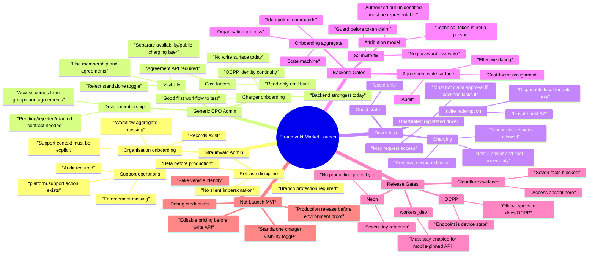

# Straumvakt Market Launch Functionality Matrix - Draft

Purpose: human-readable table of required functionality for the Straumvakt
product-to-market launch. This reflects current AI-agent findings as of
2026-08-09 and should be revised after Claude A, Claude B, and Codex finish the
current ultra tasks.

Status legend:

- **Must**: required for market beta or first customer use.
- **Gated**: product-needed, but cannot be interactive until backend/security or
  release evidence exists.
- **Ready-ish**: backend/UI exists enough for local or controlled beta testing,
  with listed caveats.
- **Read-only**: may be shown, but not editable yet.
- **Rejected**: current recommendation is not to build this as a separate
  feature.
- **Later**: not required for launch.

## Executive TL;DR

For market launch, Straumvakt should focus on:

1. onboarding an organisation;
2. onboarding chargers safely;
3. onboarding drivers safely;
4. granting driver access through membership/agreement policy;
5. preserving correct session and billing attribution;
6. showing truthful cost/charging information;
7. operating beta/production environments without accidental Cloudflare,
   workers.dev, Neon, or OCPP breakage.

Do **not** build separate charger visibility toggles now. Do **not** make pricing
or cost-factor UI interactive until a write surface exists. Do **not** make
invite redemption a real customer path until S2 is fixed.

## Mind Map

This is the saved high-level product-to-market map. Use the table below for
details and the mind map for orientation.

## Functionality Matrix

| Area | Functionality | Launch status | Current evidence | Required before interactive use | Owner lane | UI stance now |
|---|---|---|---|---|---|---|
| Straumvakt Admin | Create/onboard organisation | **Gated** | Records exist, but Claude A says workflow aggregate does not | Organisation onboarding aggregate, commands, audit, tests | Claude A backend; Codex UI | Show readiness/progress concept; avoid claiming full process |
| Straumvakt Admin | Assist organisation setup | **Gated** | Support context concept accepted; `platform.support.action` exists but is not enforced | Support-context enforcement, scope, expiry, audit events | Claude A backend | Show explicit support banner only as non-live/design until backend exists |
| Straumvakt Admin | View onboarding queue | **Ready-ish** | Codex web built queue/detail UI; backend workflow incomplete | API truth check, disabled states for missing transitions | Codex + Claude A | Can show local UI with honest blocked states |
| Straumvakt Admin | Manage organisations directory | **Ready-ish** | Codex web built organisation directory | Verify backend read endpoints and permissions | Codex | Read/list flows likely safe locally |
| Straumvakt Admin | Branch/release operation | **Must** | Claude B: production no-go; branch protections absent | Protection decisions, release manifest, Cloudflare evidence | Claude B | Not product UI; operator checklist |
| CPO/Admin | Charger onboarding | **Ready-ish / Must** | Claude A says strongest backend domain | Keep OCPP endpoint continuity, verify beta environment, tests | Claude A + Claude B + Codex | Build/test charger onboarding UI first |
| CPO/Admin | OCPP identity provisioning | **Must** | Source has OCPP identity and gateway paths; OCPP docs local | Field-safety runbook, attribution model, endpoint stability | Claude A + Claude B | Expose carefully; avoid renaming endpoint |
| CPO/Admin | Driver onboarding by invite | **Gated / Unsafe** | Claude A: works only through Critical invite consume path | S2 fix, D-01 decision, client compatibility window | Claude A | Disable real invite redemption for customer data |
| CPO/Admin | Driver membership/access grants | **Must** | Membership drives charger access today | Authenticated join/access contract, pending/rejected/granted states | Claude A | Can model UI, but interactive grant waits for contract |
| CPO/Admin | Installation code/passphrase access | **Gated** | Codex UI exists; backend contract incomplete/uncertain | API contract and tests for code/passphrase submit/status | Claude A + Codex | Honest unavailable/pending states only |
| CPO/Admin | Charger visibility toggle | **Rejected** | Claude A recommends reject; current access is membership + active agreement | Andri override if product requirement is real | Product decision | Do not build a standalone visibility toggle |
| CPO/Admin | Availability / out-of-service status | **Must or Gated** | Visibility use cases may really be availability | Decide scope separate from access visibility | Claude A + Codex | Label as availability, not visibility |
| CPO/Admin | Public charging exposure | **Later / Gated** | Visibility use cases may really be public charging | Product decision and backend model | Product + Claude A | Do not include in launch MVP unless explicitly chosen |
| CPO/Admin | Cost-factor assignment | **Gated / Blocked** | Claude A: no write surface; routes are GET-only | Agreement/cost-factor write API, permissions, tests | Claude A backend | Read-only or disabled UI only |
| CPO/Admin | Agreement/tariff management | **Gated / Blocked** | Read-only API; billing correctness has no input | Create/update/retire agreement API and audit | Claude A backend | Read-only summary only |
| CPO/Admin | Pricing preview | **Gated** | Cannot be truthful without write/input surface | Cost-factor write surface and pricing preview endpoint | Claude A | Hide or mark unavailable |
| Driver App | Guest local-only state | **Ready-ish** | Codex mobile built guest state | Verify no accidental backend claim | Codex | Safe local UI |
| Driver App | Registered unaffiliated state | **Ready-ish** | Codex mobile built unaffiliated state | Verify auth/profile read contract | Codex + Claude A | Safe local UI |
| Driver App | Request access | **Gated** | Codex mobile UI exists; backend contract incomplete | Authenticated join/access request endpoint | Claude A | UI may show request path disabled or local fixture only |
| Driver App | Pending/rejected/granted access | **Gated** | Claude A found `pendingApproval` absent in API | Server states and response contract | Claude A | Do not claim real pending approval until API exists |
| Driver App | Invite redemption | **Unsafe** | Critical password overwrite still open | S2 shipped and compatibility proven | Claude A | Disposable local tenants only |
| Driver App | Concurrent active sessions | **Must / Ready-ish** | Codex mobile supports chooser; prior mobile hardening preserved identity | Backend current-session truth and attribution model | Codex + Claude A | Good candidate for local test |
| Driver App | Active charge screen | **Must / Ready-ish** | Codex mobile handles truthful power/cost uncertainty | Backend telemetry/cost semantics | Codex + Claude A | Show unavailable/pending where uncertain |
| Driver App | Stop/session settlement | **Must / Gated** | Mobile has session detail/settlement flows | Hardware/beta approval for real end-to-end stop | Codex + Claude B | Local/emulator test only until approved |
| Driver App | Billing/cost display | **Gated** | UI compensates for backend cost defects; do not encode workaround as contract | Backend cost model and cost-factor write surface | Claude A | Show truthful pending/final-only cost |
| Driver App | Account/privacy | **Must / Ready-ish** | Codex mobile built account/privacy screen | Verify backend account/delete/legal contract | Codex + Claude A | Local UI safe; destructive actions disabled |
| Backend | S2 invite password-overwrite fix | **Must** | Claude A designed full fix, proposal only | D-01 decision, Q-02 blast-radius check, implement/test | Claude A | Blocks real invite redemption |
| Backend | Token class and attribution | **Must** | Claude A: attribution may be confidently wrong | T2/A10 model, schema, tests | Claude A | Blocks real customer charging/billing confidence |
| Backend | Support audit attribution | **Must** | Support actions inside tenant unaudited/unconditional | Enforce `platform.support.action` and audit support context | Claude A | Blocks staff-assisted production support |
| Backend | Permission enforcement | **Must** | 35/37 admin routes use `requirePermission`; not decorative | Fill gaps, test live/defined-only verbs | Claude A | UI must respect backend permissions |
| Backend | Agreement/cost write API | **Must for billing MVP** | No write surface today | API, repository, audit, tests | Claude A | Blocks cost-factor UI |
| Backend | Onboarding aggregate | **Must for polished launch** | Records exist; workflow no | Aggregate/state machine/API | Claude A | Until then, show checklist/readiness not full process |
| Release/Ops | Beta web/API/OCPP topology | **Must / Partly verified** | Claude B: three beta Workers identified | Dashboard evidence still needed | Claude B | Operator evidence, not product UI |
| Release/Ops | Cloudflare access | **Blocked** | Claude B: absent in current environment | Read-only dashboard/API/Wrangler session | Claude B / Andri | Blocks seven facts |
| Release/Ops | `workers_dev` preservation | **Must** | Claude B: routes can infer workers_dev false; mobile pins host | Explicit config/check before domain change | Claude B | Blocks beta domain migration |
| Release/Ops | Production Neon project | **Must before production** | Claude B: one Neon project, no production project | Create/protect production project with approval | Claude B / Andri | Production no-go |
| Release/Ops | Branch protections | **Must** | Claude B: 0/16 protected | Protect staging/production model | Claude B / Andri | Production no-go |
| Release/Ops | E:\Claude cleanup | **Should / Plan-first** | Claude B: 95% regenerable but preservation risk | Approved dry-run, preserve OCPP and parked evidence | Claude B | No deletion until approval |
| Protocol | OCPP official reference | **Ready as reference** | OCA files local at `docs/OCPP`, untracked | Decide whether/how to commit or archive | Claude B + coordinator | Use as evidence, avoid long quotes |
| Protocol | OCPP endpoint continuity | **Must** | OCPP Worker live; URL/DO identity is device state | Field-safety plan before any endpoint change | Claude B | Do not rename casually |

## Launch MVP Shape

| Surface | Must-have for useful market beta | Keep disabled/read-only until ready | Not in launch MVP |
|---|---|---|---|
| Straumvakt Admin | Organisation directory, onboarding readiness, explicit support context display, charger onboarding oversight | Actual support actions, organisation workflow transitions, invite redemption | Silent impersonation, production release controls inside product UI |
| Generic CPO/Admin | Charger onboarding, driver/member list, group-based access model, charger/access readiness, read-only cost summaries | Driver invite redemption, cost-factor editing, agreement editing, availability/public exposure if not modeled | Separate charger visibility toggle |
| Driver | Guest state, unaffiliated state, access-request framing, active session chooser, truthful charge screen, final settlement view | Real access request, pending approval, invite redemption, account deletion, billing/cost breakdown | Fake vehicle identity, fake cost certainty, debug credentials |
| Backend | S2 fix, attribution model, support audit context, agreement/cost write surface, onboarding aggregate | Live data mutation until tests and migration plans exist | Pricing UI without a write/input model |
| Release/Ops | Beta topology evidence, workers_dev guard, branch protection, Neon separation plan, OCPP continuity | Domain moves, production creation, cleanup deletion | Any production launch before dashboard/version evidence |

## Product Decisions To Make

| Decision | Why it matters | Recommended current stance |
|---|---|---|
| Is invite consume a password reset? | Blocks S2 and real invite redemption | Treat as no by default; require explicit reset flow |
| Is charger visibility a real requirement? | Current recommendation rejects toggle | Reject for launch; use groups/agreements and availability language |
| What is first-market billing scope? | Cost-factor writes are absent | Build minimal agreement/cost write surface before editable pricing UI |
| What support actions need context? | Staff tenant actions are unaudited | Require explicit support context for all tenant-scoped support |
| What can Codex make interactive now? | Prevents fake product confidence | Charger/membership/read-only flows yes; pricing/visibility/invite no |
| Where do OCPP docs live long-term? | `docs/OCPP` is untracked | Preserve now; decide commit/archive policy later |

## Coordinator Notes

- This matrix should be updated after the current Claude A Ultra, Claude B
  Ultra, and Codex UI tasks return.
- Do not treat this as a committed launch promise. It is a working market-MVP
  decision surface.
- Any row marked **Gated**, **Blocked**, or **Unsafe** must not become a real
  interactive beta workflow until the named gate closes.
