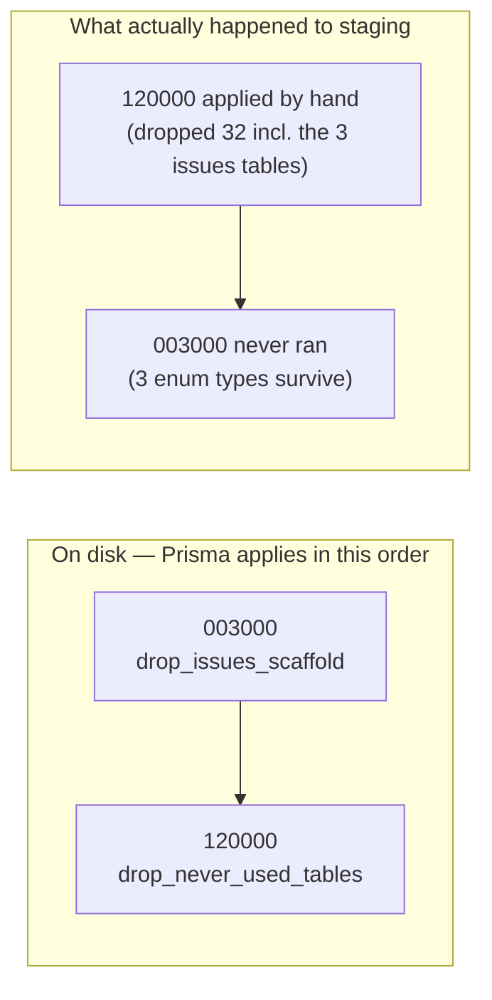

# Migration-history reconciliation

**No SQL was run. No database was connected to. No migration was executed.**
Everything below is established from source and prior recorded evidence.

## The two migrations

| | `20260807003000_drop_issues_scaffold` | `20260807120000_drop_never_used_tables` |
|---|---|---|
| Statements | 3 × `DROP TABLE IF EXISTS`, 3 × `DROP TYPE IF EXISTS` | 32 × `DROP TABLE IF EXISTS`, 0 × `DROP TYPE` |
| **Idempotent?** | ✅ every statement `IF EXISTS` | ✅ **32 of 32** carry `IF EXISTS` |
| Recorded in `_prisma_migrations` | ❌ nowhere | ❌ nowhere |
| Effect on **staging** | **partly outstanding** — 3 tables moot, **3 types still exist** | **fully applied** — 32/32 tables gone |
| Effect on **test** | **fully applied** — types already gone | fully applied |

Both are **REPO-DECL + HISTORICAL**: the file headers record measurements taken
directly against both Neon branches on 2026-08-07 and 2026-08-08. I did not
re-measure — that would require SQL.

## Evidence they were applied manually

1. Neither appears in `_prisma_migrations` on either branch (recorded
   2026-08-08), yet their effects are present — 32 tables gone from staging.
   Effects without history is the signature of hand-applied DDL.
2. The `drop_issues_scaffold` header states plainly: *"This file has never run
   as a migration on any branch, and is recorded in `_prisma_migrations`
   nowhere."*
3. Its three `DROP TABLE`s are moot because
   `20260807120000_drop_never_used_tables` **drops the same three among its 32** —
   so the later-numbered migration's effects landed while the earlier-numbered
   one never ran.

## The ordering trap

This is the part most likely to be got wrong.

**Lexicographic order ≠ the order in which effects landed.**



A `migrate deploy` now would run `003000` **first**. That is fine — and in fact
correct — because:

- its three `DROP TABLE IF EXISTS` hit absent tables and are **no-ops that take
  no lock at all**;
- its three `DROP TYPE IF EXISTS` are the **only real DDL left in either file**;
- `120000` then runs 32 `IF EXISTS` drops against already-absent tables — also
  no-ops.

## What database metadata is missing

| Missing | Consequence |
|---|---|
| A `_prisma_migrations` row for each of the two | `migrate status` reports 2 pending; the count on disk (47) never matches the count recorded |
| A checksum for each | Prisma pins a checksum per migration **once a row exists** |
| Any record of *who* applied them and when | No audit trail for two schema changes on a database with 21 continuously-writing chargers |

## Recommended bookkeeping: `deploy`, not `resolve`

**Recommendation: `migrate deploy`. Do not use `migrate resolve --applied`.**

The file's own header argues this, and the argument is right:

> *"`migrate resolve --applied` on this migration WITHOUT running it would record
> something untrue and strand three enum types with no history entry that
> explains them."*

| Option | On staging | Verdict |
|---|---|---|
| `migrate resolve --applied` on both | Records both as applied. **Leaves `issues."IssueStatus"`, `"IssueSeverity"`, `"IssueSubject"` on staging forever**, with history claiming they were dropped | ❌ records a falsehood |
| `migrate deploy` | Runs both idempotently; drops the 3 types; records both | ✅ history and database agree |
| Do nothing | Permanent 2-pending drift; staging and test stay divergent | ❌ |

**On `test`, the answer differs.** Everything is already applied there, so
`resolve --applied` would be factually correct. But the cheaper and more durable
route is: reconcile staging first, then **reset `test` from staging** — test is
reset periodically anyway (`last_reset_at` 2026-08-06), so anything applied to it
directly is thrown away at the next reset, while inheriting a corrected parent is
permanent.

**Ordering constraint:** reset `test` from `staging` **only after** staging is
reconciled, or test re-inherits the three orphaned enum types and the divergence
reverses.

## Verification an approved operator must run

**I did not run these.** They are read-only and belong to whoever has approval.

```sql
-- 1. Do the three enum types still exist on staging?  (expect 3 rows before, 0 after)
SELECT n.nspname, t.typname
FROM pg_type t JOIN pg_namespace n ON n.oid = t.typnamespace
WHERE n.nspname = 'issues'
  AND t.typname IN ('IssueStatus','IssueSeverity','IssueSubject');

-- 2. Do they have ANY dependent columns?  (expect 0 — the drop is unblocked)
SELECT c.relname, a.attname, t.typname
FROM pg_attribute a
JOIN pg_class c ON c.oid = a.attrelid
JOIN pg_type t ON t.oid = a.atttypid
JOIN pg_namespace n ON n.oid = t.typnamespace
WHERE n.nspname = 'issues'
  AND t.typname IN ('IssueStatus','IssueSeverity','IssueSubject');

-- 3. Are the 3 issues tables really gone?  (expect 0 rows)
SELECT table_schema, table_name FROM information_schema.tables
WHERE table_schema = 'issues';

-- 4. What does history actually contain for these two?  (expect 0 rows)
SELECT migration_name, finished_at, rolled_back_at
FROM _prisma_migrations
WHERE migration_name LIKE '20260807%';

-- 5. Count recorded vs on-disk (on disk: 47)
SELECT count(*) FROM _prisma_migrations WHERE rolled_back_at IS NULL;
```

**Every query must be run with an explicit Neon branch id.** The project default
is the abandoned `production` branch, whose older schema makes a wrong-branch
result read as a schema bug rather than a wrong-branch error.

## Safe sequence

| # | Step | Type |
|---|---|---|
| 1 | Neon backup branch from `staging`, `backup-YYYY-MM-DD-pre-migration-reconcile` | **MUTATION — approval** |
| 2 | Run verification queries 1–5 against **staging**, explicit branch id | read-only |
| 3 | Confirm query 2 returns **0 rows** (no dependent columns) | gate |
| 4 | `prisma migrate deploy` against staging | **MUTATION — approval** |
| 5 | Re-run queries 1, 4, 5 — expect 0 types, 2 rows, 47 recorded | verification |
| 6 | `npm run check:migrations` → "47 migrations found", "up to date" | verification |
| 7 | Reset `test` from `staging` | **MUTATION — approval** |
| 8 | Confirm test matches | verification |

## Stop conditions

Abort and re-measure if any of these is true:

1. Query 2 returns **any** dependent column — the drop would fail or cascade.
2. Query 3 shows the `issues` tables **still present** — the premise is stale and
   the whole analysis must be redone.
3. `_prisma_migrations` already contains a row for either migration — someone
   reconciled it in the meantime; **the file must not be edited after that**
   (Prisma pins a checksum per migration, and editing afterwards makes every
   later `migrate status` and `migrate deploy` fail).
4. Recorded count is not 45 before / 47 after.
5. Any charger ingest error during step 4 — 21 chargers write continuously.

## Backup and rollback limitations

**Be honest about what a backup can and cannot undo here.**

| | |
|---|---|
| Backup unit | Neon copy-on-write branch from `staging` — near-instant, near-free |
| What it restores | The schema **and** the data as of the branch point |
| **What it costs** | **Any charger writes accepted after the branch point are lost on restore.** With 21 continuously-writing chargers, that window is not empty |
| What cannot be rolled back | A dropped enum type is trivially recreatable; a dropped **table with data** is not — but all 35 tables here were measured empty and unreferenced |
| Practical risk | **Low.** The only real DDL is three enum drops with zero dependent columns |

Restore is a **restore, not a rollback**: it returns the database to a point in
time, discarding what happened since. For this change the safer instinct is to
verify before rather than restore after.

## Schema history ≠ operational-data retention

**These are different questions and must not be traded off against each other.**

The accepted decision that real organisations onboard fresh in production, with
no legacy operational-data backfill, is about **charging logs, sessions and
customer records** — business data.

It says nothing about **`_prisma_migrations`**, which is schema *metadata*. A
production database still needs an accurate migration history, because:

- `migrate deploy` on a fresh production database replays the full set from
  scratch — and it must be **internally consistent** or it fails partway;
- an inaccurate history on beta will be copied forward as the model for
  production;
- "we do not keep old charging data" is not a licence to keep incorrect
  metadata about the shape of the database.

**The no-backfill policy does not justify leaving two migrations unrecorded.**
Fixing the history on beta is a prerequisite for production being built from a
clean, replayable migration set.
