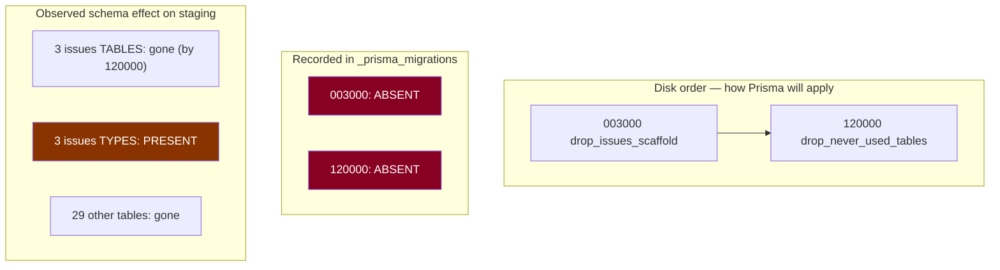

# Migration reconciliation — operator pack

**No SQL was run. No database was connected to. No migration file was written or
edited.** Every mutation below is marked ⚙️ and requires 🔒.

## 1. Idempotency proved statement-by-statement

Verified by reading the files at RC `4b69d0f`, not by assertion.

### `20260807120000_drop_never_used_tables`

| Property | Measured | Consequence |
|---|---|---|
| Non-comment statements | **34** | — |
| `DROP TABLE IF EXISTS` | **32** | every drop is conditional |
| Drops **without** `IF EXISTS` | **0** | **no statement can fail on an absent object** |
| `CASCADE` | **0** | **cannot silently remove a dependent object** |
| Non-`DROP` statements | 2 — `BEGIN;` and `COMMIT;` | **the whole migration is one transaction** |

Schemas touched: `billing` (9), `reports` (4), `energy` (3), `issues` (3),
`roaming` (3), `webhooks` (3), `assets` (2), `entitlements` (2), `vendors` (2),
`ocpp` (1).

**Conclusion: idempotent *and* atomic.** Re-running it is a no-op; a failure
part-way rolls the whole thing back. The absence of `CASCADE` is the load-bearing
detail — with it, a drop could take an unlisted dependent object with it.

### `20260807003000_drop_issues_scaffold`

| # | Statement | Effect on staging | Effect on test |
|---|---|---|---|
| 1 | `DROP TABLE IF EXISTS "issues"."ticket_events"` | **no-op** (already dropped) | no-op |
| 2 | `DROP TABLE IF EXISTS "issues"."detection_rules"` | **no-op** | no-op |
| 3 | `DROP TABLE IF EXISTS "issues"."tickets"` | **no-op** | no-op |
| 4 | `DROP TYPE IF EXISTS "issues"."IssueStatus"` | **REAL DDL** | no-op |
| 5 | `DROP TYPE IF EXISTS "issues"."IssueSeverity"` | **REAL DDL** | no-op |
| 6 | `DROP TYPE IF EXISTS "issues"."IssueSubject"` | **REAL DDL** | no-op |

All six conditional; no `CASCADE`. **Three statements do real work, and only on
staging.**

> **Asymmetry worth noting:** this file has no explicit `BEGIN`/`COMMIT`. Prisma
> wraps a migration in a transaction by default for PostgreSQL, so this is not a
> defect — but the two files differ in style, and an operator reading only one
> would draw the wrong conclusion about the other.

## 2. Order: on disk, recorded, and observed

**Disk order ≠ application order.** `120000` landed by hand; `003000` never ran.
Applying in disk order now is nonetheless correct: `003000`'s three table-drops
are no-ops, its three type-drops do the outstanding work, and `120000` then
re-runs 32 no-ops inside a transaction.

## 3. Read-only preflight (an approved operator runs these — I did not)

**Every query requires an explicit Neon branch id.** The project default is the
abandoned branch, whose older schema makes a wrong-branch answer look like a
schema bug.

| # | Purpose | Expected before | Expected after |
|---|---|---|---|
| Q1 | do the 3 enum types exist in `issues`? | **3 rows** | 0 rows |
| Q2 | do those types have **any** dependent column? | **0 rows** | 0 rows |
| Q3 | tables remaining in schema `issues` | **0 rows** | 0 rows |
| Q4 | `_prisma_migrations` rows matching `20260807%` | **0 rows** | **2 rows** |
| Q5 | count of applied, non-rolled-back migrations | **45** | **47** |
| Q6 | are the 29 other dropped tables absent? | 0 rows | 0 rows |

Q1–Q5 are in the prior reconciliation note. **Q2 is the gate.** If it returns any
row, the drop is blocked and the whole plan is re-opened.

**Q6 is new and worth adding:** it verifies the premise that `120000` was fully
applied, rather than trusting a note from two days ago.

## 4. Rehearsal on a disposable clone — do this before touching staging

| # | Step | Type |
|---|---|---|
| R1 | Create a throwaway Neon branch from `staging` (**not** `test`, which others reset) | ⚙️🔒 |
| R2 | Point a local `DATABASE_URL` at it — never at `staging` | config |
| R3 | Run Q1–Q6 → record actual values | read-only |
| R4 | `prisma migrate status` → expect *2 pending* | read-only |
| R5 | `prisma migrate deploy` | ⚙️ (on the clone only) |
| R6 | Re-run Q1–Q6 → expect the "after" column | read-only |
| R7 | `prisma migrate status` → expect **47 found, up to date** | read-only |
| R8 | **Delete the throwaway branch** | ⚙️🔒 |

**R1 uses a fresh branch rather than `test`** because `test` is periodically reset
by others; a rehearsal there could be destroyed mid-run, or could destroy someone
else's state.

**The rehearsal is the whole point of this pack.** It converts "the file says it
is idempotent" into "we ran it and observed the result", at zero risk.

## 5. Applying to staging

| # | Step | Type |
|---|---|---|
| S1 | Backup branch `backup-YYYY-MM-DD-pre-migration-reconcile` from `staging` | ⚙️🔒 |
| S2 | Record its parent LSN and creation time | read-only |
| S3 | Confirm rehearsal (§4) passed on the clone | gate |
| S4 | Re-run Q1, Q2, Q6 against **staging** | read-only |
| S5 | **Gate: Q2 must return 0 rows** | gate |
| S6 | `prisma migrate deploy` against staging | ⚙️🔒 |
| S7 | Q1, Q4, Q5 → 0 types, 2 rows, 47 | read-only |
| S8 | `npm run check:migrations` → 47, up to date | read-only |
| S9 | Reset `test` from `staging` — **after** S6, never before | ⚙️🔒 |

**S9 ordering is not stylistic.** Reset `test` first and it re-inherits the three
orphaned enum types, reversing the divergence this whole exercise closes.

## 6. Production replay from empty

Production is built by replaying the reconciled set into an empty database.

| # | Step | Expectation |
|---|---|---|
| P1 | New Neon project + branch, empty | — |
| P2 | `prisma migrate deploy` | **all 47 apply cleanly, in order** |
| P3 | `prisma migrate status` | 47 found, up to date |
| P4 | Compare the resulting schema against staging's | differences must be explainable |

**P2 is the reason the beta history must be reconciled first.** A replay applies
`003000` and `120000` in disk order against an empty database, where every
statement is a no-op on absent objects — which works, but only if both files are
*in* the recorded set. Leaving them unrecorded on beta invites someone to "fix"
production by editing a file, and **editing a migration after any row exists
breaks every later `migrate status` and `migrate deploy` via the pinned
checksum.**

## 7. Failure and partial-application recovery

| Failure | Recovery |
|---|---|
| `migrate deploy` fails on `120000` | It is `BEGIN`/`COMMIT`-wrapped — Postgres rolls it back whole. Re-run after fixing the cause |
| `migrate deploy` fails on `003000` | Prisma's implicit transaction rolls it back. Same |
| A row is recorded but the DDL did not run | **This is what `resolve --applied` causes.** Recovery: run the SQL by hand, since re-deploying will not re-run a recorded migration |
| Q2 returns dependent columns after all | Stop. The drop is unsafe. Re-plan |
| A charger write fails during the window | 21 chargers write continuously — treat as a stop condition, not noise |
| Checksum mismatch on a later run | Someone edited a recorded migration. **Do not "fix" by editing further** — reconcile deliberately |

## 8. Evidence to retain

| Artefact | Why |
|---|---|
| Q1–Q6 output, before and after, with branch id and UTC | the factual record of what changed |
| Backup branch id + parent LSN | the restore point |
| `migrate status` output before and after | the history claim |
| Rehearsal transcript from the disposable clone | proves the plan was tested |
| Operator name and approval | audit |

Store **outside the repository** with the release evidence. **Never store a
connection string.**

## 9. Proposed CI tiers

| Tier | Check | Needs a credential? | When |
|---|---|---|---|
| **Tier-0** | migration **files** parse; filenames are ordered; every `DROP` carries `IF EXISTS`; no `CASCADE` without a comment | **no** | every PR |
| **Tier-0** | migration directory count matches an expected constant | **no** | every PR |
| **Tier-1** | `prisma migrate status` against a **disposable** branch | yes, least-privilege | trunk/RC only, or scheduled |
| **Tier-1** | replay-from-empty into a throwaway branch | yes | pre-release |

**Tier-0 is the valuable half and it needs no credential at all.** A lint that
rejects a `DROP` without `IF EXISTS`, or a `CASCADE` without an explanatory
comment, would have made this entire reconciliation unnecessary — and it can run
on every fork PR safely.

## 10. Least-privilege credential — conceptual

For Tier-1 only:

| Grant | Why |
|---|---|
| `CONNECT` on the database | required |
| `USAGE` on the one schema holding `_prisma_migrations` | required |
| `SELECT` on `_prisma_migrations` **only** | `migrate status` reads exactly this |
| **Nothing else** | no business table, no write, no DDL |

**Constraint (established previously):** Neon roles created via console, CLI or
API receive `neon_superuser` with `pg_write_all_data`. **Only a SQL-created role
is least-privilege**, and it must be proved with a *negative* test — a `SELECT`
against a business table must fail. A positive-only test proves nothing.

Replay-from-empty (Tier-1, pre-release) needs DDL and therefore a **different,
stronger** credential, scoped to throwaway branches only. Do not conflate the two.
