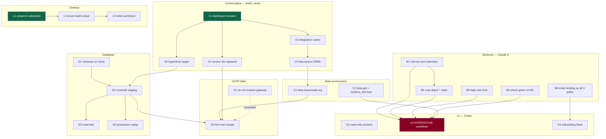

# Product-to-market dependency map

**Planning only. Nothing was executed.** Answers: *what must Claude A prove
before Codex makes UI workflows interactive*, and *what can run in parallel*.

## The map

## What runs in parallel, what waits, what is unsafe

| Stream | Can start now? | Blocked by | Why |
|---|---|---|---|
| **Cleanup L1** (preserve untracked) | ✅ **immediately** | nothing | pure copy; the only irreversible risk in the estate is *not* doing it |
| **Cleanup L2** (prune build output) | ✅ after L1 + junction removal | L1 | 41.6 GB, zero risk |
| **Backend B1/B2** (telemetry truth) | ✅ **immediately** | nothing | repository-side; no control plane |
| **Backend B3** (login rate limit) | ✅ **immediately** | binding provisioning | independent |
| **Backend B4** (invite binding) | ✅ **immediately** | nothing | test-first |
| **Database D1** (rehearse on clone) | ✅ **immediately** | approval for a throwaway branch | isolated |
| **Database D2** (reconcile staging) | ⏸ | D1 + backup + **V5** | must know Hyperdrive's target first |
| **Control plane V1** | ✅ **immediately** | dashboard access | ~30 min, unblocks nine items |
| **Beta domains C1/C2** | ⏸ | **V3** | do not add domains while a second repo can deploy |
| **UI U1** (read-only screens) | ✅ **immediately** | nothing | reading existing endpoints is safe |
| **UI U2** (interactive workflows) | ⛔ **WAIT** | **B1, B2, B3, B5, C2** | see the gate below |
| **OCPP O2** (first real charge) | ⏸ | D2, C1, V4 | needs a rollback target and a reconciled database |
| **OCPP rename** | ⛔ **UNSAFE** | — | field risk; the no-backfill decision may remove the need entirely |

### Explicitly unsafe combinations

| # | Do not | Because |
|---|---|---|
| 1 | Add `routes` to the API Worker **without** `"workers_dev": true` | `workers_dev` is inferred `false`; the shipped app's pinned host stops serving |
| 2 | Move the API from Custom Domain to a route | same-zone `fetch()` from web → API fails without a service binding |
| 3 | Advance `staging` before V2 | if the integration belongs to CPMS, the push behaves unpredictably |
| 4 | Reconcile migrations before V5 | you may be writing to a different branch than you think |
| 5 | Delete `node_modules` before removing cross-worktree junctions | four worktrees break later, elsewhere |
| 6 | Make UI interactive before B1/B2 | the UI would encode workarounds for backend defects, and the tests would pin them |
| 7 | `git push` from `dev/rename-prod-worker` | its upstream is `origin/staging` |

---

# The backend → UI gate

**Mission question 4: what evidence must Claude A provide before Codex makes UI
workflows interactive?**

The principle: **a UI becomes interactive when the contract it writes against is
stable and truthful.** Interactive UI encodes assumptions in tests, and the
expensive failure is a test suite that pins a workaround.

That already happened once: Codex's contract tests now assert
`costIsk: 2500 → "25 kr"` and `costIsk: 0 → null`. Both are correct against
today's backend and both are compensations for backend defects — now green tests
that a future reader takes for the intended contract.

## Gate G — required before Codex builds interactive workflows

| # | Evidence Claude A must provide | Why interactive UI needs it | Acceptance |
|---|---|---|---|
| **G1** | **Telemetry emits `null`, never `0`, for unmeasured values** | The UI must render "Unavailable" from the API's own shape, not from a `0`-means-absent workaround | A live response shows `power: null` mid-charge |
| **G2** | **A `cost` object with an explicit `state`** (`pending`/`priced`/`free`/`unpriced`) | Without it the UI cannot distinguish free from unpriced, and currently shows a free session as "Pending" | Free and unpriced render differently |
| **G3** | **Money carries `amountMinor` + `currency` + `exponent`** | The client's ÷100 must be removed in the *same release* the API stops sending aurar. Interactive money UI before this is a 100× hazard | Golden test: one value renders identically server-side and in-app |
| **G4** | **`check` green on the release candidate** | An interactive UI against a red pipeline cannot distinguish its own bugs from inherited ones | CI green on the RC commit |
| **G5** | **Login rate limiting live** | Interactive auth flows invite credential stuffing; shipping the surface before the control is backwards | 429 after threshold, per IP and per account |
| **G6** | **Invite identity binding proven on all three consume paths** | Onboarding UI is the highest-value abuse target | Negative test per path: code for A, presented by B, rejected |
| **G7** | **A stable session-state enum**, not the literal `"Charging"` | The UI branches on state; a single literal makes every branch dead code | Enum documented and returned |
| **G8** | **`beta.api.straumvakt.org` reachable with `workers_dev: true` retained** | Codex needs a stable beta origin that is not the production API | Both hostnames serve; CORS allows the beta origin |

### What Codex can build *now*, before Gate G

| Safe now | Why |
|---|---|
| Read-only screens over existing endpoints | `/sessions/history`, `/sessions/:id`, `/chargers/:id/pricing` exist and have no caller |
| Layout, navigation, i18n, accessibility | no contract dependency |
| Empty/error/loading states | these are exactly what G1/G2 will need |
| Local fixtures and widget tests | provided they test *rendering*, not a backend workaround |
| The onboarding **visual** flow | interactivity waits for G6 |

### The rule worth writing down

> **Do not encode a backend workaround in a UI test.** If the API returns
> something the UI must compensate for, that compensation belongs in one clearly
> named adapter with a comment pointing at the backend issue — never spread
> across screens and never asserted as correct in a contract test.

## Sequencing summary

1. **Now, in parallel:** cleanup L1/L2 · backend B1–B4 · database D1 · UI
   read-only work · control-plane V1.
2. **After V1:** V2 → V3 → beta domains C1/C2 (with the `workers_dev` fix).
3. **After V5 + backup:** D2 → D3.
4. **After Gate G:** Codex makes workflows interactive.
5. **After D2 + C1 + V4:** the first real charge.
6. **Not scheduled:** OCPP rename, production cutover, any deletion.

**Nothing on the critical path requires the OCPP fleet to be touched**, and
nothing requires a deletion. Both are deferrable indefinitely, which is the
useful property of this ordering.
