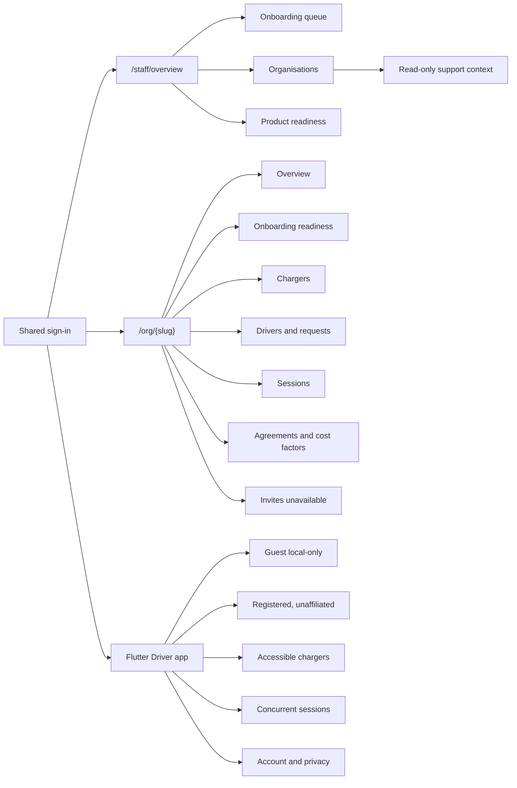

# Product-to-market UI contract

Date: 2026-08-09

This packet is the frontend boundary for the Straumvakt staff, organisation
admin, and Driver experiences. It is derived from the release candidate at
`4b69d0f`, the onboarding domain packet at `54c7155`, and the two Codex UI
branches. It does not claim that a source-wired path has been exercised against
beta, a real database, or hardware.

## Verdict

The product has enough read contracts to present a useful operational view and
enough write contracts to review driver access requests and create a charger
inside an existing organisation. It does not yet have a safe singular join
contract, persisted support context, installation code/passphrase contract, or
driver-visible access-request status feed.

The UI rule is therefore:

1. Real read or write contract: wire the control and surface API failures.
2. Read contract only: show current state without an enabled mutation.
3. Missing contract: show a disabled control with the missing dependency.
4. Unsafe contract: do not offer the action.
5. Unknown hardware behavior: say that it requires field verification.

## Workflow coverage matrix

| Workflow                                   | Surface    | Verdict                             | Evidence                                                                                                              | UI disposition                                                  |
| ------------------------------------------ | ---------- | ----------------------------------- | --------------------------------------------------------------------------------------------------------------------- | --------------------------------------------------------------- |
| Organisation application queue/detail      | Staff      | Ready, read-only in this UI         | `GET /api/admin/host-applications` and `/:id`                                                                         | Existing queue and detail remain live                           |
| Singular organisation onboarding aggregate | Staff      | Disabled pending backend            | No aggregate or step command in runtime source; packet `02` is proposed                                               | Readiness view only                                             |
| Organisation inventory and tenant entry    | Staff      | Ready                               | `GET /api/admin/orgs`, `/orgs/:id`, `/api/admin/me`                                                                   | Organisation directory and tenant route                         |
| Staff support context                      | Staff      | Read-only only                      | No persisted support-context model or command                                                                         | Permanent actor/org banner; no mutations or impersonation       |
| Installation inventory                     | CPO        | Ready                               | `GET /api/admin/installations`, org-scoped reads                                                                      | Display readiness and OCPP identity counts                      |
| Charger inventory                          | CPO        | Ready                               | `GET /api/admin/orgs/:id/chargers`                                                                                    | Live table with online/offline and installation                 |
| Charger creation in an existing site       | CPO        | Ready but destructive               | `POST /api/admin/chargers`; password returned once                                                                    | Form with explicit one-time-secret handling; no automatic retry |
| Full org-to-charger chain                  | Staff      | Ready but not the CPO path          | `POST /api/admin/onboarding/chains` creates a new org and full hierarchy                                              | Do not use from an existing organisation page                   |
| OCPP password rotation/disable             | CPO        | Ready but operationally dangerous   | installation password routes                                                                                          | Out of this UI slice; requires a separate guarded workflow      |
| Driver membership list                     | CPO        | Ready, read-only                    | `GET /api/admin/billing/driver-contracts?orgId=`                                                                      | Driver directory with group/agreement/dormancy                  |
| Driver access-request inbox                | CPO        | Ready                               | `GET/PATCH /api/admin/access-requests`                                                                                | Approve and deny with explicit reason                           |
| Driver invite bootstrap                    | CPO/Driver | Unsafe until security fix           | `invites/consume` can overwrite an existing password and discards `kennitala`                                         | Disabled; do not direct new users into this path                |
| Identity-bound driver invite redemption    | Driver     | Ready for existing path             | `claim-invite` plus authenticated `redeem-invite`                                                                     | Existing Driver invite flow retained                            |
| Installation code/passphrase               | Driver     | Disabled pending backend            | Proposed contract only; no runtime route or persistence                                                               | Inputs visible but disabled                                     |
| Driver access-request submission           | Driver     | Partial                             | `POST /api/driver/access-requests` needs an installation UUID, but unaffiliated discovery and status reads are absent | Do not offer as a complete workflow yet                         |
| Driver access-request status/cancel        | Driver     | Disabled pending backend            | No driver GET/cancel route                                                                                            | Pending/rejected fixtures only in local preview/tests           |
| Site access classification                 | CPO        | Ready                               | `PATCH /api/admin/sites/:siteId` supports `public`, `private`, `taxi_only`                                            | May be displayed; do not describe it as a driver grant          |
| Charger visibility to drivers              | CPO        | Disabled pending domain decision    | Driver charger visibility is agreement/membership-derived; no visibility policy contract                              | Disabled policy panel                                           |
| Cost-factor catalogue                      | CPO        | Ready, read-only for this slice     | `GET /api/admin/billing/cost-factors`                                                                                 | Catalogue and usage counts                                      |
| Driver cost/agreement assignment           | CPO        | Read-only only                      | Membership/agreement read exists; no narrow assignment command in this surface                                        | Show assignment; no edit control                                |
| Active and completed sessions              | CPO/Driver | Ready                               | org session summary; Driver current/history/detail endpoints                                                          | Read views and concurrent-session chooser                       |
| Live power                                 | Driver     | Truthful only when non-null         | backend may emit no measured value; client maps zero to absent                                                        | Render `Unavailable`, never inferred power                      |
| Mid-session cost                           | Driver     | Provisional                         | cost may be null until projection                                                                                     | Render `Pending`; final pricing only after close                |
| Audit/event trail read                     | Staff/CPO  | Disabled pending backend            | Audit writes exist; no audit read endpoint                                                                            | Readiness card only                                             |
| Account self-deletion                      | Driver     | Disabled pending backend/legal flow | No deletion contract                                                                                                  | Disabled control with support route copy                        |

## Route and navigation map

## Local demo-data contract

Any local visual preview must satisfy all of these rules:

- It is available only when `STRAUMVAKT_LOCAL_PRODUCT_PREVIEW=1`.
- It performs no network request and imports no API client.
- Every synthetic record uses reserved `demo-*` identifiers and `.test` email
  addresses.
- It is labelled `Local preview` in the first viewport.
- Controls that would mutate data are disabled or replace the action with a
  statement of the real dependency.
- The variable is absent from Wrangler configuration, CI, beta and production.
- The preview route returns `notFound()` when the variable is absent.
- No fixture is inserted through Prisma, Drizzle, SQL, API calls, or seeds.

This is a rendering harness, not a product environment.

## What Andri can test today

| Experience | Test today                                                                                                                      | Needs backend or environment work                                                             |
| ---------- | ------------------------------------------------------------------------------------------------------------------------------- | --------------------------------------------------------------------------------------------- |
| Staff      | Queue, organisation directory, read-only support context, readiness matrix                                                      | Aggregate commands, persistent support context, audit read                                    |
| CPO        | Overview, chargers, charger-create form behavior, driver directory, access-request review form, sessions, cost-factor catalogue | Safe invite flow, installation-code policy, driver visibility policy, cost assignment command |
| Driver     | Guest/unaffiliated states, invite entry, concurrent sessions, truthful power/cost states, activity, account/privacy             | Installation-code submission, request status/cancel, registration/legal, deletion             |

## Backend continuation prompts

### Singular join and installation access

Implement the identity-bound `join` command described in
`docs/domain/onboarding/04-invite-consolidation.md` and the access credential,
request, and policy persistence in `11-persistence-and-rollout.md`. Preserve old
clients during the compatibility window. Never overwrite an existing password;
never silently drop `kennitala`; add driver read/cancel status endpoints before
enabling the mobile pending/rejected workflow.

### Support context and audit read

Implement a platform-only, expiring support context with a distinct
`platform.support.enter` permission, actor attribution, org binding, expiry,
exit, and break-glass reason. Add a tenant-scoped audit read endpoint. Do not
impersonate an organisation user and do not allow staff to accept commercial
terms on an organisation's behalf.

### Driver visibility and cost assignment

Define a narrow contract for what `visible` means separately from site access
classification and agreement eligibility. Add explicit read/write endpoints for
driver-group agreement assignment and cost overrides with effective dates,
preview, audit attribution, and rollback. Do not reuse `site.accessLevel` as a
driver authorization switch.

## Approvals before beta

- Security fixes and compatibility sequencing for `invites/consume`.
- The singular join/access-code domain and rate-limit policy.
- Whether site classification and driver discovery are separate controls.
- Cost assignment ownership, effective-date and approval rules.
- Support-context permission, duration and notification target.
- A real observed charge using the singular onboarding path.
