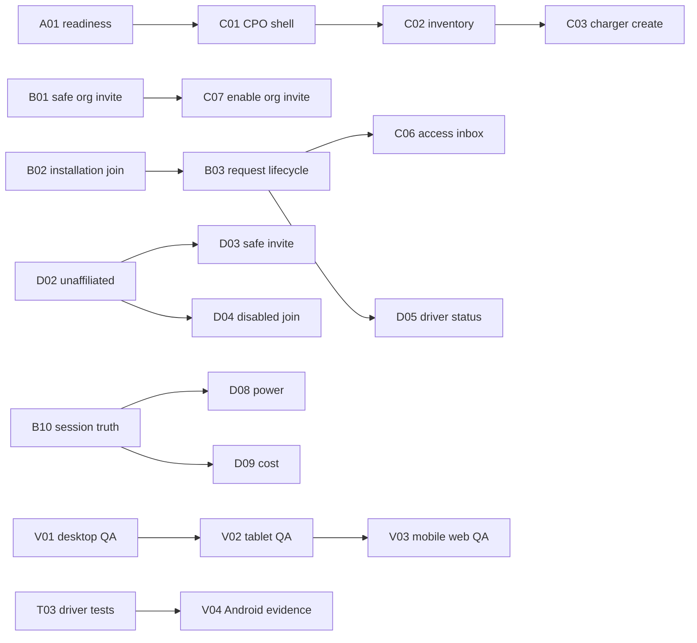

# Product UI work packages

Date: 2026-08-09
Status: local planning artifact; 64 packages, top 20 issue-ready

## Mutation legend

- `NONE`: documentation, local fixture, or test-only.
- `READ`: authenticated read surface only.
- `API`: existing runtime mutation; requires normal product authorization.
- `BACKEND`: missing or unsafe contract must be implemented and reviewed first.
- `CLOUD`: infrastructure approval required.
- `HARDWARE`: field or bench action required.

## Package registry

Every row states evidence, scope, non-goal, dependencies, acceptance, rollback, observability and mutation boundary.

### Straumvakt admin

| ID  | Package                          | Evidence                                             | Scope                                                | Non-goal                     | Dependencies                   | Acceptance                                   | Rollback             | Observability                    | Mutation |
| --- | -------------------------------- | ---------------------------------------------------- | ---------------------------------------------------- | ---------------------------- | ------------------------------ | -------------------------------------------- | -------------------- | -------------------------------- | -------- |
| A01 | Readiness inventory              | Source workflows span ready/read-only/blocked states | Staff-filtered readiness page                        | Change contracts             | Product readiness registry     | Counts and persona filters are deterministic | Remove nav/route     | Page render and test counts      | READ     |
| A02 | Organisation queue               | Existing staff aggregate and application endpoints   | Dense queue with status/owner/age                    | Self-onboarding mutation     | Staff auth and aggregate reads | Empty/loading/error/table states verified    | Remove route link    | Fetch result and visible state   | READ     |
| A03 | Organisation detail              | Aggregate lacks one canonical detail contract        | Honest partial detail with missing sections disabled | Join data client-side        | Backend aggregate              | No inferred ownership or totals              | Revert page          | Section readiness labels         | READ     |
| A04 | Support context banner           | Domain packet requires actor plus on-behalf-of org   | Persistent actor/org banner with expiry              | Impersonation                | B05 support-context contract   | Every support action shows both identities   | Remove support entry | Audit event and expiry telemetry | BACKEND  |
| A05 | Onboarding intervention timeline | No canonical audit read exists                       | Read-only event timeline placeholder                 | Invent audit history         | B06 audit read                 | Real actor/time/action only                  | Hide section         | Query latency and empty state    | BACKEND  |
| A06 | Unknown charger queue            | Staff inventory already exposes unassigned hardware  | Review/assign queue                                  | Auto-claim devices           | Existing charger reads         | Identity, last seen and reason visible       | Remove queue tab     | Queue count and age              | READ     |
| A07 | Safety stop controls             | Admin can intervene but no consolidated workflow     | Role-gated destructive-action shell                  | Execute without confirmation | Existing individual commands   | Typed confirmation and consequence copy      | Remove control       | Audit event required             | API      |
| A08 | Product health card              | Checks and workflow state are scattered              | Read-only operational summary                        | Restore work-view repo UI    | A01 and release evidence       | Product health excludes repository internals | Remove card          | Source timestamp                 | READ     |

### Organisation / CPO

| ID  | Package                       | Evidence                                                      | Scope                                          | Non-goal                             | Dependencies                  | Acceptance                                                  | Rollback                  | Observability                    | Mutation |
| --- | ----------------------------- | ------------------------------------------------------------- | ---------------------------------------------- | ------------------------------------ | ----------------------------- | ----------------------------------------------------------- | ------------------------- | -------------------------------- | -------- |
| C01 | CPO shell                     | Org landing has section registry and membership gate          | Calm reusable org navigation                   | Marketing landing page               | Org auth                      | All built sections route; blocked sections stay unavailable | Revert registry           | 404/403/navigation telemetry     | READ     |
| C02 | Charger inventory             | Sites, installations and chargers have existing reads         | Searchable operational inventory               | Live telemetry fabrication           | Existing org reads            | Identity/site/model/state shown truthfully                  | Remove page               | Fetch errors and stale timestamp | READ     |
| C03 | OCPP charger creation         | Existing `POST /api/admin/chargers` returns one-time password | Creation form and one-time credential result   | Auto-configure field device          | Existing endpoint and C01     | No retry after ambiguous success; password shown once       | Remove form               | Request id and outcome           | API      |
| C04 | Site/installation picker      | Charger creation needs valid ownership hierarchy              | Dependent selectors from server data           | Create missing site inline           | Site and installation reads   | Invalid combinations impossible                             | Fall back to explicit ids | Selection validation errors      | READ     |
| C05 | Driver membership roster      | Driver contracts endpoint exists                              | Membership, group, agreement and state table   | Infer access from identity alone     | Existing contracts read       | Inactive membership never appears granted                   | Remove page               | State distribution               | READ     |
| C06 | Access-request inbox          | Pending request read and approve/deny commands exist          | Review queue with required denial reason       | Installation-code join               | Existing endpoints            | Approve/deny updates list and errors stay visible           | Remove action buttons     | Decision actor/outcome           | API      |
| C07 | Driver invitation safety gate | Bearer consume can overwrite passwords                        | Blocked screen describing unavailable workflow | Call unsafe consume endpoint         | B01 identity-bound org invite | No network action possible                                  | Remove route              | Attempt count should remain zero | NONE     |
| C08 | Visibility policy             | Site access level exists; driver visibility contract does not | Disabled policy row                            | Reinterpret site access level        | B07 visibility contract       | Disabled until persisted/readable end to end                | Remove row                | Contract readiness state         | BACKEND  |
| C09 | Cost-factor catalogue         | Platform catalogue read exists                                | Read-only catalogue and ownership labels       | Assign factor without endpoint       | Existing catalogue read       | Currency/unit/owner visible                                 | Remove section            | Catalogue fetch status           | READ     |
| C10 | Driver cost assignment        | Assignment mutation absent                                    | Disabled assignment control                    | Mutate agreement ad hoc              | B08 assignment contract       | Enabled only with read-after-write                          | Keep read-only            | Assignment event and version     | BACKEND  |
| C11 | Session overview              | Organisation sessions have a read surface                     | Active/recent session table                    | Claim measured power when absent     | Existing session read         | Null values say unavailable                                 | Remove page               | Poll age/errors                  | READ     |
| C12 | Organisation settings         | Self-service profile/terms flows incomplete                   | Read-only identity and support entry           | Accept commercial terms for customer | Onboarding contracts          | Ownership and legal state explicit                          | Remove page               | Change requests routed           | READ     |

### Driver app

| ID  | Package                          | Evidence                                                             | Scope                                      | Non-goal                             | Dependencies                   | Acceptance                                            | Rollback                      | Observability                     | Mutation |
| --- | -------------------------------- | -------------------------------------------------------------------- | ------------------------------------------ | ------------------------------------ | ------------------------------ | ----------------------------------------------------- | ----------------------------- | --------------------------------- | -------- |
| D01 | Guest local state                | Product decision: installed app can be entirely local                | Guest shell without server claims          | Create account silently              | Local storage                  | No API call before user starts registration           | Restore prior guest route     | Local screen only                 | NONE     |
| D02 | Registered unaffiliated state    | Identity may exist without membership/access                         | Clear empty-access screen and refresh      | Treat identity as access             | Auth plus charger read         | Zero chargers never means error or granted            | Revert screen                 | Refresh outcome                   | READ     |
| D03 | Identity-bound invitation        | `/api/driver/redeem-invite` is authenticated and bound               | Code redemption for signed-in driver       | Use bearer `invites/consume`         | Existing safe endpoint         | Bearer header sent; success names group/install       | Remove entry point            | Redemption result                 | API      |
| D04 | Installation code disabled state | Code/passphrase join contract is missing                             | Disabled inputs/action with concise status | Fake local grant                     | B02 join contract              | Keyboard cannot focus/submit fields                   | Hide card                     | Contract readiness only           | NONE     |
| D05 | Access-request status            | Submit path is partial; unaffiliated status read absent              | Pending/rejected/granted state machine     | Infer state from charger count       | B03 request/status contract    | State survives restart and denial reason is shown     | Hide request entry            | State transition telemetry        | BACKEND  |
| D06 | Concurrent-session chooser       | Multiple sessions are a product requirement                          | Stable session id chooser                  | Collapse to newest session           | Existing session list/detail   | Two sessions remain distinguishable across polls      | Return to single session view | Selected id and poll result       | READ     |
| D07 | Session identity preservation    | Earlier client could switch identity during polls                    | Bind detail updates to selected id         | Guess by connector label             | D06                            | Poll cannot replace selected id                       | Revert state holder           | Mismatch counter                  | READ     |
| D08 | Truthful power                   | Backend may return null/unmeasured power                             | Unavailable state and provenance label     | Display `0.0 kW` as measured         | Session DTO                    | Null is not formatted as zero                         | Hide power row                | Null/known distribution           | READ     |
| D09 | Truthful cost                    | Cost uses aurar contract and can be unpriced                         | Distinguish free, pending and unavailable  | Treat zero as universally free       | Billing contract clarification | Fixture covers null/zero/positive                     | Hide projected cost           | Cost-state distribution           | READ     |
| D10 | Account/privacy state            | Account deletion contract absent                                     | Read-only identity/privacy screen          | Claim deletion is complete           | B09 privacy contract           | Missing destructive action is disabled                | Remove route                  | Support request link              | BACKEND  |
| D11 | Vehicle profile recovery         | Vehicle visual work exists but user-specific model behavior does not | Parked preview, no charging identity claim | Infer Autocharge identity from model | Vehicle contract               | No fabricated VIN/EVCCID/EMAID                        | Hide page                     | Local only                        | NONE     |
| D12 | Offline capability boundary      | BLE/settings exist but network behavior differs                      | Per-capability offline banner              | Promise full offline operation       | Hardware capability discovery  | Cloud/BLE state visible and no automatic retry of PIN | Disable entry                 | Transport and verification result | HARDWARE |

### Backend contract dependencies

| ID  | Package                         | Evidence                                                            | Scope                                          | Non-goal                                      | Dependencies                         | Acceptance                                                  | Rollback                | Observability                         | Mutation |
| --- | ------------------------------- | ------------------------------------------------------------------- | ---------------------------------------------- | --------------------------------------------- | ------------------------------------ | ----------------------------------------------------------- | ----------------------- | ------------------------------------- | -------- |
| B01 | Consolidate organisation invite | Unsafe consume overwrites existing password and drops kennitala     | Identity-bound organisation onboarding path    | Keep two equivalent public paths              | Security review and client migration | Existing password cannot be reset by invite possession      | Feature flag old path   | Claim/reject audit                    | BACKEND  |
| B02 | Installation join contract      | No code/passphrase aggregate or persistence                         | Issue/redeem/revoke installation credential    | Identify a driver from shared technical token | Assignment model                     | Optional org approval and deterministic status              | Disable issuance        | Issuance/redemption/revocation events | BACKEND  |
| B03 | Driver request aggregate        | Submit exists without complete unaffiliated read model              | Request create/status/cancel API               | Grant membership implicitly                   | B02/access model                     | Idempotent request and denial reason                        | Disable create          | Lifecycle metrics                     | BACKEND  |
| B04 | Organisation aggregate          | Eleven routes have no current in-repo caller and data is fragmented | Canonical org detail read                      | Add UI-specific SQL joins everywhere          | Domain packet                        | One tenant-scoped response with versions                    | Keep existing reads     | Latency/completeness                  | BACKEND  |
| B05 | Support context                 | No persistence/expiry command                                       | Enter/exit scoped support context              | Impersonate customer                          | New permission and audit             | Actor and on-behalf-of ids on every mutation                | Disable support mode    | Enter/exit/expiry events              | BACKEND  |
| B06 | Audit read model                | Attribution exists unevenly and no canonical read                   | Tenant-safe event projection                   | Expose secrets or raw meter payload           | Retention decision                   | Actor/action/subject/time/correlation available             | Disable timeline        | Projection lag                        | BACKEND  |
| B07 | Visibility policy               | Site access level is not a complete driver visibility contract      | Persist and read discovery policy              | Rename existing enum without migration        | Product decision                     | Default explicit; driver preview testable                   | Feature flag            | Policy version and evaluation         | BACKEND  |
| B08 | Cost assignment                 | Catalogue read exists but assignment command is missing             | Versioned driver/group cost-factor assignment  | Rewrite tariff engine                         | Agreement model                      | Effective dates and owner preserved                         | End assignment          | Assignment audit                      | BACKEND  |
| B09 | Privacy lifecycle               | No account-deletion contract                                        | Request/export/delete state machine            | Immediate destructive delete                  | Legal retention decision             | Confirmation, cooling period and retained-record disclosure | Cancel before execution | Lifecycle audit                       | BACKEND  |
| B10 | Session truth contract          | Power/cost provenance and null semantics have drifted               | Explicit measured/projected/unavailable fields | Change OCPP ingestion in UI ticket            | Billing/session owners               | Clients need no zero-value workaround                       | Compatibility window    | Contract-version metrics              | BACKEND  |

### Visual QA

| ID  | Package                     | Evidence                                 | Scope                                         | Non-goal                 | Dependencies        | Acceptance                               | Rollback               | Observability         | Mutation |
| --- | --------------------------- | ---------------------------------------- | --------------------------------------------- | ------------------------ | ------------------- | ---------------------------------------- | ---------------------- | --------------------- | -------- |
| V01 | Desktop role preview        | 1280 x 720 screenshots exist             | Regression captures for three personas        | Production fixture route | Local preview gate  | Pixel review, no overlap                 | Remove preview         | Screenshot artifact   | NONE     |
| V02 | Tablet web pass             | Not yet captured                         | 1024 x 768 all routes                         | Redesign data density    | Stable pages        | No clipped tabs/tables                   | CSS revert             | Screenshot artifact   | NONE     |
| V03 | Mobile web pass             | Not yet captured                         | 390 x 844 preview and key CPO routes          | Replace Flutter app      | Responsive CSS      | Commands remain reachable                | CSS revert             | Screenshot artifact   | NONE     |
| V04 | Android state capture       | APK builds; screen evidence pending      | Guest/unaffiliated/invite/session screenshots | Hardware validation      | Emulator            | Device/version/APK hash recorded         | Reinstall baseline APK | Screenshot/log bundle | NONE     |
| V05 | Empty/error/loading gallery | Current routes implement states unevenly | Deterministic state catalogue                 | Simulate API success     | Component injection | Every data surface has all three         | Remove fixtures        | Component tests       | NONE     |
| V06 | Visual token audit          | Existing palette is dark operational UI  | Contrast/spacing/status token inventory       | New brand redesign       | Design review       | Tokens reused, no one-note palette drift | Token revert           | Screenshot diff       | NONE     |

### Accessibility

| ID  | Package                | Evidence                                        | Scope                              | Non-goal                             | Dependencies        | Acceptance                               | Rollback           | Observability          | Mutation |
| --- | ---------------------- | ----------------------------------------------- | ---------------------------------- | ------------------------------------ | ------------------- | ---------------------------------------- | ------------------ | ---------------------- | -------- |
| X01 | Keyboard navigation    | Native controls mostly used                     | Full route keyboard pass           | Custom keybindings                   | Auth fixture        | Logical order and visible focus          | Revert focus CSS   | Manual checklist       | NONE     |
| X02 | Screen-reader status   | Status text exists; live updates unverified     | Announce request/mutation outcomes | Narrate static decoration            | Component semantics | NVDA/TalkBack script passes              | Remove live region | QA record              | NONE     |
| X03 | Contrast/high contrast | Status palette visually reviewed only           | WCAG contrast and Windows mode     | Brand recolour                       | Token inventory     | Text/control thresholds pass             | Token revert       | Audit report           | NONE     |
| X04 | Zoom/text scale        | Compact operational surfaces risk overflow      | 200% web and 1.3x Android text     | Scale display headings with viewport | Responsive pass     | No overlap/loss of action                | CSS/layout revert  | Screenshots            | NONE     |
| X05 | Error comprehension    | Denial/security states carry consequential copy | Plain-language error inventory     | Translate now                        | Product copy review | Error says what happened and next action | Copy revert        | Support feedback later | NONE     |

### Testing

| ID  | Package                     | Evidence                                           | Scope                               | Non-goal                        | Dependencies         | Acceptance                                  | Rollback                    | Observability     | Mutation |
| --- | --------------------------- | -------------------------------------------------- | ----------------------------------- | ------------------------------- | -------------------- | ------------------------------------------- | --------------------------- | ----------------- | -------- |
| T01 | Readiness registry tests    | Three focused tests green                          | Counts/persona/filter invariants    | Endpoint integration            | A01                  | Mutation fool-test fails                    | Remove registry             | CI result         | NONE     |
| T02 | CPO component tests         | Build/typecheck pass; interaction tests absent     | Charger/access/error states         | Live mutation                   | Component injection  | Deterministic request assertions            | Remove tests                | CI result         | NONE     |
| T03 | Driver contract tests       | 48 Flutter tests green                             | Safe invite and disabled join paths | Real login                      | D03/D04              | Unsafe endpoint has no UI caller            | Revert navigation           | Test result       | NONE     |
| T04 | Browser smoke suite         | Manual browser evidence exists                     | Gated preview role/tab assertions   | Authenticated beta smoke        | Local server         | Runs without external network               | Remove suite                | Trace/screenshots | NONE     |
| T05 | Android five-version matrix | Only build/widget columns are evidenced            | Install/open/layout across 11-15    | BLE hardware claim              | Emulator/device pool | Every cell has evidence or explicit not-run | Remove unsupported claim    | Device logs       | NONE     |
| T06 | Contract drift guard        | Client workarounds can become accidental contracts | Assert null/provenance semantics    | Freeze flawed DTO names forever | B10                  | Fails on zero/null collapse                 | Remove after API versioning | CI result         | NONE     |

### Documentation and handoff

| ID  | Package                      | Evidence                                           | Scope                                   | Non-goal                    | Dependencies   | Acceptance                               | Rollback       | Observability    | Mutation |
| --- | ---------------------------- | -------------------------------------------------- | --------------------------------------- | --------------------------- | -------------- | ---------------------------------------- | -------------- | ---------------- | -------- |
| O01 | Product contract             | Source-derived matrix now exists                   | Workflow readiness and route map        | Replace ADRs                | Reconciliation | Every enabled action cites a contract    | Revert doc     | Review date      | NONE     |
| O02 | Demo-data contract           | Preview uses `.test`/`demo-*` and no API client    | Fixture boundary and gate               | Seed beta                   | Local preview  | Route absent without flag                | Remove preview | Build check      | NONE     |
| O03 | Andri test script            | Manual workflow list exists                        | Human-readable local runbook            | Operator production runbook | V01/D03        | New tester completes without hidden step | Revert doc     | Checklist record | NONE     |
| O04 | Backend continuation prompts | Missing contracts are enumerated                   | Security-scoped prompts for next agents | Authorize mutations         | B01-B10        | Each prompt states stop conditions       | Revert prompts | Handoff review   | NONE     |
| O05 | Release evidence index       | Artifacts span worktrees and external evidence dir | Tips/files/tests/screenshots/risks      | Push or merge               | Final QA       | Reproducible from clean worktrees        | Revert doc     | Hash/timestamp   | NONE     |

## Top 20 issue-ready bodies

### A01 - Staff workflow readiness inventory

**Evidence:** product workflows had no single source-derived UI and the retired work-view page concerned repository health, not launch capability.
**Scope:** maintain a typed workflow registry and staff-only page with persona and readiness filters.
**Non-goals:** change API behavior, restore work-view, or expose repository internals.
**Dependencies:** staff session gate.
**Acceptance:** registry tests cover totals, persona filtering and state filtering; page renders loading/error-free from static registry.
**Rollback:** remove nav item, route and registry.
**Observability:** page route logs only normal render failures; no user data.
**Mutation:** `READ`.

### A02 - Staff organisation onboarding queue

**Evidence:** application and aggregate reads exist, while no consolidated workflow view is present in the relaunched UI.
**Scope:** list applicant organisation, contact, state, age and assigned staff owner with empty/error/loading states.
**Non-goals:** accept terms or create membership on behalf of an applicant.
**Dependencies:** staff authentication and existing queue reads.
**Acceptance:** tenant data never appears before auth; sort and state filters are deterministic.
**Rollback:** unlink route; no persisted state changes.
**Observability:** fetch latency, count and error class.
**Mutation:** `READ`.

### A03 - Staff organisation detail aggregate

**Evidence:** organisation facts are spread across routes and eleven onboarding endpoints have no current in-repo caller.
**Scope:** render available identity, membership, installations, driver groups and unresolved steps as separate sections.
**Non-goals:** client-side joins that imply atomicity.
**Dependencies:** B04.
**Acceptance:** every field has server provenance; unavailable sections remain disabled.
**Rollback:** fall back to queue only.
**Observability:** aggregate completeness and version.
**Mutation:** `READ`.

### A04 - Scoped support context

**Evidence:** support must preserve the real actor and identify the tenant; current source has no enter/exit persistence contract.
**Scope:** explicit enter, persistent redacted banner, expiry countdown and exit.
**Non-goals:** impersonation or completing commercial acceptance.
**Dependencies:** B05 plus new platform support permission.
**Acceptance:** every downstream mutation contains actor and on-behalf-of ids; expiry ends access.
**Rollback:** disable support entry globally.
**Observability:** enter/exit/expiry/action correlation events.
**Mutation:** `BACKEND`.

### A05 - Staff onboarding audit timeline

**Evidence:** no canonical tenant-safe audit read exists.
**Scope:** chronological actor/action/subject/outcome display with correlation id.
**Non-goals:** expose credentials, secrets, raw OCMF or sensitive request bodies.
**Dependencies:** B06 and retention decision.
**Acceptance:** cross-tenant event query returns 404/empty by policy; timestamps and actors are immutable.
**Rollback:** hide timeline while retaining audit writes.
**Observability:** projection lag and query errors.
**Mutation:** `BACKEND`.

### C01 - Organisation operational shell

**Evidence:** the relaunch contains an organisation landing and a built-section registry.
**Scope:** shared navigation, tenant identity, role label and predictable section layout.
**Non-goals:** marketing hero or platform-admin tools.
**Dependencies:** organisation membership authorization.
**Acceptance:** every link is tenant-scoped and unavailable sections cannot be navigated directly.
**Rollback:** restore landing-only registry.
**Observability:** authorization failures and unknown slugs.
**Mutation:** `READ`.

### C02 - Organisation charger inventory

**Evidence:** sites, installations and chargers are readable through existing endpoints.
**Scope:** table with OCPP identity, installation, hardware and truthful state.
**Non-goals:** synthesize connector telemetry or configuration capabilities.
**Dependencies:** C01 and existing reads.
**Acceptance:** empty/error/loading states, stable columns and no cross-tenant rows.
**Rollback:** remove route from built sections.
**Observability:** fetch age and stale-state marker.
**Mutation:** `READ`.

### C03 - Existing OCPP charger creation workflow

**Evidence:** `POST /api/admin/chargers` exists and returns a one-time OCPP password.
**Scope:** validate installation, create identity, display credential once and require explicit acknowledgement.
**Non-goals:** configure a physical charger or automatically retry ambiguous requests.
**Dependencies:** C04 and existing endpoint authorization.
**Acceptance:** one request per submit; success clears secret after leaving; errors preserve safe input.
**Rollback:** remove form while retaining inventory.
**Observability:** request id, actor, installation and outcome without password.
**Mutation:** `API`.

### C04 - Hierarchical site and installation selector

**Evidence:** charger creation currently depends on valid organisation-owned installation ids.
**Scope:** load sites and installations, constrain choices and show no-site/no-installation states.
**Non-goals:** inline site creation.
**Dependencies:** existing reads.
**Acceptance:** an installation from another site or tenant cannot be submitted.
**Rollback:** disable creation form.
**Observability:** validation rejection count.
**Mutation:** `READ`.

### C05 - Driver membership roster

**Evidence:** driver contracts read includes membership/agreement state.
**Scope:** searchable roster with group, agreement, activation and installation scope.
**Non-goals:** infer access from account existence.
**Dependencies:** C01 and existing read.
**Acceptance:** inactive, invited and active remain distinct.
**Rollback:** remove route.
**Observability:** state distribution and fetch failure.
**Mutation:** `READ`.

### C06 - Driver access-request inbox

**Evidence:** pending reads and approve/deny commands exist.
**Scope:** review request evidence, approve, or deny with required reason.
**Non-goals:** issue or redeem installation codes.
**Dependencies:** existing endpoint authorization.
**Acceptance:** double-submit is prevented; denial without reason is impossible; list refreshes after decision.
**Rollback:** remove action buttons.
**Observability:** actor, request, decision and outcome.
**Mutation:** `API`.

### C07 - Block unsafe organisation invite consumption

**Evidence:** public invite consumption can overwrite an existing password and ignores the app-supplied kennitala.
**Scope:** keep the org invite UI non-interactive until B01 lands.
**Non-goals:** paper over the flaw with warning copy.
**Dependencies:** B01.
**Acceptance:** no reachable component calls `/api/public/invites/consume`.
**Rollback:** remove route entirely.
**Observability:** static contract state only.
**Mutation:** `NONE`.

### D01 - Local-only guest state

**Evidence:** product decision permits an installed app with no account and no server relationship.
**Scope:** render local guest identity and an explicit registration entry.
**Non-goals:** background account creation or charger discovery.
**Dependencies:** local secure storage boundary.
**Acceptance:** cold install produces no authenticated API request.
**Rollback:** restore prior guest screen.
**Observability:** none until consented registration.
**Mutation:** `NONE`.

### D02 - Registered but unaffiliated driver

**Evidence:** identity can exist without organisation membership, driver group, charger access, sessions or billing.
**Scope:** empty-access state with refresh and safe invitation entry.
**Non-goals:** call the user an organisation member.
**Dependencies:** authenticated charger read.
**Acceptance:** zero chargers is a stable state; refresh navigates when real access appears.
**Rollback:** restore previous empty screen.
**Observability:** refresh success/failure without PII.
**Mutation:** `READ`.

### D03 - Identity-bound driver invitation redemption

**Evidence:** safe authenticated `/api/driver/redeem-invite` exists but the app previously navigated to unsafe public consume.
**Scope:** submit invitation code under the signed-in identity and show returned group/installation.
**Non-goals:** set or overwrite a password.
**Dependencies:** driver token and existing endpoint.
**Acceptance:** contract test proves bearer header/path/body; no UI caller remains for unsafe consume.
**Rollback:** remove invitation entry while preserving unaffiliated state.
**Observability:** redemption outcome and server correlation id.
**Mutation:** `API`.

### D04 - Disabled installation-code state

**Evidence:** no complete code/passphrase issue, redemption, approval and status contract exists.
**Scope:** render disabled fields and action with a concise availability state.
**Non-goals:** local validation that resembles server acceptance.
**Dependencies:** B02.
**Acceptance:** fields and submit are semantically disabled and issue no request.
**Rollback:** hide the entire option.
**Observability:** none.
**Mutation:** `NONE`.

### D05 - Driver access request lifecycle

**Evidence:** a partial submit path exists, but unaffiliated drivers lack a complete request-status read.
**Scope:** create, pending, rejected, granted and cancelled states with restart recovery.
**Non-goals:** infer grant from visible charger count.
**Dependencies:** B03.
**Acceptance:** idempotent submit, stable request id, denial reason and retry policy.
**Rollback:** disable request entry.
**Observability:** state transition and age.
**Mutation:** `BACKEND`.

### B01 - Identity-bound organisation onboarding

**Evidence:** bearer invite consumption grants organisation membership, overwrites passwords and strips kennitala.
**Scope:** consolidate on an authenticated/identity-bound claim model and migrate clients before hardening the old route.
**Non-goals:** break already-issued invitations without a transition.
**Dependencies:** security owner, compatibility plan and tests for existing accounts.
**Acceptance:** possession alone cannot reset credentials or grant mismatched identity; old route is disabled only after client migration.
**Rollback:** retain compatibility path behind a kill switch without password overwrite.
**Observability:** issued/claimed/rejected/expired counts and actor identity.
**Mutation:** `BACKEND`.

### B02 - Installation code/passphrase join contract

**Evidence:** the required product flow has no durable aggregate or complete API.
**Scope:** issue scoped credential, redeem, optionally request org approval, read status, revoke and rotate.
**Non-goals:** use shared credential as driver identity or OCPP RFID identity.
**Dependencies:** assignment model, expiry/rotation decisions and rate limiting.
**Acceptance:** hashed secret storage, single displayed plaintext, idempotent redemption and optional approval policy.
**Rollback:** disable issuance and redemption while preserving pending records.
**Observability:** no plaintext; issue/redeem/reject/revoke audit.
**Mutation:** `BACKEND`.

### B03 - Driver access-request aggregate

**Evidence:** the UI needs persistent pending/rejected/granted state, while current unaffiliated reads are insufficient.
**Scope:** tenant-scoped request resource with create/read/cancel and organisation decision linkage.
**Non-goals:** duplicate driver-group membership.
**Dependencies:** B02 or another discovery/targeting mechanism.
**Acceptance:** one open request per driver/target; 404 on cross-tenant reads; decision creates access exactly once.
**Rollback:** stop new requests and retain read-only status.
**Observability:** queue age, decision latency and duplicate suppression.
**Mutation:** `BACKEND`.

## Dependency order

