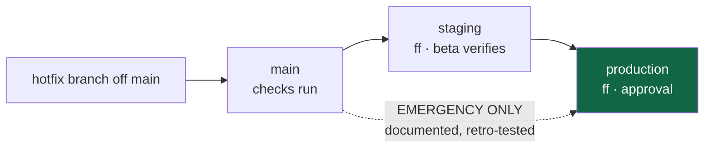

# Branch and promotion system

**Specification and pseudocode appendices. No workflow file, branch, ruleset or
protection setting was created or changed.**

## The invariant

> Production runs **the exact commit beta ran**. Nothing is edited on the way,
> and no environment difference lives in a branch.

Everything below exists to make that verifiable rather than aspirational.

## Branch model

| Branch | Purpose | Owner | Allowed update | Protection |
|---|---|---|---|---|
| `main` | canonical integrated source | engineering | PR merge only | no force-push, no delete, required checks |
| `staging` | **beta deploy pointer** | engineering | **fast-forward from `main` only** | no force-push, no delete, no direct commits |
| `production` | **production deploy pointer** | release owner | **fast-forward from the beta-tested commit only** | as above + 1 approval |

Neither pointer is ever committed to. If a pointer needs to move backwards, that
is a **rollback of the Worker version**, not a Git operation.

## Fast-forward verification

The only correctness check that matters before advancing a pointer:

```bash
git fetch origin
git rev-list --left-right --count origin/<pointer>...origin/<source>
# REQUIRED: left side is 0.  "0<TAB>N" = fast-forward.
# Anything else means the pointer has commits the source does not, and the
# promotion is NOT a promotion — stop.
```

Current values (DF, 2026-08-09): `staging...RC` = `0 166` — a true fast-forward.

## Exact-commit identity proof

Three independent checks. **All three, not one** — each catches something the
others miss.

| # | Check | Catches |
|---|---|---|
| 1 | `git rev-parse origin/production` **==** the recorded beta-tested SHA | a different commit |
| 2 | `git rev-list --left-right --count` left side **== 0** | a divergent pointer |
| 3 | `git diff --stat <beta-sha> origin/production` is **empty** | a same-SHA claim that is actually a different tree (should be impossible; verifies the first two were run against the right refs) |

Check 3 is cheap and exists because the failure it catches — a stale local ref
making checks 1 and 2 pass against the wrong thing — is the realistic human error.

## Release manifest — the artefact that makes a release auditable

Produced at promotion time, stored **outside** the repository with the release
evidence. Contents:

```yaml
release_id:        release-2026-08-09
commit:            <full sha>
tag:               release-2026-08-09
promoted_from:     staging
beta_tested_since: <UTC of the beta deploy of this exact sha>
worker_versions_before: { web: "", api: "", ocpp: "" }   # rollback targets
worker_versions_after:  { web: "", api: "", ocpp: "" }
migrations_recorded:    47
mobile_min_supported:   <version>
approver:          <name>
checks:            { check: pass, fast_forward: pass, identity: pass }
```

**`worker_versions_before` is the single most valuable field.** It is the rollback
target, and today no such record exists for any Worker.

## Deployment tags

The `production` branch is the trigger (accepted decision). Tags are
**additional**, and the reason is operational rather than aesthetic: a branch
answers *"what should be running"*; only an immutable tag answers *"what **was**
running when this incident started"* — the first question in most runbooks here.

Convention: annotated `release-YYYY-MM-DD[-n]`, matching the repo's existing
habit (`staging-deploy-2026-06-04-pre-goingpublic`).

## Hotfix path



**The dotted path is deliberately ugly.** A hotfix that skips beta must be
recorded as a deviation with a named approver and a follow-up beta verification.
Making it visually awkward is intentional; making it *impossible* would mean the
first real incident is handled by someone editing protections under pressure.

## Abandoned release handling

A promoted commit that fails beta is abandoned, not reverted:

1. Do **not** move `staging` backwards — a fast-forward-only pointer cannot, and
   forcing it is a production action.
2. Fix forward on `main`; promote the new commit.
3. Record the abandoned `release_id` with its reason.
4. If it already reached production, roll back the **Worker version**, then fix
   forward. The branch stays where it is; the running code does not.

## Beta data compatibility

Beta and production hold **different data with different lifecycles**. A promotion
must therefore assert compatibility, not assume it:

| Question | Gate |
|---|---|
| Does this commit require a migration not yet applied to production? | migration count in the manifest |
| Does it change a driver API contract? | mobile compatibility gate below |
| Does it change a field's meaning without changing its name? | **the dangerous case** — needs an explicit note in the manifest |

The last row exists because of a real precedent in this codebase: a monetary
field whose *unit* was ambiguous while its *name* stayed constant. Type-checking
does not catch that class of change, and neither does a diff review at a glance.

## Mobile and backend compatibility gate

**Constraint (DF):** the shipped mobile app pins
`hlada-api-staging.straumvakt.workers.dev` and **cannot be rolled back like a
Worker**. Therefore:

| Rule | Rationale |
|---|---|
| The API keeps N−1 mobile compatibility for at least one release | there is always an installed base you cannot update |
| A contract change ships **additively first**, removal at least one release later | the client must be able to run against both shapes |
| The manifest records `mobile_min_supported` | makes the compatibility window explicit rather than remembered |
| Renaming or retiring the pinned host requires evidence of **zero traffic** | the only safe signal |

---

# Appendix A · Proposed GitHub workflows (pseudocode — **not implemented**)

Illustrative only. No workflow file was created or edited.

## A1 · `main` integration check

```yaml
name: main-check
on:
  pull_request:
  push: { branches: [main] }
permissions:
  contents: read          # least privilege — no write, no id-token
concurrency:
  group: main-check-${{ github.ref }}
  cancel-in-progress: true
jobs:
  check:
    runs-on: ubuntu-latest
    steps:
      - uses: actions/checkout@v4
      - uses: actions/setup-node@v4
        with: { node-version: 22 }
      - run: npm install --no-audit --no-fund
      - run: npm run db:generate
      - run: npm run check
```

**Fork behaviour:** `pull_request` from a fork runs with a read-only token and
**no access to secrets** — which is why `check` must not require a database
credential. `pull_request_target` is explicitly **not** used: it is privileged and
would hand a fork's code repository write access.

## A2 · Promotion to beta

```yaml
name: promote-staging
on: { workflow_dispatch: { inputs: { sha: { required: true } } } }
permissions: { contents: write }     # needs to move a ref
concurrency: { group: promote-staging, cancel-in-progress: false }
jobs:
  promote:
    runs-on: ubuntu-latest
    environment: beta                # deployment environment, no reviewers
    steps:
      - uses: actions/checkout@v4
        with: { fetch-depth: 0 }
      - name: Verify fast-forward
        run: |
          left=$(git rev-list --left-right --count origin/staging...${{ inputs.sha }} | cut -f1)
          test "$left" = "0" || { echo "NOT a fast-forward"; exit 1; }
      - name: Verify the sha is an ancestor of main
        run: git merge-base --is-ancestor ${{ inputs.sha }} origin/main
      - run: git push origin ${{ inputs.sha }}:staging
```

`cancel-in-progress: false` is deliberate: cancelling a half-finished ref move is
worse than queueing.

## A3 · Promotion to production

```yaml
name: promote-production
on: { workflow_dispatch: { inputs: { sha: {required: true}, release_id: {required: true} } } }
permissions: { contents: write }
concurrency: { group: promote-production, cancel-in-progress: false }
jobs:
  promote:
    runs-on: ubuntu-latest
    environment: production          # REQUIRED REVIEWERS — the human gate
    steps:
      - uses: actions/checkout@v4
        with: { fetch-depth: 0 }
      - name: Prove this exact sha ran in beta
        run: |
          git merge-base --is-ancestor ${{ inputs.sha }} origin/staging
          left=$(git rev-list --left-right --count origin/production...${{ inputs.sha }} | cut -f1)
          test "$left" = "0"
      - name: Emit release manifest artifact
        run: ./scripts/analysis/emit-release-manifest.sh > manifest.yaml   # NOT WRITTEN
      - uses: actions/upload-artifact@v4
        with: { name: release-${{ inputs.release_id }}, path: manifest.yaml }
      - run: git push origin ${{ inputs.sha }}:production
      - run: git tag -a ${{ inputs.release_id }} ${{ inputs.sha }} -m "..." && git push origin ${{ inputs.release_id }}
```

## Provenance and SLSA-style evidence

| Property | How |
|---|---|
| What was released | commit sha + annotated tag |
| From where | `promoted_from: staging` + ancestry proof |
| By whom | environment approval record |
| What checks passed | manifest `checks` block, artifact-attached |
| What it replaced | `worker_versions_before` |
| Tamper evidence | tag is immutable; artifact retained with the run |

This is deliberately **not** full SLSA. The gap worth naming: the *build* is
produced by Cloudflare's integration (or by hand), so the artifact that runs is
not the artifact this workflow attests. Closing that would require building and
uploading the Worker from CI — a larger change, and the honest note is that
provenance here covers **source selection**, not **binary production**.

## Failure handling

| Failure | Behaviour |
|---|---|
| Fast-forward check fails | job fails **before** any push — no partial state |
| Ancestry check fails | same |
| Push rejected by protection | job fails; protection is the backstop, not the primary check |
| Manifest emit fails | **fail the job** — a release without a rollback target is the thing to prevent |
| Tag push fails after branch push | branch moved, tag missing → **retry the tag only**; do not move the branch again |

The last row is the one that bites: the two pushes are not atomic, and the
recovery is to fix the tag, never to re-push the branch.
