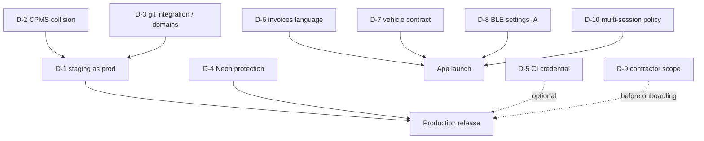

# Release decision register

Unresolved choices that need a human decision. Each states the options, what the
evidence supports, and what happens if it is left undecided. Companion to
[the main packet](2026-08-09-overnight-readiness-audit.md).

**None of these was decided by me.** Where I have a recommendation it is marked
as such and is not an action taken.

---

## D-1 · `staging` as the production deploy pointer

| | |
|---|---|
| Evidence | `straumvakt.org`, `www`, and `hlada-staging.straumvakt.workers.dev` return byte-identical bodies (SHA-256 `4bf6719964446f68…`) |
| Options | (a) keep `staging` as the live pointer; (b) promote a real production Worker and demote `staging` |
| Recommendation | (b) eventually; (a) is survivable **only** with branch protection and a known deploy trigger |
| If undecided | Every push to `staging` remains a potential production release with no gate |

## D-2 · Worker name collision and migration sequence

| | |
|---|---|
| Evidence | CPMS declares `name: "hlada"` and `env.staging.name: "hlada-staging"` — the same names, same account |
| Options | (a) migrate Straumvakt to `straumvakt-console`; (b) retire/repoint CPMS; (c) leave it |
| Recommendation | (b) **first** — it removes the live hazard; (a) is the durable fix |
| If undecided | A push to CPMS `staging` can overwrite the Worker serving `straumvakt.org` |
| Note | `4fe0a95` renames the **root** name only, i.e. the Worker that is *not* deployed |

## D-3 · Git integration and custom-domain retention

| | |
|---|---|
| Evidence | `origin/staging` config has **no** `routes` block, yet the custom domains are live — so they were attached out of band |
| Unknown | Whether a deploy omitting `routes` detaches them. **Cloudflare does not document this** |
| Options | (a) verify in dashboard first; (b) deploy and watch |
| Recommendation | (a). (b) risks the brand domain on an undocumented behaviour |
| If undecided | Domain loss is possible on the next deploy, with no advance warning |

## D-4 · Neon branch protection and default branch

| | |
|---|---|
| Evidence | `production` is primary/default and **unprotected**; `staging` also unprotected; an unqualified query reached `production` on 2026-08-08T20:38Z |
| Options | (a) protect both; (b) protect `staging` only; (c) repoint the default |
| Recommendation | (a) + (c). The trap's failure mode is silent — a wrong-branch query reads as a schema error |
| If undecided | Agents and tooling keep reaching the abandoned CPMS-era database by default |

## D-5 · CI migration-status credential

| | |
|---|---|
| Evidence | Neon console/CLI/API roles get `neon_superuser` (read **and write** everything); only SQL-created roles can be least-privilege |
| Options | (a) SQL-created least-privilege role + GitHub Environment; (b) reuse the existing credential; (c) drop the CI check |
| Recommendation | (a), with R1–R8 from the infra packet — including a **negative test** proving business tables are unreachable |
| If undecided | Either no CI migration check, or an over-privileged credential in CI |

## D-6 · "Billing records" vs "invoices" language

| | |
|---|---|
| Evidence | `GET /invoices` returns charge sessions; its own comment says so. No invoice document is generated anywhere |
| Options | (a) rename the surface; (b) build real invoice documents; (c) ship as "Invoices" |
| Recommendation | (a) now, (b) later. **(c) is a factual misstatement to customers** |
| If undecided | The app claims to show invoices it cannot produce |

## D-7 · Vehicle profile and Autocharge contract

| | |
|---|---|
| Evidence | No driver vehicle API exists; the prototype asserts plate/battery/range/Autocharge |
| Options | (a) truthful minimal screen (nickname only, user-entered, clearly not verified); (b) build the vehicle-account API; (c) remove the screen |
| Recommendation | (a) or (c) for launch. Codex is working on this |
| Required before (b) | What EVCCID/EMAID/PLC-MAC each mean, which Zaptec actually provides, where confidence is stored, and an enrolment flow |
| If undecided | The app makes vehicle claims it cannot support |

## D-8 · Charger BLE settings in the driver IA

| | |
|---|---|
| Evidence | `GET /chargers/:serial/ble-pin` and `POST /advanced-grant` are reachable with a **driver** token; PIN release is audited and never shown to the user |
| Options | (a) keep in the driver app; (b) move to an installer/contractor app; (c) gate behind a role |
| Recommendation | (b) or (c). This is installer capability wearing a driver token |
| If undecided | Every driver carries latent charger-configuration privilege |

## D-9 · Contractor access scope

| | |
|---|---|
| Evidence | `MEMBERSHIP_ROLE_PERMISSIONS` maps `contractor` → `TECHNICIAN_BUNDLE` (incl. `charger.remote_start`/`_stop`) as a **pre-ADR-0014 compatibility mapping** |
| Options | (a) keep; (b) define a real contractor bundle; (c) remove the deprecated role |
| Recommendation | (b) before any contractor is onboarded |
| If undecided | A deprecated role silently grants remote start/stop |

## D-10 · Multiple active sessions — product policy

| | |
|---|---|
| Evidence | Mechanically supported end to end; stop is deterministic via explicit `sessionId` |
| Options | (a) allow many; (b) allow one per driver; (c) allow many, surface one |
| Recommendation | Decide explicitly — the **implementation already allows many**, so silence is a decision by default |
| If undecided | Three lineages may each answer differently and the UI will disagree with itself |

---

## Decision dependency order

**D-2 and D-3 are the critical path.** Both are dashboard questions, and both
block the release rather than the app.
