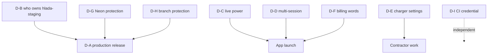

# Release decision workshop packet

For a working session with Andri and engineers. **Nothing here is decided.**
Gates are expressed in sequence terms — no invented dates.

## How to run this

Nine decisions. Six are **cheap and reversible**; three change the product. Take
the cheap ones first — several of the expensive ones look different once the
cheap ones land.

---

## D-A · Does the release proceed as a production release?

**Statement:** Advancing `staging` publishes 140 commits / 635 files to the live
brand domain in one step.
**Why now:** the deployed console is two months stale; the gap is the thing that
makes each release larger and riskier.
**Facts:** brand domains and `hlada-staging` return byte-identical bodies; the
range is a true fast-forward (`0 140`); the RC excludes `4fe0a95`, `30fa407`,
`5311cbd`.
**Unknowns:** whether the git push *is* the deploy; whether custom domains
survive; the current version id (there is no rollback target without it).
**Options:** (1) resolve WP-07/08 then release; (2) release now and watch;
(3) defer until the Worker migration.
**Recommendation:** **(1).** (2) has no rollback target, which is not a risk
appetite question but a missing prerequisite.
**Owner:** Andri · **Gate:** after WP-07, WP-08 · **Proceed meanwhile:** all P0
code work, CI, mobile.

## D-B · Who owns `hlada-staging`?

**Statement:** CPMS declares the same Worker names and documents auto-deploy.
**Facts:** `wrangler.jsonc:3,32`; CPMS dormant since 2026-04-23; `hlada` returns
error 1042.
**Unknown:** whether CPMS's Git integrations are still connected.
**Options:** (1) disconnect/repoint CPMS; (2) migrate Straumvakt to a new name;
(3) accept the risk.
**Recommendation:** **(1) now, (2) as the durable fix.** (3) is a bet that nobody
pushes to a repo that still exists.
**Owner:** Andri · **Gate:** before D-A · **Proceed meanwhile:** everything else.

## D-C · Live power — source it or drop it?

**Statement:** No power source exists; the app shows "Unavailable" indefinitely.
**Facts:** `powerKw: 0` hardcoded; the repo comment describes a surface the app
never calls; `ae5db26` renders "Unavailable".
**Options:** (1) ship without the tile; (2) derive from meter values;
(3) estimate from energy delta.
**Recommendation:** **(1) for launch, (2) as the real answer.** (3) produces a
number that looks measured and is not — the exact failure this packet exists to
remove.
**Owner:** Andri + product · **Gate:** launch · **Proceed meanwhile:** WP-01.

## D-D · Multiple active sessions

**Statement:** The system already allows N>1. **Silence ships that.**
**Facts:** array end-to-end; stop requires an explicit `sessionId` and is
deterministic; `ae5db26` tracks a selection.
**Options:** (1) prohibit; (2) allow + explicit selection; (3) allow + primary.
**Recommendation:** **(3).** (1)'s failure mode is a stale row preventing a
driver from charging at all — worse than any N>1 awkwardness.
**Real question for the room:** *is two cars at once a legitimate case, or only
ever a fault?* That changes the framing more than the mechanics.
**Owner:** product · **Gate:** launch.

## D-E · Charger service settings — whose feature?

**Statement:** ~3,800 lines (38% of the mobile app) of installer-grade BLE
configuration, reachable with a **driver** token.
**Facts:** `session_guard.dart` says its guard is client-side and **not** the
security boundary; the Zaptec PIN is factory-set and **cannot be rotated**, so
caching is a permanent grant; PIN release is audit-logged; Codex removed it from
driver navigation but preserved the source.
**Options:** (1) driver app behind a role; (2) installer/contractor surface;
(3) delete.
**Recommendation:** **(2).** (3) discards bench-tested work; (1) makes the driver
token a service credential.
**Owner:** product + security · **Gate:** before any contractor work ·
**Proceed meanwhile:** WP-23 (server-side enforcement) is right under every option.

## D-F · Billing vocabulary

**Statement:** `/invoices` returns charge sessions; no invoice document exists.
**Options:** (1) rename surfaces; (2) build invoicing; (3) ship as "Invoices".
**Recommendation:** **(1) now, (2) later.** (3) is a factual misstatement to a
paying customer.
**Owner:** product · **Gate:** launch · **Note:** `ae5db26` already stopped
labelling them invoice documents.

## D-G · Neon protection and the default branch

**Statement:** the abandoned `production` branch is the project default and
unprotected; `staging` is unprotected.
**Facts:** its compute was reached 2026-08-08T20:38:44Z by a call omitting a
branch id; the failure is silent because the older schema makes it look like a
schema bug.
**Options:** (1) protect both + repoint default; (2) protect `staging` only;
(3) discipline only.
**Recommendation:** **(1).** (3) is not a control, it is a hope.
**Owner:** Andri · **Gate:** before release · **Cheap and reversible.**

## D-H · Branch protection on the deploy pointer

**Statement:** all 16 branches unprotected; no rulesets; **repo is public**;
`staging` serves the brand domain.
**Recommendation:** `non_fast_forward` + `deletion` on trunk and `staging` now;
required status check on trunk only, once `check` is green — putting one on
`staging` turns a bookkeeping rule into a deploy blocker.
**Owner:** Andri · **Gate:** before release · **Cheap and reversible.**

## D-I · CI migration-status credential

**Statement:** the check needs a live DSN; `check.yml` runs on `["**"]`.
**Decisive fact:** Neon console/CLI/API roles get `neon_superuser` with
`pg_write_all_data` — only a **SQL-created** role is least-privilege.
**Options:** (1) SQL role + Environment gating; (2) reuse existing credential;
(3) drop the check and run it in the release runbook.
**Recommendation:** **(1)** with a negative test proving business tables are
unreachable — or **(3)** if the appetite for a standing credential is low. (3) is
a legitimate answer, not a cop-out.
**Owner:** Andri · **Gate:** none — independent.

---

## Go/no-go checklists

### Mobile product branch integration
- [ ] `ae5db26` reviewed against acceptance §M
- [ ] No screen renders an unmeasured numeric (AC-22…25)
- [ ] `my_vehicle.dart` asserts nothing unbacked
- [ ] **Money divide-by-100 is understood as coupled to WP-06** — not removed independently
- [ ] Start-race grace state present (AC-12)

### Release candidate
- [ ] `check` green (Claude 1)
- [ ] Excludes `4fe0a95`, `30fa407`, `5311cbd` — **verified**
- [ ] Still a true fast-forward at push time (`0 N`)

### Cloudflare verification
- [ ] Git integration: connected? which repo? which branch?
- [ ] CPMS integrations disconnected or repointed
- [ ] Deployed version id captured — **rollback target**
- [ ] Custom domains listed; retention behaviour known
- [ ] Hyperdrive target confirmed
- [ ] Secret names compared

### Neon safety
- [ ] Backup branch from `staging`
- [ ] Protection decided (D-G)
- [ ] Branch-id discipline documented

### Production release
- [ ] D-A decided; all above green
- [ ] Migration reconciliation ordered; no DB action before approval
- [ ] Smoke tests ready; stop conditions agreed
- [ ] Observation window staffed

### Driver session truth
- [ ] WP-01 landed (null, not zero)
- [ ] WP-05 landed (comment corrected)
- [ ] D-C decided
- [ ] WP-06 sequenced with the mobile release

### Login rate limit
- [ ] WP-04 landed; AC-05 passes; shared-NAT case tested
- [ ] Binding fails **closed** when absent

### First real end-to-end driver charge
- [ ] A real driver, real charger, real session start→stop→cost
- [ ] Cost matches an independently computed expectation
- [ ] **This has never been observed.** It is the single most informative test available and needs no new code.

### 4k pilot readiness vs 4k proven capacity
- [ ] **Pilot readiness:** model reviewed, SLOs agreed, alerts live — *achievable now*
- [ ] **Proven capacity:** E1, E2, E3, E7 executed with results — *not achievable without a load test*
- [ ] The distinction is stated to anyone who asks "can we do 4,000?"

---

## Decision dependency

**D-B is the critical path.** It is a dashboard question, and it gates the
release rather than the app — so every P0 code item can proceed in parallel.
