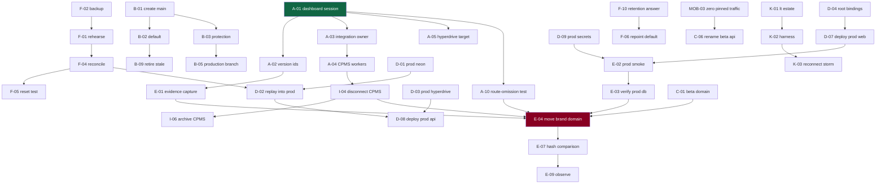

# Release execution work packages

**68 packages.** Every external mutation ⚙️, every human approval 🔒. Nothing was
executed. Effort: S/M/L, given only where scope is understood.

Domains: **CF** Cloudflare · **GH** GitHub · **NE** Neon · **DNS** ·
**WEB** · **API** · **OCPP** · **MOB** mobile · **OBS** observability ·
**SEC** security · **TEST** · **OPS** · **DOC**

---

## Track A — Control-plane verification (all read-only, all blocking)

| # | Package | Domain | Mutates | Effort |
|---|---|---|---|---|
| **A-01** | Complete the Cloudflare dashboard session (§A1–A9 of the kit) | CF | no 🔒 | S |
| **A-02** | Record active version ids for the three live Workers | CF | no 🔒 | S |
| **A-03** | Identify the Git-integration owner for `hlada-staging` | CF | no 🔒 | S |
| **A-04** | Enumerate CPMS Workers and their integrations | CF | no 🔒 | S |
| **A-05** | Verify the Hyperdrive target branch, two sources | CF+NE | no 🔒 | S |
| **A-06** | Inventory secret **names** per Worker | CF | no 🔒 | S |
| **A-07** | Record queue depths, DLQ counts, consumer config | CF | no 🔒 | S |
| **A-08** | Record DO namespace ids and class names | CF | no 🔒 | S |
| **A-09** | Record compatibility dates/flags per deployed Worker | CF | no 🔒 | S |
| **A-10** | Determine route-omission behaviour on **throwaway** resources | CF | ⚙️🔒 | M |
| **A-11** | Determine whether `*.api` wildcard can bear a second Worker hostname | CF | no 🔒 | S |
| **A-12** | Neon metadata: branches, defaults, protection, retention | NE | no 🔒 | S |
| **A-13** | GitHub: environments, Actions secret **names**, webhooks | GH | no | S |

## Track B — Git, branches and protection

| # | Package | Domain | Mutates | Effort |
|---|---|---|---|---|
| B-01 | Create `main` additively at the RC commit | GH | ⚙️🔒 | S |
| B-02 | Repoint the GitHub default branch to `main` | GH | ⚙️🔒 | S |
| B-03 | Ruleset: `non_fast_forward` + `deletion` on `main`/`staging`/`production` | GH | ⚙️🔒 | S |
| B-04 | Required status check on `main` **only** | GH | ⚙️🔒 | S |
| B-05 | Create the `production` branch | GH | ⚙️🔒 | S |
| B-06 | Advance `staging` to the RC (a true fast-forward, `0 166`) | GH | ⚙️🔒 | S |
| B-07 | Publish the trunk→pointer gap where a human reads it | OPS | no | S |
| B-08 | Adopt annotated `release-YYYY-MM-DD` tags | GH | ⚙️ | S |
| B-09 | Retire the stale default branch (**after** B-02) | GH | ⚙️🔒 | S |
| B-10 | Document the promotion procedure for humans | DOC | no | S |
| B-11 | Create the GitHub `production` environment with reviewers | GH | ⚙️🔒 | S |

## Track C — Beta topology

| # | Package | Domain | Mutates | Effort |
|---|---|---|---|---|
| C-01 | Add `beta.straumvakt.org` to the beta web Worker | CF+DNS | ⚙️🔒 | S |
| C-02 | Add `beta.api.straumvakt.org` to the beta API Worker | CF+DNS | ⚙️🔒 | S |
| C-03 | Decide the beta cookie/CORS boundary (same parent vs separate domain) | SEC | no 🔒 | S |
| C-04 | Add the beta origin to the driver-API CORS allow list | API | ⚙️🔒 | S |
| C-05 | Rename beta web → `straumvakt-web-beta` | CF | ⚙️🔒 | M |
| C-06 | Rename beta API → `straumvakt-api-beta` (**after** MOB-03) | CF | ⚙️🔒 | M |
| C-07 | **Do not rename** the beta OCPP Worker — record the decision | OCPP | no 🔒 | S |
| C-08 | Flag beta organisations as test tenants | API+NE | ⚙️🔒 | M |
| C-09 | Document a beta test-data purge procedure | OPS | no | M |

## Track D — Production topology

| # | Package | Domain | Mutates | Effort |
|---|---|---|---|---|
| D-01 | Create the production Neon project | NE | ⚙️🔒 | S |
| D-02 | Replay all 47 migrations into an empty production database | NE | ⚙️🔒 | M |
| D-03 | Create production Hyperdrive against D-01 | CF | ⚙️🔒 | S |
| D-04 | Add `HYPERDRIVE_DB` + missing bindings to the **root** config | WEB+API | no | S |
| D-05 | Create production queues and DLQs | CF | ⚙️🔒 | S |
| D-06 | Create the production R2 evidence bucket + lifecycle | CF | ⚙️🔒 | S |
| D-07 | Deploy `straumvakt-web` — workers.dev only | CF | ⚙️🔒 | M |
| D-08 | Deploy `straumvakt-api` — workers.dev only | CF | ⚙️🔒 | M |
| D-09 | Set production secrets **by name**, distinct values | CF | ⚙️🔒 | M |
| D-10 | Create `straumvakt-ocpp` for production chargers | CF | ⚙️🔒 | M |
| D-11 | Disable `workers_dev` on production Workers | CF | ⚙️🔒 | S |
| D-12 | Verify production estate against the manifest schema | DOC | no | S |

## Track E — Cutover

| # | Package | Domain | Mutates | Effort |
|---|---|---|---|---|
| E-01 | Pre-cutover evidence capture (versions, domains, hashes) | CF | no 🔒 | S |
| E-02 | Full production smoke on workers.dev | TEST | no | M |
| E-03 | Verify production reads the **production** database (SF-1) | TEST | no | S |
| E-04 | Attach `straumvakt.org` to production, detach from beta | CF+DNS | ⚙️🔒 | M |
| E-05 | Attach `www` (separate certificate) | CF+DNS | ⚙️🔒 | M |
| E-06 | Attach `api.straumvakt.org` to production | CF+DNS | ⚙️🔒 | M |
| E-07 | Post-cutover body-hash comparison per hostname (SF-5) | TEST | no | S |
| E-08 | Independent TLS verification per hostname | TEST | no | S |
| E-09 | 24-hour observation window, staffed | OPS | no 🔒 | M |
| E-10 | Keep beta Workers warm through the bake | OPS | no | S |
| E-11 | **Defer all deletion** — no cleanup scheduled | OPS | no | S |

## Track F — Database and migrations

| # | Package | Domain | Mutates | Effort |
|---|---|---|---|---|
| F-01 | Rehearse `migrate deploy` on a **disposable** clone | NE | ⚙️🔒 | M |
| F-02 | Backup branch before touching staging | NE | ⚙️🔒 | S |
| F-03 | Run read-only preflight Q1–Q6 against staging | NE | no 🔒 | S |
| F-04 | Reconcile the two migrations on staging via `migrate deploy` | NE | ⚙️🔒 | M |
| F-05 | Reset `test` from `staging` (**after** F-04) | NE | ⚙️🔒 | S |
| F-06 | Repoint the Neon project default away from the abandoned branch | NE | ⚙️🔒 | S |
| F-07 | Enable Neon branch protection on `staging` (and the old default) | NE | ⚙️🔒 | S |
| F-08 | Document explicit-branch-id discipline for humans **and agents** | DOC | no | S |
| F-09 | Measure and record restore time (the RTO) | NE | ⚙️🔒 | M |
| F-10 | Resolve the CPMS-era data retention question | OPS | no 🔒 | M |

## Track G — Secrets and bindings

| # | Package | Domain | Mutates | Effort |
|---|---|---|---|---|
| G-01 | Name-only secret inventory per Worker per environment | SEC | no 🔒 | S |
| G-02 | Verify **no value** is shared beta↔production (rotate-and-observe) | SEC | ⚙️🔒 | M |
| G-03 | Ensure `OCPP_CRED_KEK` differs between environments | SEC | ⚙️🔒 | S |
| G-04 | Remove stale `DATABASE_URL`/`DIRECT_URL` from the web Worker | CF | ⚙️🔒 | S |
| G-05 | Document secret ownership and rotation procedure | DOC | no | M |

## Track H — Observability

| # | Package | Domain | Mutates | Effort |
|---|---|---|---|---|
| H-01 | Environment-scoped dashboards (`env` on every metric) | OBS | ⚙️🔒 | M |
| H-02 | Queue depth, consumer lag, DLQ alerts | OBS | ⚙️🔒 | M |
| H-03 | Cost-projection freshness alert | OBS | ⚙️🔒 | M |
| H-04 | Scheduled brand-domain body-hash + TLS check | OBS | ⚙️🔒 | M |
| H-05 | Alert on a Worker version change with **no release manifest** | OBS | ⚙️🔒 | M |
| H-06 | Alert on activity against the abandoned Neon branch | OBS | ⚙️🔒 | S |
| H-07 | Fire a test alert and confirm a human receives it (SF-8) | OBS | no | S |
| H-08 | Record a version id on every deploy, both estates | OPS | no | S |
| H-09 | Define log redaction rules; sampled review | SEC | no | M |

## Track I — CPMS retirement

| # | Package | Domain | Mutates | Effort |
|---|---|---|---|---|
| I-01 | Inventory CPMS Workers, bindings, secret names, domains | CF | no 🔒 | S |
| I-02 | Export CPMS config + `CLAUDE.md` into the evidence bundle | DOC | no | S |
| I-03 | **Decision:** confirm CPMS will not be redeployed | OPS | no 🔒 | S |
| I-04 | Disconnect the CPMS integration to `hlada-staging` | CF | ⚙️🔒 | S |
| I-05 | Verify from outside that the Worker still serves after I-04 | TEST | no | S |
| I-06 | Archive (not delete) the CPMS repository — **after** I-04 | GH | ⚙️🔒 | S |
| I-07 | Do not delete shared-name Workers while CPMS declares them | OPS | no | S |

## Track J — Mobile compatibility

| # | Package | Domain | Mutates | Effort |
|---|---|---|---|---|
| MOB-01 | Confirm the shipped app's pinned host and its traffic volume | MOB | no | S |
| MOB-02 | Ship a release that reads its API base from configuration | MOB | ⚙️ | M |
| MOB-03 | Confirm zero traffic on the pinned host before any rename | MOB+OBS | no 🔒 | M |
| MOB-04 | Beta↔production compatibility matrix for N−2 app versions | TEST | no | M |

## Track K — Testing and governance

| # | Package | Domain | Mutates | Effort |
|---|---|---|---|---|
| K-01 | Stand up the isolated load-test estate | CF+NE | ⚙️🔒 | L |
| K-02 | Build the OCPP simulator harness with seeded generation | TEST | no | L |
| K-03 | Run E2 (reconnect storm) — the first experiment | TEST | ⚙️🔒 | L |
| K-04 | Run E7 (DB connection exhaustion) | TEST | ⚙️🔒 | M |
| K-05 | Run E8 (projection lag) | TEST | ⚙️🔒 | M |
| K-06 | Post-test contamination checks after **every** run | TEST | no | S |
| K-07 | Tier-0 migration lint (no credential needed) | TEST | no | S |
| K-08 | Execute the beta acceptance programme | TEST | ⚙️🔒 | L |
| K-09 | Disaster-recovery exercise, timed | OPS | ⚙️🔒 | M |
| K-10 | Remove `check:work-view` from the check pipeline | OPS | no 🔒 | S |
| K-11 | Name a release owner and record rollback authority | OPS | no 🔒 | S |

**Total: 68.**

---

# Issue-ready bodies — top 25

Ordered by leverage. Each: evidence · scope · non-goals · dependencies ·
acceptance · rollback · observability · approval · mutates.

### 1. A-01 · Complete the Cloudflare dashboard session
**Evidence:** nine control-plane facts are UNK; the verification kit enumerates them.
**Scope:** kit §A1–A9, read-only. **Non-goals:** any change; any secret value.
**Depends:** dashboard access. **Acceptance:** every field in the evidence form populated or marked `ABSENT`; stop conditions evaluated.
**Rollback:** n/a. **Observability:** the completed form is the artefact. **Approval:** 🔒. **Mutates:** no.
**Unblocks:** A-02…A-09, E-01, I-01, and the entire cutover.

### 2. A-03 · Identify the Git-integration owner
**Evidence:** both Straumvakt and CPMS declare `hlada-staging`; GitHub shows no deployments, which is not proof.
**Scope:** Settings → Build for `hlada-staging`. **Non-goals:** disconnecting anything yet.
**Acceptance:** repository, branch, build command and root directory recorded verbatim.
**Stop condition:** repository is `andri187/CPMS` → **incident**, halt the release.
**Mutates:** no. **Approval:** 🔒.

### 3. A-04 · Enumerate CPMS Workers and integrations
**Evidence:** CPMS is private, so webhooks/deployments are not publicly visible — dashboard is the only source.
**Acceptance:** per CPMS Worker: name, integration state, repository, branch.
**Mutates:** no. **Blocks:** I-04.

### 4. B-03 · Branch protection ruleset
**Evidence:** 0 of 16 branches protected; rulesets `[]`; repo **public**; `staging` serves the brand domain.
**Scope:** `non_fast_forward` + `deletion` on `main`, `staging`, `production`. **Non-goals:** required checks on the pointers — they would block a fast-forward.
**Acceptance:** a force-push to `staging` is rejected; a normal fast-forward still succeeds.
**Rollback:** delete the ruleset. **Approval:** 🔒. **Mutates:** ⚙️. **Effort:** S — the cheapest high-value control in the packet.

### 5. I-04 · Disconnect the CPMS integration
**Evidence:** CPMS declares the same names and documents auto-deploy.
**Depends:** A-04, I-03. **Non-goals:** deleting anything; archiving (that is I-06, and it comes after).
**Acceptance:** no CPMS Worker holds an integration naming `hlada*`; I-05 confirms the Worker still serves.
**Rollback:** reconnect. **Stop condition:** if this is the **only** deploy path to `hlada-staging`, stop — a Straumvakt path must exist first.
**Approval:** 🔒. **Mutates:** ⚙️.

### 6. A-02 · Record active version ids
**Evidence:** no version id is recorded anywhere; there is no rollback target today.
**Acceptance:** three ids recorded, each confirmed present in the retained-version list (SF-7).
**Mutates:** no. **Blocks:** every cutover package.

### 7. F-02 · Backup branch before migration work
**Evidence:** 21 chargers write continuously; a restore discards writes since the branch point.
**Acceptance:** branch exists; parent LSN and creation time recorded.
**Approval:** 🔒. **Mutates:** ⚙️.

### 8. F-01 · Rehearse `migrate deploy` on a disposable clone
**Evidence:** both migrations are all-`IF EXISTS`, no `CASCADE`, one wrapped in `BEGIN/COMMIT`.
**Scope:** fresh branch (not `test`), run Q1–Q6, deploy, re-run, delete.
**Acceptance:** Q1 goes 3 rows → 0; Q4 0 → 2; Q5 45 → 47; status "up to date".
**Rollback:** delete the clone. **Approval:** 🔒. **Mutates:** ⚙️ on the clone only.

### 9. F-04 · Reconcile the migrations on staging
**Depends:** F-01, F-02, F-03. **Gate:** Q2 must return **0 dependent columns**.
**Non-goals:** `resolve --applied` — it would record a falsehood and strand three enum types.
**Acceptance:** 47 recorded; three enum types gone; `check:migrations` clean.
**Rollback:** restore from F-02, **losing writes since the branch point**.

### 10. C-01 · `beta.straumvakt.org`
**Evidence:** the hostname is NXDOMAIN today; beta currently has no address of its own.
**Scope:** additive custom domain. **Non-goals:** touching the brand domain.
**Acceptance:** 200 + valid TLS; brand domain body hash **unchanged**.
**Rollback:** detach. **Approval:** 🔒. **Mutates:** ⚙️.

### 11. F-06 · Repoint the Neon project default
**Evidence:** the abandoned branch is the default and was reached on 2026-08-08T20:38:44Z by a call omitting a branch id; the failure is silent.
**Acceptance:** default is a branch whose accidental use is safe or loud.
**Depends:** F-10 (retention answer). **Approval:** 🔒. **Mutates:** ⚙️.

### 12. F-07 · Neon branch protection
**Acceptance:** an accidental write to a protected branch fails loudly. **Approval:** 🔒.

### 13. D-01 · Production Neon project
**Evidence:** accepted decision; and a wrong-branch query has already occurred on the shared project.
**Acceptance:** separate project; ids recorded in the manifest (never invented before creation).

### 14. D-04 · Root-config bindings
**Evidence:** the root config has **no** Hyperdrive binding — a root deploy today yields a Worker with no database.
**Scope:** config only, not deployed. **Acceptance:** manifest validates; no deploy performed.
**Mutates:** no.

### 15. D-09 · Production secrets by name
**Non-goals:** copying any value through a terminal, document or chat.
**Acceptance:** names match the manifest; G-02 confirms no value is shared.
**Approval:** 🔒.

### 16. G-03 · Distinct `OCPP_CRED_KEK`
**Evidence:** it derives the key decrypting stored vendor charger passwords; a shared KEK makes a beta compromise a **production charger** compromise.
**Acceptance:** rotating beta's value leaves production working.

### 17. E-01 · Pre-cutover evidence capture
**Acceptance:** version ids, domain attachments, body hashes and TLS all captured **before** any change.
**Why it is a package:** without it there is no rollback target and no way to prove SF-5 afterwards.

### 18. E-04 · Move `straumvakt.org` to production
**Depends:** A-01, A-10, E-01, E-02, E-03. **The one customer-visible step.**
**Acceptance:** body hash **differs** from the beta Worker's; TLS valid; beta still reachable at C-01.
**Rollback:** re-attach to the beta Worker — warm, minutes.

### 19. E-07 · Post-cutover body-hash comparison
**Evidence:** SF-5 — the site loading proves nothing; only a hash comparison distinguishes production from beta.
**Acceptance:** apex, `www` and `api` each differ from their beta counterparts.

### 20. H-05 · Alert on a version change without a manifest
**Evidence:** T-05 — a rogue or CPMS deploy changes a version id with no release record.
**Acceptance:** an out-of-band deploy raises an alert within minutes.
**Why it is high leverage:** it is the single cleanest detective control for the highest-severity threat.

### 21. MOB-03 · Confirm zero traffic on the pinned host
**Evidence:** the shipped app pins `hlada-api-staging.straumvakt.workers.dev`; a mobile release cannot be rolled back.
**Acceptance:** telemetry shows zero requests from installed clients over a defined window.
**Blocks:** C-06.

### 22. K-07 · Tier-0 migration lint
**Evidence:** a lint rejecting `DROP` without `IF EXISTS`, or `CASCADE` without a comment, would have made this whole reconciliation unnecessary.
**Acceptance:** runs with **no credential**, on every PR including forks.
**Effort:** S. **Value:** prevents the class of problem, not the instance.

### 23. K-03 · Run the reconnect storm
**Depends:** K-01, K-02. **Acceptance:** 95% reconnected < 5 min at 5k; no message loss; contamination checks clean.
**Note:** first experiment by design — least evidence, highest consequence.

### 24. K-09 · Timed disaster-recovery exercise
**Acceptance:** four timings recorded (version rollback, domain re-attach, database restore, queue drain). **Those four numbers are the recovery objectives**; any stated RTO not derived from them is fiction.

### 25. K-10 · Remove `check:work-view` from the pipeline
**Evidence:** it gates on a generated route that was deliberately parked; it reports a deletion as staleness.
**Scope:** one line in `check-all.mjs` plus its now-misleading comment. **Non-goals:** deleting the generator; touching `WORKSPACE.md`/`TASKS.md`.
**Acceptance:** `npm run check` passes; `npm run work-view` still runs locally.
**Owner:** another implementation track. **Mutates:** no external state.

---

## Dependency graph



## Critical path

```
A-01 → A-03 → A-04 → I-04 → E-01 → E-04 → E-07 → E-09
```

**A-01 is one dashboard session and unblocks eleven packages.** Highest leverage
in the backlog by a wide margin. **E-04 is the only step with a customer-visible
failure mode.**

## Four-track parallel execution

Designed so **no two tracks touch the same worktree or the same control-plane
resource**.

| Track | Owner | Packages | Touches | Conflicts with |
|---|---|---|---|---|
| **1 · Control plane** | Andri | A-01…A-13, I-01…I-07, F-06, F-07 | Cloudflare, CPMS, Neon settings | nothing — read-mostly |
| **2 · Git & governance** | engineering | B-01…B-11, K-10, K-11, H-08 | GitHub only | none |
| **3 · Database** | engineering + Andri | F-01…F-05, F-08…F-10, D-01, D-02, K-07 | Neon branches, migration docs | Track 1 only at F-06/F-07 |
| **4 · Product & mobile** | Codex / mobile | MOB-01…MOB-04, C-08, C-09 | `apps/mobile`, beta data | none |

**Serialisation points** — the only places tracks must synchronise:

1. **I-04 before E-04** — no cutover while a second repository can deploy.
2. **F-04 before D-02** — production replays a reconciled set.
3. **MOB-03 before C-06** — no rename before the pinned host is quiet.
4. **A-01 before everything in Tracks 1 and 3** that mutates.

Everything else runs concurrently. Tracks 2 and 4 have **no dependency on the
dashboard at all** and can start immediately — which matters, because the
dashboard is the one resource that cannot be parallelised.
