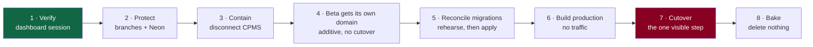

# Release RACI and executive go/no-go packet

**Derived from the full evidence packet. Nothing here was executed.**

---

# Part 1 · RACI for every release action

**R** responsible (does it) · **A** accountable (owns the outcome) ·
**C** consulted · **I** informed

Roles: **AN** Andri · **RO** release owner · **ENG** engineering ·
**OPS** operations · **MOB** mobile/Codex · **OC** on-call

| Action | AN | RO | ENG | OPS | MOB | OC |
|---|---|---|---|---|---|---|
| Dashboard verification session | **A/R** | C | I | I | — | — |
| Decide CPMS's fate | **A/R** | C | C | I | — | — |
| Disconnect a CPMS integration | **A/R** | I | I | I | — | — |
| Create `main`, repoint the default | C | I | **A/R** | I | — | — |
| Create branch protection rulesets | **A** | I | **R** | I | — | — |
| Advance `staging` (beta deploy) | I | **A** | **R** | I | I | I |
| Advance `production` (release) | **A** | **R** | C | I | I | I |
| Approve a production release | **A/R** | C | I | I | — | — |
| Neon backup before migration work | **A/R** | I | C | I | — | — |
| Run `migrate deploy` on staging | **A** | I | **R** | I | — | — |
| Create the production Neon project | **A/R** | I | C | I | — | — |
| Set production secrets | **A/R** | I | I | I | — | — |
| Deploy production Workers (no domain) | **A** | C | **R** | I | — | — |
| **Move the brand domain** | **A** | **R** | C | C | I | I |
| Post-cutover verification | I | **A** | **R** | C | — | I |
| **Execute a rollback** | I | C | C | C | — | **A/R** |
| Declare an incident | I | C | C | **A/R** | I | **R** |
| Communicate to customers | **A/R** | C | I | **R** | — | I |
| Retire the pinned mobile host | C | **A** | C | I | **R** | — |
| Ship a mobile release | I | I | C | I | **A/R** | — |
| Rename beta Workers | I | **A** | **R** | I | C | — |
| **Change an OCPP endpoint** | **A** | C | C | **R** | — | I |
| Run a load test | I | I | **R** | **A** | — | I |
| Delete any Worker or branch | **A/R** | C | C | I | — | — |

**Two rows carry the load:**

- **Rollback is A/R to on-call, with nobody in the approval column.** Every other
  action has an accountable owner who can be consulted first. This one cannot,
  because a control that delays recovery is a liability.
- **Deletion is A/R to Andri alone.** It is the only irreversible category in the
  system, and no track owns it.

---

# Part 2 · Executive go/no-go packet

## The situation in five facts

1. **There is no production environment.** The three deployed Workers —
   `hlada-staging`, `hlada-api-staging`, `straumvakt-ocpp-staging` — are all beta.
   All three production names return "no such Worker".
2. **Beta serves the real brand domain.** `straumvakt.org`, `www` and the beta
   Worker return byte-identical bodies. The site customers would visit is the
   test environment.
3. **A second, private repository can deploy the Worker serving that domain.**
   CPMS declares the same Worker names and documents auto-deploy. It has been
   dormant since 2026-04-23. Whether its integration is live is **unknown**.
4. **Nothing is protected.** Zero of sixteen Git branches; no rulesets; the
   repository is public; the Neon branch holding real data is unprotected, and
   the project default is an abandoned branch that was accidentally reached the
   day before yesterday.
5. **There is no rollback target.** No deployed version id is recorded for any
   Worker, anywhere.

## Recommendation

**NO-GO on a production release. GO on everything that prepares one.**

The blocker is not a defect in the product — it is that a release cannot be
undone. Fact 5 alone is disqualifying: a release with no recorded rollback target
is a one-way door, and facts 3 and 4 mean the door can also be opened by someone
else.

None of this requires new engineering. **Four of the five facts are closed by one
read-only dashboard session plus two settings changes.**

## What it costs to become GO

| # | Action | Effort | Who |
|---|---|---|---|
| 1 | Dashboard verification session | ~30 min | Andri |
| 2 | Record three version ids | included in 1 | Andri |
| 3 | Determine the integration owner; disconnect CPMS if live | ~15 min | Andri |
| 4 | Branch protection ruleset (3 branches) | ~10 min | engineering |
| 5 | Neon protection + repoint the default | ~15 min | Andri |

**Roughly ninety minutes of control-plane work closes the gap between "cannot
safely release" and "can plan a release".** No code, no migration, no deploy.

## Decisions needed from Andri

| # | Decision | Blocking? | Default if unanswered |
|---|---|---|---|
| D1 | Is CPMS retired, or repointed off shared names? | **yes** | risk persists indefinitely |
| D2 | Does production get a separate Neon project? | yes | accepted already |
| D3 | Beta API hostname: `beta.api.straumvakt.org` (likely cert-covered) or `api-beta.…` | no | pick the covered one |
| D4 | Beta cookie boundary: same parent domain, or a separate beta domain | no | same parent, with the isolation consequence recorded |
| D5 | Retention status of CPMS-era data on the abandoned Neon branch | yes, for D2's cleanup | nothing is deleted |
| D6 | Who is the named release owner? | yes, before the first release | — |

## Sequence

Steps 1–3 are ~90 minutes and change nothing customers can see. Steps 4–6 are
additive: everything is created alongside, nothing is taken away. **Step 7 is the
only moment a customer could notice**, and it is reversible in minutes because
the beta Worker stays warm.

## What is deliberately not being fixed now

| Item | Why deferred |
|---|---|
| Renaming the OCPP gateway | Field risk outweighs naming consistency; the no-backfill decision may remove the need entirely |
| Renaming the beta API Worker | Blocked on a mobile release; the shipped app pins its hostname |
| Deleting anything | Every deletion here is irreversible and none is urgent |
| CI-attested build artefacts | Real gap, large change, not on the critical path |
| Proving 4–5k capacity | Requires an isolated estate and executed load tests; **"pilot readiness" and "proven capacity" are different claims** and only the first is available |

## The one-sentence version

**The product is closer to ready than the platform is: nothing can be released
safely until a release can be undone, and about ninety minutes of read-only
verification plus two protection settings is what stands between here and there.**
