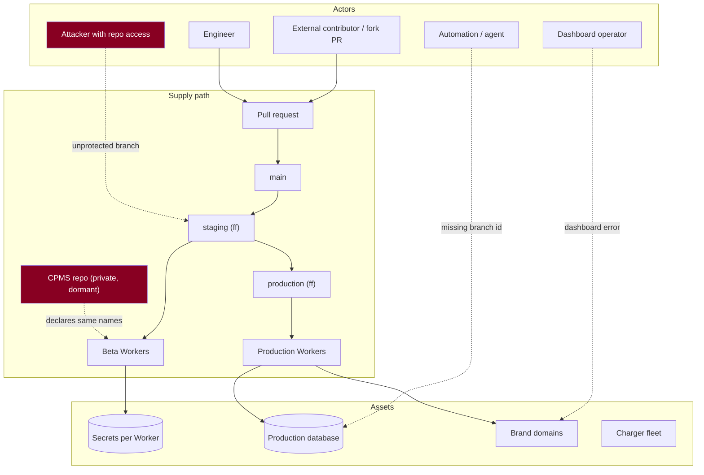

# Threat model of the release system itself

**Analysis only. No control was implemented, no setting changed.**

Scope is the **release pipeline**, not the product: the ways code, configuration
or credentials can reach the wrong place. Product-surface security is covered
elsewhere.

## Threats

Severity is **launch risk**, not theoretical elegance. **B** = fixable before
beta; **P** = needed before production.

### T-01 · Malicious or careless pull request — **Medium · B**
**Precondition:** ability to open a PR. Repo is **public**.
**Impact:** merged code reaches beta, then production, via the promotion path.
**Preventive:** required review on `main`; required `check`; **no
`pull_request_target`** (privileged and would give a fork repository write).
**Detective:** commit signing; release manifest records what was promoted.
**Present today:** **none** — 0 of 16 branches protected, no rulesets.
**Recovery:** revert on `main`; roll back the Worker version.

### T-02 · Compromised CI token — **Medium · P**
**Impact:** anything the token's scope allows.
**Preventive:** least-privilege `permissions:` per workflow (`contents: read`
for checks, `contents: write` only for promotion); environment-scoped secrets;
**no secret available to fork PRs** (GitHub already enforces this).
**Detective:** review of workflow run history for unexpected `workflow_dispatch`.
**Recovery:** rotate; the blast radius is bounded by scope, which is why scope is
the control.

### T-03 · Environment secret crossover — **High · P**
**Precondition:** a value reused between beta and production.
**Impact:** **a beta compromise becomes a production compromise.** Worst case is
`OCPP_CRED_KEK`, which derives the key decrypting stored vendor charger
passwords — a shared KEK exposes **real customer chargers** from a beta
foothold.
**Preventive:** distinct values by policy; never copy a value through a terminal,
a document or a chat.
**Detective:** rotate the beta value — **if production breaks, they were shared**
(the only reliable test, and it is cheap).
**Recovery:** rotate both; re-encrypt anything derived from the KEK.

### T-04 · Production database selected by default — **High · B**
**Precondition:** a tool, script or agent omits a Neon branch id.
**Impact:** reads or writes land on the wrong branch. **The failure is silent** —
the abandoned branch's older schema surfaces as `relation … does not exist`,
which reads as a schema bug.
**Evidence it is real:** that compute was reached at 2026-08-08T20:38:44Z by a
call omitting a branch id.
**Preventive:** repoint the project default; **protect** both branches; make the
harness refuse to start without an explicit branch id (a control in code beats a
line in a checklist).
**Detective:** alert on any activity on the abandoned branch's compute.
**Recovery:** if a write occurred, restore from backup — and that branch is
**unprotected today**.

### T-05 · Rogue Worker deployment — **High · B**
**Precondition:** a second repository holding a Git integration to the same
Worker name. **CPMS declares `hlada` and `hlada-staging` and documents
auto-deploy.**
**Impact:** a push to a dormant, **private** repository replaces the Worker
serving `straumvakt.org`.
**Preventive:** disconnect the CPMS integration; migrate off shared names.
**Detective:** alert on any Worker version change not accompanied by a release
manifest — **the cleanest signal available**, because a legitimate deploy always
has one.
**Recovery:** Cloudflare rollback to the captured version id.

### T-06 · Stale custom domain — **Medium · P**
**Precondition:** a domain left attached to a retired Worker, or detached
silently by a deploy that omitted `routes`.
**Impact:** brand domain serves stale code, or nothing.
**Preventive:** config-as-truth for routes; **verify** the undocumented
route-omission behaviour on throwaway resources before relying on either answer.
**Detective:** scheduled body-hash + TLS check on each brand hostname.

### T-07 · Unprotected deploy branch — **High · B**
**Present today:** 0 of 16 branches protected; rulesets `[]`; repo **public**;
`staging` serves the brand domain.
**Impact:** force-push or delete the branch that deploys production traffic.
**Preventive:** `non_fast_forward` + `deletion` rules — neither blocks a
fast-forward, so the release path is unaffected.
**Cost:** effectively zero. **This is the cheapest control in the model.**

### T-08 · Artifact substitution — **Low–Medium · P**
**Precondition:** the running artifact is built by Cloudflare's integration, not
attested by CI.
**Impact:** what runs is not provably what was reviewed.
**Preventive (partial):** the release manifest binds `release_id` → commit →
version id, so a mismatch is **detectable** even though the build is not attested.
**Honest limitation:** closing this properly means building and uploading the
Worker from CI. That is a larger change and is **not** proposed here.

### T-09 · Rollback to a vulnerable build — **Medium · P**
**Precondition:** an incident rollback selects an older version containing a
known flaw.
**Impact:** a fixed vulnerability returns during an incident, when attention is
elsewhere.
**Preventive:** record a **minimum safe version** per Worker in the manifest;
rollback targets are chosen from versions at or above it.
**Tension, stated plainly:** rollback must stay ungated for speed, so this is a
*documented* constraint rather than an enforced one. An enforcement that delays
recovery would cause more harm than it prevents.

### T-10 · Dashboard operator error — **Medium · B**
**Precondition:** a human in the Cloudflare console during a verification or
cutover.
**Impact:** a detached domain, a deleted binding, a triggered deploy.
**Preventive:** the verification kit is **explicitly read-only** and says so per
step; two people for cutover; capture state **before** each change.
**Detective:** version-id change without a manifest (T-05's detective control
covers this too).
**Recovery:** re-attach, or roll back to the captured version.

### T-11 · Agent acting beyond intent — **Medium · B**
**Precondition:** automation with control-plane credentials.
**Impact:** any of the above, faster and without hesitation.
**Preventive:** read-only credentials by default; a separate, approval-gated
credential for mutation; **explicit branch ids required in code**.
**Detective:** audit every control-plane change against a change record.
**Note:** this session operated with no control-plane credentials at all, which
is why nine facts are unknown — **that is the control working**, not a gap.

### T-12 · Load test contaminating a real environment — **High · B**
**Precondition:** a harness with a mistyped host or a missing branch id.
**Impact:** synthetic rows in beta or production; synthetic chargers colliding
with real serials.
**Preventive:** dedicated `*-lt` resources; reserved serial range; hard abort on
a real `orgId`; egress restricted to `*-lt` hosts.
**Detective:** the post-test contamination checks, run after **every**
experiment.

## Control summary

| Control | Cost | Prevents | Before |
|---|---|---|---|
| Branch protection (`non_fast_forward`, `deletion`) | ~zero | T-01, T-07 | **beta** |
| Disconnect the CPMS integration | low | **T-05** | **beta** |
| Repoint + protect Neon branches | low | T-04 | **beta** |
| Explicit branch id enforced in code | low | T-04, T-12 | **beta** |
| Read-only-by-default credentials | low | T-10, T-11 | **beta** |
| Distinct secret values per environment | medium | **T-03** | **production** |
| Release manifest + version-id binding | medium | T-05, T-08, T-09 | production |
| Scheduled domain/TLS check | low | T-06 | production |
| Required review + checks on `main` | medium | T-01 | production |
| Minimum-safe-version record | low | T-09 | production |
| CI-built and attested artifacts | **high** | T-08 fully | *not proposed* |

**Five controls are cheap and belong before beta.** Two of them — branch
protection and disconnecting CPMS — address the two highest-severity threats in
the model and cost almost nothing.

## Residual risk after the pre-beta controls

| Residual | Why accepted |
|---|---|
| Build is not attested (T-08) | closing it needs CI-built Workers; the manifest makes substitution detectable |
| Rollback may select an older build (T-09) | speed of recovery outranks it; documented rather than enforced |
| Dashboard error remains possible (T-10) | mitigated by procedure, not eliminated; a two-person cutover is the practical limit |
| CPMS repository still exists | **deliberate** — it is the provenance record; only its *deploy capability* is removed |
