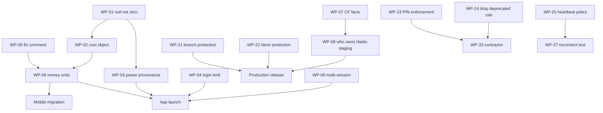

# Remediation issue backlog

**34 issue-ready work packages.** No item says "improve X". Effort bands are
S/M/L and are given only where scope is understood.

Domains: **BE** backend · **MO** mobile · **IN** infra · **SE** security ·
**PR** product · **OP** operations · **DA** data

---

## P0 — launch blockers

### WP-01 · Emit `null`, never `0`, for unmeasured driver telemetry
**Evidence:** `driver-sessions.ts:135` `powerKw: 0`; `:89-91`, `:95-98` collapse
null→0; also `driver.ts:593,683`.
**Scope:** repository + stop-session snapshots. **Non-goals:** sourcing a power
value (WP-03); the cost object (WP-02).
**Domain:** BE · **Depends:** none · **Effort:** S
**Acceptance:** no driver DTO returns `0` for an unmeasured quantity; unit tests
assert null; **AC-22…AC-25** pass.
**Rollout:** additive; `ae5db26` already treats `0` as absent so it is safe today.
**Gate:** launch.

### WP-02 · Introduce the `cost` object with an explicit `state`
**Evidence:** free and not-yet-priced are indistinguishable; `ae5db26` renders a
free session as "Pending".
**Scope:** `{amountMinor, currency, exponent, state}` on active/history DTOs.
**Non-goals:** invoice documents.
**Domain:** BE · **Depends:** WP-01 · **Effort:** M
**Acceptance:** `state ∈ pending|priced|free|unpriced`; a genuinely free session
renders "Free".

### WP-03 · Decide live-power provenance
**Evidence:** no power source exists; `driver-sessions.ts:108` describes a
charger-status surface the app never calls.
**Scope:** choose ship-without / meter-derived / status-derived.
**Domain:** PR + BE · **Depends:** WP-01 · **Effort:** S (decide) / M (implement)
**Acceptance:** no UI implies a measurement that does not exist. If shown,
carries `observedAt` and degrades when stale.
**Gate:** launch.

### WP-04 · Rate-limit `POST /api/driver/login`
**Evidence:** `driver.ts:121` unthrottled; `:1029-1036` throttles `/claim-invite`
with a binding named `DRIVER_LOGIN_RATE_LIMITER`.
**Scope:** IP + hashed-account limiters, identical 429 for known/unknown.
**Non-goals:** renaming the existing binding (WP-05).
**Domain:** BE + IN + SE · **Depends:** binding provisioned · **Effort:** S
**Acceptance:** AC-05 passes; shared-NAT false-positive case tested.
**Rollout:** binding first — **verify the helper fails closed when absent.**
**Gate:** launch.

### WP-05 · Correct the aurar/króna comment and helper name
**Evidence:** `driver-sessions.ts:93-98` asserts "ISK has no minor unit",
contradicting `compute-session-cost.ts:13-21` and `formatIskMinor`.
**Scope:** comment + internal helper name **only**. **Non-goals:** changing any
returned value — that is WP-06.
**Domain:** BE · **Depends:** none · **Effort:** S
**Acceptance:** no comment in the repo claims ISK lacks a minor unit.
**Why P0 despite being a comment:** it invites the change that breaks every
client by 100×. **Gate:** launch.

### WP-06 · Migrate money to unit-explicit fields
**Evidence:** `costIsk` carries aurar; clients divide by 100
(`types.dart:234,464`; archived web `history/page.tsx:23`).
**Scope:** ship `cost` alongside `costIsk`, migrate clients, then remove.
**Domain:** BE + MO · **Depends:** WP-02, WP-05 · **Effort:** M
**Acceptance:** golden test — one aurar value renders identically server-side and
in every client. Regression test asserting `costIsk` is **undivided aurar** so
the trap cannot return.
**Rollout:** **the divide must be removed in the same release the API stops
sending aurar.** Any other order is a 100× error.
**Gate:** launch.

### WP-07 · Resolve the Cloudflare control-plane facts
**Evidence:** infra packet §A1 — six gates blocked.
**Scope:** dashboard verification only; **no mutation**.
**Domain:** IN · **Effort:** S
**Acceptance:** Git-integration repo/branch, deployed version id, custom-domain
retention, Hyperdrive target, secret names all recorded. **Gate:** release.

### WP-08 · Establish which repository owns `hlada-staging`
**Evidence:** CPMS `wrangler.jsonc:3,32` declares the same names; its
`CLAUDE.md` documents auto-deploy.
**Domain:** IN · **Depends:** WP-07 · **Effort:** S
**Acceptance:** documented; if CPMS is connected, its integration is disconnected
or repointed **before** any Straumvakt release. **Gate:** release.

### WP-09 · Decide the multiple-active-session policy
**Evidence:** array end-to-end; stop already deterministic.
**Domain:** PR · **Effort:** S
**Acceptance:** decision recorded; if primary-session, the rule is stable across
polls. **Note:** silence ships the permissive option. **Gate:** launch.

---

## P1 — launch hardening

### WP-10 · Coarse refresh-token revocation
Token-version claim on `User`, bumped to invalidate all of a user's tokens.
**Evidence:** `driver.ts:14-16` 30d stateless, no revocation. **BE+SE · M ·**
Acceptance: an operator can invalidate one user's tokens; RB-14 has a recovery step.

### WP-11 · Prove invite identity binding on all three consume paths
**Evidence:** `/api/public/invites/consume`, `/redeem-invite` (`:1158`),
`/claim-invite` (`:1029`); ADR 0053 sets the invariant. **BE+SE · M ·**
Acceptance: negative test per path — a code minted for A is rejected for B on
**every** path. Then retire the redundant paths.

### WP-12 · Map real connector state
`status: "Charging"` is a literal. **BE · S ·** Acceptance: reflects actual
connector state; enum is a stable lowercase token.

### WP-13 · Reconcile history vs billable sources
`/sessions/history` reads the ledger; `/invoices` reads sessions — different
latency, so screens disagree. **BE+PR · M ·** Acceptance: one source, or the
difference is explained in UI.

### WP-14 · Rename the billing surface away from "invoices"
**PR+BE · S ·** Acceptance: no UI says "Invoices" absent an invoice document;
route rename is a separate breaking change.

### WP-15 · Surface pending-approval
`POST /access-requests` (`:867`) has no caller. **MO+BE · M ·** Acceptance: AC-09.

### WP-16 · Surface pricing preview
`/chargers/:id/pricing` (`:829`) has no caller. **MO+BE · M ·** Acceptance:
driver sees price before starting; estimate labelled non-binding.

### WP-17 · Consolidate the access surface
`/installations` (`:816`) has no caller. **BE+MO · M**

### WP-18 · Support, privacy, terms
Store-listing requirement. **PR+MO · S**

### WP-19 · Start-race grace state
Empty array means "not yet" **and** "ended". **MO · S ·** Acceptance: AC-12 — a
starting state held ≥60 s before showing "ended".

### WP-20 · Idempotency key on stop
Repeated stops enqueue repeated commands. **BE · S ·** Acceptance: N identical
stops produce one queued command.

### WP-21 · Branch protection on trunk and `staging`
All 16 branches `protected: false`; rulesets `[]`; repo public. **IN+SE · S ·**
Acceptance: `non_fast_forward` + `deletion`; fast-forward still works.

### WP-22 · Neon branch protection and default repoint
**IN · S ·** Acceptance: `staging` protected; default no longer the abandoned
branch; branch-id discipline documented.

### WP-23 · Server-side enforcement of BLE PIN release
`session_guard.dart` says its check is **not** the security boundary. **BE+SE ·
M ·** Acceptance: PIN release requires a role a driver does not hold.

### WP-24 · Remove the deprecated `contractor → TECHNICIAN_BUNDLE` mapping
Silently grants `charger.config` and remote start/stop. **BE+SE · S ·**
Acceptance: no deprecated role grants charger control.

---

## P2 — 4k–5k scale readiness

### WP-25 · Set and hold a heartbeat-interval policy
Dominates sensitivity at 2.97×; operator-controlled. **OP+IN · S ·** Acceptance:
policy documented; deployed fleet audited against it.

### WP-26 · Queue depth and consumer-lag metrics with alerts
S5 grows silently: ~118k messages in 1 h at half throughput. **IN+OP · S**

### WP-27 · Run E2 reconnect storm
Least evidence, highest consequence. **IN · L ·** Acceptance: 95% reconnected
< 5 min at 5k.

### WP-28 · Run E7 database connection exhaustion
The predicted 4k bottleneck the model cannot simulate. **IN · M**

### WP-29 · Run E8 projection lag
Validates the assumption most likely optimistic, and the one drivers feel.
**IN+BE · M**

### WP-30 · Audit `cpu_ms: 50` against fan-out handlers
**BE · S**

### WP-31 · Dependency and licence inventory
No upgrades during freeze. **BE+MO · S**

---

## Product-contract decisions

### WP-32 · Vehicle profile and Autocharge contract
No vehicle API exists; `ae5db26` correctly claims nothing. **PR+BE · L ·**
Acceptance: provenance discriminator on every attribute; enrolment state machine;
EVCCID masked.

### WP-33 · Contractor assignment model
First legitimate cross-tenant grant. **PR+BE+SE · L ·** Acceptance: every tenancy
predicate re-read against assignment; TTL; revocation.

---

## Operations

### WP-34 · Publish the trunk→staging gap
The 140-commit gap existed because nothing measured it. **OP · S**

---

## Dependency graph

## Recommended sequence

1. **WP-05** — one comment, removes the most dangerous trap in the packet.
2. **WP-01, WP-04** — independent, small, both launch gates.
3. **WP-02 → WP-06 → mobile migration** — strictly ordered; money breaks otherwise.
4. **WP-03, WP-09** — product decisions, unblock UI work.
5. **WP-07 → WP-08** — dashboard; gate the release, not the app.
6. **WP-21, WP-22** — cheap, no code.
7. P1 hardening, then P2 scale.

**WP-05 first is deliberate.** It is the smallest item in the backlog and the one
whose absence most likely causes a money incident while everything else proceeds.
