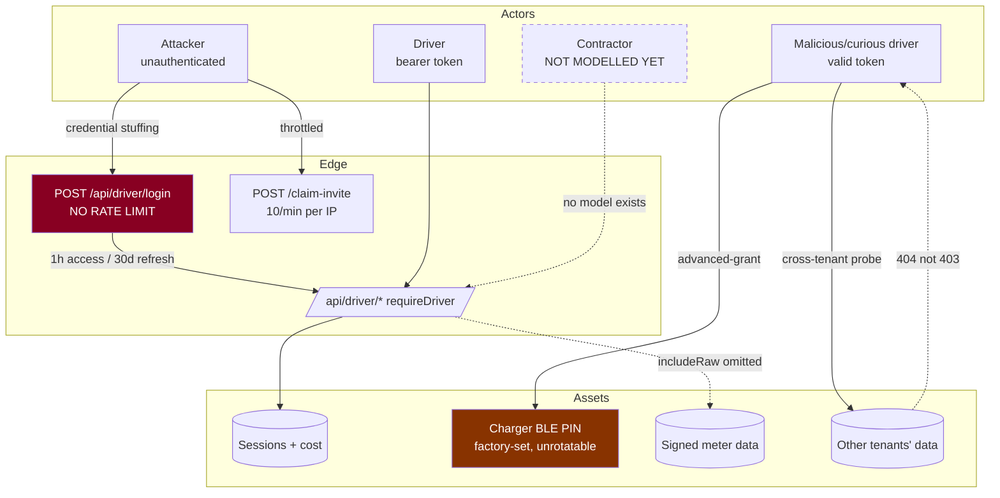
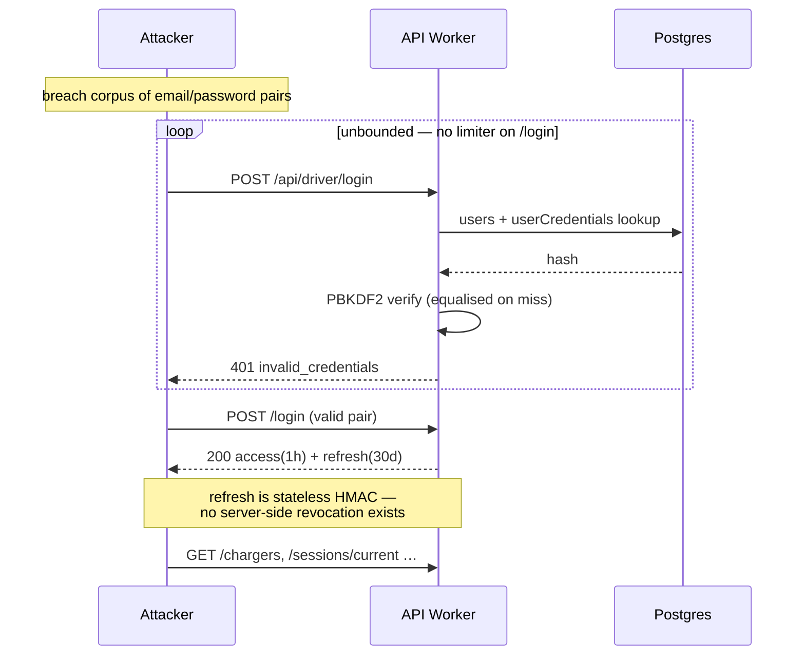

# Security remediation packet

**Proposals only.** No code, config, credential, or policy was changed.
`SECURITY.md` deliberately untouched. Source: RC `4b69d0f`, mobile `ae5db26`.

Findings are ranked by **launch risk**, not by how alarming they sound. Where a
control already exists it is credited — a packet that lists only faults
misrepresents the system.

## Threat model

## Abuse case — unthrottled credential stuffing

The PBKDF2 cost equalisation on miss (`driver.ts` login path, mirroring
`admin/auth.ts`) defeats *user enumeration by timing* — it does **not** bound
attempt volume. Those are different controls and only one is present.

---

## Findings

### SEC-1 · `/api/driver/login` is unthrottled — **High, blocks launch**

| | |
|---|---|
| Threat | Credential stuffing / brute force against driver accounts |
| Precondition | None. Internet-reachable, unauthenticated |
| Evidence | `driver.ts:121` — bare handler. `driver.ts:1029-1036` throttles `/claim-invite` at 10/min via a binding named **`DRIVER_LOGIN_RATE_LIMITER`**. `admin/auth.ts` throttles admin login |
| Existing mitigation | PBKDF2 verify with cost equalisation on miss (anti-enumeration only) |
| Design | Two independent limiters: IP (coarse) and `sha256(lower(email))` (fine). Identical 429 body/timing for known and unknown accounts. Never log the address; key on the hash |
| Tests | 429 per-IP and per-account independently; identical response for unknown vs. existing; recovery after window; **shared-NAT false-positive case** |
| Telemetry | `driver.login.throttled{key_kind}` — hashed key only |
| Rollout | Binding first, then middleware. **Verify whether the helper fails open or closed when the binding is absent** before relying on it |
| Residual | Distributed attackers below per-IP threshold; account limiter is the backstop |

### SEC-2 · 30-day stateless refresh tokens cannot be revoked — **Medium**

| | |
|---|---|
| Evidence | `driver.ts:14-16` — access 1h, refresh 30d, *"stateless HMAC-signed bearer tokens (no driver_sessions table)"* |
| Threat | A leaked refresh token is valid for a month. There is no kill switch for one user, one device, or all |
| Options | (a) token-version claim on `User`, bumped to invalidate all of a user's tokens — cheap, coarse; (b) a revocation list keyed by `jti` with a 30-day TTL — precise, adds a read to the refresh path; (c) shorten refresh TTL — reduces exposure, worsens UX |
| Recommended | **(a) now**, (b) if per-device revocation is ever required. (a) is one integer column and one comparison, and turns "we cannot revoke" into "we can revoke everything for this user" |
| Residual | (a) logs a user out of all devices — acceptable for an incident, poor for routine use |

### SEC-3 · Session-stop authorization and replay — **Low, already sound**

Stop resolves `WHERE id = ? AND userId = ? AND status = 'in_progress'`
(`resolveStoppableSession`), and without a resolved OCPP `transactionId` returns
409 rather than enqueuing a command the charger cannot act on. **Ownership is in
the predicate, not a separate check** — the correct pattern.

Residual: repeated stop requests enqueue repeated commands. An idempotency key
per (sessionId, intent) would bound queue growth under a retry storm. Low
severity — bounded by session ownership.

### SEC-4 · Invite identity binding across three paths — **Medium**

Three consume paths coexist: `POST /api/public/invites/consume` (used by the
app), `POST /redeem-invite` (`driver.ts:1158`), `POST /claim-invite`
(`driver.ts:1029`).

ADR 0053 established that driver invites are **identity-bound capabilities, not
bearer tokens**, after a code minted for one driver was redeemable by another.
**Which of the three paths that invariant is enforced on must be verified
per-path before launch** — an invariant enforced on two of three routes is not
enforced.

Action: a negative test per path — a code minted for A, presented by B, must be
rejected on **every** path. Then retire the redundant ones.

### SEC-5 · Tap-intent correlation, replay, race — **Medium**

Controls present: server-side RSSI gate (`driver-tap-intent.ts:67-73`) that does
not trust the client's own threshold; a TTL; access checked server-side because
the serial is resolved there.

Residual risks: two drivers at the same charger within the TTL — correlation is
by proximity plus time, and the source acknowledges *"the RSSI is the only
distance evidence in the whole flow"*; RSSI is spoofable by an attacker with a
radio. Abuse monitoring: alert on repeated intents for one charger from distinct
drivers inside one TTL window.

### SEC-6 · BLE PIN permanence — **Medium, decision-gated**

The Zaptec PIN is **factory-set, printed on the enclosure, and cannot be
rotated** (`pin_store.dart`). Caching it is therefore a permanent grant that
revocation cannot reach. Storage is Keystore/Keychain — correct, and explicitly
documented as *not* proof against a rooted device.

`session_guard.dart` states plainly that it is a **client-side** guard and *not*
the security boundary, and names the missing backend enforcement.

Required before this ships anywhere: server-side role check on PIN release, a
grant TTL, and a revocation story that does not depend on rotating an
unrotatable secret. See PROPOSED-I.

**Credit where due:** the PIN is never shown to the user, and release is
audit-logged (`charger-pin.ts:143`, `charger.ble_pin.released`).

### SEC-7 · `advanced-grant` with a driver token — **Medium**

`POST /api/driver/chargers/:serial/advanced-grant` is reachable with a
driver-audience token. Least privilege says charger configuration is not a driver
capability. Blocked on PROPOSED-I / PROPOSED-K.

### SEC-8 · Raw meter data minimisation — **Low, already correct**

`getSessionFullDetail` is called **without** `includeRaw` for drivers, with a
comment saying drivers never see raw 723/OCMF envelopes. Contract 3C preserves
this by exposing a hash reference only. Keep the omission **explicit** rather
than a default, or a future refactor will re-enable it.

### SEC-9 · Neon default-branch hazard — **Medium (operational)**

`production` is default and unprotected; its compute was reached at
2026-08-08T20:38:44Z by a call omitting a branch id. The failure mode is silent:
a wrong-branch query fails as `relation … does not exist`, which reads as a
schema bug. See PROPOSED-D.

### SEC-10 · CI secret isolation — **Medium**

`check.yml` runs on `push: ["**"]`. Any `DATABASE_URL` added naively is reachable
from every branch push. Fork PRs cannot read secrets, so exposure is
same-repository — narrower than it first appears, not eliminated. See PROPOSED-E.

### SEC-11 · Unprotected deploy branch — **High (operational)**

All 16 branches report `protected: false`; `/rulesets` returns `[]`; the repo is
**public**. `staging` serves the brand domain. Anyone with push access can
force-push or delete it.

Proposal: a ruleset over `refs/heads/main` and `refs/heads/staging` with
`non_fast_forward` and `deletion`. Neither blocks a fast-forward, so the release
runbook still works. A required status check waits until `check` is green, and
goes on trunk only — putting one on `staging` turns a bookkeeping rule into a
deploy blocker.

### SEC-12 · Incident logging without personal data — **Low**

Log hashed keys, session ids and org ids; never email addresses, plate numbers,
full EVCCIDs, or meter payloads. EVCCID is a stable cross-site identifier and is
personal data by linkage; contract 3E masks it.

---

## Controls that already work

Recording these so a reviewer does not "fix" them:

| Control | Where |
|---|---|
| Cross-driver session reads return **404, not 403** | `driver.ts:759-783` |
| Ownership enforced **in the query predicate**, not a separate check | `resolveStoppableSession` |
| Stop refuses without an OCPP `transactionId` (409) rather than guessing | `driver.ts:617+` |
| Server-side RSSI gate, client threshold not trusted | `driver-tap-intent.ts:67-73` |
| PIN never user-visible; release audit-logged | `pin_store.dart`, `charger-pin.ts:143` |
| Raw OCMF withheld from drivers | `driver.ts:759` |
| PBKDF2 cost equalised on login miss | `admin/auth.ts`, driver login |
| Committed secrets removed from `.env.example` | RC `e7e8ad1` |
| `middleware.ts` moved to `src/` so it actually compiles | RC `14c1ce2` |

## Pre-production security acceptance checklist

- [ ] SEC-1 driver login throttled; shared-NAT case tested
- [ ] SEC-4 identity binding proven on **all three** invite paths by negative test
- [ ] SEC-2 a revocation mechanism exists, even if coarse
- [ ] SEC-6/7 charger service settings unreachable with a driver token, **or** an explicit accepted decision recorded
- [ ] SEC-11 `staging` and trunk protected against force-push and deletion
- [ ] SEC-9 branch-id discipline documented; Neon protection decided
- [ ] SEC-8 no driver response contains a raw meter payload (contract test)
- [ ] SEC-12 no personal identifier in logs (sampled review)
- [ ] Cross-tenant negative suite AC-40…AC-44 passes
- [ ] Dependency inventory produced; no upgrades performed during the freeze
