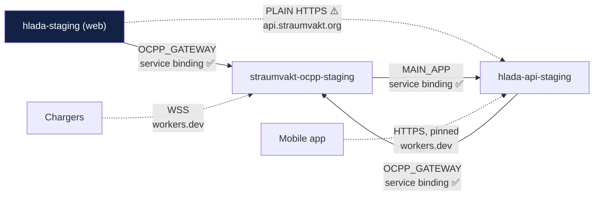
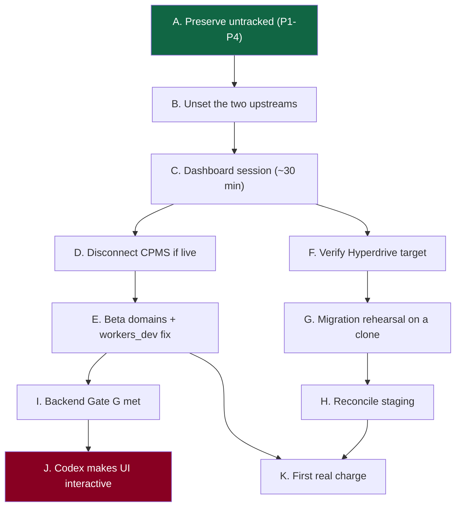

# Ultra release-ops packet — Cloudflare gap, safety controls, cleanup, beta runway

**Read-only. Nothing was pushed, deployed, deleted, queried with SQL, or mutated
externally.** Measured 2026-08-09T13:09Z onward.

| | |
|---|---|
| Worktree | `E:\Claude\Straumvakt-beta-production` |
| Branch | `docs/beta-production-release-architecture` |
| Start tip | `563b554` — **verified MATCH**, clean |

Appendices: [A · blocked-facts operator kit](2026-08-09-appendix-a-blocked-facts-operator-kit.md) ·
[B · 36 runbooks](2026-08-09-appendix-b-operator-runbooks.md) ·
[C · 142 work packages](2026-08-09-appendix-c-work-packages.md)

---

## Phase 0 · Containment — all verified

| Source | Expected | Observed | Dirty |
|---|---|---|---|
| my branch | `563b554` | **`563b554`** | 0 |
| `Straumvakt-release-candidate` | `4b69d0f` | **`4b69d0f`** | 0 |
| `Straumvakt-onboarding-domain` (Claude A) | `1e9bfb8` | **`1e9bfb8`** | 0 |
| `Straumvakt-onboarding-web` (Codex) | `d228f53` | **`d228f53`** | **16** |
| `Straumvakt-driver-access-ui` (Codex) | `75beb3c` | **`75beb3c`** | **9** |

**No peer moved since `563b554`.** Two Codex trees have grown dirty (16 and 9) —
active work, untouched by me.

| Preservation check | State |
|---|---|
| `docs/OCPP` in canonical | **untracked**, `0` tracked files, **128 files on disk** |
| Canonical dirty count | **22** — unchanged |
| `Straumvakt-parked` | **38 files** — intact |

**No cleanup or deletion has occurred anywhere.**

---

## Phase 3 · The workers.dev foot-gun — and it is worse than reported

### Config inventory (RC `4b69d0f`)

| Worker config | `workers_dev` | `routes` | Status |
|---|---|---|---|
| `wrangler.jsonc` (web) | **`true`** at `:67` | **present** | ✅ **protected** — explicit `true` beats the inference |
| `apps/api/wrangler.jsonc` | **absent** | absent | ⚠️ **latent** |
| `gateway/wrangler.jsonc` | **absent** | absent | 🔴 **latent, worse blast radius** |

### The escalation

The documented rule: *"If you do not specify `workers_dev = false` but add a
routes component … the value of `workers_dev` will be inferred as `false` on the
next deploy."*

The prior packet flagged this for the **API** Worker, whose workers.dev hostname
is pinned by the shipped mobile app. **The gateway has the identical latent
condition**, and its workers.dev hostname is what **chargers in the field
connect to**.

| Worker | If `routes` is added without `workers_dev: true` | Blast radius |
|---|---|---|
| web | protected — already declares `true` | — |
| **API** | `hlada-api-staging.straumvakt.workers.dev` stops serving | **every installed mobile app** |
| **gateway** | `straumvakt-ocpp-staging.straumvakt.workers.dev` stops serving | **the entire charger fleet disconnects** |

**The gateway case is a fleet-wide outage triggered by a config addition that
mentions nothing about workers.dev**, in a diff that would read as "add a
custom domain".

### Pinned-hostname inventory (verified both mobile lineages)

`https://hlada-api-staging.straumvakt.workers.dev` — identical in
`Straumvakt-release-candidate` and `Straumvakt-driver-access-ui`. **One host,
both lineages, no configuration indirection.**

### The one-line requirement

Any change that adds a `routes` block to **either** `apps/api/wrangler.jsonc` or
`gateway/wrangler.jsonc` must add, **in the same commit, in the same environment
block**:

```jsonc
"workers_dev": true
```

### Proposed static check — no credential, runs on every PR

```
Tier-0 lint: for each wrangler config and each environment block,
  IF   the block declares "routes"
  AND  the block does not declare "workers_dev"
  THEN fail with:
       "<config>:<env> adds routes without declaring workers_dev.
        Cloudflare infers workers_dev=false, which disables the
        workers.dev hostname. The API host is pinned by the shipped
        mobile app; the gateway host is the charger endpoint."
```

Pure config parsing — no network, no credential, safe on fork PRs. **~30 lines.**

### Release-checklist item

> Before any deploy that changes a Wrangler config: diff the config for a new
> `routes` key. If present, confirm `workers_dev` is declared explicitly in the
> same block. **Then verify the workers.dev hostname still serves after deploy.**

### Verification command (read-only, post-deploy)

```bash
for h in hlada-api-staging straumvakt-ocpp-staging; do
  printf '%-34s %s\n' "$h" \
    "$(curl -s -o /dev/null -w '%{http_code}' https://$h.straumvakt.workers.dev/)"
done
# API expects 404 with application/json; gateway expects 404 text/plain "not found".
# Cloudflare "error code: 1042" means the hostname is GONE.
```

### Rollback

Re-declare `workers_dev: true` and redeploy. Recovery is a deploy cycle — but the
charger fleet is disconnected for its duration, and reconnection produces a
storm.

### What Codex and mobile must know

1. The pinned host is **not** a deploy detail — it is a shipped-app dependency.
2. Moving the app to a configurable base URL (WP-C12) is the only durable fix.
3. **Until then, the pinned host must never be renamed or disabled**, and its
   liveness is a release-gate item, not a nice-to-have.

---

## Phase 4 · Same-zone fetch — every Worker-to-Worker path mapped



| Path | Mechanism | Evidence | Depends on Custom Domain? |
|---|---|---|---|
| web → gateway | `OCPP_GATEWAY` binding | `wrangler.jsonc:70-71` | no |
| API → gateway | `OCPP_GATEWAY` binding | `apps/api/wrangler.jsonc:28-29`; `dispatch-targets.ts:90,137` | no |
| gateway → API | `MAIN_APP` binding | `gateway/wrangler.jsonc:64-65`; `auth.ts:101,140`, `identity-do.ts:919` | no |
| **web → API** | **plain HTTPS** | `src/lib/api-client.ts` → `https://api.straumvakt.org` | **YES** |

**Exactly one path depends on Custom-Domain status**, and it is the only one
without a service binding. Cloudflare documents that same-zone `fetch()` fails
against a *route* but succeeds against a *Custom Domain*.

**Consequences:**

1. **Never convert `api.straumvakt.org` from Custom Domain to a route.** The
   failure would surface as an application error, not a routing error.
2. **The durable fix is a service binding** web → API. It removes the
   Custom-Domain dependency, removes a public round-trip, and is the only change
   here that makes the topology strictly simpler.
3. **Production inherits the same shape.** The web config already maps
   `hlada-api.straumvakt.workers.dev` and `api.straumvakt.org` in
   `api-client.ts` — pointing at a production API Worker that **does not exist**
   (error 1042). Harmless today; a trap when someone reads the map as truth.

**Probes once access exists:** confirm `api.straumvakt.org` is a *Custom Domain*
(not a route) in Domains & Routes; confirm no `routes` pattern shadows it.

---

## Phase 5 · GitHub and branch safety

**Verified 2026-08-09** (unchanged from the prior round): default branch
`dev/sprint-00-foundation`; **0 of 16 protected**; rulesets `[]`; public; last
push 2026-08-08T15:28Z; 42 local branches.

### The urgent item — two commands, no remote touched

| Local branch | Upstream | Hazard |
|---|---|---|
| **`dev/rename-prod-worker`** | **`origin/staging`** | a bare `git push` puts `4fe0a95` — the Worker rename that must not ship — on the branch serving the brand domain |
| **`dev/secret-hygiene-v2`** | **`origin/staging`** | same path, different payload |

```bash
git branch --unset-upstream dev/rename-prod-worker
git branch --unset-upstream dev/secret-hygiene-v2
git for-each-ref --format='%(refname:short) -> %(upstream:short)' refs/heads/ | grep 'origin/staging'
# expected after: only the local `staging` branch itself
```

**Risk if not fixed:** with zero branch protection, the upstream misconfiguration
is the *only* thing between a habitual `git push` and a production deploy. This
is the cheapest risk removal available in the whole programme.

---

## Phase 6 · Neon production runway

**Verified read-only:** one project `spring-leaf-73019190`; **no production
project**; 13 branches; **none protected**; the abandoned `production` branch is
still **default**; **history retention 604,800 s = 7 days**;
`allowed_ips: []`; `block_public_connections: false`.

### What 7-day retention actually means

| Mechanism | Window | Note |
|---|---|---|
| **Backup branch** (copy-on-write) | **indefinite** — it is a branch | the durable mechanism |
| **Point-in-time restore** | **7 days only** | cannot recover a mistake found on day 8 |
| Archived branches | retained | 4 already archived |

**Consequence:** any rollback plan that says "restore to just before the
incident" is valid only inside 7 days. Beyond that, recovery depends on a
*deliberately created* backup branch. **Backups are therefore not optional
hygiene — they are the only long-horizon recovery mechanism.**

### Production project requirements

| # | Requirement | Why |
|---|---|---|
| 1 | Separate project, not a sibling branch | a wrong `branchId` already reached the abandoned branch once |
| 2 | Its default branch **is** the real one | remove the trap by construction |
| 3 | Protection on the primary from day one | it is free at creation and awkward later |
| 4 | Retention reviewed against the RTO | 7 days may not satisfy a customer commitment |
| 5 | `allowed_ips` considered | currently empty and publicly reachable |
| 6 | Migrations replayed from empty | needs the beta history reconciled first |
| 7 | Separate Hyperdrive | never share a config across environments |

### Default-branch repoint plan (beta project)

**Gated on the retention answer for CPMS-era data.** Steps: decide retention →
create a named replacement default (or promote `staging`) → repoint → protect
both → verify a tool omitting a branch id now fails loudly. **No SQL required at
any step.**

---

## Phase 7 · Cleanup execution plan

Measured: **43.76 GB total, 41.57 GB (95%) regenerable, 2.25 GB real content.**
Full matrix in the prior cleanup plan; this phase adds **executable dry-run
scripting** and hazards.

### Junction hazards — enumerated

Five junctions cross worktree boundaries. **Deleting a target orphans the source.**

| Source worktree | Junction | Target |
|---|---|---|
| `Straumvakt-catchup-runbook` | `node_modules` | `Straumvakt\node_modules` |
| `Straumvakt-employee-landing` | `node_modules` | `Straumvakt\node_modules` |
| `Straumvakt-migrations-config` | `node_modules` | `Straumvakt\node_modules` |
| `Straumvakt-n1` | `node_modules`, `.next\standalone\node_modules` | `Straumvakt\node_modules` |
| `Straumvakt-onboarding-web` | `node_modules`, `.next\standalone\node_modules`, `apps\api\src\generated` | `Straumvakt-release-candidate\…` |

**Rule: remove junctions before deleting any target.** `Remove-Item -Recurse` on
a junction can traverse it — always use `cmd /c rmdir` for a junction, never
`Remove-Item -Recurse`.

### Preservation — never delete

| # | Item | Why |
|---|---|---|
| **P1** | `E:\Claude\Straumvakt-parked` (38 files) | OpenADR/Dynamic Grid report — **not a git worktree**, untracked anywhere |
| **P2** | `E:\Claude\Straumvakt\docs\OCPP` (**128 files**) | official OCPP 1.6/2.0.1/2.1 specs — **untracked** |
| **P3** | Canonical's other 17 untracked entries | archive folder, 6 mobile assets, 4 screens, session notes, `_to_delete/` |
| **P4** | `C:\Users\Andri\Documents\New project\*` | every prompt and handoff — **outside any repo** |
| **P5** | `E:\Claude\CPMS` | provenance for the `hlada` name and the OCPP design |

**P4 is new to this packet and easy to miss:** the prompts driving this entire
programme live in a Documents folder with no version control and no backup
mentioned anywhere.

### Dry-run script

`scripts/analysis/cleanup/cleanup-dryrun.ps1` — **reports only; contains no
delete verb.** Emits a manifest of what *would* be reclaimed, verifies
preservation targets exist, and lists junctions in removal order.

### Recovery

| If lost | Recovery |
|---|---|
| `node_modules`, `.next`, `.dart_tool` | `npm install` / `flutter pub get` — minutes |
| A retired worktree | `git worktree add` from the branch — seconds |
| A **branch** | reflog, if local; otherwise **gone** |
| P1–P4 | **no recovery** — hence copy-first |

---

## Phase 8 · Beta runway

### Gate order



### What can be tested locally today — no approval needed

| Test | Where |
|---|---|
| `npm run check` on the RC | local |
| Tier-0 config lint (workers.dev rule) | local, once written |
| Migration file idempotency lint | local |
| Manifest schema validation | local — validator exists, 8/8 |
| Mobile widget/contract tests | local fixtures |
| UI read-only screens against existing endpoints | local |
| Accessibility, i18n, text scaling | local |
| Cleanup **dry-run** | local, reports only |

### What needs approval before beta testing

Dashboard session · CPMS disconnection · beta domains · Neon backup + migration
reconciliation · branch protection · first real charge.

### Blockers restated

1. **No production Neon project** — production cannot be built yet.
2. **No rollback target** — no version id recorded anywhere.
3. **Zero branch protection** on a public repo.
4. **CPMS may still deploy the Worker serving the brand domain.**
5. **Mobile pins a workers.dev host** that two configs could silently disable.

---

## Phase 9 · Release-manifest schema

Extends the existing environment-manifest work with a **release** manifest —
what was promoted, from where, onto what, and how to undo it.

Artefacts: `scripts/analysis/manifest/release-manifest.schema.json` ·
fixtures · validated by the existing offline validator
(`validate-manifest.mjs --self-test`).

Required fields — the ones that exist because something went wrong without them:

| Field | Why it is mandatory |
|---|---|
| `workerVersionsBefore` | **the rollback target — none is recorded today** |
| `workersDevRequired` per Worker | encodes the Phase-3 foot-gun as data |
| `ocppEndpointUnchanged` | forces an explicit statement that no field device is affected |
| `mobileMinSupported` | the pinned-host compatibility window |
| `neonBranchId` | explicit, never defaulted |
| `secretNames` only | policy-enforced: no values |

---

## Summary of what changed in the plan this round

| # | Change | Driver |
|---|---|---|
| 1 | **The gateway carries the same workers.dev foot-gun as the API — with the charger fleet as blast radius** | Phase 3 |
| 2 | **Exactly one** Worker-to-Worker path depends on Custom-Domain status (web → API); a service binding removes it | Phase 4 |
| 3 | 7-day PITR makes deliberate backup branches the **only** long-horizon recovery | Phase 6 |
| 4 | Junctions must be removed with `cmd /c rmdir`, never `Remove-Item -Recurse` | Phase 7 |
| 5 | **P4: the prompts in `Documents\New project` are unversioned and unbacked** | Phase 7 |
| 6 | `api-client.ts` already maps a production API host that does not exist | Phase 4 |
