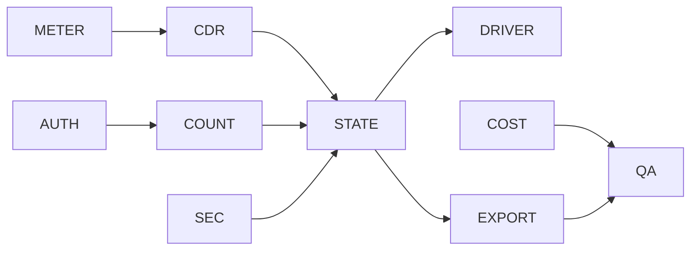

# Core backend-contract work packages

Sixty issue-ready packages for future implementation. Together with the prior 100-package Core UI backlog, the local planning corpus now contains 160 packages. None authorizes backend mutation.

| ID | Area | Scope | Evidence | Invariant | Dependencies / approvals | Acceptance |
|---|---|---|---|---|---|---|
| METER-01 | Meter semantics | Confirm register unit. | Current source/audit row for meter semantics. | Unknown and blocked states remain explicit; no cross-tenant or false-final result. | Product approval; prior package none. | Focused contract tests plus one negative case pass. |
| METER-02 | Meter semantics | Implement delta calculation. | Current source/audit row for meter semantics. | Unknown and blocked states remain explicit; no cross-tenant or false-final result. | Backend contract; prior package METER-01. | Focused contract tests plus one negative case pass. |
| METER-03 | Meter semantics | Handle rollover/reset. | Current source/audit row for meter semantics. | Unknown and blocked states remain explicit; no cross-tenant or false-final result. | Security approval; prior package METER-02. | Focused contract tests plus one negative case pass. |
| METER-04 | Meter semantics | Represent missing readings. | Current source/audit row for meter semantics. | Unknown and blocked states remain explicit; no cross-tenant or false-final result. | Legal/commercial; prior package METER-03. | Focused contract tests plus one negative case pass. |
| METER-05 | Meter semantics | Add verification hold. | Current source/audit row for meter semantics. | Unknown and blocked states remain explicit; no cross-tenant or false-final result. | Infrastructure approval; prior package METER-04. | Focused contract tests plus one negative case pass. |
| METER-06 | Meter semantics | Record verifier. | Current source/audit row for meter semantics. | Unknown and blocked states remain explicit; no cross-tenant or false-final result. | QA evidence; prior package METER-05. | Focused contract tests plus one negative case pass. |
| CDR-01 | CDR authority | Define price source enum. | Current source/audit row for cdr authority. | Unknown and blocked states remain explicit; no cross-tenant or false-final result. | Product approval; prior package none. | Focused contract tests plus one negative case pass. |
| CDR-02 | CDR authority | Persist calculation version. | Current source/audit row for cdr authority. | Unknown and blocked states remain explicit; no cross-tenant or false-final result. | Backend contract; prior package CDR-01. | Focused contract tests plus one negative case pass. |
| CDR-03 | CDR authority | Link source evidence. | Current source/audit row for cdr authority. | Unknown and blocked states remain explicit; no cross-tenant or false-final result. | Security approval; prior package CDR-02. | Focused contract tests plus one negative case pass. |
| CDR-04 | CDR authority | Correct authority labels. | Current source/audit row for cdr authority. | Unknown and blocked states remain explicit; no cross-tenant or false-final result. | Legal/commercial; prior package CDR-03. | Focused contract tests plus one negative case pass. |
| CDR-05 | CDR authority | Add additive correction. | Current source/audit row for cdr authority. | Unknown and blocked states remain explicit; no cross-tenant or false-final result. | Infrastructure approval; prior package CDR-04. | Focused contract tests plus one negative case pass. |
| CDR-06 | CDR authority | Guard false provenance. | Current source/audit row for cdr authority. | Unknown and blocked states remain explicit; no cross-tenant or false-final result. | QA evidence; prior package CDR-05. | Focused contract tests plus one negative case pass. |
| STATE-01 | Statement states | Define state machine. | Current source/audit row for statement states. | Unknown and blocked states remain explicit; no cross-tenant or false-final result. | Product approval; prior package none. | Focused contract tests plus one negative case pass. |
| STATE-02 | Statement states | Build readiness projection. | Current source/audit row for statement states. | Unknown and blocked states remain explicit; no cross-tenant or false-final result. | Backend contract; prior package STATE-01. | Focused contract tests plus one negative case pass. |
| STATE-03 | Statement states | Expose blocking reasons. | Current source/audit row for statement states. | Unknown and blocked states remain explicit; no cross-tenant or false-final result. | Security approval; prior package STATE-02. | Focused contract tests plus one negative case pass. |
| STATE-04 | Statement states | Preserve rate version. | Current source/audit row for statement states. | Unknown and blocked states remain explicit; no cross-tenant or false-final result. | Legal/commercial; prior package STATE-03. | Focused contract tests plus one negative case pass. |
| STATE-05 | Statement states | Add final-state gate. | Current source/audit row for statement states. | Unknown and blocked states remain explicit; no cross-tenant or false-final result. | Infrastructure approval; prior package STATE-04. | Focused contract tests plus one negative case pass. |
| STATE-06 | Statement states | Add stale-state handling. | Current source/audit row for statement states. | Unknown and blocked states remain explicit; no cross-tenant or false-final result. | QA evidence; prior package STATE-05. | Focused contract tests plus one negative case pass. |
| DRIVER-01 | Driver statement | Build detail read. | Current source/audit row for driver statement. | Unknown and blocked states remain explicit; no cross-tenant or false-final result. | Product approval; prior package none. | Focused contract tests plus one negative case pass. |
| DRIVER-02 | Driver statement | Add session evidence. | Current source/audit row for driver statement. | Unknown and blocked states remain explicit; no cross-tenant or false-final result. | Backend contract; prior package DRIVER-01. | Focused contract tests plus one negative case pass. |
| DRIVER-03 | Driver statement | Add meter anomaly state. | Current source/audit row for driver statement. | Unknown and blocked states remain explicit; no cross-tenant or false-final result. | Security approval; prior package DRIVER-02. | Focused contract tests plus one negative case pass. |
| DRIVER-04 | Driver statement | Add correction detail. | Current source/audit row for driver statement. | Unknown and blocked states remain explicit; no cross-tenant or false-final result. | Legal/commercial; prior package DRIVER-03. | Focused contract tests plus one negative case pass. |
| DRIVER-05 | Driver statement | Add delivery wording. | Current source/audit row for driver statement. | Unknown and blocked states remain explicit; no cross-tenant or false-final result. | Infrastructure approval; prior package DRIVER-04. | Focused contract tests plus one negative case pass. |
| DRIVER-06 | Driver statement | Add offline cache contract. | Current source/audit row for driver statement. | Unknown and blocked states remain explicit; no cross-tenant or false-final result. | QA evidence; prior package DRIVER-05. | Focused contract tests plus one negative case pass. |
| AUTH-01 | Manual driver | Define read permission. | Current source/audit row for manual driver. | Unknown and blocked states remain explicit; no cross-tenant or false-final result. | Product approval; prior package none. | Focused contract tests plus one negative case pass. |
| AUTH-02 | Manual driver | Define add permission. | Current source/audit row for manual driver. | Unknown and blocked states remain explicit; no cross-tenant or false-final result. | Backend contract; prior package AUTH-01. | Focused contract tests plus one negative case pass. |
| AUTH-03 | Manual driver | Define deactivate permission. | Current source/audit row for manual driver. | Unknown and blocked states remain explicit; no cross-tenant or false-final result. | Security approval; prior package AUTH-02. | Focused contract tests plus one negative case pass. |
| AUTH-04 | Manual driver | Define billing effective date. | Current source/audit row for manual driver. | Unknown and blocked states remain explicit; no cross-tenant or false-final result. | Legal/commercial; prior package AUTH-03. | Focused contract tests plus one negative case pass. |
| AUTH-05 | Manual driver | Bind invite identity. | Current source/audit row for manual driver. | Unknown and blocked states remain explicit; no cross-tenant or false-final result. | Infrastructure approval; prior package AUTH-04. | Focused contract tests plus one negative case pass. |
| AUTH-06 | Manual driver | Audit actor and tenant. | Current source/audit row for manual driver. | Unknown and blocked states remain explicit; no cross-tenant or false-final result. | QA evidence; prior package AUTH-05. | Focused contract tests plus one negative case pass. |
| COUNT-01 | Core billing count | Approve connector rule. | Current source/audit row for core billing count. | Unknown and blocked states remain explicit; no cross-tenant or false-final result. | Product approval; prior package none. | Focused contract tests plus one negative case pass. |
| COUNT-02 | Core billing count | Approve driver rule. | Current source/audit row for core billing count. | Unknown and blocked states remain explicit; no cross-tenant or false-final result. | Backend contract; prior package COUNT-01. | Focused contract tests plus one negative case pass. |
| COUNT-03 | Core billing count | Build period snapshot. | Current source/audit row for core billing count. | Unknown and blocked states remain explicit; no cross-tenant or false-final result. | Security approval; prior package COUNT-02. | Focused contract tests plus one negative case pass. |
| COUNT-04 | Core billing count | Deduplicate by organisation. | Current source/audit row for core billing count. | Unknown and blocked states remain explicit; no cross-tenant or false-final result. | Legal/commercial; prior package COUNT-03. | Focused contract tests plus one negative case pass. |
| COUNT-05 | Core billing count | Handle mid-period changes. | Current source/audit row for core billing count. | Unknown and blocked states remain explicit; no cross-tenant or false-final result. | Infrastructure approval; prior package COUNT-04. | Focused contract tests plus one negative case pass. |
| COUNT-06 | Core billing count | Reconcile capped charge. | Current source/audit row for core billing count. | Unknown and blocked states remain explicit; no cross-tenant or false-final result. | QA evidence; prior package COUNT-05. | Focused contract tests plus one negative case pass. |
| COST-01 | OCPP cost control | Classify routine heartbeat. | Current source/audit row for ocpp cost control. | Unknown and blocked states remain explicit; no cross-tenant or false-final result. | Product approval; prior package none. | Focused contract tests plus one negative case pass. |
| COST-02 | OCPP cost control | Bypass queue before enqueue. | Current source/audit row for ocpp cost control. | Unknown and blocked states remain explicit; no cross-tenant or false-final result. | Backend contract; prior package COST-01. | Focused contract tests plus one negative case pass. |
| COST-03 | OCPP cost control | Add per-connector frame cap. | Current source/audit row for ocpp cost control. | Unknown and blocked states remain explicit; no cross-tenant or false-final result. | Security approval; prior package COST-02. | Focused contract tests plus one negative case pass. |
| COST-04 | OCPP cost control | Define overflow behavior. | Current source/audit row for ocpp cost control. | Unknown and blocked states remain explicit; no cross-tenant or false-final result. | Legal/commercial; prior package COST-03. | Focused contract tests plus one negative case pass. |
| COST-05 | OCPP cost control | Add cost metrics. | Current source/audit row for ocpp cost control. | Unknown and blocked states remain explicit; no cross-tenant or false-final result. | Infrastructure approval; prior package COST-04. | Focused contract tests plus one negative case pass. |
| COST-06 | OCPP cost control | Load-test reconnect storm. | Current source/audit row for ocpp cost control. | Unknown and blocked states remain explicit; no cross-tenant or false-final result. | QA evidence; prior package COST-05. | Focused contract tests plus one negative case pass. |
| EXPORT-01 | Export and delivery | Research Iceland formats. | Current source/audit row for export and delivery. | Unknown and blocked states remain explicit; no cross-tenant or false-final result. | Product approval; prior package none. | Focused contract tests plus one negative case pass. |
| EXPORT-02 | Export and delivery | Define internal statement format. | Current source/audit row for export and delivery. | Unknown and blocked states remain explicit; no cross-tenant or false-final result. | Backend contract; prior package EXPORT-01. | Focused contract tests plus one negative case pass. |
| EXPORT-03 | Export and delivery | Validate material hash. | Current source/audit row for export and delivery. | Unknown and blocked states remain explicit; no cross-tenant or false-final result. | Security approval; prior package EXPORT-02. | Focused contract tests plus one negative case pass. |
| EXPORT-04 | Export and delivery | Define delivery outcome. | Current source/audit row for export and delivery. | Unknown and blocked states remain explicit; no cross-tenant or false-final result. | Legal/commercial; prior package EXPORT-03. | Focused contract tests plus one negative case pass. |
| EXPORT-05 | Export and delivery | Make resend idempotent. | Current source/audit row for export and delivery. | Unknown and blocked states remain explicit; no cross-tenant or false-final result. | Infrastructure approval; prior package EXPORT-04. | Focused contract tests plus one negative case pass. |
| EXPORT-06 | Export and delivery | Add retention policy. | Current source/audit row for export and delivery. | Unknown and blocked states remain explicit; no cross-tenant or false-final result. | QA evidence; prior package EXPORT-05. | Focused contract tests plus one negative case pass. |
| SEC-01 | Tenant security | Define platform read permission. | Current source/audit row for tenant security. | Unknown and blocked states remain explicit; no cross-tenant or false-final result. | Product approval; prior package none. | Focused contract tests plus one negative case pass. |
| SEC-02 | Tenant security | Enforce tenant predicate. | Current source/audit row for tenant security. | Unknown and blocked states remain explicit; no cross-tenant or false-final result. | Backend contract; prior package SEC-01. | Focused contract tests plus one negative case pass. |
| SEC-03 | Tenant security | Return non-disclosing errors. | Current source/audit row for tenant security. | Unknown and blocked states remain explicit; no cross-tenant or false-final result. | Security approval; prior package SEC-02. | Focused contract tests plus one negative case pass. |
| SEC-04 | Tenant security | Audit support context. | Current source/audit row for tenant security. | Unknown and blocked states remain explicit; no cross-tenant or false-final result. | Legal/commercial; prior package SEC-03. | Focused contract tests plus one negative case pass. |
| SEC-05 | Tenant security | Threat-model exports. | Current source/audit row for tenant security. | Unknown and blocked states remain explicit; no cross-tenant or false-final result. | Infrastructure approval; prior package SEC-04. | Focused contract tests plus one negative case pass. |
| SEC-06 | Tenant security | Test cross-tenant denial. | Current source/audit row for tenant security. | Unknown and blocked states remain explicit; no cross-tenant or false-final result. | QA evidence; prior package SEC-05. | Focused contract tests plus one negative case pass. |
| QA-01 | Quality | Add contract fixtures. | Current source/audit row for quality. | Unknown and blocked states remain explicit; no cross-tenant or false-final result. | Product approval; prior package none. | Focused contract tests plus one negative case pass. |
| QA-02 | Quality | Add route matrix. | Current source/audit row for quality. | Unknown and blocked states remain explicit; no cross-tenant or false-final result. | Backend contract; prior package QA-01. | Focused contract tests plus one negative case pass. |
| QA-03 | Quality | Add keyboard checklist. | Current source/audit row for quality. | Unknown and blocked states remain explicit; no cross-tenant or false-final result. | Security approval; prior package QA-02. | Focused contract tests plus one negative case pass. |
| QA-04 | Quality | Add text scaling checks. | Current source/audit row for quality. | Unknown and blocked states remain explicit; no cross-tenant or false-final result. | Legal/commercial; prior package QA-03. | Focused contract tests plus one negative case pass. |
| QA-05 | Quality | Add false-claim lint. | Current source/audit row for quality. | Unknown and blocked states remain explicit; no cross-tenant or false-final result. | Infrastructure approval; prior package QA-04. | Focused contract tests plus one negative case pass. |
| QA-06 | Quality | Add visual regression set. | Current source/audit row for quality. | Unknown and blocked states remain explicit; no cross-tenant or false-final result. | QA evidence; prior package QA-05. | Focused contract tests plus one negative case pass. |

## Dependency order

## First safe vertical slice

`METER-01 -> METER-02 -> METER-05 -> CDR-01 -> STATE-02 -> DRIVER-03 -> QA-01` proves one verification-held meter anomaly from contract to Driver display without enabling billing mutation, export or delivery.
