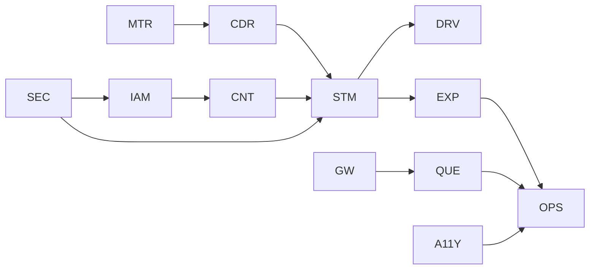

# Marathon Core integration work packages

One hundred and twenty issue-ready packages. Combined with the prior 160 local Core packages, the planning corpus now contains 280 packages and satisfies the 200-cumulative fallback target. Packages describe future work; they do not approve mutation.

| ID | Area | Scope | Evidence | Invariant | Dependencies / approvals | Acceptance |
|---|---|---|---|---|---|---|
| MTR-01 | Meter evidence | Confirm engine delta contract. | Latest source finding and marathon route audit. | Unknown remains distinct from zero; no tenant or final-state inference. | Product approval; none. | Positive, negative and rollback/recovery acceptance cases pass. |
| MTR-02 | Meter evidence | Define per-session hold. | Latest source finding and marathon route audit. | Unknown remains distinct from zero; no tenant or final-state inference. | Backend contract; MTR-01. | Positive, negative and rollback/recovery acceptance cases pass. |
| MTR-03 | Meter evidence | Validate register units. | Latest source finding and marathon route audit. | Unknown remains distinct from zero; no tenant or final-state inference. | Security approval; MTR-02. | Positive, negative and rollback/recovery acceptance cases pass. |
| MTR-04 | Meter evidence | Handle rollover/reset. | Latest source finding and marathon route audit. | Unknown remains distinct from zero; no tenant or final-state inference. | Operations approval; MTR-03. | Positive, negative and rollback/recovery acceptance cases pass. |
| MTR-05 | Meter evidence | Expose evidence authority. | Latest source finding and marathon route audit. | Unknown remains distinct from zero; no tenant or final-state inference. | Legal/commercial; MTR-04. | Positive, negative and rollback/recovery acceptance cases pass. |
| MTR-06 | Meter evidence | Add anomaly reason. | Latest source finding and marathon route audit. | Unknown remains distinct from zero; no tenant or final-state inference. | QA evidence; MTR-05. | Positive, negative and rollback/recovery acceptance cases pass. |
| MTR-07 | Meter evidence | Preserve source readings. | Latest source finding and marathon route audit. | Unknown remains distinct from zero; no tenant or final-state inference. | Product approval; MTR-06. | Positive, negative and rollback/recovery acceptance cases pass. |
| MTR-08 | Meter evidence | Add correction lineage. | Latest source finding and marathon route audit. | Unknown remains distinct from zero; no tenant or final-state inference. | Backend contract; MTR-07. | Positive, negative and rollback/recovery acceptance cases pass. |
| MTR-09 | Meter evidence | Measure hold rate. | Latest source finding and marathon route audit. | Unknown remains distinct from zero; no tenant or final-state inference. | Security approval; MTR-08. | Positive, negative and rollback/recovery acceptance cases pass. |
| MTR-10 | Meter evidence | Write recovery runbook. | Latest source finding and marathon route audit. | Unknown remains distinct from zero; no tenant or final-state inference. | Operations approval; MTR-09. | Positive, negative and rollback/recovery acceptance cases pass. |
| CDR-01 | CDR provenance | Define source enum. | Latest source finding and marathon route audit. | Unknown remains distinct from zero; no tenant or final-state inference. | Product approval; none. | Positive, negative and rollback/recovery acceptance cases pass. |
| CDR-02 | CDR provenance | Detect mismatch. | Latest source finding and marathon route audit. | Unknown remains distinct from zero; no tenant or final-state inference. | Backend contract; CDR-01. | Positive, negative and rollback/recovery acceptance cases pass. |
| CDR-03 | CDR provenance | Detect unlabelled rows. | Latest source finding and marathon route audit. | Unknown remains distinct from zero; no tenant or final-state inference. | Security approval; CDR-02. | Positive, negative and rollback/recovery acceptance cases pass. |
| CDR-04 | CDR provenance | Persist calculation version. | Latest source finding and marathon route audit. | Unknown remains distinct from zero; no tenant or final-state inference. | Operations approval; CDR-03. | Positive, negative and rollback/recovery acceptance cases pass. |
| CDR-05 | CDR provenance | Preserve imported amount. | Latest source finding and marathon route audit. | Unknown remains distinct from zero; no tenant or final-state inference. | Legal/commercial; CDR-04. | Positive, negative and rollback/recovery acceptance cases pass. |
| CDR-06 | CDR provenance | Build authority projection. | Latest source finding and marathon route audit. | Unknown remains distinct from zero; no tenant or final-state inference. | QA evidence; CDR-05. | Positive, negative and rollback/recovery acceptance cases pass. |
| CDR-07 | CDR provenance | Add correction command. | Latest source finding and marathon route audit. | Unknown remains distinct from zero; no tenant or final-state inference. | Product approval; CDR-06. | Positive, negative and rollback/recovery acceptance cases pass. |
| CDR-08 | CDR provenance | Block final statement. | Latest source finding and marathon route audit. | Unknown remains distinct from zero; no tenant or final-state inference. | Backend contract; CDR-07. | Positive, negative and rollback/recovery acceptance cases pass. |
| CDR-09 | CDR provenance | Observe mismatch rate. | Latest source finding and marathon route audit. | Unknown remains distinct from zero; no tenant or final-state inference. | Security approval; CDR-08. | Positive, negative and rollback/recovery acceptance cases pass. |
| CDR-10 | CDR provenance | Write dispute runbook. | Latest source finding and marathon route audit. | Unknown remains distinct from zero; no tenant or final-state inference. | Operations approval; CDR-09. | Positive, negative and rollback/recovery acceptance cases pass. |
| STM-01 | Statement lifecycle | Approve state machine. | Latest source finding and marathon route audit. | Unknown remains distinct from zero; no tenant or final-state inference. | Product approval; none. | Positive, negative and rollback/recovery acceptance cases pass. |
| STM-02 | Statement lifecycle | Build readiness read. | Latest source finding and marathon route audit. | Unknown remains distinct from zero; no tenant or final-state inference. | Backend contract; STM-01. | Positive, negative and rollback/recovery acceptance cases pass. |
| STM-03 | Statement lifecycle | Separate invoice state. | Latest source finding and marathon route audit. | Unknown remains distinct from zero; no tenant or final-state inference. | Security approval; STM-02. | Positive, negative and rollback/recovery acceptance cases pass. |
| STM-04 | Statement lifecycle | Separate payment state. | Latest source finding and marathon route audit. | Unknown remains distinct from zero; no tenant or final-state inference. | Operations approval; STM-03. | Positive, negative and rollback/recovery acceptance cases pass. |
| STM-05 | Statement lifecycle | Lock immutable period. | Latest source finding and marathon route audit. | Unknown remains distinct from zero; no tenant or final-state inference. | Legal/commercial; STM-04. | Positive, negative and rollback/recovery acceptance cases pass. |
| STM-06 | Statement lifecycle | Add stale state. | Latest source finding and marathon route audit. | Unknown remains distinct from zero; no tenant or final-state inference. | QA evidence; STM-05. | Positive, negative and rollback/recovery acceptance cases pass. |
| STM-07 | Statement lifecycle | Add delivery state. | Latest source finding and marathon route audit. | Unknown remains distinct from zero; no tenant or final-state inference. | Product approval; STM-06. | Positive, negative and rollback/recovery acceptance cases pass. |
| STM-08 | Statement lifecycle | Add download policy. | Latest source finding and marathon route audit. | Unknown remains distinct from zero; no tenant or final-state inference. | Backend contract; STM-07. | Positive, negative and rollback/recovery acceptance cases pass. |
| STM-09 | Statement lifecycle | Add retention policy. | Latest source finding and marathon route audit. | Unknown remains distinct from zero; no tenant or final-state inference. | Security approval; STM-08. | Positive, negative and rollback/recovery acceptance cases pass. |
| STM-10 | Statement lifecycle | Test reconciliation. | Latest source finding and marathon route audit. | Unknown remains distinct from zero; no tenant or final-state inference. | Operations approval; STM-09. | Positive, negative and rollback/recovery acceptance cases pass. |
| DRV-01 | Driver experience | Wire final statement. | Latest source finding and marathon route audit. | Unknown remains distinct from zero; no tenant or final-state inference. | Product approval; none. | Positive, negative and rollback/recovery acceptance cases pass. |
| DRV-02 | Driver experience | Wire pending CDR. | Latest source finding and marathon route audit. | Unknown remains distinct from zero; no tenant or final-state inference. | Backend contract; DRV-01. | Positive, negative and rollback/recovery acceptance cases pass. |
| DRV-03 | Driver experience | Wire mismatch hold. | Latest source finding and marathon route audit. | Unknown remains distinct from zero; no tenant or final-state inference. | Security approval; DRV-02. | Positive, negative and rollback/recovery acceptance cases pass. |
| DRV-04 | Driver experience | Wire unlabelled source. | Latest source finding and marathon route audit. | Unknown remains distinct from zero; no tenant or final-state inference. | Operations approval; DRV-03. | Positive, negative and rollback/recovery acceptance cases pass. |
| DRV-05 | Driver experience | Wire correction line. | Latest source finding and marathon route audit. | Unknown remains distinct from zero; no tenant or final-state inference. | Legal/commercial; DRV-04. | Positive, negative and rollback/recovery acceptance cases pass. |
| DRV-06 | Driver experience | Wire locked period. | Latest source finding and marathon route audit. | Unknown remains distinct from zero; no tenant or final-state inference. | QA evidence; DRV-05. | Positive, negative and rollback/recovery acceptance cases pass. |
| DRV-07 | Driver experience | Wire delivery outcomes. | Latest source finding and marathon route audit. | Unknown remains distinct from zero; no tenant or final-state inference. | Product approval; DRV-06. | Positive, negative and rollback/recovery acceptance cases pass. |
| DRV-08 | Driver experience | Wire denied access. | Latest source finding and marathon route audit. | Unknown remains distinct from zero; no tenant or final-state inference. | Backend contract; DRV-07. | Positive, negative and rollback/recovery acceptance cases pass. |
| DRV-09 | Driver experience | Wire offline access. | Latest source finding and marathon route audit. | Unknown remains distinct from zero; no tenant or final-state inference. | Security approval; DRV-08. | Positive, negative and rollback/recovery acceptance cases pass. |
| DRV-10 | Driver experience | Wire manual support. | Latest source finding and marathon route audit. | Unknown remains distinct from zero; no tenant or final-state inference. | Operations approval; DRV-09. | Positive, negative and rollback/recovery acceptance cases pass. |
| IAM-01 | Driver authority | Define roster read. | Latest source finding and marathon route audit. | Unknown remains distinct from zero; no tenant or final-state inference. | Product approval; none. | Positive, negative and rollback/recovery acceptance cases pass. |
| IAM-02 | Driver authority | Define manual add. | Latest source finding and marathon route audit. | Unknown remains distinct from zero; no tenant or final-state inference. | Backend contract; IAM-01. | Positive, negative and rollback/recovery acceptance cases pass. |
| IAM-03 | Driver authority | Define deactivate. | Latest source finding and marathon route audit. | Unknown remains distinct from zero; no tenant or final-state inference. | Security approval; IAM-02. | Positive, negative and rollback/recovery acceptance cases pass. |
| IAM-04 | Driver authority | Define invite claim. | Latest source finding and marathon route audit. | Unknown remains distinct from zero; no tenant or final-state inference. | Operations approval; IAM-03. | Positive, negative and rollback/recovery acceptance cases pass. |
| IAM-05 | Driver authority | Define support context. | Latest source finding and marathon route audit. | Unknown remains distinct from zero; no tenant or final-state inference. | Legal/commercial; IAM-04. | Positive, negative and rollback/recovery acceptance cases pass. |
| IAM-06 | Driver authority | Set effective date. | Latest source finding and marathon route audit. | Unknown remains distinct from zero; no tenant or final-state inference. | QA evidence; IAM-05. | Positive, negative and rollback/recovery acceptance cases pass. |
| IAM-07 | Driver authority | Handle active session. | Latest source finding and marathon route audit. | Unknown remains distinct from zero; no tenant or final-state inference. | Product approval; IAM-06. | Positive, negative and rollback/recovery acceptance cases pass. |
| IAM-08 | Driver authority | Add tenant audit. | Latest source finding and marathon route audit. | Unknown remains distinct from zero; no tenant or final-state inference. | Backend contract; IAM-07. | Positive, negative and rollback/recovery acceptance cases pass. |
| IAM-09 | Driver authority | Rate-limit mutation. | Latest source finding and marathon route audit. | Unknown remains distinct from zero; no tenant or final-state inference. | Security approval; IAM-08. | Positive, negative and rollback/recovery acceptance cases pass. |
| IAM-10 | Driver authority | Test cross-tenant denial. | Latest source finding and marathon route audit. | Unknown remains distinct from zero; no tenant or final-state inference. | Operations approval; IAM-09. | Positive, negative and rollback/recovery acceptance cases pass. |
| CNT-01 | Core counts | Approve connector rule. | Latest source finding and marathon route audit. | Unknown remains distinct from zero; no tenant or final-state inference. | Product approval; none. | Positive, negative and rollback/recovery acceptance cases pass. |
| CNT-02 | Core counts | Approve driver rule. | Latest source finding and marathon route audit. | Unknown remains distinct from zero; no tenant or final-state inference. | Backend contract; CNT-01. | Positive, negative and rollback/recovery acceptance cases pass. |
| CNT-03 | Core counts | Deduplicate driver. | Latest source finding and marathon route audit. | Unknown remains distinct from zero; no tenant or final-state inference. | Security approval; CNT-02. | Positive, negative and rollback/recovery acceptance cases pass. |
| CNT-04 | Core counts | Snapshot period. | Latest source finding and marathon route audit. | Unknown remains distinct from zero; no tenant or final-state inference. | Operations approval; CNT-03. | Positive, negative and rollback/recovery acceptance cases pass. |
| CNT-05 | Core counts | Handle mid-month access. | Latest source finding and marathon route audit. | Unknown remains distinct from zero; no tenant or final-state inference. | Legal/commercial; CNT-04. | Positive, negative and rollback/recovery acceptance cases pass. |
| CNT-06 | Core counts | Handle inactive state. | Latest source finding and marathon route audit. | Unknown remains distinct from zero; no tenant or final-state inference. | QA evidence; CNT-05. | Positive, negative and rollback/recovery acceptance cases pass. |
| CNT-07 | Core counts | Handle CDR-only driver. | Latest source finding and marathon route audit. | Unknown remains distinct from zero; no tenant or final-state inference. | Product approval; CNT-06. | Positive, negative and rollback/recovery acceptance cases pass. |
| CNT-08 | Core counts | Reconcile cap. | Latest source finding and marathon route audit. | Unknown remains distinct from zero; no tenant or final-state inference. | Backend contract; CNT-07. | Positive, negative and rollback/recovery acceptance cases pass. |
| CNT-09 | Core counts | Expose count reason. | Latest source finding and marathon route audit. | Unknown remains distinct from zero; no tenant or final-state inference. | Security approval; CNT-08. | Positive, negative and rollback/recovery acceptance cases pass. |
| CNT-10 | Core counts | Audit count changes. | Latest source finding and marathon route audit. | Unknown remains distinct from zero; no tenant or final-state inference. | Operations approval; CNT-09. | Positive, negative and rollback/recovery acceptance cases pass. |
| GW-01 | Gateway cost | Complete gateway suite. | Latest source finding and marathon route audit. | Unknown remains distinct from zero; no tenant or final-state inference. | Product approval; none. | Positive, negative and rollback/recovery acceptance cases pass. |
| GW-02 | Gateway cost | Repair toolchain. | Latest source finding and marathon route audit. | Unknown remains distinct from zero; no tenant or final-state inference. | Backend contract; GW-01. | Positive, negative and rollback/recovery acceptance cases pass. |
| GW-03 | Gateway cost | Verify heartbeat fast path. | Latest source finding and marathon route audit. | Unknown remains distinct from zero; no tenant or final-state inference. | Security approval; GW-02. | Positive, negative and rollback/recovery acceptance cases pass. |
| GW-04 | Gateway cost | Measure queue bypass. | Latest source finding and marathon route audit. | Unknown remains distinct from zero; no tenant or final-state inference. | Operations approval; GW-03. | Positive, negative and rollback/recovery acceptance cases pass. |
| GW-05 | Gateway cost | Add deployment marker. | Latest source finding and marathon route audit. | Unknown remains distinct from zero; no tenant or final-state inference. | Legal/commercial; GW-04. | Positive, negative and rollback/recovery acceptance cases pass. |
| GW-06 | Gateway cost | Define frame cap. | Latest source finding and marathon route audit. | Unknown remains distinct from zero; no tenant or final-state inference. | QA evidence; GW-05. | Positive, negative and rollback/recovery acceptance cases pass. |
| GW-07 | Gateway cost | Define burst window. | Latest source finding and marathon route audit. | Unknown remains distinct from zero; no tenant or final-state inference. | Product approval; GW-06. | Positive, negative and rollback/recovery acceptance cases pass. |
| GW-08 | Gateway cost | Define overflow action. | Latest source finding and marathon route audit. | Unknown remains distinct from zero; no tenant or final-state inference. | Backend contract; GW-07. | Positive, negative and rollback/recovery acceptance cases pass. |
| GW-09 | Gateway cost | Load-test reconnect. | Latest source finding and marathon route audit. | Unknown remains distinct from zero; no tenant or final-state inference. | Security approval; GW-08. | Positive, negative and rollback/recovery acceptance cases pass. |
| GW-10 | Gateway cost | Write cost incident runbook. | Latest source finding and marathon route audit. | Unknown remains distinct from zero; no tenant or final-state inference. | Operations approval; GW-09. | Positive, negative and rollback/recovery acceptance cases pass. |
| QUE-01 | Queue operations | Verify deployment. | Latest source finding and marathon route audit. | Unknown remains distinct from zero; no tenant or final-state inference. | Product approval; none. | Positive, negative and rollback/recovery acceptance cases pass. |
| QUE-02 | Queue operations | Record version. | Latest source finding and marathon route audit. | Unknown remains distinct from zero; no tenant or final-state inference. | Backend contract; QUE-01. | Positive, negative and rollback/recovery acceptance cases pass. |
| QUE-03 | Queue operations | Observe traffic. | Latest source finding and marathon route audit. | Unknown remains distinct from zero; no tenant or final-state inference. | Security approval; QUE-02. | Positive, negative and rollback/recovery acceptance cases pass. |
| QUE-04 | Queue operations | Measure lag. | Latest source finding and marathon route audit. | Unknown remains distinct from zero; no tenant or final-state inference. | Operations approval; QUE-03. | Positive, negative and rollback/recovery acceptance cases pass. |
| QUE-05 | Queue operations | Measure failure rate. | Latest source finding and marathon route audit. | Unknown remains distinct from zero; no tenant or final-state inference. | Legal/commercial; QUE-04. | Positive, negative and rollback/recovery acceptance cases pass. |
| QUE-06 | Queue operations | Define dead-letter policy. | Latest source finding and marathon route audit. | Unknown remains distinct from zero; no tenant or final-state inference. | QA evidence; QUE-05. | Positive, negative and rollback/recovery acceptance cases pass. |
| QUE-07 | Queue operations | Build offline sweep. | Latest source finding and marathon route audit. | Unknown remains distinct from zero; no tenant or final-state inference. | Product approval; QUE-06. | Positive, negative and rollback/recovery acceptance cases pass. |
| QUE-08 | Queue operations | Set sweep cadence. | Latest source finding and marathon route audit. | Unknown remains distinct from zero; no tenant or final-state inference. | Backend contract; QUE-07. | Positive, negative and rollback/recovery acceptance cases pass. |
| QUE-09 | Queue operations | Add recovery evidence. | Latest source finding and marathon route audit. | Unknown remains distinct from zero; no tenant or final-state inference. | Security approval; QUE-08. | Positive, negative and rollback/recovery acceptance cases pass. |
| QUE-10 | Queue operations | Write queue runbook. | Latest source finding and marathon route audit. | Unknown remains distinct from zero; no tenant or final-state inference. | Operations approval; QUE-09. | Positive, negative and rollback/recovery acceptance cases pass. |
| EXP-01 | Export delivery | Research bank formats. | Latest source finding and marathon route audit. | Unknown remains distinct from zero; no tenant or final-state inference. | Product approval; none. | Positive, negative and rollback/recovery acceptance cases pass. |
| EXP-02 | Export delivery | Research accounting format. | Latest source finding and marathon route audit. | Unknown remains distinct from zero; no tenant or final-state inference. | Backend contract; EXP-01. | Positive, negative and rollback/recovery acceptance cases pass. |
| EXP-03 | Export delivery | Define internal schema. | Latest source finding and marathon route audit. | Unknown remains distinct from zero; no tenant or final-state inference. | Security approval; EXP-02. | Positive, negative and rollback/recovery acceptance cases pass. |
| EXP-04 | Export delivery | Add material hash. | Latest source finding and marathon route audit. | Unknown remains distinct from zero; no tenant or final-state inference. | Operations approval; EXP-03. | Positive, negative and rollback/recovery acceptance cases pass. |
| EXP-05 | Export delivery | Validate encoding. | Latest source finding and marathon route audit. | Unknown remains distinct from zero; no tenant or final-state inference. | Legal/commercial; EXP-04. | Positive, negative and rollback/recovery acceptance cases pass. |
| EXP-06 | Export delivery | Define recipients. | Latest source finding and marathon route audit. | Unknown remains distinct from zero; no tenant or final-state inference. | QA evidence; EXP-05. | Positive, negative and rollback/recovery acceptance cases pass. |
| EXP-07 | Export delivery | Persist attempts. | Latest source finding and marathon route audit. | Unknown remains distinct from zero; no tenant or final-state inference. | Product approval; EXP-06. | Positive, negative and rollback/recovery acceptance cases pass. |
| EXP-08 | Export delivery | Make retry idempotent. | Latest source finding and marathon route audit. | Unknown remains distinct from zero; no tenant or final-state inference. | Backend contract; EXP-07. | Positive, negative and rollback/recovery acceptance cases pass. |
| EXP-09 | Export delivery | Record provider outcome. | Latest source finding and marathon route audit. | Unknown remains distinct from zero; no tenant or final-state inference. | Security approval; EXP-08. | Positive, negative and rollback/recovery acceptance cases pass. |
| EXP-10 | Export delivery | Define retention. | Latest source finding and marathon route audit. | Unknown remains distinct from zero; no tenant or final-state inference. | Operations approval; EXP-09. | Positive, negative and rollback/recovery acceptance cases pass. |
| SEC-01 | Security | Threat-model billing reads. | Latest source finding and marathon route audit. | Unknown remains distinct from zero; no tenant or final-state inference. | Product approval; none. | Positive, negative and rollback/recovery acceptance cases pass. |
| SEC-02 | Security | Create platform permission. | Latest source finding and marathon route audit. | Unknown remains distinct from zero; no tenant or final-state inference. | Backend contract; SEC-01. | Positive, negative and rollback/recovery acceptance cases pass. |
| SEC-03 | Security | Enforce tenant filter. | Latest source finding and marathon route audit. | Unknown remains distinct from zero; no tenant or final-state inference. | Security approval; SEC-02. | Positive, negative and rollback/recovery acceptance cases pass. |
| SEC-04 | Security | Protect statement subject. | Latest source finding and marathon route audit. | Unknown remains distinct from zero; no tenant or final-state inference. | Operations approval; SEC-03. | Positive, negative and rollback/recovery acceptance cases pass. |
| SEC-05 | Security | Audit support context. | Latest source finding and marathon route audit. | Unknown remains distinct from zero; no tenant or final-state inference. | Legal/commercial; SEC-04. | Positive, negative and rollback/recovery acceptance cases pass. |
| SEC-06 | Security | Protect exports. | Latest source finding and marathon route audit. | Unknown remains distinct from zero; no tenant or final-state inference. | QA evidence; SEC-05. | Positive, negative and rollback/recovery acceptance cases pass. |
| SEC-07 | Security | Hide tenant existence. | Latest source finding and marathon route audit. | Unknown remains distinct from zero; no tenant or final-state inference. | Product approval; SEC-06. | Positive, negative and rollback/recovery acceptance cases pass. |
| SEC-08 | Security | Test permission denial. | Latest source finding and marathon route audit. | Unknown remains distinct from zero; no tenant or final-state inference. | Backend contract; SEC-07. | Positive, negative and rollback/recovery acceptance cases pass. |
| SEC-09 | Security | Review personal data. | Latest source finding and marathon route audit. | Unknown remains distinct from zero; no tenant or final-state inference. | Security approval; SEC-08. | Positive, negative and rollback/recovery acceptance cases pass. |
| SEC-10 | Security | Add abuse metrics. | Latest source finding and marathon route audit. | Unknown remains distinct from zero; no tenant or final-state inference. | Operations approval; SEC-09. | Positive, negative and rollback/recovery acceptance cases pass. |
| A11Y-01 | Accessibility | Test keyboard order. | Latest source finding and marathon route audit. | Unknown remains distinct from zero; no tenant or final-state inference. | Product approval; none. | Positive, negative and rollback/recovery acceptance cases pass. |
| A11Y-02 | Accessibility | Trap mobile drawer focus. | Latest source finding and marathon route audit. | Unknown remains distinct from zero; no tenant or final-state inference. | Backend contract; A11Y-01. | Positive, negative and rollback/recovery acceptance cases pass. |
| A11Y-03 | Accessibility | Test visible focus. | Latest source finding and marathon route audit. | Unknown remains distinct from zero; no tenant or final-state inference. | Security approval; A11Y-02. | Positive, negative and rollback/recovery acceptance cases pass. |
| A11Y-04 | Accessibility | Test 200 percent zoom. | Latest source finding and marathon route audit. | Unknown remains distinct from zero; no tenant or final-state inference. | Operations approval; A11Y-03. | Positive, negative and rollback/recovery acceptance cases pass. |
| A11Y-05 | Accessibility | Test text-only scaling. | Latest source finding and marathon route audit. | Unknown remains distinct from zero; no tenant or final-state inference. | Legal/commercial; A11Y-04. | Positive, negative and rollback/recovery acceptance cases pass. |
| A11Y-06 | Accessibility | Test screen reader amounts. | Latest source finding and marathon route audit. | Unknown remains distinct from zero; no tenant or final-state inference. | QA evidence; A11Y-05. | Positive, negative and rollback/recovery acceptance cases pass. |
| A11Y-07 | Accessibility | Test forced colors. | Latest source finding and marathon route audit. | Unknown remains distinct from zero; no tenant or final-state inference. | Product approval; A11Y-06. | Positive, negative and rollback/recovery acceptance cases pass. |
| A11Y-08 | Accessibility | Test reduced motion. | Latest source finding and marathon route audit. | Unknown remains distinct from zero; no tenant or final-state inference. | Backend contract; A11Y-07. | Positive, negative and rollback/recovery acceptance cases pass. |
| A11Y-09 | Accessibility | Test table navigation. | Latest source finding and marathon route audit. | Unknown remains distinct from zero; no tenant or final-state inference. | Security approval; A11Y-08. | Positive, negative and rollback/recovery acceptance cases pass. |
| A11Y-10 | Accessibility | Test Icelandic copy fit. | Latest source finding and marathon route audit. | Unknown remains distinct from zero; no tenant or final-state inference. | Operations approval; A11Y-09. | Positive, negative and rollback/recovery acceptance cases pass. |
| OPS-01 | Product operations | Approve final terminology. | Latest source finding and marathon route audit. | Unknown remains distinct from zero; no tenant or final-state inference. | Product approval; none. | Positive, negative and rollback/recovery acceptance cases pass. |
| OPS-02 | Product operations | Assign CDR mismatch owner. | Latest source finding and marathon route audit. | Unknown remains distinct from zero; no tenant or final-state inference. | Backend contract; OPS-01. | Positive, negative and rollback/recovery acceptance cases pass. |
| OPS-03 | Product operations | Assign manual-review owner. | Latest source finding and marathon route audit. | Unknown remains distinct from zero; no tenant or final-state inference. | Security approval; OPS-02. | Positive, negative and rollback/recovery acceptance cases pass. |
| OPS-04 | Product operations | Define period close SLA. | Latest source finding and marathon route audit. | Unknown remains distinct from zero; no tenant or final-state inference. | Operations approval; OPS-03. | Positive, negative and rollback/recovery acceptance cases pass. |
| OPS-05 | Product operations | Define delivery recovery. | Latest source finding and marathon route audit. | Unknown remains distinct from zero; no tenant or final-state inference. | Legal/commercial; OPS-04. | Positive, negative and rollback/recovery acceptance cases pass. |
| OPS-06 | Product operations | Define support boundary. | Latest source finding and marathon route audit. | Unknown remains distinct from zero; no tenant or final-state inference. | QA evidence; OPS-05. | Positive, negative and rollback/recovery acceptance cases pass. |
| OPS-07 | Product operations | Approve Icelandic copy. | Latest source finding and marathon route audit. | Unknown remains distinct from zero; no tenant or final-state inference. | Product approval; OPS-06. | Positive, negative and rollback/recovery acceptance cases pass. |
| OPS-08 | Product operations | Create pilot checklist. | Latest source finding and marathon route audit. | Unknown remains distinct from zero; no tenant or final-state inference. | Backend contract; OPS-07. | Positive, negative and rollback/recovery acceptance cases pass. |
| OPS-09 | Product operations | Run first real statement. | Latest source finding and marathon route audit. | Unknown remains distinct from zero; no tenant or final-state inference. | Security approval; OPS-08. | Positive, negative and rollback/recovery acceptance cases pass. |
| OPS-10 | Product operations | Hold go-live review. | Latest source finding and marathon route audit. | Unknown remains distinct from zero; no tenant or final-state inference. | Operations approval; OPS-09. | Positive, negative and rollback/recovery acceptance cases pass. |

## Dependency graph

## Smallest current-finding slice

`CDR-01 -> CDR-02 -> CDR-03 -> CDR-06 -> CDR-08 -> STM-02 -> DRV-02 -> DRV-03` proves pending, mismatched and unlabelled CDR authority from source contract to Driver hold without changing billing data.
